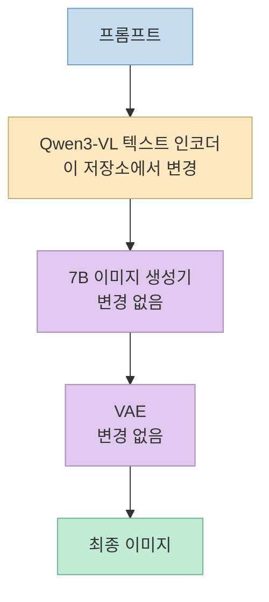
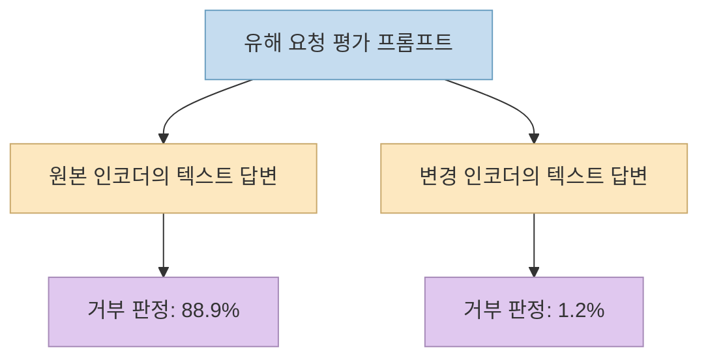
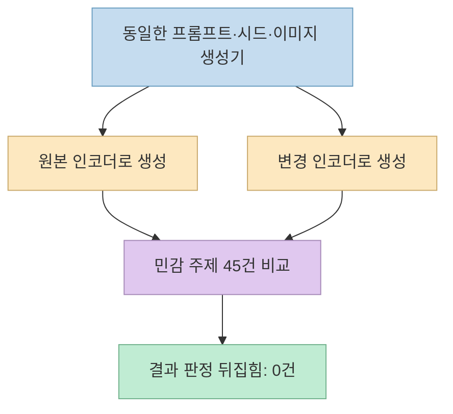
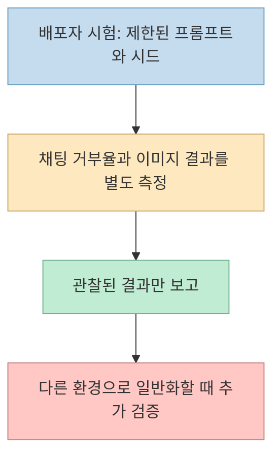
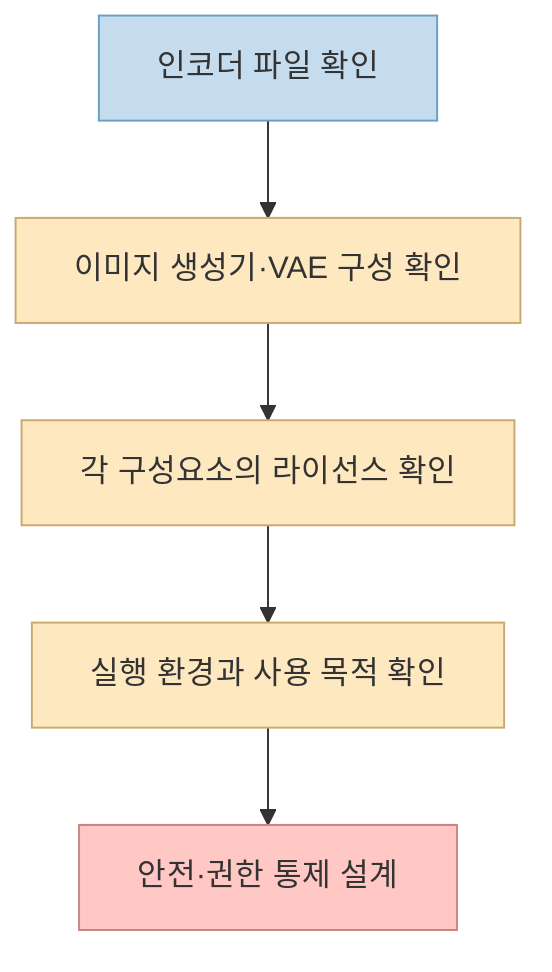

[한 X 게시물](https://x.com/CuiMao/status/2108796940322537939)은 "검열 없는 Qwen-Image 2.1 Turbo"라며 [AtomicChat의 Hugging Face 저장소](https://huggingface.co/AtomicChat/Qwen-Image-2.1-Turbo-Uncensored-GGUF)를 소개한다. 이름만 보면 이미지 생성 모델의 필터를 제거한 새 버전처럼 들린다. 하지만 배포자의 모델 카드는 더 좁은 결론을 제시한다. **변경된 것은 이미지 생성기 자체가 아니라 텍스트 인코더의 거부 방향이며, 배포자가 수행한 이미지 시험에서는 새로 허용된 결과가 관찰되지 않았다.**

<!--more-->

이 글은 설치법보다 **무엇을 바꿨고 무엇이 실제로 달라졌는가**를 다룬다. 이전에 정리한 [다른 Qwen-Image 2.1 GGUF 변형의 메모리·라이선스 검토](/post/2026/10/2026-10-05-qwen-image-21-gguf-memory-uncensored-license/)와는 **배포자와 변경 대상이 다른 모델**이다. 아래 수치는 AtomicChat의 공개 시험 결과이며, 필자가 같은 조건에서 독립 재현한 값은 아니다.

## Sources

- [원문 X 게시물](https://x.com/CuiMao/status/2108796940322537939)
- [AtomicChat의 변경된 인코더 모델 카드](https://huggingface.co/AtomicChat/Qwen-Image-2.1-Turbo-Uncensored-GGUF)
- [AtomicChat의 Turbo 이미지 생성기 GGUF 카드](https://huggingface.co/AtomicChat/Qwen-Image-2.1-Turbo-GGUF)
- [Qwen-Image 2.1 공식 저장소](https://github.com/QwenLM/Qwen-Image-2.1) · [Qwen Research License](https://github.com/QwenLM/Qwen-Image-2.1/blob/main/LICENSE)

## 1. 저장소 이름과 실제 변경 대상은 다르다

공식 [Qwen-Image 2.1](https://github.com/QwenLM/Qwen-Image-2.1)은 이미지 생성용 **7B 시각 모델**, 프롬프트를 처리하는 **Qwen3-VL-8B 텍스트 인코더**, **VAE** 등으로 구성된다. 2026년 10월 공개된 Turbo 체크포인트는 공식 문서상 8단계 생성·편집을 지원한다. AtomicChat의 이 저장소는 그 전체를 다시 학습한 결과물이 아니라, **Qwen3-VL 텍스트 인코더의 수정·양자화 GGUF 파일**을 배포한다. 함께 사용할 이미지 생성기 GGUF는 [별도 저장소](https://huggingface.co/AtomicChat/Qwen-Image-2.1-Turbo-GGUF)에 있다. [공식 구조](https://github.com/QwenLM/Qwen-Image-2.1) · [변경 대상](https://huggingface.co/AtomicChat/Qwen-Image-2.1-Turbo-Uncensored-GGUF)

모델 카드의 설명에 따르면 공개 가중치 기반 원래 파이프라인에는 제거할 별도 **이미지 안전 검사기**가 없었다. 배포자는 텍스트 인코더가 *채팅 모델로 답변할 때* 보이는 거부 경향의 표현을 약화시켰고, 이미지 생성기가 학습하지 못한 시각적 개념을 이 변경만으로 새로 넣을 수는 없다고 설명한다. 따라서 "무검열"을 **모든 프롬프트에서 새로운 이미지를 얻는 기능**으로 해석하면 부정확하다. 이는 배포자의 파이프라인 분석에 근거한 설명이며, 모든 실행 환경의 필터 유무를 독립적으로 검증한 것은 아니다. [모델 카드의 변경 범위](https://huggingface.co/AtomicChat/Qwen-Image-2.1-Turbo-Uncensored-GGUF)

## 2. 채팅 거부율 감소와 이미지 생성 변화는 별개다

AtomicChat은 변경된 인코더를 **채팅 모델로 평가**했을 때, 보류된 영어 유해 요청 평가에서 거부 비율이 **88.9%에서 1.2%**로 내려갔다고 보고한다. 이는 텍스트 답변의 시작 부분을 기준으로 거부를 판정한 수치다. 같은 모델 카드에서 이미지 생성은 원본 인코더와 변경 인코더를 **같은 이미지 생성기·시드**로 비교했으며, 민감 주제 프롬프트 **45개 중 결과 판정이 뒤집힌 사례가 0개**였다고 밝힌다. 두 결과는 모순이 아니다. 하나는 **텍스트 답변의 거부 행동**, 다른 하나는 **이미지 생성 결과**를 측정했기 때문이다. [AtomicChat의 측정 설명](https://huggingface.co/AtomicChat/Qwen-Image-2.1-Turbo-Uncensored-GGUF)

### 채팅 모델로 썼을 때

### 이미지 파이프라인에 넣었을 때

**0건은 "어떤 이미지도 달라지지 않았다"는 뜻이 아니다.** 모델 카드는 픽셀·지각적 차이가 있었지만, 시험한 프롬프트에서 요청한 주제의 생성 여부가 바뀌지 않았다고 구분한다. 따라서 X 게시물의 표현은 **채팅 인코더의 거부 경향 감소**를 강조한 것으로는 이해할 수 있으나, **이미지 생성에서 검열이 해제돼 새 결과가 나왔다**는 증거로 읽어서는 안 된다. [이미지 비교](https://huggingface.co/AtomicChat/Qwen-Image-2.1-Turbo-Uncensored-GGUF)

## 3. 공개 시험으로 말할 수 있는 범위

모델 카드는 이미지 시험이 **민감 주제 45개, 중립 주제 48개, 시드 1개**이며, 생성 여부의 예/아니요 판단에 **비전 모델 판정자**를 사용했다고 적는다. 채팅 거부율도 답변 첫머리를 기준으로 계산하므로 완곡한 거부를 놓칠 수 있다고 스스로 경고한다. 또한 첫 토큰 KL·잔존 방향에 관한 내부 검증 관문 두 개가 목표를 통과하지 못했다고 공개한다. 따라서 "이 실험에서는 이미지 판정 변화가 없었다"는 결론은 강하지만, **모든 프롬프트·시드·샘플러·실행 도구에서 효과가 절대 없다는 증명은 아니다.** [한계와 검증 관문](https://huggingface.co/AtomicChat/Qwen-Image-2.1-Turbo-Uncensored-GGUF)

배포자는 **ComfyUI, Mac, 비-Turbo 이미지 생성기**에서는 아직 시험하지 않았다고 명시한다. Hugging Face 페이지에 GGUF 파일이 있다는 사실과 해당 조합에서 이미지 워크플로가 검증됐다는 사실을 구분해야 한다. [모델 카드의 제한 사항](https://huggingface.co/AtomicChat/Qwen-Image-2.1-Turbo-Uncensored-GGUF)

## 4. 로컬 실행 파일, 라이선스, 운영 책임을 분리한다

이 저장소의 모델 카드에는 인코더 GGUF를 **BF16 16.39GB부터 여러 양자화 크기**로 제공한다고 적혀 있다. 그러나 인코더 파일 하나의 크기가 전체 이미지 생성 파이프라인의 저장 공간이나 VRAM 요구량은 아니다. 실제 이미지 생성에는 [Turbo 이미지 생성기 GGUF](https://huggingface.co/AtomicChat/Qwen-Image-2.1-Turbo-GGUF)와 VAE도 필요하다. 배포자가 공개한 실행 예시는 `stable-diffusion.cpp` 조합이며, 다른 프로그램에서의 성공을 자동으로 보증하지 않는다. [파일 구성과 시험 환경](https://huggingface.co/AtomicChat/Qwen-Image-2.1-Turbo-Uncensored-GGUF)

라이선스도 구성요소별로 봐야 한다. 이 **인코더 저장소**는 `apache-2.0`으로 표시되지만, 함께 쓰는 [Turbo 이미지 생성기 GGUF](https://huggingface.co/AtomicChat/Qwen-Image-2.1-Turbo-GGUF)는 `qwen-research`로 표시된다. [Qwen Research License](https://github.com/QwenLM/Qwen-Image-2.1/blob/main/LICENSE)는 비상업적 연구·평가 사용과 별도 상업 라이선스 조건을 구분한다. 인코더의 저장소 태그 하나만 보고 조합 전체를 상업적으로 자유롭게 쓸 수 있다고 판단해서는 안 된다.

안전성은 모델 이름이 대신 책임져 주지 않는다. 배포자 역시 변경된 인코더가 **안전하거나 적법한 출력을 보장하지 않으며**, 공개 서비스에는 별도 접근 통제와 정책 집행이 필요하다고 경고한다. 이미지 생성·편집에서는 당사자 동의, 실제 인물의 초상, 불법·착취적 콘텐츠 방지 같은 운영 통제를 따로 설계해야 한다. [배포자의 책임 사용 고지](https://huggingface.co/AtomicChat/Qwen-Image-2.1-Turbo-Uncensored-GGUF)

## 실전 적용 포인트

1. **모델 파일의 역할을 확인한다.** 이 링크는 전체 이미지 모델이 아니라 변경된 텍스트 인코더를 배포한다.
2. **측정 지표를 분리한다.** 채팅 거부율 감소를 이미지 결과 개선으로 바꾸어 말하지 않는다.
3. **재현 범위를 기록한다.** 비교하려면 같은 프롬프트·시드·이미지 생성기·샘플러를 사용하고 출력 품질과 내용 판정을 따로 기록한다.
4. **배포 조건을 확인한다.** 인코더와 이미지 생성기의 라이선스, 실행 도구의 지원 범위, 콘텐츠 안전 통제를 각각 검토한다.

## 핵심 요약

- X 게시물이 가리키는 저장소는 **Qwen3-VL 텍스트 인코더의 변경·양자화본**이다. 이미지 생성기와 VAE는 별도다.
- 배포자 시험에서 **채팅 거부율은 크게 줄었지만**, 이미지 프롬프트 **45개 중 판정이 바뀐 것은 0개**였다.
- 이 결과는 제한된 프롬프트와 한 시드에서 나온 **배포자의 관찰**이다. 모든 조건의 불변성을 증명하지는 않는다.
- `apache-2.0` 인코더 태그와 `qwen-research` 이미지 생성기 조건, 안전 운영 책임을 혼동하지 말아야 한다.

## 결론

"무검열 Qwen-Image"라는 짧은 소개보다 모델 카드의 구분이 중요하다. **텍스트 모델로서 거부를 덜 하는 인코더**와 **새로운 종류의 이미지를 만들어 내는 파이프라인**은 같은 주장이 아니다. 현재 공개된 배포자 시험은 전자를 뒷받침하지만, 후자의 실질적인 개선은 보여 주지 않는다.
