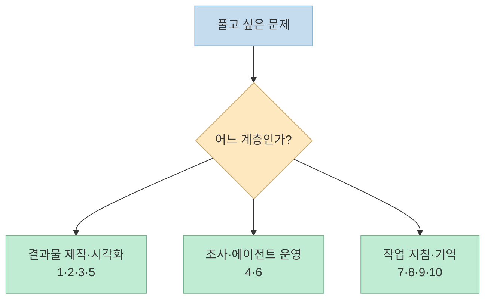
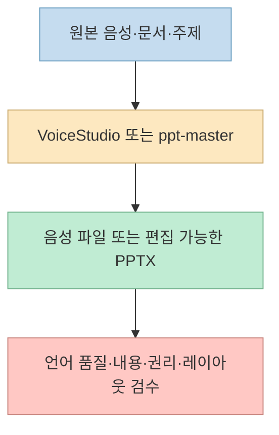
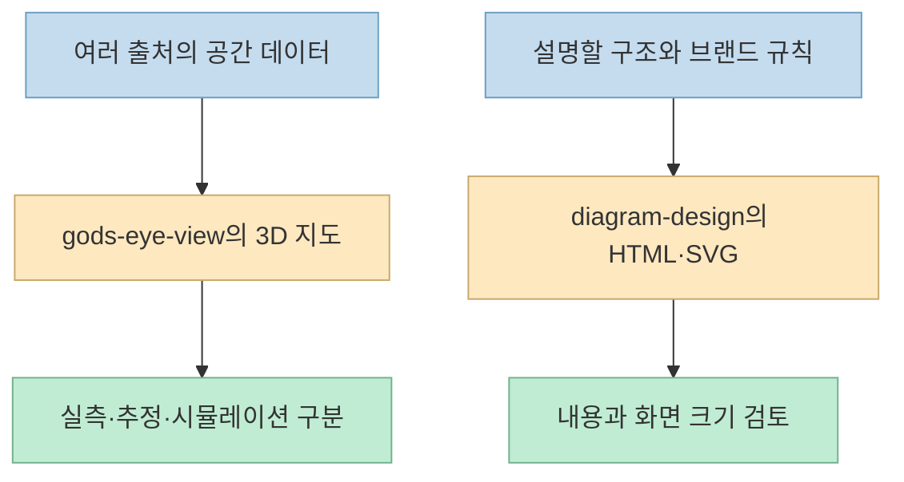
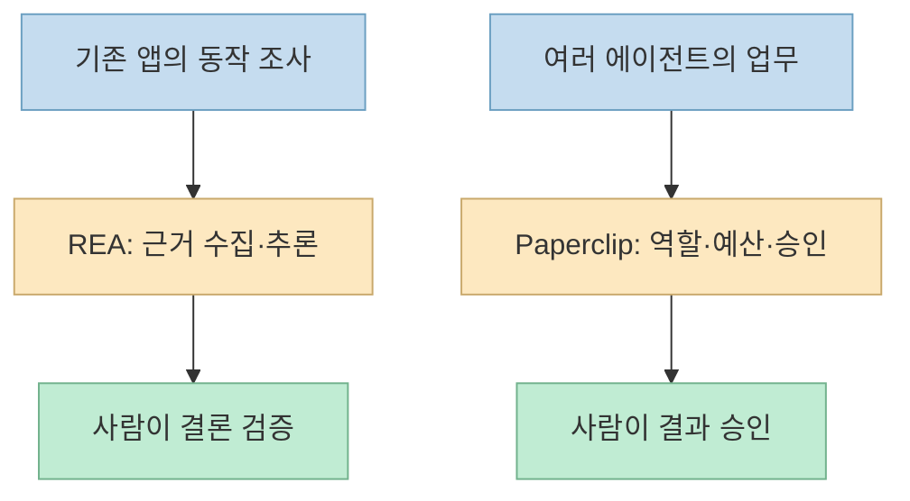
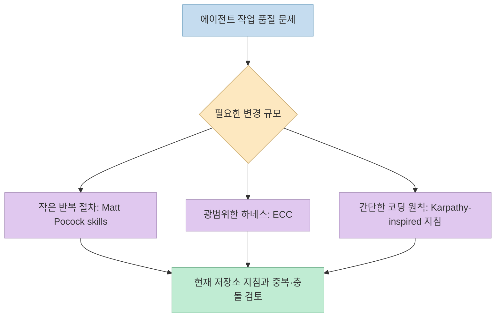
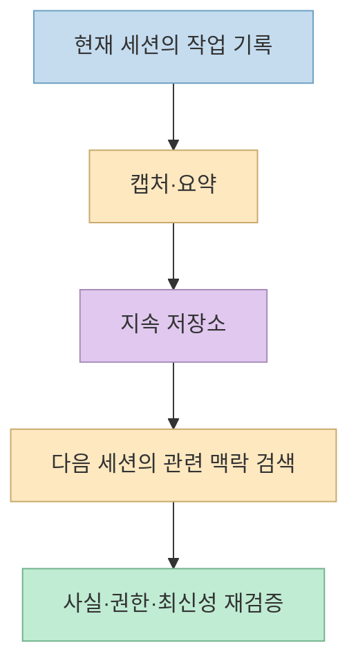

[한 X 게시물](https://x.com/brenzhills/status/2108983461230845978)은 "이번 달 폭발적으로 성장하는 무료 GitHub 저장소 10개"를 소개한다. 음성 앱과 PowerPoint 생성기부터 역공학 도구, 에이전트 운영 플랫폼, Claude Code 스킬, 세션 메모리까지 한 목록에 묶였다. 모두 유용할 수 있지만 **별점 순서로 설치할 목록은 아니다.** 어떤 것은 바로 쓰는 앱이고, 어떤 것은 에이전트의 작업 지침이며, 또 어떤 것은 데이터를 저장하거나 여러 에이전트를 관리하는 기반이다.

<!--more-->

이 글은 원문의 1~10번 순서를 유지하면서 **실제 용도·필요한 조건·과장되기 쉬운 부분**을 공식 저장소와 대조한다. 별점은 시점마다 바뀌므로 원문의 숫자를 현재 성능이나 품질 지표로 사용하지 않는다. 원문 본문은 X 공개 페이지와 공개 게시물 데이터에서 확인했고, 기능은 각 README에서 확인했다.

## Sources

- [원문 X 게시물](https://x.com/brenzhills/status/2108983461230845978)
- [1. VoiceStudio](https://github.com/debpalash/VoiceStudio)
- [2. ppt-master](https://github.com/hugohe3/ppt-master)
- [3. gods-eye-view](https://github.com/bilawalsidhu/gods-eye-view)
- [4. REA](https://github.com/morluto/rea)
- [5. diagram-design](https://github.com/cathrynlavery/diagram-design)
- [6. Paperclip](https://github.com/paperclipai/paperclip)
- [7. Matt Pocock의 skills](https://github.com/mattpocock/skills)
- [8. ECC](https://github.com/affaan-m/ECC)
- [9. andrej-karpathy-skills](https://github.com/multica-ai/andrej-karpathy-skills)
- [10. claude-mem](https://github.com/thedotmack/claude-mem)

## 먼저 구분할 것: 앱, 작업 지침, 운영 기반

원문의 "누구나 쓸 수 있는 도구"와 "Claude Code를 더 잘 쓰게 하는 도구"는 좋은 출발점이다. 다만 사용 방식으로 나누면 더 명확하다. **VoiceStudio·ppt-master·gods-eye-view**는 결과물을 다루는 앱, **REA·diagram-design**은 에이전트에게 전문 작업을 맡기는 도구·스킬, **Paperclip**은 여러 에이전트의 업무 운영, **skills·ECC·karpathy 지침**은 에이전트의 행동을 조정하는 설정, **claude-mem**은 세션 사이의 맥락 저장에 가깝다. 이 분류는 각 프로젝트 README를 바탕으로 한 해석이다.

## 1·2. 음성과 슬라이드: 결과물은 만들지만 검수는 남는다

**1. [VoiceStudio](https://github.com/debpalash/VoiceStudio)** 는 음성 복제·더빙·전사·오디오북 제작 등을 로컬 우선으로 묶은 앱이다. 원문의 "646개 언어"는 프로젝트가 내세우는 지원 범위다. **모든 언어에서 같은 품질로 복제·더빙된다는 보증은 아니다.** 실사용에서는 선택한 음성 모델과 언어별 품질, 음성 사용 동의, 앱·가중치의 라이선스를 따로 확인해야 한다. 앞서 작성한 [VoiceStudio 소개 글](/post/2026/10/2026-10-03-github-trending-five-ai-tools-voice-memory-agent-operations/)에서 앱과 모델 라이선스의 차이를 더 다뤘다. [공식 README](https://github.com/debpalash/VoiceStudio)

**2. [ppt-master](https://github.com/hugohe3/ppt-master)** 는 PDF·Word 같은 소스 자료 또는 주제를 바탕으로 **PowerPoint 네이티브 객체**를 포함한 `.pptx`를 만드는 프로젝트다. 저장소는 편집 가능한 도형·차트·표, 마스터·레이아웃, 전환·애니메이션 등을 설명한다. 원문의 "진짜 편집 가능한 PowerPoint"는 이미지로 평탄화된 슬라이드와 구별하는 장점이지만, 복잡한 문서의 사실관계와 회사 템플릿 재현도가 자동으로 완벽하다는 뜻은 아니다. 생성 파일을 PowerPoint에서 열어 개별 요소와 데이터 연결을 확인해야 한다. [공식 README](https://github.com/hugohe3/ppt-master)

## 3·5. 지도를 보는 도구와 도표를 만드는 스킬

**3. [gods-eye-view](https://github.com/bilawalsidhu/gods-eye-view)** 는 3D 지구본에 항공기·선박·위성·지진·공개 카메라 등 여러 공간 데이터를 겹쳐 보여 준다. 원문의 "실시간 비행기·배·카메라"는 각각 **다른 출처와 갱신 조건**을 가진다. [README의 데이터 계층 설명](https://github.com/bilawalsidhu/gods-eye-view)에 따르면 일부 지도·선박 데이터에는 계정·키가 필요하고, 도로 위 차량은 실제 개별 차량의 관측 위치가 아니라 **시뮬레이션**이다. 따라서 화면 전체를 실시간 실측 감시 데이터로 해석하면 안 된다.

**5. [diagram-design](https://github.com/cathrynlavery/diagram-design)** 는 에이전트가 브랜드 스타일에 맞춘 도표를 **자체 포함 HTML·SVG**로 만들도록 돕는 스킬이다. 공식 README의 **44개 도표 유형**은 선택 가능한 표현 범위이지, 모든 출력이 검토 없이 정확한 설계도라는 뜻은 아니다. 이 블로그는 좁은 본문에서 구조·흐름을 설명할 때 Mermaid를 기본으로 쓰므로, 이 스킬은 Mermaid를 대체하기보다 **편집용·브랜드용 시각 산출물**이 필요할 때 검토할 만하다. [공식 README](https://github.com/cathrynlavery/diagram-design)

## 4·6. 기존 앱을 조사하는 REA와 에이전트 조직을 운영하는 Paperclip

**4. [REA](https://github.com/morluto/rea)** 는 웹사이트·Electron 앱·네이티브 바이너리 등에서 구조와 동작 근거를 모아 **작동 원리를 추론**하도록 돕는다. "소스 없이 기능을 설명한다"는 말을 **원본 소스를 완전히 복원한다**는 뜻으로 읽으면 안 된다. 대상에 따라 Chrome 계열 브라우저나 Ghidra·Hopper·IDA 같은 별도 도구가 필요하다. REA의 설치·증거 수준은 [기존 상세 글](/post/2026/10/2026-10-10-rea-agent-reverse-engineering-evidence-workflow/)에서 더 살폈다. [공식 README](https://github.com/morluto/rea)

**6. [Paperclip](https://github.com/paperclipai/paperclip)** 은 여러 에이전트에게 역할과 작업을 배분하고 예산·승인·실행 상태를 관리하는 **운영 플랫폼**이다. 원문의 "자율 에이전트 회사"는 제품의 은유에 가깝다. 앱을 설치한다고 에이전트가 수익을 만들거나 사람의 경영 판단을 대신한다는 보장은 없다. 작업 소유권, 접근 권한, 비용 한도, 승인 단계를 설계해야 한다. [공식 README](https://github.com/paperclipai/paperclip)

## 7·8·9. 에이전트가 일하는 방식을 바꾸는 세 종류의 지침

**7. [mattpocock/skills](https://github.com/mattpocock/skills)** 는 작성자의 실제 작업에서 나온 작은 엔지니어링 스킬 모음이다. 저장소는 Claude Code뿐 아니라 Codex·Copilot 등 클라이언트별 설치 경로를 안내하고, 저장소별 `setup` 과정에서 이슈 트래커와 문서 저장 위치 등을 묻는다. 따라서 원문의 "바로 가져다 쓰는 작은 스킬"은 맞지만, **내 저장소의 작업 방식에 맞춘 초기 설정**이 필요하다. [공식 README](https://github.com/mattpocock/skills)

**8. [ECC](https://github.com/affaan-m/ECC)** 는 스킬·보안·연구 우선 개발·기억 등 여러 에이전트 하네스용 구성요소를 모은 **큰 시스템**이다. 특히 저장소는 **스킬만 설치하는 것과 Memory Vault 실행 도구를 설치하는 것이 다르다**고 명시한다. 메모리는 검토되지 않은 맥락이므로 권위 있는 문서와 대조해야 한다는 경계도 제시한다. 통째로 복사하기보다 필요한 구성요소만 골라 기존 지침과 중복을 검토하는 편이 안전하다. [공식 README](https://github.com/affaan-m/ECC)

**9. [andrej-karpathy-skills](https://github.com/multica-ai/andrej-karpathy-skills)** 는 Karpathy의 LLM 코딩 관련 관찰에서 영감을 받아 작성한 **제3자의 `CLAUDE.md` 지침**이다. 저장소 이름 때문에 Karpathy가 직접 만들거나 승인한 공식 스킬로 오해해서는 안 된다. 원문의 "한 파일, 네 가지 규칙"은 복잡한 플러그인보다 간단한 작업 원칙을 추가하려는 선택지로 읽는 편이 정확하다. [공식 README](https://github.com/multica-ai/andrej-karpathy-skills)

## 10. claude-mem: 세션의 기록을 다음 작업의 맥락으로

**[claude-mem](https://github.com/thedotmack/claude-mem)** 은 에이전트 활동을 캡처·요약해 이후 세션에서 관련 맥락을 다시 제공하는 프로젝트다. 원문의 "다음 세션이 처음부터 시작하지 않게 한다"는 핵심을 잘 잡았다. 다만 **기억이 있다는 것과 기억이 정확하거나 최신이라는 것은 다르다.** 세션 기록에는 비밀정보, 낡은 결정, 임시 가설이 섞일 수 있으므로 저장·검색 범위와 보존·삭제 방법을 확인해야 한다. 프로젝트 README가 지원하는 클라이언트와 설치 방법도 시점에 따라 바뀌므로 현재 문서를 기준으로 검토한다. [공식 README](https://github.com/thedotmack/claude-mem)

## 실전 적용 포인트

1. **작업 병목 하나를 고른다.** 콘텐츠 제작, 앱 분석, 에이전트 운영, 작업 지침, 세션 기억을 한꺼번에 설치할 이유는 없다.
2. **공식 README와 라이선스를 확인한다.** "무료"는 소스 공개나 초기 사용 비용을 뜻할 수 있지만, 모델 가중치·외부 서비스·상업 이용 조건까지 동일하다는 뜻은 아니다.
3. **권한과 데이터 흐름을 점검한다.** 음성 원본, 외부 계정, 분석 대상, 에이전트 메모리가 어디에 저장·전송되는지 확인한다.
4. **작은 사례로 검증한다.** 생성 결과의 품질, 특정 언어·파일·대상 앱의 지원 여부, 기존 지침과의 충돌을 측정한다.

## 핵심 요약

- **VoiceStudio·ppt-master·gods-eye-view·diagram-design**은 음성·슬라이드·지도·도표라는 서로 다른 결과물을 다룬다.
- **REA**는 기존 앱의 작동 근거를 조사하고, **Paperclip**은 여러 에이전트의 업무를 관리한다.
- **Matt Pocock skills·ECC·Karpathy-inspired 지침**은 에이전트의 일하는 방식을 조정하되, 적용 범위와 초기 설정이 다르다.
- **claude-mem**은 세션 맥락을 이어 주지만 저장된 내용을 검증하는 책임까지 없애지는 않는다.
- 원문의 별점과 "무료"라는 표현보다 **내 작업과의 적합성·권한·라이선스**를 먼저 봐야 한다.

## 결론

이 열 개의 저장소는 경쟁하는 "최고의 AI 도구"가 아니라 **서로 다른 작업 계층의 부품**이다. 이름과 별점만 보고 모두 설치하기보다, 지금 가장 큰 병목 한 곳을 정하고 공식 문서의 요구사항과 제한을 확인한 뒤 작게 시험하는 것이 실용적이다.
