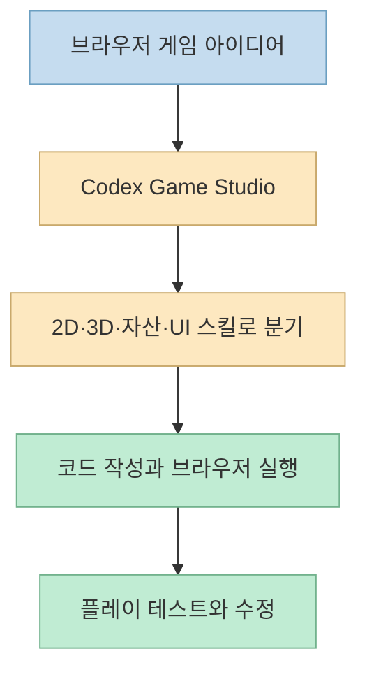
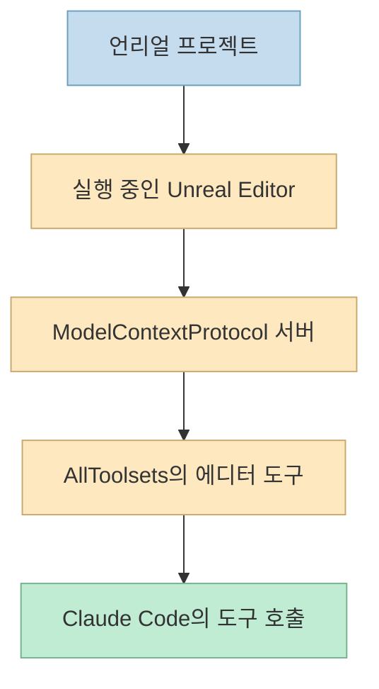
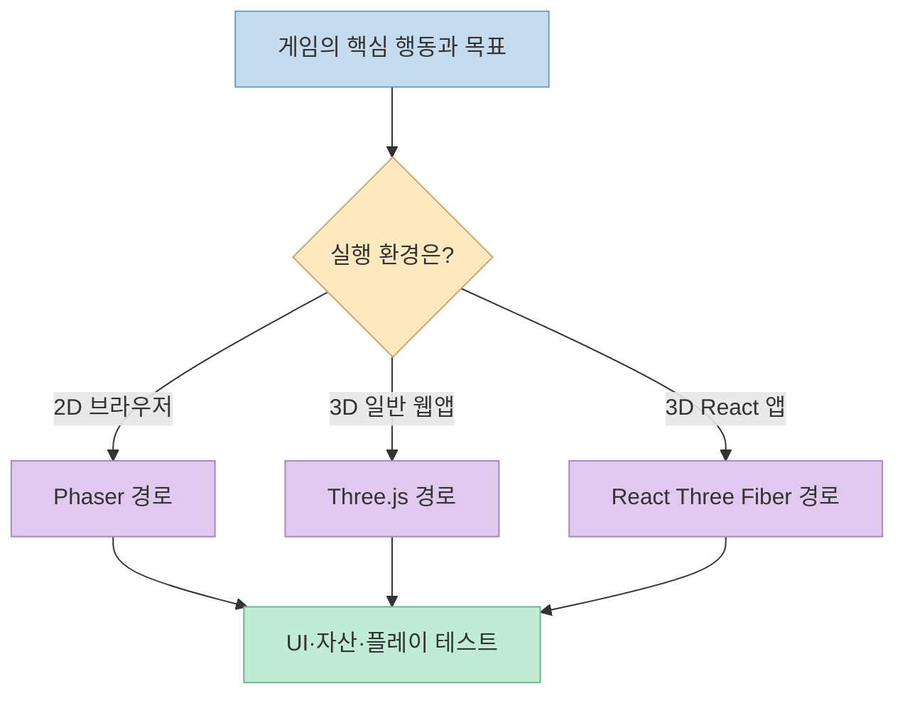
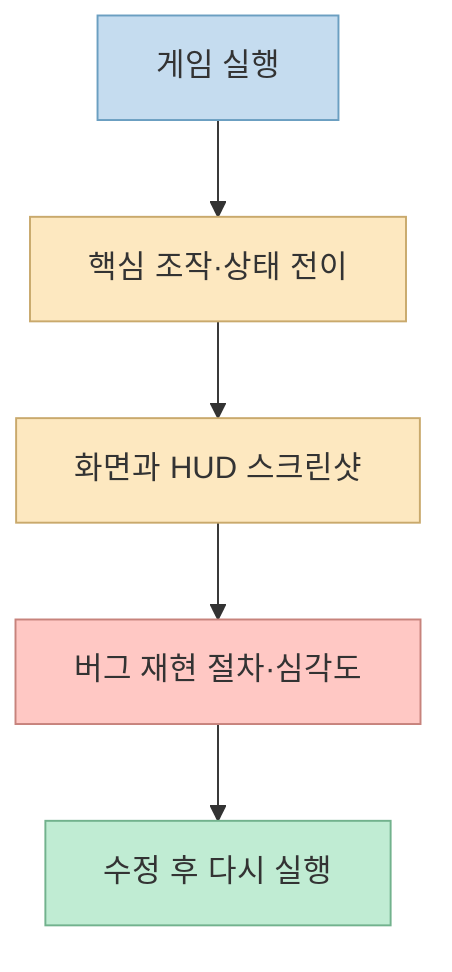
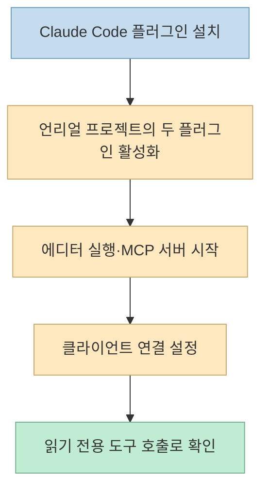

[오유상의 Threads 게시물](https://www.threads.com/share/BAVQBDFhl2/)은 게임 제작자를 위한 두 연결 도구를 소개한다. 하나는 **Codex의 브라우저 게임용 Game Studio**, 다른 하나는 **Claude Code에서 언리얼 에디터를 조작하는 Epic Games 플러그인**이다. 둘 다 AI에 게임 작업을 맡기는 방법이지만, 전자는 작업 지침을 나눠 담은 스킬 묶음이고 후자는 실행 중인 에디터에 접근하는 MCP 도구까지 연결한다. 설치 후 무엇이 가능한지 이해하려면 이 차이부터 봐야 한다.

<!--more-->

## Sources

- [원문 Threads 게시물과 작성자의 답글](https://www.threads.com/share/BAVQBDFhl2/)
- [OpenAI Game Studio 플러그인 저장소](https://github.com/openai/plugins/tree/main/plugins/game-studio)
- [Game Studio의 작업 분기 스킬](https://github.com/openai/plugins/blob/main/plugins/game-studio/skills/game-studio/SKILL.md)
- [Game Studio의 플레이 테스트 스킬](https://github.com/openai/plugins/blob/main/plugins/game-studio/skills/game-playtest/SKILL.md)
- [Epic Games 언리얼 Claude Code 플러그인](https://github.com/EpicGames/unreal-engine-skills-for-claude-code-plugin)
- [Epic Games의 MCP 설정 가이드](https://github.com/EpicGames/unreal-engine-skills-for-claude-code-plugin/blob/main/skills/unreal-mcp/references/setup.md)
- [OpenAI 공식 플러그인 개념 문서](https://developers.openai.com/plugins/concepts/plugins)

## 이름은 비슷해도 권한 구조는 다르다

[Game Studio의 플러그인 선언](https://github.com/openai/plugins/blob/main/plugins/game-studio/.codex-plugin/plugin.json)은 OpenAI를 개발자로 표시하고, 브라우저 게임의 기획·프로토타입·제작·플레이 테스트를 안내한다. 저장소의 `skills/`에는 **9개 스킬**이 있다. 중심 `game-studio` 스킬이 작업을 분류한 뒤 2D Phaser, 3D Three.js 또는 React Three Fiber, 스프라이트, 3D 에셋, UI, 플레이 테스트 등의 전문 스킬로 보낸다. "9개 스킬"은 서로 다른 게임 엔진 9개가 아니라 **작업 영역 9개**라는 뜻이다. [공식 스킬 목록](https://github.com/openai/plugins/tree/main/plugins/game-studio/skills)

반면 [Epic Games의 언리얼 플러그인](https://github.com/EpicGames/unreal-engine-skills-for-claude-code-plugin)은 Claude Code에 작업 지침과 훅을 넣고, **실행 중인 Unreal Editor의 MCP 서버**에 접속해 에디터 도구를 호출한다. 배우·블루프린트·머티리얼·나이아가라·시퀀서 등을 포함한 30개 이상의 도구 묶음을 설명한다. 30개는 "완성된 게임 기능 30개"가 아니라 에디터 작업을 분류한 **toolset** 수다. 스킬만 설치했는데 에디터가 꺼져 있다면 라이브 조작은 할 수 없다. [공식 README](https://github.com/EpicGames/unreal-engine-skills-for-claude-code-plugin)

## Game Studio: 기본은 2D Phaser, 3D는 요구에 따라 분기

[Game Studio의 중심 스킬](https://github.com/openai/plugins/blob/main/plugins/game-studio/skills/game-studio/SKILL.md)은 엔진을 정하지 않은 **브라우저 게임** 요청에 먼저 2D Phaser 경로를 권한다. 3D를 명시하거나 WebGL 중심 요구가 있으면 일반 TypeScript/Vite 앱의 Three.js, React 앱의 React Three Fiber 등으로 분기한다. 플레이어가 무엇을 하는지, 핵심 반복 행동·실패 조건·진행 방식·세션 길이를 먼저 정하고, 그다음 UI와 자산 파이프라인을 선택하라는 순서다. 따라서 Threads의 "2D는 Phaser, 3D는 Three.js"는 좋은 요약이지만, **모든 3D 작업을 무조건 순수 Three.js로 고정한다**는 뜻은 아니다.

작성자 답글은 캐릭터 스프라이트, 3D 모델, 메뉴·체력바 등도 스킬별로 다룬다고 설명한다. 이는 [공식 저장소의 `sprite-pipeline`, `web-3d-asset-pipeline`, `game-ui-frontend` 스킬](https://github.com/openai/plugins/tree/main/plugins/game-studio/skills)과 맞는다. 다만 스킬은 **작업 지침과 분기 기준**이지, 필요한 이미지·모델을 저작권 문제 없이 언제나 자동 공급한다는 보증은 아니다. 실제 자산 생성 수단, 라이선스, 파일 크기와 런타임 성능은 프로젝트별로 확인해야 한다.

## "플레이 테스트까지"의 정확한 의미

[공식 `game-playtest` 스킬](https://github.com/openai/plugins/blob/main/plugins/game-studio/skills/game-playtest/SKILL.md)은 게임 실행 화면을 확인하고, 주요 조작을 시도하고, 대표 상태를 스크린샷으로 남긴 뒤, UI와 렌더링 영역을 따로 검토하고, 문제를 심각도와 재현 절차로 보고하도록 안내한다. 저장소에 Playwright 같은 브라우저 자동화가 있으면 사용을 선호하며, Canvas·WebGL 중심 게임에서는 DOM 검사만으로 화면 오류를 놓칠 수 있으므로 **스크린샷 검토가 중요하다**고 적는다.

이는 "플러그인을 설치하면 완성된 게임을 자동으로 끝까지 검수해 준다"는 뜻이 아니다. 게임이 실제로 실행돼야 하고, 입력 자동화나 브라우저 접근 수단이 있어야 하며, 테스트할 핵심 행동과 기대 결과도 정해져야 한다. 자동화가 어렵다면 구조화된 수동 테스트와 근거 캡처로 대체한다는 것이 스킬의 안내다. 결과적으로 **플레이 테스트 루프를 제안·수행할 수 있지만 품질 보증은 아니다.** [공식 플레이 테스트 스킬](https://github.com/openai/plugins/blob/main/plugins/game-studio/skills/game-playtest/SKILL.md)

## 언리얼 플러그인: 설치와 에디터 연결은 두 단계다

Threads 답글은 Claude Code에서 `/plugin install unreal-engine-skills-for-claude-code@claude-plugins-official`을 안내한다. 이 명령은 [Epic Games README](https://github.com/EpicGames/unreal-engine-skills-for-claude-code-plugin)의 설치 예시와 일치한다. 그러나 **Claude Code 플러그인 설치만으로 언리얼 MCP 연결이 끝나지 않는다.** 프로젝트에서 `ModelContextProtocol`과 `AllToolsets`를 활성화하고, Unreal Editor를 실행해 MCP 서버를 시작하거나 자동 시작을 설정해야 한다. `ModelContextProtocol`만 켜면 서버는 떠도 조작 도구가 노출되지 않는다. [Epic Games 설정 가이드](https://github.com/EpicGames/unreal-engine-skills-for-claude-code-plugin/blob/main/skills/unreal-mcp/references/setup.md)

그다음 실행 중인 에디터에서 `ModelContextProtocol.GenerateClientConfig ClaudeCode`로 연결 설정을 생성할 수 있다. 공식 가이드는 설치 방식에 따라 설정 파일의 위치가 달라질 수 있으므로 프로젝트와 엔진 빌드 형태를 먼저 확인하도록 한다. 연결 확인도 **플러그인이 설치됨 → `/mcp`에 서버가 보임 → 읽기 전용 에디터 호출이 성공함**의 세 수준으로 구분해야 한다. 프록시가 연결됐다는 표시만으로 에디터가 현재 응답한다는 뜻은 아니다. [Epic Games README](https://github.com/EpicGames/unreal-engine-skills-for-claude-code-plugin) · [설정 가이드](https://github.com/EpicGames/unreal-engine-skills-for-claude-code-plugin/blob/main/skills/unreal-mcp/references/setup.md)

## 언리얼의 도구 권한은 보안 경계이기도 하다

[Epic Games의 보안 안내](https://github.com/EpicGames/unreal-engine-skills-for-claude-code-plugin#security)는 `ProgrammaticToolset.execute_tool_script`가 **에디터 프로세스 안에서 임의의 Python을 실행**할 수 있다고 경고한다. 프로젝트 파일과 에셋을 변경하거나 삭제할 수 있는 높은 권한이다. MCP 서버가 `localhost`에 묶여 있어도 같은 컴퓨터의 다른 프로세스가 연결할 수 있으므로 이를 안전한 인증 경계로 간주하지 말라고 안내한다. 공유·신뢰할 수 없는 컴퓨터에서 서버를 실행하지 말고, 외부 네트워크로 포트를 노출하지 않아야 한다.

또한 승인 단계를 없애는 실행 옵션은 에이전트가 에디터를 더 넓게 조작하게 만들 수 있다. 실제 프로젝트라면 **별도 실험용 사본에서 시작하고, 버전 관리 상태를 저장하고, 읽기 전용 호출로 연결을 검증한 뒤, 수정 결과를 diff와 에디터 화면으로 확인**해야 한다. 이는 공식 보안 안내의 권한·복구 가능성 경고를 실무 절차로 풀어 쓴 것이다. [Epic Games README](https://github.com/EpicGames/unreal-engine-skills-for-claude-code-plugin#security)

## 실전 적용 포인트

1. **브라우저 게임이라면 Game Studio부터 검토한다.** 2D는 Phaser 경로가 기본이고, 3D는 기존 웹 스택에 따라 Three.js 또는 React Three Fiber로 갈린다. [Game Studio 스킬](https://github.com/openai/plugins/blob/main/plugins/game-studio/skills/game-studio/SKILL.md)
2. **언리얼 프로젝트라면 에디터 준비를 먼저 확인한다.** Claude Code 플러그인 설치와 `ModelContextProtocol`·`AllToolsets` 활성화, 실행 중인 서버 연결은 서로 다른 단계다. [Epic Games 설정 가이드](https://github.com/EpicGames/unreal-engine-skills-for-claude-code-plugin/blob/main/skills/unreal-mcp/references/setup.md)
3. **테스트를 요청할 때 기대 동작을 적는다.** "직접 해 봐"보다 시작 화면, 이동·공격·실패·재시작, HUD 변화와 예상 결과를 지정하면 재현 가능한 버그 보고에 가깝다. [Game Playtest 스킬](https://github.com/openai/plugins/blob/main/plugins/game-studio/skills/game-playtest/SKILL.md)
4. **권한의 크기를 설치 편의성과 분리한다.** 언리얼 MCP는 실제 에디터와 프로젝트를 수정할 수 있으므로 실험용 사본과 버전 관리가 필요하다. [Epic Games 보안 안내](https://github.com/EpicGames/unreal-engine-skills-for-claude-code-plugin#security)

## 핵심 요약

- **OpenAI Game Studio** 는 브라우저 게임 제작의 9개 작업 스킬을 묶는다. 게임 엔진이나 아트 생성기를 9개 제공한다는 뜻은 아니다. [공식 저장소](https://github.com/openai/plugins/tree/main/plugins/game-studio)
- **Epic Games 언리얼 플러그인** 은 Claude Code와 실행 중인 Unreal Editor의 MCP 서버를 연결한다. 플러그인 설치와 서버·도구 활성화는 별개다. [공식 README](https://github.com/EpicGames/unreal-engine-skills-for-claude-code-plugin)
- **플레이 테스트** 는 실행·입력·스크린샷·재현 절차가 갖춰졌을 때 의미가 있다. 설치만으로 품질이 보증되지는 않는다. [공식 Playtest 스킬](https://github.com/openai/plugins/blob/main/plugins/game-studio/skills/game-playtest/SKILL.md)

## 결론

두 플러그인은 "AI가 게임을 알아서 만든다"는 한 문장보다 **어떤 엔진에서, 어떤 도구와 권한으로, 어떤 검증 루프를 돌릴 것인가**로 평가해야 한다. 웹 게임에서는 작은 핵심 플레이를 구현·재생·수정하는 루프를, 언리얼에서는 에디터 연결과 권한 통제를 먼저 세우는 것이 안전한 출발점이다.
