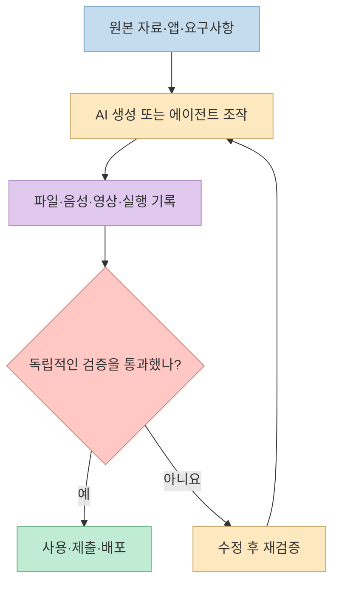
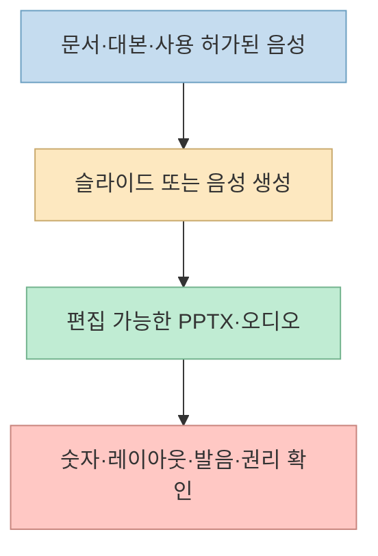
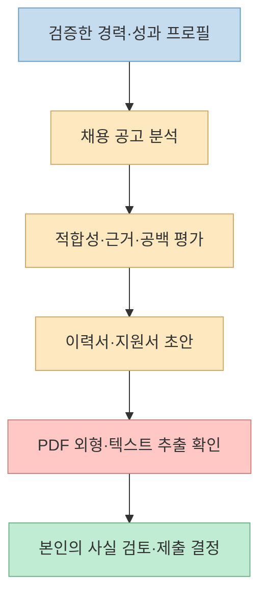
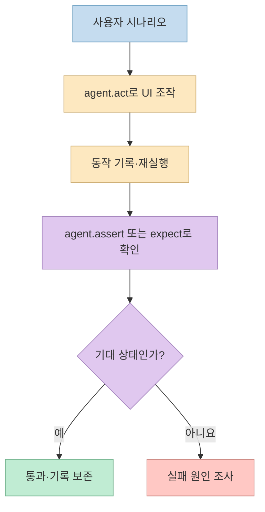
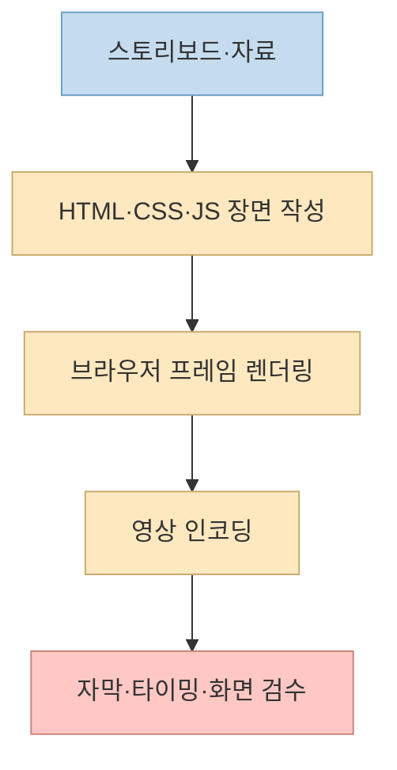

[한 X 게시물](https://x.com/UniverseB1020/status/2109606535370305931)은 PPT, 음성, 취업 준비, E2E 테스트, 영상 제작에 쓰는 오픈소스 다섯 개를 소개한다. 분야는 달라도 공통 질문은 같다. **AI가 무언가를 만들거나 조작한 뒤, 무엇을 근거로 결과를 믿을 것인가?** 이 글은 프로젝트의 기능을 공식 저장소와 대조하고, 생성 단계와 검증 단계를 구분한다.

<!--more-->

원문의 GitHub 별 수와 일·주간 증가량은 게시 당시의 소개 수치다. 현재 수치나 성능·안정성의 증거로 사용하지 않는다. 프로젝트별 세부 기능도 변경될 수 있으므로 실제 도입 전에는 아래 공식 문서를 다시 확인해야 한다.

## Sources

- [원문 X 게시물](https://x.com/UniverseB1020/status/2109606535370305931)
- [1. ppt-master 공식 저장소](https://github.com/hugohe3/ppt-master)
- [2. VoiceStudio 공식 저장소](https://github.com/debpalash/VoiceStudio)
- [3. ai-job-search 공식 저장소](https://github.com/MadsLorentzen/ai-job-search)
- [4. tester-army/e2e 공식 저장소](https://github.com/tester-army/e2e)
- [5. HyperFrames 공식 저장소](https://github.com/heygen-com/hyperframes)

## 다섯 프로젝트를 관통하는 흐름: 생성과 통과 판정은 다르다

**ppt-master**는 편집 가능한 발표 파일, **VoiceStudio**는 음성 콘텐츠, **ai-job-search**는 채용 공고에 맞춘 지원 자료, **HyperFrames**는 코드로 정의한 영상을 만든다. **tester-army/e2e**는 다른 성격이다. 앱을 실제로 조작하고 기대한 동작을 확인하는 테스트 도구다. 하지만 이 도구도 AI가 조작 절차를 찾아냈다는 사실과 테스트가 성공했다는 판정을 분리해야 한다. 이 분류는 [각 프로젝트의 설명](https://github.com/tester-army/e2e)을 바탕으로 한 해석이다.

이 관점에서 다섯 개를 같은 "AI가 다 해 준다"는 도구 목록으로 보면 중요한 차이를 놓친다. 산출물마다 **사실 확인, 권리·동의, 기계적으로 판정할 수 있는 조건, 사람의 최종 판단**이 서로 다르다.

## ppt-master와 VoiceStudio: 편집 가능성과 로컬 실행도 품질 보증은 아니다

[ppt-master](https://github.com/hugohe3/ppt-master)는 자료와 지시를 바탕으로 `.pptx`를 생성하며, 저장소는 도형·차트·표 같은 **편집 가능한 PowerPoint 객체**와 애니메이션·발표 내레이션을 설명한다. 이는 한 장의 이미지로 굳어진 슬라이드보다 사후 수정에 유리하다. 그러나 원본 문서의 숫자가 맞는지, 차트와 본문이 일치하는지, 회사 템플릿에서 글자가 넘치지 않는지는 별도로 확인해야 한다. [앞선 ppt-master 소개 글](/post/2026/10/2026-10-12-ten-github-repos-voice-slides-agent-skills-memory-selection/)에서도 이 구분을 다뤘다.

[VoiceStudio](https://github.com/debpalash/VoiceStudio)는 로컬 우선 방식의 음성 복제·더빙·전사·오디오북 제작을 내세운다. "로컬"은 제작 흐름의 배치 방식이지 **모든 모델의 사용 조건과 모든 언어의 결과 품질을 보증하는 단어는 아니다.** 사용할 음성에 대한 동의를 얻고, 앱과 선택한 모델의 라이선스를 따로 확인하며, 전사·발음·화자 일관성을 실제 오디오로 점검해야 한다. 원문의 "무료 ElevenLabs 대안"은 활용 가능성을 표현한 것이지 비용·품질·기능의 완전한 동등성을 입증하지 않는다. [기존 VoiceStudio 글](/post/2026/10/2026-10-12-ten-github-repos-voice-slides-agent-skills-memory-selection/)을 함께 참고할 수 있다.

## ai-job-search: 지원서를 쓰기 전에 경력 사실부터 고정한다

[ai-job-search](https://github.com/MadsLorentzen/ai-job-search)는 Claude Code에서 실행하는 취업 지원 워크플로다. README의 중심 흐름은 **자기 경력 프로필 작성 → 공고와의 적합성 평가 → 이력서·지원서 맞춤 작성 → PDF 생성과 확인**이다. 단순히 공고를 붙여 넣고 자기소개서를 한 번 생성하는 도구가 아니다. 프로젝트는 작성자와 검토자의 역할을 나누고, 지원서 PDF를 시각적으로 살펴보며 `pdftotext`로 텍스트 계층도 확인하는 절차를 제시한다. 이는 사람이 읽는 외형과 채용 시스템이 추출하는 텍스트가 모두 중요하기 때문이다.

핵심 경계는 **지원 가능성을 높이는 편집과 없는 경력을 만들어 내는 조작은 다르다**는 점이다. [README의 `/apply` 설명](https://github.com/MadsLorentzen/ai-job-search)은 공고의 키워드와 경력의 근거를 연결하되 근거가 없는 항목을 채우지 않는 접근을 강조한다. 초안의 프로젝트명·기간·수치·학력·자격을 원본 프로필과 대조하고, 지원자의 문장으로 최종 수정해야 한다. 이 과정은 탈락·합격을 예측하거나 보장하지 않는다.

또한 저장소에 파일을 로컬로 보관한다는 설명과 **Claude Code를 통한 모델 호출에서 데이터가 어디로 전달되는지**는 별개다. 경력 정보, 연락처, 기업별 지원 내역은 민감할 수 있으므로 사용 중인 모델 제공자의 데이터 처리 조건을 확인하고, 공개 저장소에 원본을 올리지 않아야 한다. 프로젝트는 덴마크 채용 시장용 스킬을 포함하지만 핵심 워크플로는 국가에 고정되지 않도록 설명한다. 따라서 한국 채용 사이트까지 자동 지원한다고 해석해서는 안 된다. [공식 README](https://github.com/MadsLorentzen/ai-job-search)

## tester-army/e2e: 에이전트의 조작과 테스트의 단언을 분리한다

[tester-army/e2e](https://github.com/tester-army/e2e)는 자연어 지시로 화면을 조작하는 `agent.act`, 에이전트 기반 확인을 표현하는 `agent.assert`, 그리고 `expect(screen.getByRole(...))` 같은 일반적인 단언을 함께 제시한다. 중요한 차이는 **"로그인 버튼을 찾아 눌렀다"는 조작 기록과 "로그인 후 대시보드가 보인다"는 성공 판정이 다르다**는 것이다. AI가 버튼을 찾게 하더라도 통과 조건은 가능한 한 관찰 가능한 UI 상태로 명시해야 회귀 테스트가 된다.

[공식 README](https://github.com/tester-army/e2e)에 따르면 조작을 기록해 변경이 없을 때는 모델 호출 없이 재실행할 수 있다. 이는 AI 탐색 비용과 실행의 변동성을 줄이려는 설계다. 다만 앱 구조가 달라졌거나 기록이 유효하지 않으면 재탐색과 테스트 수정이 필요할 수 있으므로, 기록 기능 자체가 테스트의 항상성을 보장하지는 않는다.

웹 엔진은 Playwright 기반 브라우저를, 모바일 엔진은 iOS 시뮬레이터·Android 에뮬레이터 환경을 사용한다. **한 프레임워크에서 웹·모바일을 다룬다**는 말은 설정과 실행 환경까지 동일하다는 뜻이 아니다. 팀에서 도입한다면 먼저 작은 로그인 시나리오 하나를 각 환경에 따로 연결하고, 명시적 단언·실패 로그·재실행 동작을 확인하는 편이 좋다. 모델 제공자 설정에 따라 호출 비용도 달라질 수 있다. [공식 README](https://github.com/tester-army/e2e)

## HyperFrames: HTML로 영상을 정의해도 최종 화면은 봐야 한다

[HeyGen의 HyperFrames](https://github.com/heygen-com/hyperframes)는 HTML·CSS·JavaScript로 화면과 시간에 따른 구성을 작성하고 영상으로 렌더링하는 도구다. 브라우저가 프레임을 만들고 인코딩 단계가 영상 파일을 내보내는 방식이므로, 에이전트가 **코드로 수정 가능한 장면**을 다루기에 적합하다. 이것이 한 번의 프롬프트로 고품질 영상을 자동 보장한다는 뜻은 아니다. 렌더링된 프레임의 잘림·자막 오탈자·길이·음성 동기화를 확인해야 한다. [기존 HyperFrames 글](/post/2026/10/2026-10-10-github-trending-openshell-cursor-hyperframes-anyps5-openrig-agent-reach/)에서 다른 영상 도구와의 위치를 더 다뤘다.

## 실전 적용 포인트

1. **만들려는 결과물 하나만 고른다.** 발표 자료·음성·지원서·테스트·영상은 입력 데이터와 검수 방법이 다르다. 별점 순위 대신 현재 작업의 병목을 기준으로 선택한다.
2. **생성 전에 기준을 적는다.** 슬라이드는 원본 숫자, 음성은 사용 동의와 발음, 지원서는 검증된 경력, 테스트는 통과 상태, 영상은 자막·타이밍이 최소 기준이다.
3. **AI 산출물과 판정 수단을 분리한다.** PDF의 화면과 텍스트 추출, E2E의 UI 단언, 영상의 실제 재생처럼 결과물을 다른 방식으로 확인한다.
4. **작은 샘플에서 비용과 권한을 확인한다.** 로컬 우선 앱도 모델·가중치 라이선스가 다를 수 있고, 에이전트 기반 도구는 모델 호출·개인정보·실행 환경의 조건이 따로 붙는다.

## 핵심 요약

- **ppt-master·VoiceStudio·HyperFrames** 는 편집·제작의 출발점을 빠르게 만들지만 내용·권리·최종 품질의 검수는 남는다.
- **ai-job-search** 는 사실에 근거한 경력 프로필에서 공고 분석·지원서 생성·PDF 확인까지 연결한다. 경력의 진실성과 제출 결정은 지원자의 책임이다.
- **tester-army/e2e** 는 에이전트 조작과 명시적 테스트 판정을 함께 다룬다. 재실행 가능한 기록이 있어도 단언과 환경 설정을 생략할 수 없다.

## 결론

이 다섯 프로젝트의 공통 가치는 "AI가 끝까지 대신한다"가 아니다. **반복 작업을 줄이되, 결과를 확인할 기준을 더 분명하게 만든다**는 데 있다. 도입 순서는 별점이 아니라 현재 문제, 필요한 데이터, 그리고 팀이 실제로 수행할 수 있는 검증 절차로 정하는 편이 안전하다.
