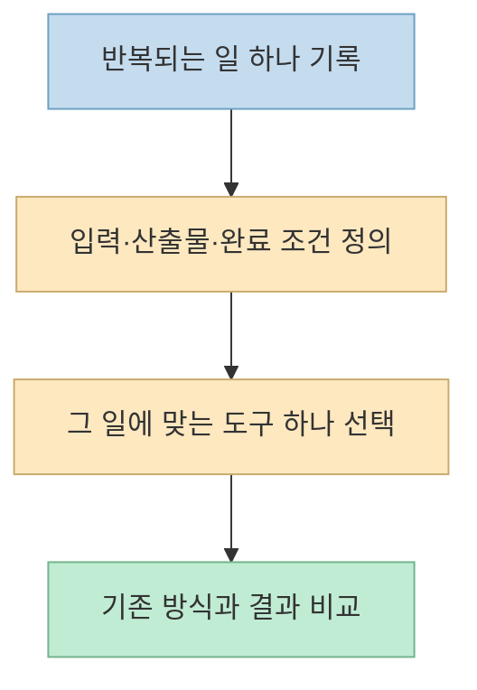
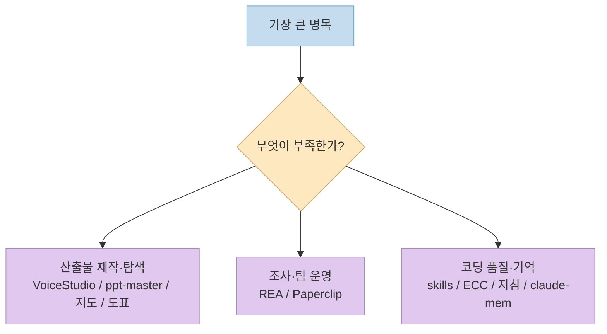
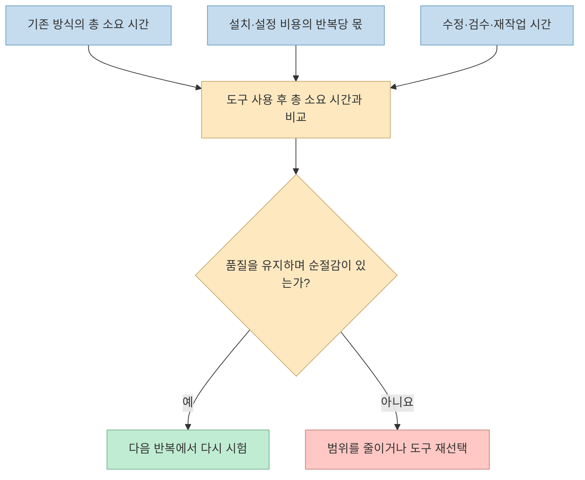
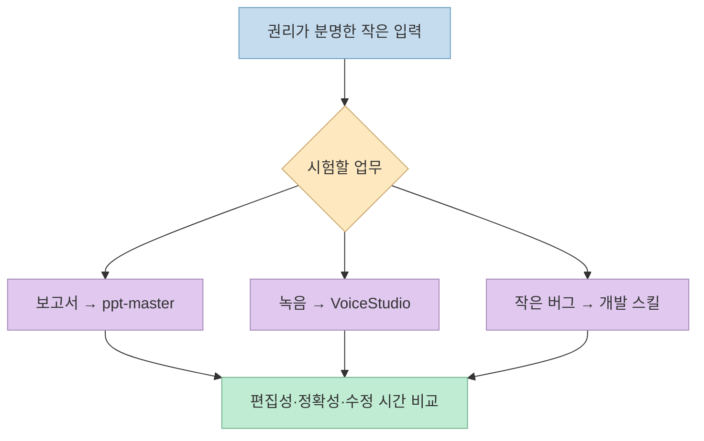
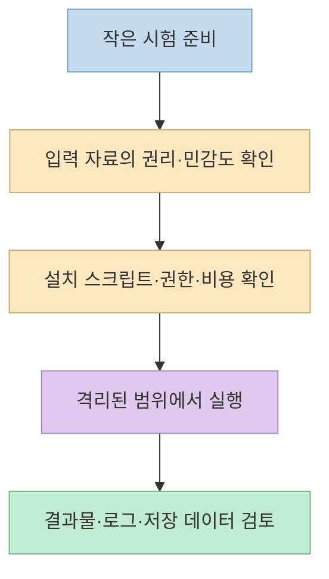

[Minuco의 X 게시물](https://x.com/iamminuco/status/2109527379223916655)은 GitHub의 AI 도구 10개를 소개하지만, 마지막 메시지는 목록 자체보다 중요하다. **도구를 10개 수집하지 말고 반복 업무 하나를 골라 실제로 시간이 줄어드는지 확인하라**는 제안이다. 같은 10개 저장소가 같은 순서로 등장하는 [앞선 X 게시물](https://x.com/brenzhills/status/2108983461230845978)과 겹치므로, 이 글은 도구 소개를 반복하지 않고 **하나를 선택해 검증하는 작은 실험**에 집중한다.

<!--more-->

열 개 저장소의 기능·라이선스·권한 차이는 이미 [용도별 선택 가이드](/post/2026/10/2026-10-12-ten-github-repos-voice-slides-agent-skills-memory-selection/)에서 다뤘다. 아래 절차는 X 게시물의 결론을 실무에 적용하기 위한 **필자의 제안**이며, 게시물 작성자가 특정 실험 프로토콜이나 시간 절감 수치를 검증했다는 뜻은 아니다.

## Sources

- [원문 X 게시물: Minuco의 한국어 도구 10선](https://x.com/iamminuco/status/2109527379223916655)
- [같은 10개 도구와 영상을 소개한 앞선 X 게시물](https://x.com/brenzhills/status/2108983461230845978)
- [VoiceStudio 공식 저장소](https://github.com/debpalash/VoiceStudio) · [ppt-master 공식 저장소](https://github.com/hugohe3/ppt-master)
- [gods-eye-view](https://github.com/bilawalsidhu/gods-eye-view) · [REA](https://github.com/morluto/rea) · [diagram-design](https://github.com/cathrynlavery/diagram-design)
- [Paperclip](https://github.com/paperclipai/paperclip) · [Matt Pocock skills](https://github.com/mattpocock/skills) · [ECC](https://github.com/affaan-m/ECC)
- [Karpathy-inspired 지침](https://github.com/multica-ai/andrej-karpathy-skills) · [claude-mem](https://github.com/thedotmack/claude-mem)

## 1. 목록을 다시 읽기보다 '업무 한 단위'를 정의한다

게시물은 VoiceStudio, ppt-master, gods-eye-view, REA, diagram-design, Paperclip, Matt Pocock의 skills, ECC, Karpathy-inspired 지침, claude-mem을 차례로 소개한다. **열 개를 모두 설치할 필요가 없다**고 명시하며 보고서 작성, 고객 문의 정리, 반복되는 코딩 실수 같은 문제를 먼저 떠올리라고 권한다. 다만 이 열 개 중 어느 것도 모든 예시에 곧바로 들어맞지는 않는다. 예컨대 고객 문의 분류를 자동화하려면 목록에 없는 메일·CRM 연결이나 개인정보 처리 설계가 추가로 필요할 수 있다. [원문](https://x.com/iamminuco/status/2109527379223916655)

"보고서 작성"도 너무 넓다. **지난주 수치가 담긴 문서 한 개를 5장짜리 발표 자료로 바꾸기**처럼 시작과 끝이 분명해야 측정할 수 있다. 음성 작업이라면 "내가 권리를 가진 2분 분량 녹음을 전사해 자막 초안 만들기", 개발 작업이라면 "작은 버그 한 건을 테스트와 함께 수정하기"처럼 줄인다. 이 예시는 도구의 성능 주장이나 실측 결과가 아니라 **실험 단위를 좁히는 방법**이다.

## 2. 도구 선택은 '반복되는 병목'과 연결한다

목록은 하나의 종류가 아니다. [VoiceStudio](https://github.com/debpalash/VoiceStudio)는 음성 제작·전사, [ppt-master](https://github.com/hugohe3/ppt-master)는 PowerPoint 산출물, [gods-eye-view](https://github.com/bilawalsidhu/gods-eye-view)는 공간 데이터 탐색, [REA](https://github.com/morluto/rea)는 소프트웨어 동작 조사, [diagram-design](https://github.com/cathrynlavery/diagram-design)는 브랜드 도표 제작에 대응한다. [Paperclip](https://github.com/paperclipai/paperclip)은 여러 에이전트의 역할·작업·예산을 관리하고, [Matt Pocock skills](https://github.com/mattpocock/skills)·[ECC](https://github.com/affaan-m/ECC)·[Karpathy-inspired 지침](https://github.com/multica-ai/andrej-karpathy-skills)은 코딩 에이전트의 작업 절차를 바꾸며, [claude-mem](https://github.com/thedotmack/claude-mem)은 세션 맥락을 이어 주려 한다. 이 용도 구분은 각 저장소 README에 기반한다.

두 도구가 같은 업무에 모두 좋아 보여도 처음에는 하나만 고른다. 여러 설치와 설정을 동시에 바꾸면 **무엇이 시간을 줄였고 무엇이 품질을 떨어뜨렸는지** 분리하기 어렵다. 특히 스킬 모음과 메모리·에이전트 관리 도구는 기존 개발 지침이나 접근 권한과 상호작용하므로, 한 번에 전부 넣는 방식은 작은 시험의 장점을 없앤다.

## 3. '30분 절약'을 말하려면 기준선을 먼저 잰다

게시물의 "30분이라도 시간이 줄었다면"은 **측정해야 할 목표의 예시**이지, 열 개 도구 중 어느 하나가 30분을 절약했다는 실험 결과가 아니다. 먼저 같은 종류의 업무를 기존 방식으로 수행해 **시작부터 승인 가능한 결과가 나올 때까지** 걸린 시간을 기록한다. 도구를 쓴 뒤에도 실행 시간뿐 아니라 설치·설정, 결과 수정, 사실 확인, 업로드와 승인 시간을 합쳐야 한다.

계산식은 **순절감 시간 = 기존 총 시간 − (도구 실행 시간 + 사람의 수정·검수 시간 + 반복당 설치·설정 시간)**이다. 예를 들어 이전에 90분 걸리던 작업이 도구 실행 20분, 검수 40분, 반복당 설정 비용 10분이라면 순절감은 **20분**이다. 이 수치는 계산 예시일 뿐 실제 제품 벤치마크가 아니다. 한 번만 할 일이라면 설치 비용을 전부 포함하고, 매주 반복할 일이라면 여러 차례에 나눠 계산한다.

시간만 줄었다고 성공은 아니다. **오탈자·누락·잘못된 수치·비공개 정보 노출**이 늘었다면 재작업과 위험 비용을 함께 봐야 한다. 다음 사용 여부는 "더 빨랐다"와 "승인 가능한 품질이었다"가 동시에 참일 때 결정한다.

## 4. 세 가지 작은 시험 예시

**발표 자료:** [ppt-master](https://github.com/hugohe3/ppt-master)에 공개해도 되는 짧은 보고서 한 개를 입력해 PPTX 초안을 만든다. 기존 수작업과 비교해 ① 실제로 편집 가능한 텍스트·도형인지, ② 숫자·출처가 맞는지, ③ 회사 템플릿에 맞추는 데 얼마나 걸리는지 기록한다. 프로젝트가 네이티브 PowerPoint 객체를 지향한다는 설명과, 특정 보고서가 그대로 완성된다는 보장은 다른 이야기다. [공식 README](https://github.com/hugohe3/ppt-master)

**음성 작업:** [VoiceStudio](https://github.com/debpalash/VoiceStudio)로 사용 권한이 있는 짧은 녹음을 전사하거나 더빙한다. 문장 누락, 고유명사 오류, 말의 자연스러움, 모델 다운로드·실행 시간을 측정한다. 음성 복제라면 본인 또는 명시적으로 동의한 사람의 음성만 사용한다. 앱의 로컬 실행 가능성과 특정 언어에서의 품질·모델 사용 허가는 별도로 확인한다. [공식 README](https://github.com/debpalash/VoiceStudio)

**개발 작업:** [Matt Pocock의 스킬](https://github.com/mattpocock/skills) 중 현재 문제와 관련된 하나만 적용해 작은 버그를 수정한다. 완료 시간과 함께 **변경 파일 수, 불필요한 수정, 테스트 실패, 코드 리뷰에서 나온 재작업**을 비교한다. 저장소의 설치 안내도 프로젝트별 이슈 트래커·문서 위치를 맞추는 설정을 포함하므로, 기존 지침과 충돌하지 않는지 확인한다. [공식 README](https://github.com/mattpocock/skills)

## 5. 도입 전 안전·비용 게이트를 통과한다

원문은 오픈소스가 **무료 공개**되어 있다는 사실이 **안전성이나 무비용 운영**을 보장하지 않는다고 직접 경고한다. 실제로 도구에 따라 모델 가중치의 별도 라이선스, 외부 API·지도 데이터 키, 실행 스크립트, 저장소·클라우드 파일 접근 권한, 세션 기록 보관이 걸린다. 따라서 시험 전에 입력 자료를 최소화하고, 접근 범위와 결과물의 사용 조건을 살펴야 한다. [원문](https://x.com/iamminuco/status/2109527379223916655), [VoiceStudio](https://github.com/debpalash/VoiceStudio), [gods-eye-view](https://github.com/bilawalsidhu/gods-eye-view), [claude-mem](https://github.com/thedotmack/claude-mem)

특히 [REA](https://github.com/morluto/rea)로 제3자 소프트웨어를 조사할 때는 분석 권한과 이용 조건, [Paperclip](https://github.com/paperclipai/paperclip)으로 에이전트를 운영할 때는 예산·승인, [claude-mem](https://github.com/thedotmack/claude-mem)을 쓸 때는 저장되는 업무 정보와 삭제 경로를 확인해야 한다. 이는 각 프로젝트의 기능을 실제 업무에 배치할 때 필요한 운영상 점검이다.

## 실전 적용 포인트

1. **이번 주에 세 번 이상 반복한 작업 하나**를 고르고, 입력·완료 조건을 한 문장으로 적는다.
2. **기존 방식의 시간과 오류**를 먼저 기록한 뒤, 목록에서 관련 도구 하나만 고른다.
3. **권리가 분명한 작은 자료**로 시험하고 설치·검수·수정 시간까지 잰다.
4. **품질과 순절감 시간을 함께 비교**한다. 한 번의 성공으로 대량 적용하지 말고 다음 반복에서도 확인한다.
5. **맞지 않으면 제거한다.** 설치한 도구의 수보다 해결된 업무가 중요하다.

## 핵심 요약

- 이 X 게시물의 열 개 목록은 이미 다룬 목록과 겹친다. 새로 배울 부분은 **도구 하나로 반복 업무를 시험하라**는 실천 제안이다.
- 절감 시간은 실행 시간만이 아니라 **설치·수정·검수 비용까지 포함**해 계산해야 한다.
- 품질·권한·라이선스를 통과하지 못하면 빠른 결과도 업무 개선이라고 보기 어렵다.
- 측정 가능한 작은 실험을 반복해야 도구 수집을 **실제 작업 방식의 개선**으로 바꿀 수 있다.

## 결론

GitHub의 가치는 저장소 열 개를 북마크하는 데서 끝나지 않는다. **반복되는 문제를 좁게 정의하고, 하나의 도구로 시험하고, 시간과 품질을 재서 다음 사용 여부를 결정하는 것**이 더 실용적이다. 그 결과가 기대보다 작거나 실패여도, 무엇이 병목인지 확인했다면 다음 도구를 고를 근거가 생긴다.
