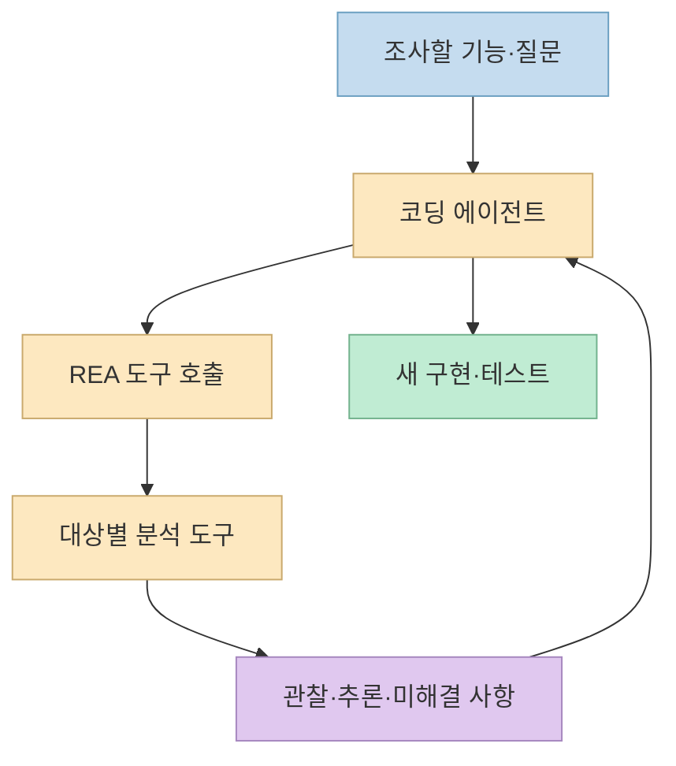
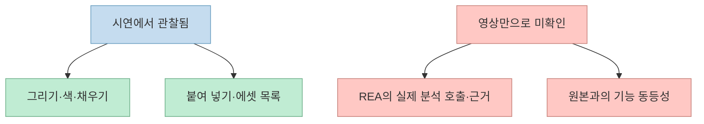
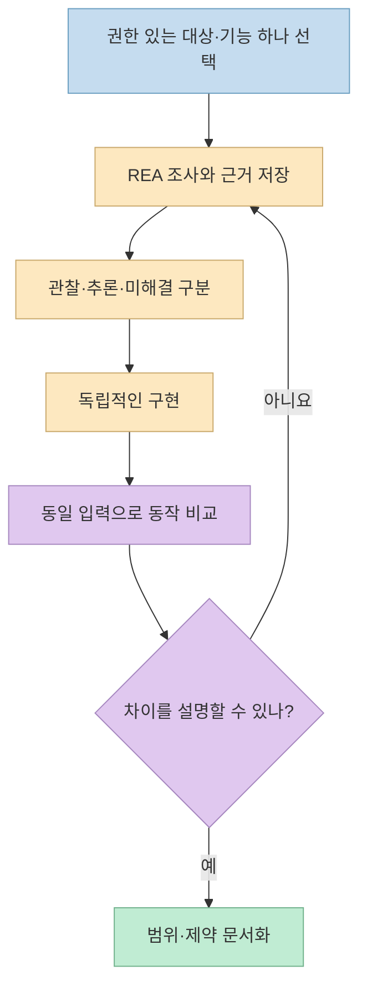

[성공지식백과의 영상](https://youtu.be/tByhXkxDKDo)은 **Reverse Engineer Anything(REA)** 을 Claude Code에 연결한 뒤 Windows 그림판과 비슷한 앱을 만들고, 붙여 넣은 이미지를 목록으로 관리하는 기능까지 보여 준다. 발표자는 약 11분이 걸렸다고 말한다. 흥미로운 시연이지만, 화면에서 기능 몇 개가 작동했다는 것과 원본 앱의 구조를 정확히 복원했다는 것은 다른 주장이다. 이 글은 그 차이를 확인한다.

<!--more-->

## Sources

- [원본 YouTube 영상](https://youtu.be/tByhXkxDKDo)
- [REA 공식 저장소](https://github.com/morluto/rea)
- [REA 설치 문서](https://github.com/morluto/rea/blob/main/docs/installation.md)
- [REA CLI와 Evidence 문서](https://github.com/morluto/rea/blob/main/docs/cli.md)
- [REA 책임 있는 사용 안내](https://github.com/morluto/rea/blob/main/DISCLAIMER.md)
- [미국 저작권청의 상호운용성 관련 법 조항](https://www.copyright.gov/title17/92chap12.html)

## REA는 복제 버튼이 아니라 조사와 구현 사이의 연결 도구다

[영상 1분 6초](https://youtu.be/tByhXkxDKDo?t=66)부터 발표자는 REA를 에이전트가 기존 앱의 작동 방식을 조사할 때 쓰는 MCP로 설명한다. [공식 README](https://github.com/morluto/rea)에 따르면 REA는 네이티브 바이너리·JavaScript/Electron 앱·웹사이트 등 **대상에 맞는 분석 도구**를 에이전트에 연결하고, 관찰과 추론의 근거를 결과에 담는다. 코드를 작성하고 테스트하는 주체는 연결된 코딩 에이전트다. 따라서 "REA가 앱을 자동 복제한다"보다 **"REA가 조사 근거를 제공하고 에이전트가 새 구현을 만든다"** 가 더 정확하다.

영상은 [Ghidra·Hopper·IDA와 브라우저 조사](https://youtu.be/tByhXkxDKDo?t=99)를 한 흐름으로 묶어 설명한다. 하지만 모든 분석에 이 도구가 전부 필요한 것은 아니다. [REA의 대상별 요구 사항](https://github.com/morluto/rea)은 네이티브 심층 분석에는 별도 분석 제공자가 필요하고, 정적 JavaScript 분석에는 네이티브 엔진이 필요 없다고 구분한다. 대상이 Windows 네이티브 앱인지, 웹페이지인지, Electron 앱인지에 따라 얻을 수 있는 근거도 달라진다. [영상 1분 58초](https://youtu.be/tByhXkxDKDo?t=118)에서 언급한 의사코드는 **원본 소스코드 자체**가 아니라 동작을 이해하기 위한 분석 표현이다.

[공식 Evidence 문서](https://github.com/morluto/rea/blob/main/docs/cli.md)는 결과에 아티팩트 식별자, 관찰 위치, 추론, 미해결 사항을 남기도록 설명한다. 종료 코드가 성공이어도 부분적인 근거나 경고가 남을 수 있다. 따라서 "분석 완료"를 "앱의 모든 동작을 이해했다"로 바꾸어 읽으면 안 된다. [영상 2분 16초](https://youtu.be/tByhXkxDKDo?t=136)의 구현·테스트·재질문 반복은 이런 미확인 부분을 좁히는 과정으로 이해하는 편이 맞다.

## 그림판 시연: 화면에서 실제로 확인한 범위

[영상 5분 22초](https://youtu.be/tByhXkxDKDo?t=322)에 발표자는 Windows 그림판을 참고해 간단한 그리기 앱을 만들고, **붙여 넣은 이미지를 목록으로 쌓는 패널**을 추가하라고 지시한다. 뒤이어 [7분 29초부터의 테스트](https://youtu.be/tByhXkxDKDo?t=449)에서 그림 그리기, 색 변경, 툴팁, 채우기, 이미지 붙여 넣기, 목록 항목의 이름 변경·복사·다운로드·삭제를 보여 준다. 이 부분은 **시연 화면에서 관찰한 동작**으로 볼 수 있다.

반면 영상만으로는 원본 그림판의 특정 내부 함수나 데이터 구조가 실제로 분석됐는지, 새 앱이 그것을 어떻게 반영했는지 확인하기 어렵다. REA 호출 로그·Evidence 기록·생성 코드와 테스트 보고서가 함께 제시되지 않았기 때문이다. 따라서 새 앱의 어느 부분이 **REA 조사 덕분**이고 어느 부분이 **Claude Code가 화면과 프롬프트만 보고 구현한 결과**인지 이 영상만으로 분리할 수 없다. 이는 시연의 성과를 부정하는 말이 아니라, 성과의 원인을 판단할 자료가 부족하다는 뜻이다. [영상의 설치·프롬프트 장면](https://youtu.be/tByhXkxDKDo?t=260) · [REA의 Evidence 계약](https://github.com/morluto/rea/blob/main/docs/cli.md)

[영상 8분 33초](https://youtu.be/tByhXkxDKDo?t=513)의 "약 11분"도 발표자의 **해당 환경·해당 시연에 관한 설명**이다. 설치 상태, 프롬프트 작성 시간, 모델 호출량, 편집 여부, 전체 기능 범위가 비교 실험으로 제시되지 않았으므로 평균 소요 시간이나 재현 가능한 성능 수치로 일반화할 수 없다. 또한 발표자도 [채우기 커서 표시가 미완성이라고 말한다](https://youtu.be/tByhXkxDKDo?t=463). 비슷하게 보이는 프로토타입과 완성된 대체 앱 사이에는 아직 기능 범위·오류 처리·접근성·파일 호환성·배포 검증의 차이가 남는다.

## 재현한다면 무엇을 검증해야 하나

이 데모의 좋은 활용법은 "그림판 전체를 복제"라는 거대한 목표보다 [영상의 추가 기능처럼](https://youtu.be/tByhXkxDKDo?t=329) **좁고 관찰 가능한 기능**을 정하는 것이다. 먼저 분석할 권한이 있는 앱에서 "이미지 붙여 넣기 후 목록에 어떤 상태가 저장되는가"처럼 질문을 한정한다. 그다음 REA의 결과에서 **확인된 관찰, 분석에 따른 추론, 아직 모르는 점**을 분리하고, 새 앱에는 그 가정을 테스트로 옮긴다. [REA 공식 README](https://github.com/morluto/rea) · [Evidence 문서](https://github.com/morluto/rea/blob/main/docs/cli.md)

예를 들어 이미지 목록 기능이라면 **여러 번 붙여 넣기, 큰 이미지, 취소·다시 실행, 이름 중복, 삭제 후 재붙여 넣기, 저장·재시작 후 상태**를 점검할 수 있다. 이것은 영상에서 모두 검증된 항목이 아니라, 시연된 [붙여 넣기와 목록 동작](https://youtu.be/tByhXkxDKDo?t=477)을 실제 제품 기능으로 확장할 때 필요한 **제안 테스트**다. 원본의 동작과 다르게 설계한 부분은 "복원"이 아니라 새 앱의 의도적인 설계 선택으로 적는 편이 정확하다.

## "새 코드로 썼으니 합법"도 "역공학은 불법"도 단정할 수 없다

영상은 [상용 앱을 그대로 만드는 문제](https://youtu.be/tByhXkxDKDo?t=379)를 경고하면서도, 새 앱을 Rust로 작성하고 원본 코드가 중복되지 않았다면 법적으로 애매하다고 말한다. 이어 [9분 33초 부근](https://youtu.be/tByhXkxDKDo?t=573)에는 남의 앱을 통째로 베끼는 것은 불법이라고 단정한다. 두 문장 모두 **모든 국가·모든 대상에 그대로 적용되는 법적 판정으로 받아들이기 어렵다.** 코드를 새로 작성했는지만이 아니라 분석 권한, 라이선스·계약 조건, 보호되는 표현과 에셋, 기술적 보호조치, 배포 방식, 적용 법률 등을 구분해야 한다. [REA 책임 있는 사용 안내](https://github.com/morluto/rea/blob/main/DISCLAIMER.md)

미국 법의 한 예로, [미국 저작권법 17 U.S.C. §1201(f)](https://www.copyright.gov/title17/92chap12.html)는 일정한 요건 아래 **독립적으로 만든 프로그램과의 상호운용성 확보**를 위한 역공학 예외를 규정한다. 이는 "모든 앱 복제가 허용된다"는 뜻도 아니고, 한국에서 동일한 결론이 나온다는 뜻도 아니다. 이 글은 법률 자문이 아니다. 공개·상업 배포를 생각한다면 대상의 이용 약관과 권리관계를 확인하고 해당 관할의 전문가에게 검토받아야 한다.

특히 게임 캐릭터나 상용 앱의 아이콘·이미지·상표를 가져오는 일은 단순한 기능 학습과 다르다. 영상에 등장하는 [게임 결합·상용 앱 대체 사례](https://youtu.be/tByhXkxDKDo?t=379)는 흥미로운 소개지만, 영상의 짧은 장면만으로 코드 출처나 사용 권한, 완성도, 법적 상태를 독립 검증할 수 없다. 학습용 실험에서도 원본 자산을 그대로 옮기지 않고, 허가받은 자료와 자체 제작 자산으로 범위를 제한하는 편이 안전하다.

## 실전 적용 포인트

1. **대상과 질문을 작게 잡는다.** "앱 전체"보다 권한이 확인된 대상의 기능 하나를 조사한다. [영상의 그림판 확장 목표](https://youtu.be/tByhXkxDKDo?t=329)
2. **MCP 연결과 조사 성공을 구분한다.** `npx rea-agents setup`은 에이전트 설정 절차다. 네이티브 분석에는 별도 도구와 대상별 조건이 필요할 수 있다. [설치 문서](https://github.com/morluto/rea/blob/main/docs/installation.md)
3. **시연 화면보다 Evidence를 남긴다.** 호출한 도구, 대상 버전, 관찰 위치, 미해결 질문을 기록해야 결과를 다시 확인할 수 있다. [Evidence 문서](https://github.com/morluto/rea/blob/main/docs/cli.md)
4. **독립적인 테스트로 마무리한다.** 원본 기능과 새 구현에 같은 입력을 넣고 결과를 비교한다. 몇 개 버튼의 시연만으로 동등성을 선언하지 않는다. [영상의 제한적인 기능 테스트](https://youtu.be/tByhXkxDKDo?t=449)
5. **권한과 배포 조건을 먼저 확인한다.** 로컬 학습, 상호운용성 연구, 상용 배포는 위험과 요건이 다르다. [REA 책임 있는 사용 안내](https://github.com/morluto/rea/blob/main/DISCLAIMER.md)

## 핵심 요약

- REA는 분석 도구를 에이전트에 연결하고 **근거를 제공**한다. 새 앱 구현과 테스트는 연결된 에이전트와 사람이 맡는다. [공식 README](https://github.com/morluto/rea)
- 영상은 그림판 유사 앱의 일부 동작과 에셋 패널을 보여 준다. 하지만 REA의 실제 호출·원본과의 기능 동등성·"11분"의 재현성은 영상만으로 입증되지 않는다. [시연 시작](https://youtu.be/tByhXkxDKDo?t=449) · [소요 시간 설명](https://youtu.be/tByhXkxDKDo?t=513)
- 역공학의 적법성을 "새 코드인지" 또는 "남의 앱인지" 하나로 단정하지 말고 권한·자산·라이선스·배포 맥락을 따로 확인해야 한다. [REA 안내](https://github.com/morluto/rea/blob/main/DISCLAIMER.md)

## 결론

이 영상이 보여 주는 가장 현실적인 가능성은 **기존 앱에서 배우고 싶은 기능을 좁혀 조사한 뒤, 내 목적에 맞는 프로토타입을 빠르게 만드는 것**이다. "소프트웨어가 끝났다"는 결론보다 중요한 것은 조사 근거를 남기고, 결과물을 읽고, 직접 테스트하며, 사용할 권한까지 확인하는 과정이다. 발표자도 [마지막 부분](https://youtu.be/tByhXkxDKDo?t=682)에서 결과물을 이해하고 검토할 역량의 필요성을 강조한다.
