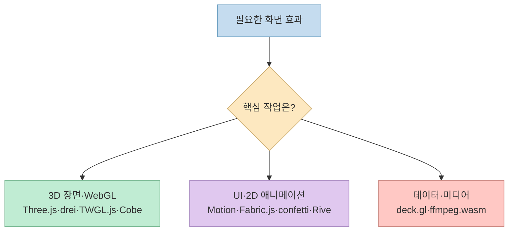
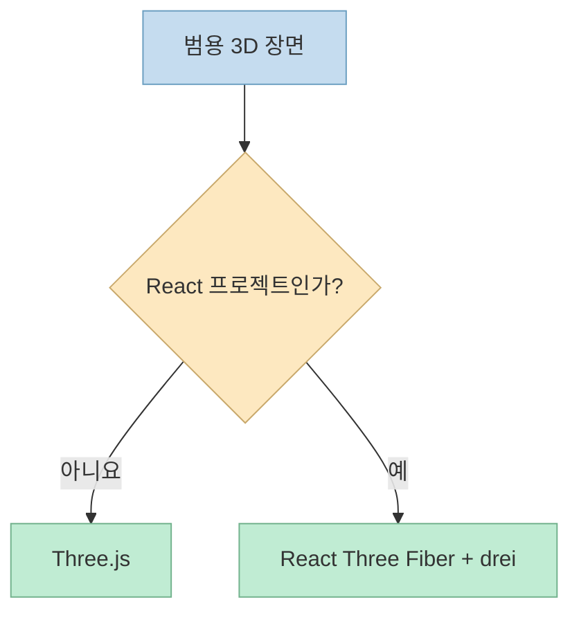
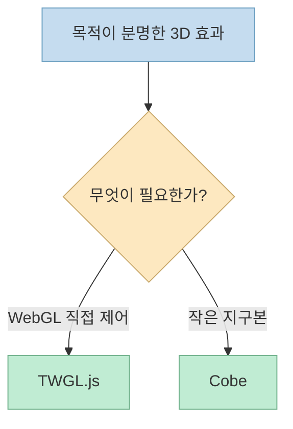
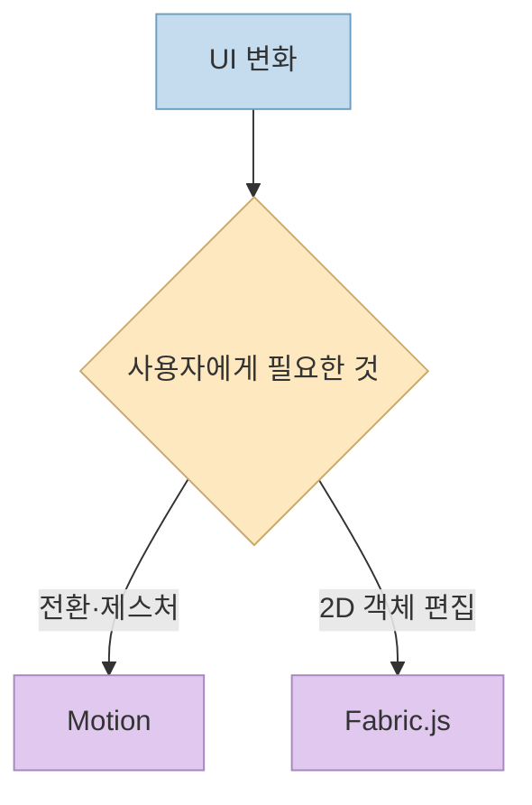
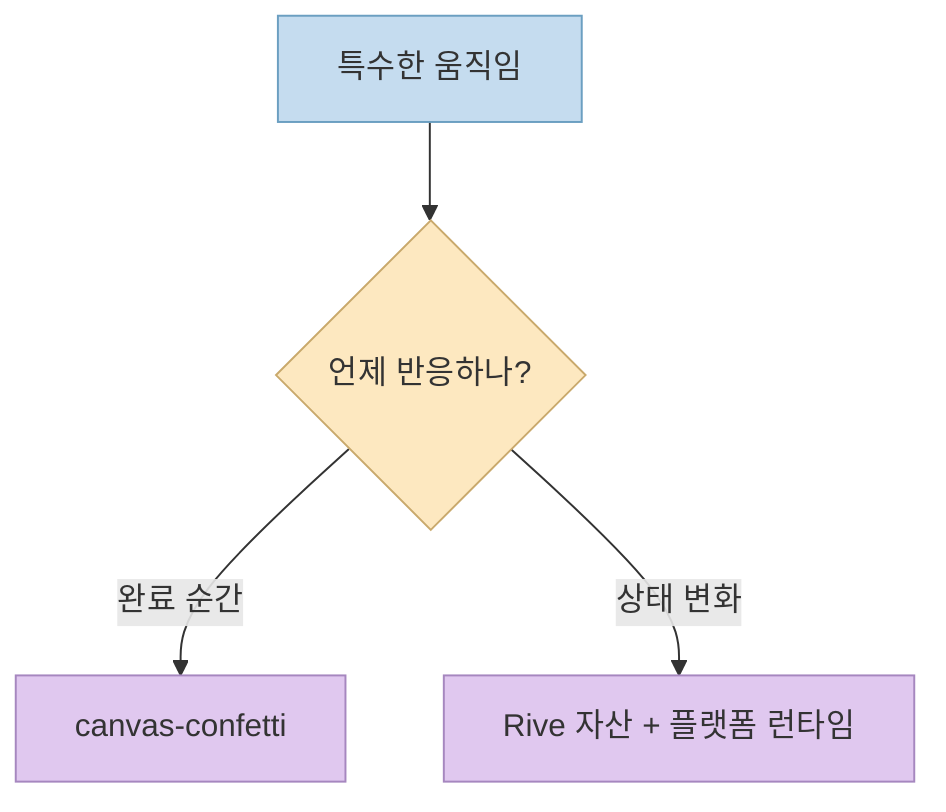
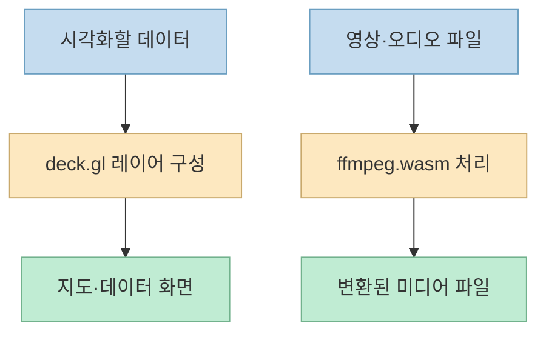
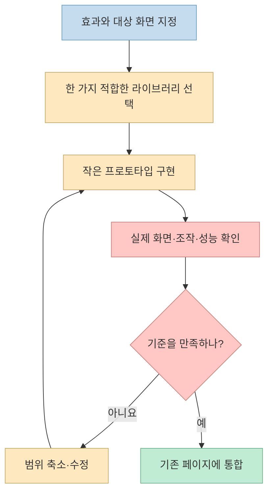

[한 Threads 게시물](https://www.threads.com/share/_gkxEDKaC/)은 Claude로 홈페이지에 3D 효과나 애니메이션을 넣을 때 참고할 오픈소스 10개를 소개한다. [이어지는 작성자 글](https://www.threads.com/@vibe.itji/post/DeZO0sBD-ck)에 전체 목록이 있다. 다만 **열 개가 모두 3D 라이브러리는 아니다.** 3D 장면을 그리는 도구, 화면 요소를 움직이는 도구, 데이터를 지도에 표시하는 도구, 완성된 영상을 변환하는 도구가 함께 묶였다. 따라서 별점 순서보다 **만들고 싶은 시각 효과가 어느 계층에 속하는지** 먼저 정해야 한다.

<!--more-->

원문에 적힌 GitHub 별 수는 게시 시점의 소개 수치이며 현재 품질·성능의 근거로 사용하지 않는다. 아래 기능 설명은 각 프로젝트의 공식 저장소와 비교했다.

## Sources

- [원문 Threads 공유 링크](https://www.threads.com/share/_gkxEDKaC/)
- [작성자의 10개 프로젝트 목록](https://www.threads.com/@vibe.itji/post/DeZO0sBD-ck)
- [1. Three.js](https://github.com/mrdoob/three.js)
- [2. Motion](https://github.com/motiondivision/motion)
- [3. Fabric.js](https://github.com/fabricjs/fabric.js)
- [4. ffmpeg.wasm](https://github.com/ffmpegwasm/ffmpeg.wasm)
- [5. deck.gl](https://github.com/visgl/deck.gl)
- [6. canvas-confetti](https://github.com/catdad/canvas-confetti)
- [7. drei](https://github.com/pmndrs/drei)
- [8. Cobe](https://github.com/shuding/cobe)
- [9. TWGL.js](https://github.com/greggman/twgl.js)
- [10. Rive Runtime](https://github.com/rive-app/rive-runtime)

## 먼저 계층을 고른다: 모두 설치하는 목록이 아니다

원문 순서를 용도별로 다시 묶으면 선택 기준이 분명해진다. **Three.js·drei·TWGL.js·Cobe**는 3D/WebGL 영역이지만 추상화 수준이 다르다. **Motion·Fabric.js·canvas-confetti·Rive Runtime**은 화면 전환, 2D 편집, 일회성 파티클, 반응형 벡터 애니메이션처럼 서로 다른 UI 문제를 푼다. **deck.gl**은 대규모 데이터 시각화, **ffmpeg.wasm**은 브라우저 안의 영상·오디오 처리다. 이 구분은 각 공식 README의 용도를 바탕으로 한 정리이며, 서로 배타적인 기술 목록은 아니다.

Threads 작성자도 열 개를 하나의 "Opus 전용 패키지"로 소개하지 않는다. 필요한 기능과 GitHub 주소를 코딩 에이전트에 함께 전달하라고 권한다. 이는 라이브러리 선택의 **출발점**이지, 여러 라이브러리를 한 번에 결합해도 충돌이나 성능 문제가 없다는 보증은 아니다. [작성자의 목록](https://www.threads.com/@vibe.itji/post/DeZO0sBD-ck)

## 3D 장면: Three.js, drei, TWGL.js, Cobe의 차이

**1. [Three.js](https://github.com/mrdoob/three.js)** 는 카메라·장면·기하 도형·재질·렌더러를 조합해 웹의 3D 장면을 만드는 범용 JavaScript 라이브러리다. 제품을 돌려 보는 히어로 섹션이나 사용자 조작에 반응하는 3D 오브젝트처럼 **장면 자체를 설계**해야 할 때 출발점이 된다. "라이브러리를 설치하면 멋진 장면이 완성된다"기보다 조명·카메라·모델·상호작용·성능을 직접 구성하는 기반이다. [공식 README의 장면 예제](https://github.com/mrdoob/three.js)

**7. [drei](https://github.com/pmndrs/drei)** 는 `@react-three/fiber`에서 쓰는 카메라·컨트롤·환경 등 재사용 컴포넌트와 추상화 모음이다. **Three.js의 대체 엔진이 아니다.** React 기반 3D 앱을 이미 만들고 있거나 React Three Fiber로 갈 계획일 때 유용하다. 반대로 순수 Three.js 프로젝트에 drei만 추가한다고 그대로 작동하는 구조는 아니다. [공식 README](https://github.com/pmndrs/drei)

**9. [TWGL.js](https://github.com/greggman/twgl.js)** 는 WebGL의 셰이더·버퍼·텍스처 등을 다룰 때 반복 코드를 줄여 주는 저수준 도우미다. 프로젝트 README도 **일반적인 3D 작업은 Three.js, 저수준 WebGL 작업은 TWGL** 이라고 구분한다. 특정 셰이더 효과를 직접 통제하려는 경우에 맞고, 장면 그래프와 카메라 체계를 통째로 제공하는 Three.js와 같은 층위로 비교하면 안 된다. [공식 README](https://github.com/greggman/twgl.js)

**8. [Cobe](https://github.com/shuding/cobe)** 는 웹페이지에 넣는 가벼운 WebGL 지구본이다. 지도상의 마커와 호를 표현하는 예제가 있으며, 프로젝트는 약 5KB·의존성 없음이라는 특징을 설명한다. **작은 지구본 UI** 가 목적이라면 범용 장면 엔진을 처음부터 구성하는 것보다 범위가 명확하다. 다만 이런 마커는 개발자가 제공한 위치 데이터로 그린 표현이지, Cobe가 실시간 지리 데이터를 자동 수집한다는 뜻은 아니다. [공식 README](https://github.com/shuding/cobe)

## UI와 2D 효과: Motion, Fabric.js, confetti, Rive

**2. [Motion](https://github.com/motiondivision/motion)** 은 React·JavaScript·Vue에서 화면 요소의 전환, 제스처, 스크롤 연동, 타임라인 같은 **UI 애니메이션**을 다룬다. 3D 렌더러가 아니라 버튼·카드·패널 등이 움직이는 방식을 설계하는 도구다. 홈 화면이 "밋밋하다"는 문제가 화면 요소의 상태 전환에 있다면 Three.js 장면을 새로 넣기 전에 Motion 같은 UI 애니메이션이 더 작은 해결책일 수 있다. [공식 README](https://github.com/motiondivision/motion)

**3. [Fabric.js](https://github.com/fabricjs/fabric.js)** 는 HTML Canvas 위에서 객체를 다루는 **2D 편집** 라이브러리다. 제품 썸네일 편집기, 이미지 위 텍스트·도형 배치처럼 사용자가 그래픽 요소를 선택하고 조작해야 할 때 맞는다. 원문은 "벡터 객체 조작"을 말하지만, 이를 3D 장면이나 비디오 렌더러로 이해하면 안 된다. [공식 README](https://github.com/fabricjs/fabric.js)

**6. [canvas-confetti](https://github.com/catdad/canvas-confetti)** 는 완료·성공 순간에 짧은 폭죽 효과를 보여 주는 목적형 라이브러리다. 복잡한 파티클 엔진 전체를 도입하기보다 **특정 피드백 한 가지**가 필요할 때 적합하다. 공식 문서에는 움직임 민감성을 고려한 `disableForReducedMotion` 옵션이 있지만 기본적으로 꺼져 있으므로, 실제 서비스에서는 사용자의 움직임 감소 설정을 존중하도록 켜는 편이 좋다. [공식 README의 Reduced Motion 안내](https://github.com/catdad/canvas-confetti)

**10. [Rive Runtime](https://github.com/rive-app/rive-runtime)** 은 `.riv` 파일의 아트보드와 상태 머신을 로드·실행·렌더링하는 **저수준 C++ 런타임**이다. 웹을 포함한 플랫폼별 Rive 런타임은 이를 감싼다. 따라서 Threads의 "반응형 애니메이션 실행 엔진"이라는 요약은 맞지만, 이 저장소가 곧 웹페이지용 편집기나 `npm install` 한 번으로 완성되는 애니메이션 자산은 아니다. 실제 사용에는 제작된 `.riv` 자산과 대상 플랫폼의 런타임을 구분해야 한다. [공식 README](https://github.com/rive-app/rive-runtime)

## 데이터와 영상: deck.gl과 ffmpeg.wasm은 3D 장식이 아니다

**5. [deck.gl](https://github.com/visgl/deck.gl)** 은 많은 데이터를 GPU 기반의 레이어로 시각화하는 프레임워크다. 지도·지리공간 데이터나 대규모 점·경로를 보여 주는 화면이 주된 용도다. "화려한 3D 효과"를 위한 일반 장식 라이브러리라기보다 **데이터가 무엇을 뜻하는지 정확하게 보여 주는 계층**에 가깝다. 원문이 말한 대규모 데이터 시각화는 공식 소개와 맞는다. [공식 README](https://github.com/visgl/deck.gl)

**4. [ffmpeg.wasm](https://github.com/ffmpegwasm/ffmpeg.wasm)** 은 FFmpeg를 WebAssembly·JavaScript로 브라우저에서 실행해 영상·오디오를 변환·처리한다. 예를 들어 업로드한 클립의 포맷을 바꾸는 **미디어 처리 단계**에 해당한다. 3D 장면을 실시간 렌더링하거나 페이지에 카메라 애니메이션을 추가하는 라이브러리는 아니다. 브라우저에서 처리한다고 해서 큰 파일의 속도·메모리 사용이 자동으로 유리하다는 뜻도 아니므로, 실제 입력 크기와 대상 기기에서 시험해야 한다. [공식 README](https://github.com/ffmpegwasm/ffmpeg.wasm)

## 코딩 에이전트에 요청할 때: 라이브러리보다 검증 조건을 먼저 쓴다

작성자의 [후속 게시물](https://www.threads.com/@vibe.itji/post/DeZO0sBD-ck)은 원하는 효과와 해당 저장소 주소를 함께 전달하라고 권한다. 이때 "홈페이지를 멋지게 해 줘"보다 **화면 위치, 입력·상태 변화, 성능·접근성 제한, 완료 판정**을 적어야 실제 결과를 검토할 수 있다. 아래는 목록의 성격을 반영한 **요청 예시**이며, 프로젝트가 제공하는 공식 프롬프트는 아니다.

> 첫 화면의 제품 이미지를 사용자가 드래그하면 좌우로 회전하게 해 주세요. 기존 React 구조를 유지하고 Three.js·React Three Fiber 경로를 검토해 주세요. 모바일에서는 터치 조작이 가능해야 하고, 움직임 감소 설정에서는 자동 회전을 끄세요. 구현 후 데스크톱·모바일 화면을 캡처하고 초기 로딩·프레임 저하를 보고해 주세요.

## 실전 적용 포인트

1. **"3D"가 정말 필요한지 묻는다.** 단순 패널 전환은 Motion, 편집 가능한 2D Canvas는 Fabric.js, 작은 지구본은 Cobe처럼 범위가 더 좁은 선택지가 있다.
2. **서로 다른 계층을 혼동하지 않는다.** drei는 React Three Fiber용 보조 도구, TWGL.js는 저수준 WebGL 도우미, ffmpeg.wasm은 미디어 처리다.
3. **한 효과씩 검증한다.** 화려함보다 모바일 입력, 작은 화면 레이아웃, 초기 로딩, 움직임 감소 설정, 실패 시 대체 화면을 먼저 확인한다.
4. **별점 대신 현재 문서를 본다.** 기능·버전·의존성·라이선스와 브라우저 지원 조건은 변할 수 있다.

## 핵심 요약

- **Three.js·drei·TWGL.js·Cobe**는 모두 WebGL과 관련이 있지만, 범용 장면·React 보조·저수준 API·지구본 위젯으로 역할이 다르다.
- **Motion·Fabric.js·canvas-confetti·Rive Runtime**은 3D 엔진 목록이 아니라 UI 전환, 2D 편집, 축하 효과, 상태 기반 벡터 실행에 가깝다.
- **deck.gl·ffmpeg.wasm**은 각각 데이터 시각화와 영상·오디오 처리다. 열 개를 모두 설치하는 대신 현재 화면의 문제 하나에 맞춰 골라야 한다.

## 결론

Threads 목록은 홈페이지를 더 생동감 있게 만들 때 참고할 **선택지 지도**로 유용하다. 그러나 좋은 결과는 도구의 개수보다, 무엇을 보여 줄지 정의하고 한 라이브러리로 작은 장면을 만든 뒤 **실제 화면·조작·성능을 검증하는 과정**에서 나온다.
