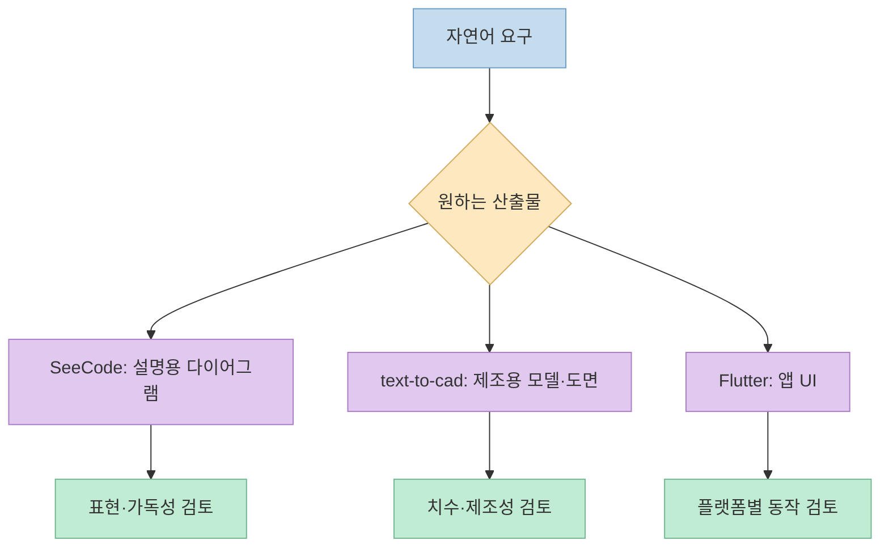
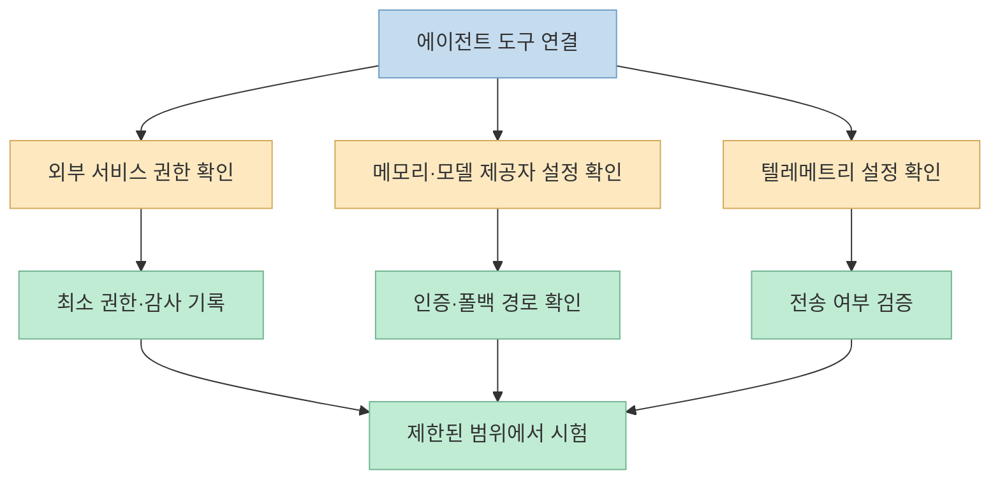
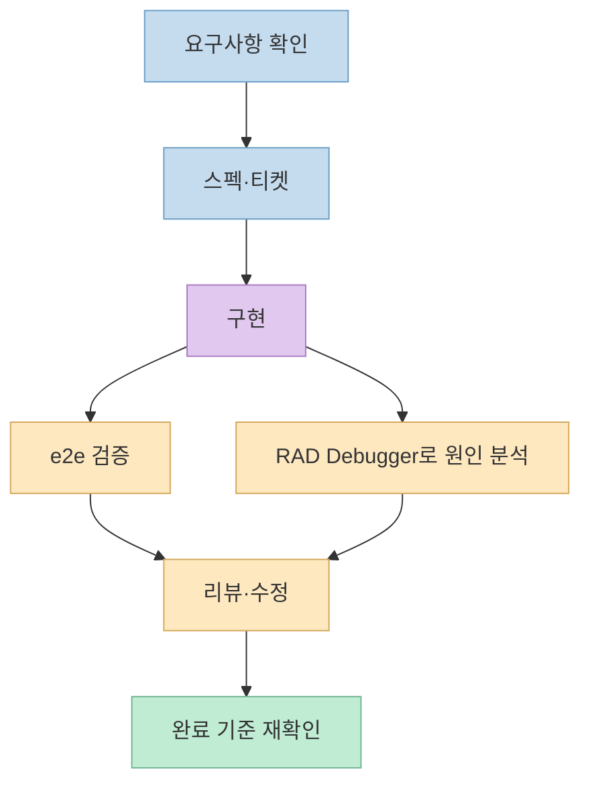
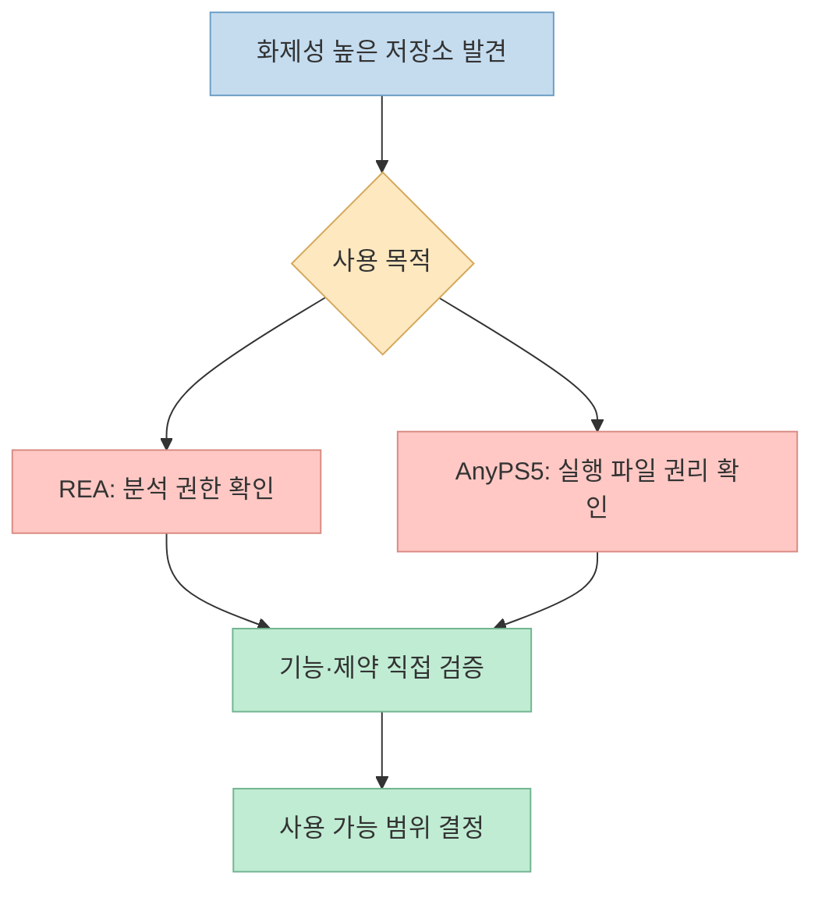

[Solostack의 10월 둘째 주 GitHub 트렌딩 영상](https://youtu.be/L6zh-2k1BQA?t=0)은 에이전트용 시각화·개발·테스트 도구와 PS5 실행 파일 이식 프로젝트까지 빠르게 훑는다. 순위보다 중요한 것은 **내 작업에 쓸 만한지, 설치 전에 무엇을 확인해야 하는지**다. 자동 자막에는 저장소 이름의 오인식이 있어, 아래 이름과 기능은 가능한 한 공식 저장소를 대조했다. 별 수와 주간 증가량은 계속 변하므로 현재 수치로 고정하지 않았다.

<!--more-->

## Sources

- [원본 Shorts: 이번 주 개발자가 놓치면 안 될 GitHub 트렌딩 Top 10](https://youtube.com/shorts/L6zh-2k1BQA?si=-pjst_HcVLg8Eeay)
- [SeeCode](https://github.com/Aryanutkarsh/SeeCode), [Flutter](https://github.com/flutter/flutter), [text-to-cad](https://github.com/earthtojake/text-to-cad)
- [Cursor plugins](https://github.com/cursor/plugins), [claude-mem](https://github.com/thedotmack/claude-mem), [HyperFrames](https://github.com/heygen-com/hyperframes)
- [RAD Debugger](https://github.com/EpicGames/raddebugger), [e2e](https://github.com/tester-army/e2e), [Matt Pocock의 skills](https://github.com/mattpocock/skills)
- [순위 밖 REA](https://github.com/morluto/rea), [AnyPS5](https://github.com/boykopovar/AnyPS5)

## 10위부터 8위: 만들기와 시각화

**10위 [SeeCode](https://github.com/Aryanutkarsh/SeeCode)**는 에이전트의 설명을 탐색·애니메이션 가능한 다이어그램으로 바꾸는 스킬이다. 공식 README는 한 HTML 파일로 결과를 만들고 SVG·PNG·GIF·MP4로 내보낼 수 있으며, 45개 다이어그램 유형을 제공한다고 설명한다. 영상에서도 말로 구성도를 만들고 유형이 늘었다고 소개한다. [영상 0:12~0:21](https://youtu.be/L6zh-2k1BQA?t=12) 단순한 구조도보다 경로를 따라가며 설명해야 하는 시스템 문서에 적합한지 살펴볼 만하다.

**9위 [Flutter](https://github.com/flutter/flutter)**는 하나의 코드베이스로 여러 플랫폼의 앱을 만드는 UI 프레임워크다. 영상은 iPhone·Android·웹을 언급하고 iPhone 접근성 문제 수정도 소개한다. [영상 0:21~0:31](https://youtu.be/L6zh-2k1BQA?t=21) 다만 특정 핫픽스의 영향 여부는 내 프로젝트가 쓰는 버전과 해당 릴리스 노트에서 확인해야 한다.

**8위 [text-to-cad](https://github.com/earthtojake/text-to-cad)**는 자연어 지시를 CAD 작업으로 연결하고 STEP·GLB·STL·3MF 결과와 도면·제조 적합성 검사 등을 지원한다. [영상 0:33~0:43](https://youtu.be/L6zh-2k1BQA?t=33) [공식 README](https://github.com/earthtojake/text-to-cad/blob/main/README.md)에 따르면 사용 통계와 충돌 보고 전송이 기본으로 켜져 있으며 `uvx cadgen telemetry off`로 끌 수 있다. 사내 설계 자료에 적용하기 전에는 생성물의 치수·공차뿐 아니라 전송 설정부터 확인해야 한다.

## 7위부터 5위: 에이전트의 권한·기억·영상 제작

**7위 [Cursor plugins](https://github.com/cursor/plugins)**는 외부 서비스와 연결되는 플러그인 모음이다. 영상은 Workday·Salesforce·Square 연동을 예로 들며 인사·결제 정보에 닿는 만큼 권한을 좁히라고 권한다. [영상 0:45~0:53](https://youtu.be/L6zh-2k1BQA?t=45) [공식 플러그인 목록](https://github.com/cursor/plugins/blob/main/README.md)에도 이 연동이 있다. 설치 여부보다 연결 계정의 읽기·쓰기 범위, 승인 절차, 감사 기록을 먼저 정하는 편이 실무적으로 중요하다.

**6위 [claude-mem](https://github.com/thedotmack/claude-mem)**은 작업 관찰을 요약·저장해 다음 에이전트 세션에 다시 제공하는 기억 플러그인이다. [영상 0:54~1:09](https://youtu.be/L6zh-2k1BQA?t=54)은 모델 제공자 장애 시 개인 Claude 사용량으로 넘어갈 수 있다고 경고한다. 단, [현재 공식 설정 문서](https://github.com/thedotmack/claude-mem/blob/main/docs/public/configuration.mdx)는 *quota fallback*이 기본적으로 꺼져 있다고 명시한다. 자동 자막이나 영상의 일반화된 설명을 그대로 설정값으로 받아들이지 말고, 실제 `CLAUDE_MEM_PROVIDER`, 인증 방식, `CLAUDE_MEM_QUOTA_FALLBACK_PROVIDER`를 확인해야 한다.

**5위 [HyperFrames](https://github.com/heygen-com/hyperframes)**는 HTML 기반 구성을 영상으로 렌더링하는 프로젝트다. 영상은 자막 추출과 텔레메트리 비활성화 관련 수정 사항을 소개한다. [영상 1:08~1:21](https://youtu.be/L6zh-2k1BQA?t=68) 릴리스별 동작은 [공식 업데이트 기록](https://github.com/heygen-com/hyperframes/blob/main/docs/weekly-updates.mdx)을 기준으로 확인하고, 비활성화 설정이 실제 네트워크 전송에도 적용되는지 테스트하는 것이 안전하다.

## 4위부터 2위: 디버깅·검증·개발 프로세스

**4위 [RAD Debugger](https://github.com/EpicGames/raddebugger)**는 여러 프로세스를 다룰 수 있는 그래픽 디버거다. 영상이 말한 대로 [공식 README](https://github.com/EpicGames/raddebugger/blob/master/README.md)는 아직 알파 단계라고 밝힌다. 현재 문서상 지원 범위는 로컬 Windows x64와 PDB 중심이므로, Linux나 다른 디버그 포맷을 당장 쓸 수 있다고 가정하면 안 된다. [영상 1:21~1:31](https://youtu.be/L6zh-2k1BQA?t=81)

**3위 [e2e](https://github.com/tester-army/e2e)**는 자연어로 테스트 목표를 정의하고 에이전트가 앱을 탐색해 검증하도록 하는 도구다. 영상은 기준 이미지와 화면을 비교하는 테스트가 추가됐다고 소개한다. [영상 1:30~1:44](https://youtu.be/L6zh-2k1BQA?t=90) 다만 자동 자막의 수치에는 오인식 가능성이 있어, 여기서는 도구의 목적만 취하고 다운로드 증가량은 반복하지 않는다. 실제 도입 시에는 에이전트가 찾은 경로와 재현 가능한 단언을 분리해 테스트가 흔들리지 않는지 봐야 한다.

**2위 [Matt Pocock의 skills](https://github.com/mattpocock/skills)**는 코딩 에이전트의 요구사항 인터뷰, 스펙, 티켓, 구현, 테스트, 리뷰를 작은 스킬로 나눠 연결한다. 영상은 요구사항을 끝까지 되묻는 흐름을 강조한다. [영상 1:44~1:58](https://youtu.be/L6zh-2k1BQA?t=104) [공식 `implement-spec` 스킬](https://github.com/mattpocock/skills/blob/main/skills/engineering/implement-spec/SKILL.md)처럼 결과가 스펙과 티켓에 연결되면 리뷰 대상이 명확해지지만, 스펙 자체가 잘못되면 그에 맞춰 검증도 잘못될 수 있으므로 외부 기준과 사람의 검토가 필요하다.

## 순위 밖 REA와 1위 AnyPS5: 관심도와 사용 가능성은 다르다

영상은 순위 밖에서 급격히 주목받은 [REA](https://github.com/morluto/rea)를 소스 없이도 프로그램 동작과 바이너리를 에이전트가 분석하도록 돕는 역공학 도구로 소개한다. [영상 1:58~2:18](https://youtu.be/L6zh-2k1BQA?t=118) 별 수와 Hacker News 점수는 시점에 민감하고 다른 화면과 일치하지 않을 수 있어 여기서는 확정 수치로 옮기지 않는다. 저장소도 소유하거나 분석 권한이 있는 소프트웨어의 연구·상호운용성 등 허용된 용도를 명시한다.

**1위 [AnyPS5](https://github.com/boykopovar/AnyPS5)**는 PS5 실행 파일을 Linux·Windows용으로 이식하려는 프로젝트다. 영상은 에뮬레이터를 쓰는 방식과 구별하고, 게임 파일 취득과 복제 방지 우회 문제에 주의를 준다. [영상 2:18~2:41](https://youtu.be/L6zh-2k1BQA?t=138) [공식 README](https://github.com/boykopovar/AnyPS5)는 저작권이 있는 게임·펌웨어·키를 배포하지 않으며 사용자가 적법한 취득·이용을 확인해야 한다고 밝힌다. 저장소의 시연이 곧 모든 게임의 호환성이나 사용 적법성을 보장하는 것은 아니다.

## 실전 적용 포인트

1. **설치 전 README와 최근 릴리스부터 읽는다.** 영상의 순위·별 수·기능은 촬영 시점 정보다.
2. **연동 도구는 최소 권한으로 시험한다.** Cursor plugins 같은 외부 서비스 연결은 별도 계정과 제한된 데이터로 시작한다.
3. **데이터 전송 경로를 확인한다.** text-to-cad의 텔레메트리, claude-mem의 모델 제공자·폴백, HyperFrames의 전송 설정은 서로 다른 문제다.
4. **데모와 검증을 구별한다.** SeeCode 다이어그램은 내용 정확성을, CAD 결과는 제조 가능성을, e2e 테스트는 재현성과 단언을 별도로 확인해야 한다.
5. **권리 문제는 기능과 따로 판단한다.** REA의 분석 대상과 AnyPS5의 실행 파일은 권한·이용 조건을 먼저 확인한다.

## 핵심 요약

- 이번 목록에는 에이전트의 **표현·기억·실행·검증**을 돕는 도구가 두드러진다.
- 자동 자막에서 이름이 흐릿한 항목은 공식 저장소로 식별했고, 변동하는 인기 수치는 확정하지 않았다.
- 도입 판단은 별 수보다 **권한, 전송 설정, 지원 범위, 결과 검증**에 달려 있다.

## 결론

GitHub 트렌딩은 새 도구를 발견하는 출발점이지 도입 승인서가 아니다. 이 영상에서 하나만 선택해 시험한다면, 먼저 내 문제에 맞는 산출물을 정하고 공식 문서의 지원 범위와 데이터·권한 경계를 확인한 뒤 작은 사례에서 검증하는 편이 좋다.
