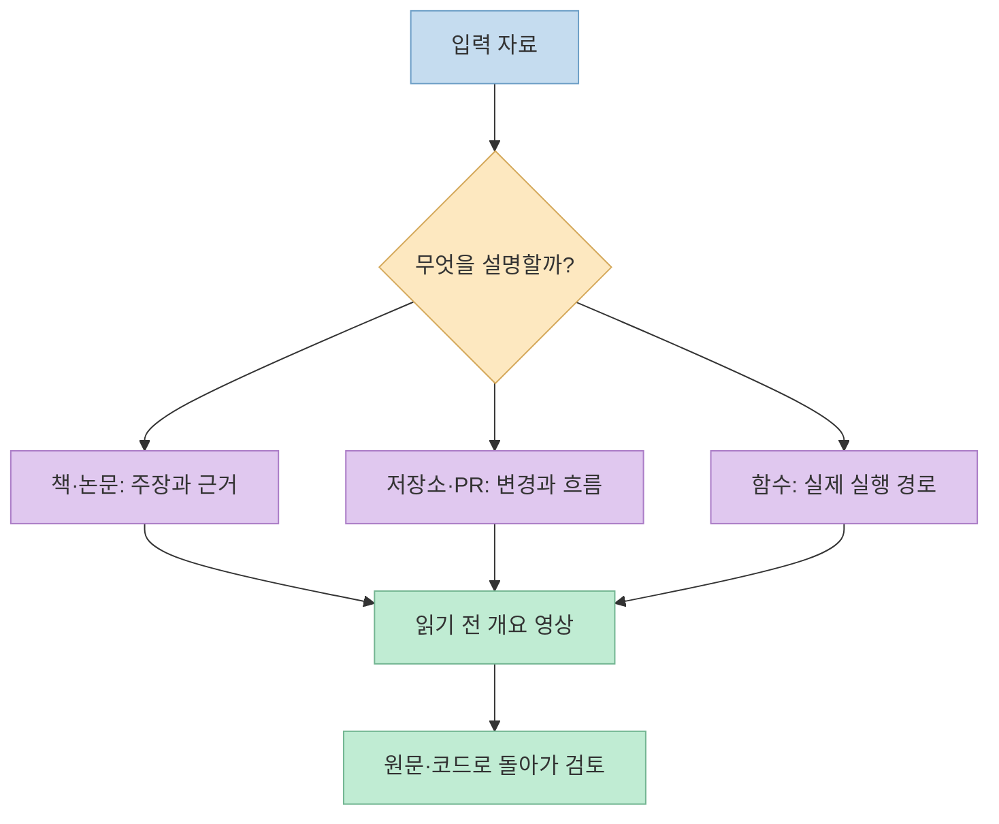
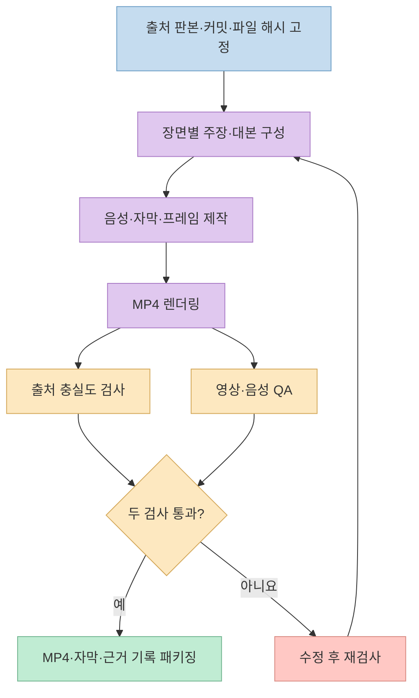
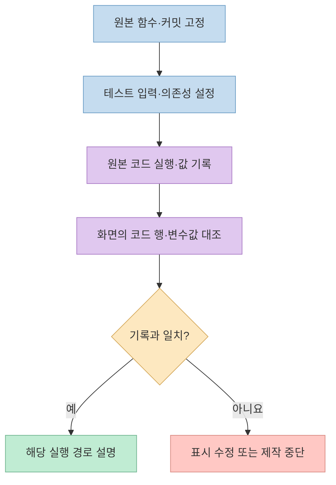

코드 변경이나 논문을 읽기 전에 **짧은 설명 영상으로 큰 그림을 먼저 잡는 방법** 이 있다. [민둥이의 Shorts](https://youtu.be/gOGxpoAUcBw?t=0)는 코드·책·논문을 내레이션이 포함된 영상으로 바꾸는 에이전트 스킬을 소개한다. 영상에서 언급한 도구는 [source-to-explainer-video](https://github.com/denim-claw/source-to-explainer-video)다. 다만 이 영상은 원문이나 코드 리뷰를 *대신*하기보다, 읽을 대상을 파악하는 입구로 써야 한다.

<!--more-->

## Sources

- [원본 Shorts: 코드·책·논문을 설명 영상으로 만드는 AI 스킬](https://youtube.com/shorts/gOGxpoAUcBw?si=DUUEOiUY4v1b2UH8)
- [source-to-explainer-video 공식 저장소와 README](https://github.com/denim-claw/source-to-explainer-video)
- [스킬 실행 지침](https://github.com/denim-claw/source-to-explainer-video/blob/master/SKILL.md)
- [코드 실행 추적 지침](https://github.com/denim-claw/source-to-explainer-video/blob/master/references/code-trace.md)
- [출처 충실도 검사 지침](https://github.com/denim-claw/source-to-explainer-video/blob/master/references/source-fidelity.md)
- [영상 품질 검사 지침](https://github.com/denim-claw/source-to-explainer-video/blob/master/references/video-qa.md)

## 왜 먼저 영상으로 보는가

영상 속 개발자는 AI가 만드는 PR의 속도를 사람이 읽고 리뷰하는 속도가 따라가지 못해, 정독 전에 큰 그림을 잡으려고 이 스킬을 만들었다고 설명한다. 학생에게는 어려운 논문이나 교재의 한 단원을 읽기 전에 개요를 보는 용도로 제안한다. [영상 0:06~0:19](https://youtu.be/gOGxpoAUcBw?t=6)

공식 README의 예시는 책의 한 절, 저장소의 요청 흐름, 함수의 실제 실행 사례다. 결과물은 내레이션과 자막이 포함된 MP4뿐 아니라 출처 충실도 기록과 재빌드 가능한 소스 패키지까지 포함한다. 따라서 "무엇을 입력하느냐"에 따라 영상을 설계하는 근거도 달라진다.

여기서 "3분 영상"은 고정된 길이가 아니다. README에 공개된 예시의 길이는 약 2분 45초부터 3분 56초까지다. [영상의 "3분 안팎" 설명](https://youtu.be/gOGxpoAUcBw?t=0)은 사용 목적을 보여 주는 표현으로 이해하는 편이 정확하다.

## 영상을 만드는 과정: 생성과 검증을 분리한다

스킬은 먼저 출처의 판본·범위 또는 저장소 커밋·파일 해시를 고정한다. 그다음 장면마다 하나의 핵심 주장과 시각 자료를 짝지어 대본을 만들고, 음성 길이에 맞춰 자막과 프레임을 생성한다. README는 Gemini TTS, Pillow, FFmpeg를 사용하는 제작 경로를 설명한다. 마지막에는 **설명이 출처와 맞는지** 와 **인코딩된 MP4가 정상인지** 를 별도로 검사한다. 영상도 변경 설명을 만들 때 원본 커밋과 파일 해시를 고정하고, 설명과 파일을 따로 검사한다고 강조한다. [영상 0:22~0:31](https://youtu.be/gOGxpoAUcBw?t=22)

두 검사는 서로 다른 실패를 잡는다. [출처 충실도 검사](https://github.com/denim-claw/source-to-explainer-video/blob/master/references/source-fidelity.md)는 장면의 주장·인용·표시 값이 고정한 자료에서 나왔는지 확인한다. [영상 QA](https://github.com/denim-claw/source-to-explainer-video/blob/master/references/video-qa.md)는 프레임·자막 겹침·음성·파일 디코딩처럼 완성된 매체의 문제를 확인한다. **잘 재생되는 영상이 사실에 충실하다는 뜻은 아니고, 사실에 충실한 대본이 보기 좋은 영상이라는 뜻도 아니다.**

## 함수의 변수값은 언제 "실제 값"인가

Shorts에서 가장 강한 주장은 함수를 설명할 때 AI가 변수값을 짐작하지 않고 코드를 실행하며 찍은 값을 보여 준다는 것이다. 지어낸 값은 검사에서 걸려 영상이 만들어지지 않는다고도 말한다. [영상 0:34~0:43](https://youtu.be/gOGxpoAUcBw?t=34) 이 표현은 [공식 코드 추적 지침](https://github.com/denim-claw/source-to-explainer-video/blob/master/references/code-trace.md)의 **디버거 기반 설명 모드**를 기준으로 읽어야 한다.

이 모드에서는 원본 구현을 고정한 뒤, 테스트용 입력과 고정된 시간·외부 의존성을 사용해 실제 코드를 실행한다. 실행 중 기록된 인자·지역 변수·결과만 화면에 표시하고, 화면의 코드 행은 원본과, 값은 추적 기록과 대조한다. 반대로 **소스 코드만 읽어 설명하는 모드**라면 값은 실제 추적값이라고 주장해서는 안 된다. 알고리즘을 새로 써서 실행한 결과도 원본 코드의 실행 증거가 아니다.

이 검사는 **기록한 한 실행 경로의 표시값** 에 대한 근거다. 실행하지 않은 분기, 실제 서비스의 외부 연동, 코드 전체의 정확성까지 입증하지는 않는다. 검증된 설명 영상이어도 PR 리뷰와 테스트는 별도로 해야 한다.

## 설치 전 확인할 것

공식 README는 Claude Code용 `~/.claude/skills/source-to-explainer-video`와 Codex 등 에이전트용 `~/.agents/skills/source-to-explainer-video` 설치 경로를 안내한다. 영상도 GitHub 주소를 에이전트에 주고 설치를 요청하는 방식을 소개한다. [영상 0:43~0:47](https://youtu.be/gOGxpoAUcBw?t=43) 그러나 **제3자 스킬의 스크립트와 권한을 확인한 뒤** 설치하는 편이 안전하다.

실행 환경에는 Python 3.11 이상과 FFmpeg·ffprobe 등이 필요하며, 실제 내레이션을 생성하려면 `GEMINI_API_KEY`가 필요하다. 음성 대본 대조에 쓰는 `whisper-cli`는 선택 사항이다. [영상의 API 키 언급](https://youtu.be/gOGxpoAUcBw?t=47)과 [공식 README의 설치 조건](https://github.com/denim-claw/source-to-explainer-video)을 함께 확인하자. 비공개 코드·논문을 외부 음성 API에 보낼 수 있는지, 책 내용을 만든 영상을 공개해도 되는지는 별도의 데이터 취급·이용권 검토가 필요하다.

## 실전 적용 포인트

1. **질문을 좁힌다.** "이 저장소 설명해 줘"보다 "이 PR이 요청 흐름을 어떻게 바꾸는지 보여 줘"처럼 대상과 범위를 정한다.
2. **출처를 고정한다.** 책은 판본과 절, 코드는 커밋과 경로, 함수 설명은 테스트 입력까지 남긴다.
3. **영상의 주장마다 근거를 찾는다.** 특히 실제 변수값을 말한다면 원본 구현을 실행한 추적 기록인지 확인한다.
4. **영상 뒤에 원문으로 돌아간다.** 개요로 관심 지점을 찾고, 중요한 결론은 코드·논문·책의 해당 부분에서 다시 검토한다.

## 핵심 요약

- `source-to-explainer-video`는 책·논문·코드의 핵심을 내레이션 영상으로 정리하는 제3자 에이전트 스킬이다.
- 출처 고정과 **사실 검증**, 완성 파일의 **매체 QA**는 서로 다른 검사다.
- 실제 변수값 주장은 원본 코드의 해당 실행 경로를 추적했을 때만 성립한다.
- "3분"은 목표에 가까운 표현이며, 영상은 정독·코드 리뷰·테스트의 대체물이 아니다.

## 결론

이 스킬의 강점은 긴 자료를 곧바로 읽기 전에 "어디부터 봐야 하는가"를 빠르게 보여 주는 데 있다. 신뢰할 만한 활용법은 영상을 최종 답으로 받아들이는 것이 아니라, **고정한 출처 → 근거 있는 장면 → 독립적인 검증 → 원문 재확인**의 루프로 사용하는 것이다.
