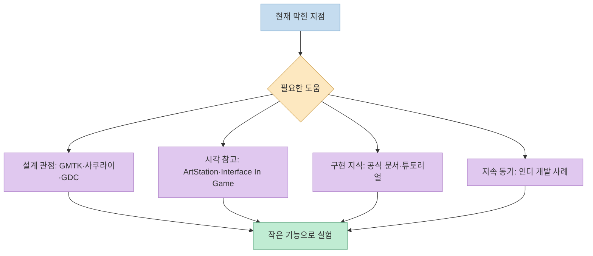
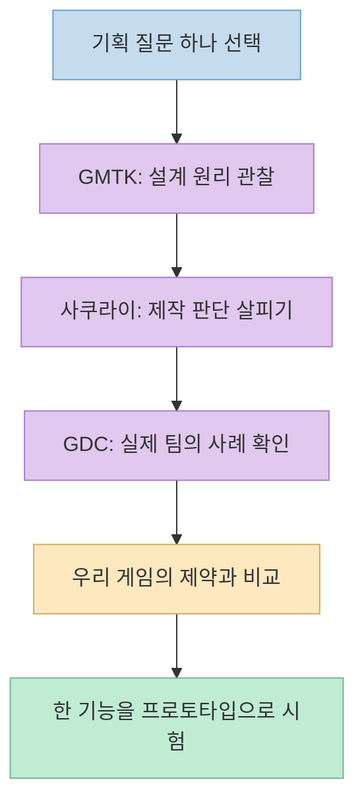
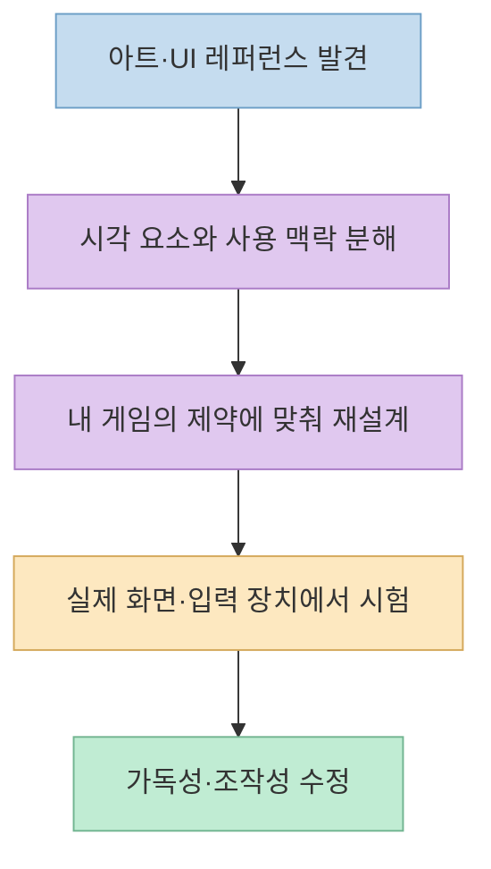
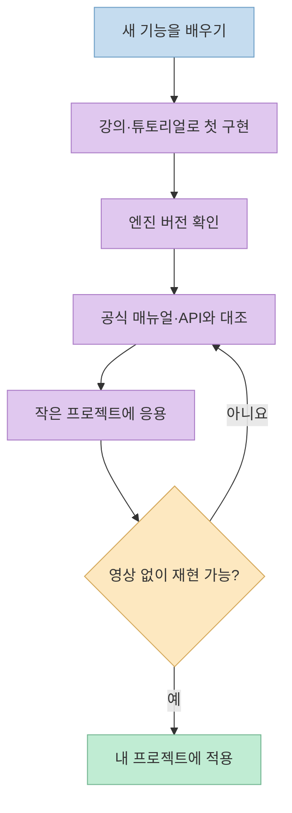

게임을 만들 때 필요한 자료는 부족하지 않다. 오히려 **강의, 작품 레퍼런스, 공식 문서, 영감의 출처가 뒤섞여** 어디부터 봐야 할지 막히기 쉽다. [이 영상](https://youtu.be/uLaC-pDacwE?t=0)의 발표자는 회사와 1인 개발에서 도움이 됐던 사이트·채널을 분야별로 소개한다. 이 글은 나열된 링크를 "무엇을 배울 때 쓸 것인가"라는 작업 흐름으로 다시 묶는다.

<!--more-->

## Sources

- [원본 YouTube 영상](https://youtu.be/uLaC-pDacwE?si=NlBLGs75VFbycHdF)
- [Game Maker's Toolkit](https://gamemakerstoolkit.com/), [Masahiro Sakurai on Creating Games](https://www.youtube.com/@sora_sakurai_en), [GDC Vault](https://gdcvault.com/)
- [ArtStation](https://www.artstation.com/), [Interface In Game](https://interfaceingame.com/)
- [Udemy](https://www.udemy.com/), [Unity Documentation](https://docs.unity.com/en-us), [Unity Learn](https://learn.unity.com/), [Brackeys](https://www.youtube.com/@Brackeys), [Thomas Brush](https://www.thomasbrush.com/)

## 먼저 자료의 역할을 구분한다

발표자는 처음부터 **가르쳐 주는 자료**, **레퍼런스·리소스를 모아 둔 곳**, **개발 의욕을 주는 사례**를 구분해 소개한다. [영상 0:13~0:38](https://youtu.be/uLaC-pDacwE?t=13) 같은 "유용한 사이트"여도 얻을 수 있는 결과가 다르다. 게임 기획 영상을 보고 바로 동작하는 코드를 얻을 수는 없고, 예쁜 UI 스크린샷을 봤다고 사용성 검증이 끝나는 것도 아니다.

## 게임 기획: 원리를 배우고 내 게임의 질문으로 바꾸기

첫 추천인 **Game Maker's Toolkit(GMTK)**은 Mark Brown이 게임 설계·개발·제작을 분석하는 채널이다. 발표자는 게임을 플레이하는 즐거움과 별개로, 어떤 설계가 그 경험을 만들었는지 보는 자료로 추천한다. [영상 0:38~1:06](https://youtu.be/uLaC-pDacwE?t=38) [공식 사이트](https://gamemakerstoolkit.com/)도 게임 디자인을 탐구하는 채널로 소개한다. 영상을 볼 때는 "좋은 게임이었다"에서 멈추지 않고, **플레이어가 어떤 정보를 받고 어떤 선택을 하게 되는지**를 기록하면 내 기획에 옮기기 쉽다.

**Masahiro Sakurai on Creating Games**는 사쿠라이 마사히로가 제작 경험을 여러 주제로 풀어낸 채널이다. 영상은 커비·스매시브라더스 제작자의 경험을 기획부터 아트·사운드·사업까지 폭넓게 볼 수 있다는 점을 강조한다. [영상 1:06~1:17](https://youtu.be/uLaC-pDacwE?t=66) 여기서 얻을 것은 특정 장르의 정답보다 **결정의 이유와 제작상의 절충**이다. [채널 소개 영상](https://www.youtube.com/watch?v=7M-DnOIeasA) 역시 게임 제작에 관한 여러 주제를 다루겠다고 설명한다.

**GDC 발표와 [GDC Vault](https://gdcvault.com/)**는 완성된 게임의 제작자가 직접 문제와 해결 과정을 설명하는 1차 사례에 가깝다. 발표자는 AAA와 인디 게임의 개발 강연을 함께 볼 수 있다고 추천한다. [영상 1:57~2:43](https://youtu.be/uLaC-pDacwE?t=117) 다만 한 팀의 성공 사례를 내 팀의 규칙으로 복사하지 말고, **그 팀의 규모·장르·제약**을 먼저 적어야 한다. GDC Vault는 공식 강연 아카이브이며, 공개 범위는 발표마다 확인해야 한다.

## 아트와 UI: 참고 자료는 곧 사용 가능한 에셋이 아니다

발표자는 콘셉트 아트, 모델링, 애니메이션, 이펙트 작업을 살펴보는 곳으로 **[ArtStation](https://www.artstation.com/)**을 추천한다. [영상 2:43~3:11](https://youtu.be/uLaC-pDacwE?t=163) 작품을 볼 때는 단순히 "이 스타일이 좋다"보다 **실루엣·색 대비·재질·화면의 시선 흐름**처럼 적용 가능한 요소를 메모하는 편이 유용하다. 공개된 포트폴리오를 볼 수 있다는 사실이 이미지나 모델을 내 게임에 사용할 권리를 뜻하지는 않는다.

**[Interface In Game](https://interfaceingame.com/)**은 여러 게임의 UI 스크린샷을 찾아보는 레퍼런스 자료다. 영상은 모바일부터 콘솔까지 화면을 살펴보거나 특정 게임의 UI를 찾는 용도로 소개한다. [영상 3:11~3:38](https://youtu.be/uLaC-pDacwE?t=191) 한 장면을 참고할 때도 스크린샷의 겉모양뿐 아니라 **화면의 목적, 정보 위계, 입력 장치, 플레이 중 가독성**을 따로 분석해야 한다. UI 이미지는 재사용 에셋이 아니며, 좋은 스크린샷 한 장이 실제 조작성을 증명하지도 않는다.

## 구현 학습: 강의로 시작해 공식 문서로 확인하기

프로그래밍 학습 플랫폼으로 발표자는 **Udemy**를 사용했다고 말한다. 강의 품질이나 가격에 대한 평가는 발표자의 경험이며 강사·할인 시점에 따라 달라진다. [영상 3:37~4:28](https://youtu.be/uLaC-pDacwE?t=217) 강의는 처음 접하는 개념의 진입로로 쓰고, 이후에는 프로젝트가 실제 사용하는 엔진 버전의 문서와 대조하는 편이 안전하다.

발표자가 가장 자주 도움을 받는 자료로 꼽은 것은 **Unity 매뉴얼**이고, 초보자에게는 **Unity Learn**을 추천한다. [영상 4:28~5:11](https://youtu.be/uLaC-pDacwE?t=268) [Unity Documentation](https://docs.unity.com/en-us)은 사용자 매뉴얼과 API 참조를 제공하고, [Unity Learn](https://learn.unity.com/)은 따라 만들며 익히는 공식 학습 자료다. **튜토리얼에서 동작한 코드와 현재 프로젝트의 엔진 버전이 다를 수 있으므로**, 문제 해결은 해당 버전의 문서·API 설명을 우선해야 한다. 발표자도 Unity나 Unreal 같은 엔진에서는 공식 학습 자료를 정확한 기준으로 본다고 설명한다. [영상 5:00~5:11](https://youtu.be/uLaC-pDacwE?t=300)

**[Brackeys](https://www.youtube.com/@Brackeys)**는 Unity·C# 등의 튜토리얼을 찾을 때 즐겨 본 채널로 언급된다. [영상 5:11~5:45](https://youtu.be/uLaC-pDacwE?t=311) 현재 [채널 소개](https://www.youtube.com/@Brackeys)에는 Godot 자료도 포함된다. 오래된 영상을 따라 할 때는 **영상의 엔진 버전, 사용 패키지, 현재 API**를 확인하고, 한 편을 본 뒤에는 같은 기능을 영상 없이 다시 구현해야 학습이 남는다.

## 자료를 계속 찾기보다 한 걸음 만들기

마지막에 발표자는 무료 리소스와 인디 게임 관련 자료도 많다며, 인디 개발 이야기를 하는 **[Thomas Brush](https://www.thomasbrush.com/)**를 예로 든다. [영상 5:46~6:29](https://youtu.be/uLaC-pDacwE?t=346) 같은 구간에 언급된 인디 게임 리뷰 블로그의 이름은 자동 자막만으로 정확히 식별할 수 없어 링크를 임의로 붙이지 않았다. 자료 목록을 더 늘리는 것보다 자신의 관심 장르에서 하나를 골라 **무엇을 배우고 무엇을 만들었는지** 남기는 일이 중요하다.

영상의 결론도 정보의 양보다 활용을 강조한다. 완벽한 첫걸음을 기다리지 말고 자기 속도로 시작하자는 메시지다. [영상 6:30~7:21](https://youtu.be/uLaC-pDacwE?t=390) 이를 실천하려면 자료 하나를 본 뒤 "오늘 바꿔 볼 기능 하나"를 정해 끝내는 식의 작은 루프가 좋다.

## 실전 적용 포인트

1. **오늘의 문제를 한 문장으로 적는다.** 예: "상점 UI에서 구매 가능한 아이템을 더 빨리 찾게 하고 싶다."
2. **용도에 맞는 자료 하나만 고른다.** 설계 이유는 GMTK·GDC, UI 사례는 Interface In Game, 구현법은 엔진 공식 문서에서 찾는다.
3. **참고와 재사용을 구별한다.** ArtStation 작품과 게임 UI 캡처는 영감·분석용이지 자유 사용 에셋이 아니다.
4. **버전을 맞춘다.** 강의 코드와 현재 엔진 문서가 다르면 현재 프로젝트 버전의 공식 설명을 확인한다.
5. **작은 결과로 닫는다.** 30분 안에 바꿀 수 있는 프로토타입·화면·메모로 배운 내용을 남긴다.

## 핵심 요약

- GMTK·사쿠라이·GDC는 **게임 제작의 판단과 사례**를 공부할 때 유용하다.
- ArtStation·Interface In Game은 **시각적 참고 자료**이며 사용 가능한 에셋 저장소와 다르다.
- Udemy·Brackeys 같은 튜토리얼로 시작하더라도 Unity 공식 문서·Learn과 **엔진 버전**을 대조해야 한다.
- 자료를 끝없이 모으는 것보다 작은 기능을 직접 만들어 검증하는 편이 학습을 이어 준다.

## 결론

좋은 자료 목록은 즐겨찾기 수를 늘리는 데서 끝나지 않는다. **질문 선택 → 맞는 자료 확인 → 작은 구현 → 결과 검토**로 연결될 때 비로소 게임 개발에 도움이 된다. 영상의 추천 사이트도 그 순서에 맞춰 하나씩 쓰는 편이 효과적이다.
