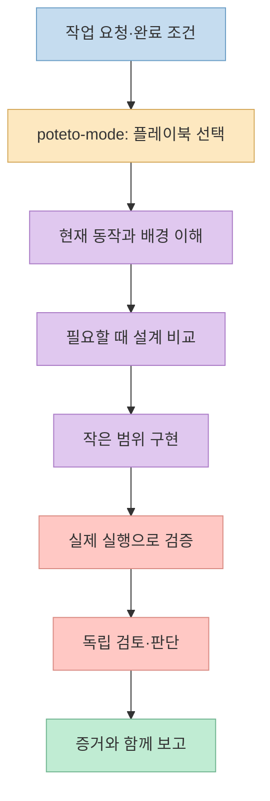
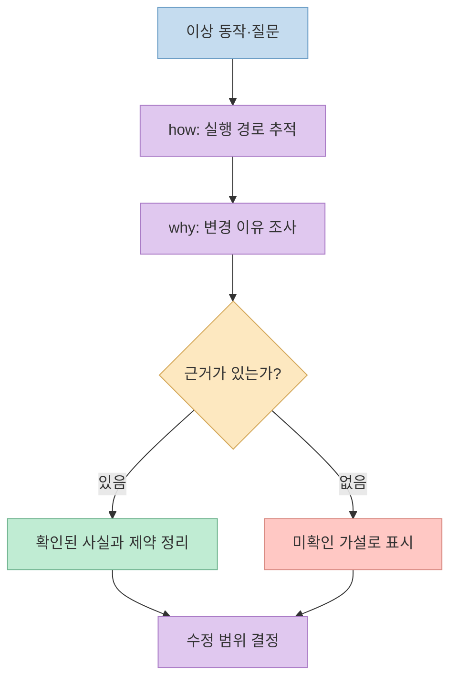
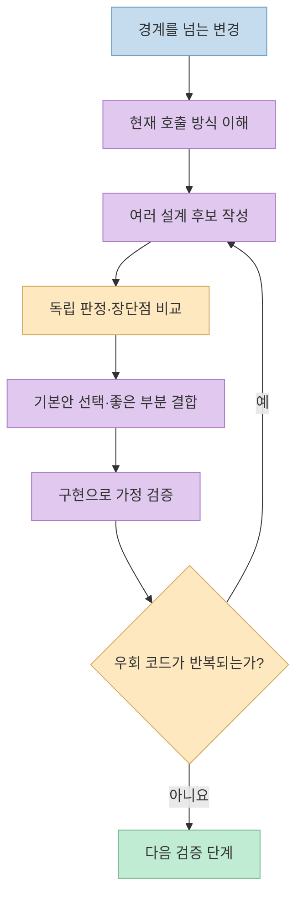
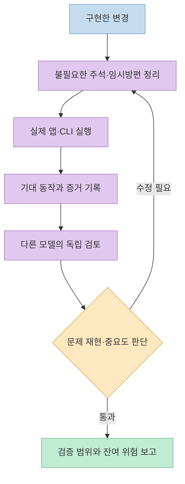
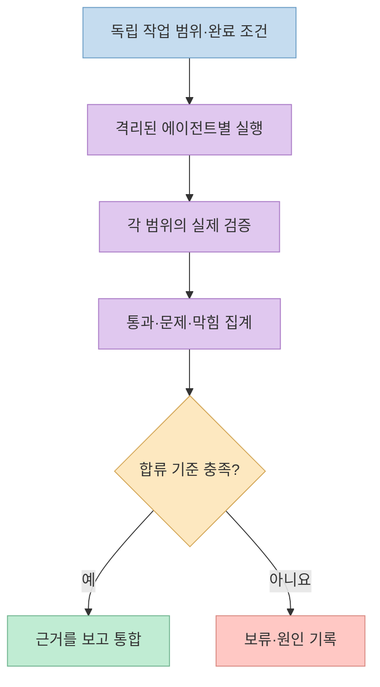

AI 에이전트 여러 개를 동시에 돌리면 코드는 빨리 늘지만, **잘못된 설계와 미검증 변경도 함께 늘 수 있다.** [민둥이의 pstack 소개 영상](https://youtu.be/gAt_rRweR7Q?t=0)은 Lauren Tan이 공개한 Cursor 플러그인 [pstack](https://github.com/cursor/plugins/tree/main/pstack)을 이 문제에 대한 작업 방식으로 소개한다. 핵심은 특정 모델에 모든 결정을 맡기는 것이 아니라, **이해 → 설계 → 구현 → 실제 동작 검증 → 독립 검토**를 과제에 맞게 반복하는 데 있다.

<!--more-->

## Sources

- [원본 YouTube 영상: 실제 Cursor 개발에 쓰이는 고품질 코딩 스킬, pstack 사용법](https://youtu.be/gAt_rRweR7Q?si=qtw4FzEgkkfhO6Ph)
- [Cursor 공식 플러그인 저장소의 pstack](https://github.com/cursor/plugins/tree/main/pstack) · [README](https://github.com/cursor/plugins/blob/main/pstack/README.md)
- [공식 가이드: 코드 이해](https://github.com/cursor/plugins/blob/main/pstack/docs/guide/03-understand.md) · [설계](https://github.com/cursor/plugins/blob/main/pstack/docs/guide/04-design.md)
- [공식 가이드: 구현·정리](https://github.com/cursor/plugins/blob/main/pstack/docs/guide/05-build-and-clean.md) · [검증·출시](https://github.com/cursor/plugins/blob/main/pstack/docs/guide/06-verify-and-ship.md) · [장시간 작업](https://github.com/cursor/plugins/blob/main/pstack/docs/guide/07-overnight.md)
- [공식 `/poteto-mode` 스킬](https://github.com/cursor/plugins/blob/main/pstack/skills/poteto-mode/SKILL.md)

## pstack이 해결하려는 문제: 빠른 생성보다 믿을 수 있는 변경

영상은 pstack을 "더 적은 코드로 더 높은 품질"을 목표로 하는 스킬·플레이북 묶음으로 설명한다. 여러 에이전트가 병렬로 일해도 같은 작성·검증 원칙을 적용해야 안심하고 작업을 나눌 수 있다는 것이다. [영상 0:09~0:46](https://youtu.be/gAt_rRweR7Q?t=9) [공식 README](https://github.com/cursor/plugins/blob/main/pstack/README.md)도 코드 줄 수나 처리량 자체가 목표가 아니라, **작지만 검증 가능한 변경**을 만드는 것이라고 밝힌다.

여기서 스킬과 플레이북은 역할이 다르다. `/how`처럼 **한 가지 사고·조사 방식**을 제공하는 스킬이 있고, 버그 수정·기능 개발·성능 개선처럼 **작업 전체의 순서**를 정하는 플레이북이 있다. `/poteto-mode`는 요청에 맞는 플레이북과 필요한 스킬을 고르는 입구다. [영상 0:35~0:47](https://youtu.be/gAt_rRweR7Q?t=35) · [공식 README의 사용 설명](https://github.com/cursor/plugins/blob/main/pstack/README.md)



## 고치기 전에 `/how`와 `/why`로 증거를 찾는다

영상의 예시는 "재시도 횟수가 왜 다섯 번인가?"라는 질문이다. `/how`는 현재 코드가 **어떻게 동작하는지**를 따라가고, `/why`는 **왜 그런 결정을 했는지**를 커밋·이슈·문서 등 사용 가능한 기록에서 찾는다. 영상은 팀 대화도 언급하지만, 이는 해당 기록에 접근할 수 있을 때만 가능한 조사다. 근거가 없으면 그 사실을 보고하고, 관찰과 추측을 구분한다. [영상 0:48~1:16](https://youtu.be/gAt_rRweR7Q?t=48) · [공식 코드 이해 가이드](https://github.com/cursor/plugins/blob/main/pstack/docs/guide/03-understand.md)

왜 이 순서가 필요할까? 현상을 처음 발견한 함수에서 바로 조건문을 고치면, **증상만 가려 놓고 원인을 남길 수 있기 때문**이다. 공식 가이드는 원인이 불분명할 때 수정 요청보다 읽기 전용 조사를 먼저 시키라고 제안한다. 실제 요청도 "현재 동작·근거·가설을 설명하고 아직 코드는 고치지 말라"처럼 두 단계로 나누는 편이 명료하다. [영상 1:16~1:23](https://youtu.be/gAt_rRweR7Q?t=76) · [공식 조사 예시](https://github.com/cursor/plugins/blob/main/pstack/docs/guide/03-understand.md)



## 큰 변경은 `/architect`와 `/arena`로 첫 설계의 편향을 줄인다

여러 함수·모듈의 경계를 바꾸는 작업에서는 `/architect`가 호출자가 실제로 쓸 API와 타입·책임을 먼저 설계한다. `/arena`는 같은 과제에 대한 여러 제안을 독립적으로 만든 뒤, 판정 기준에 따라 비교하고 좋은 부분을 합친다. 교차 판정에 다른 모델 계열을 쓰는 것은 **설정에서 사용할 수 있을 때**의 동작이다. [영상 1:23~1:41](https://youtu.be/gAt_rRweR7Q?t=83) · [공식 설계 가이드](https://github.com/cursor/plugins/blob/main/pstack/docs/guide/04-design.md)

공식 가이드는 구현 중 같은 우회 코드가 여러 곳에 생기거나 타입을 강제로 맞춰야 한다면 설계 자체를 재검토하라고 한다. 즉 `/arena`는 "가장 멋진 설계안 투표"가 아니라 **실제 구현에서 수정 비용이 적은 구조를 찾는 절차**다. 후보가 많아질수록 비용도 늘기 때문에, 단순한 수정마다 여러 모델을 호출할 이유는 없다. [영상 1:41~1:53](https://youtu.be/gAt_rRweR7Q?t=101) · [공식 `/architect` 설명](https://github.com/cursor/plugins/blob/main/pstack/docs/guide/04-design.md)



## 코드 정리와 검증은 별개의 문턱이다

영상은 `/no-comments`가 작성자와 다른 검토자에게 주석을 맡겨, 라이선스 표시·공개 API 설명처럼 필요한 것 외의 설명성 주석을 줄이는 방식을 보여 준다. 지워서는 안 되는 제약이라면 주석으로만 남기지 말고 타입·테스트·규칙으로 표현하자는 취지다. [영상 1:53~2:24](https://youtu.be/gAt_rRweR7Q?t=113) 이는 **모든 주석을 기계적으로 삭제하라는 뜻이 아니다.** [공식 구현·정리 가이드](https://github.com/cursor/plugins/blob/main/pstack/docs/guide/05-build-and-clean.md)에도 유지할 주석의 예외가 적혀 있다.

반면 **`/create-verification-skill`**은 프로젝트에 맞는 검증 방법을 만드는 장치다. 앱을 시작하고, 상태를 확인하고, 기능을 실제로 조작하고, 스크린샷·로그 같은 근거를 남기는 절차를 저장소 안에 문서화한다. 영상의 성능 측정 자동화 사례도 이런 발상이다. [영상 2:24~2:51](https://youtu.be/gAt_rRweR7Q?t=144) [공식 검증 가이드](https://github.com/cursor/plugins/blob/main/pstack/docs/guide/06-verify-and-ship.md)는 생성한 지침도 한 번 실제로 실행해 입증해야 한다고 명시한다. 테스트가 통과했다는 문장만으로 UI가 올바르게 동작했다는 증거가 되지는 않는다.

마지막으로 **`/interrogate`**는 다른 모델 계열의 검토자들에게 동일한 변경을 보여 주고 문제 제기를 비교한다. 결과는 바로 고칠 항목·고려할 항목·참고할 항목·기각할 항목으로 나누며, **자동으로 모두 수정하지 않는다.** 모델 간 일치가 강한 신호일 수는 있지만 최종 판단과 실제 재현 확인은 여전히 필요하다. [영상 2:51~3:16](https://youtu.be/gAt_rRweR7Q?t=171) · [공식 설계 가이드의 독립 검토](https://github.com/cursor/plugins/blob/main/pstack/docs/guide/04-design.md)



## `/poteto-mode`로 작업을 시작할 때 무엇을 적을까

영상은 각 스킬을 하나씩 고르지 않고 `/poteto-mode` 뒤에 작업을 적으라고 제안한다. 특히 "끝났는지 확인할 방법"을 함께 쓰면 완료 보고가 검증과 연결된다. [영상 3:17~3:35](https://youtu.be/gAt_rRweR7Q?t=197) 예를 들어 버그 수정 요청은 **재현 → 근거로 원인 추적 → 최소 수정 → 같은 조건에서 재검증 → 전후 결과 보고**의 흐름을 요구한다. [영상 3:35~3:55](https://youtu.be/gAt_rRweR7Q?t=215) · [공식 구현 가이드](https://github.com/cursor/plugins/blob/main/pstack/docs/guide/05-build-and-clean.md)

Cursor에서 시도한다면 [공식 README](https://github.com/cursor/plugins/blob/main/pstack/README.md)의 순서는 `/add-plugin pstack`으로 플러그인을 추가하고, `/setup-pstack`으로 사용할 모델을 설정한 다음, `/poteto-mode`로 실제 과제를 요청하는 것이다. 이 글은 설치를 실행한 기록이 아니라 **공식 사용법을 정리한 글**이다. 외부 플러그인을 연결하기 전에 포함된 스크립트와 작업 권한을 검토하는 편이 안전하다.

```text
/poteto-mode 장바구니 수량 변경 후 합계가 늦게 갱신되는 버그를 조사해 줘.
먼저 동일 입력으로 재현하고 원인을 기록해.
완료 조건: 수정 전 실패와 수정 후 성공을 같은 테스트와 실제 화면에서 확인해 줘.
```

위 프롬프트는 특정 버그가 실제로 존재한다는 주장이 아니라 **검증 가능한 요청 형식의 예시**다. "고쳐 줘"와 달리 재현 조건과 완료 증거를 명시해 에이전트의 그럴듯한 완료 보고를 줄인다.

## 병렬 작업·밤샘 실행: 속도보다 합류 기준

영상의 `/swarm`은 패키지별 점검처럼 **독립 범위**를 여러 에이전트에 나눠 맡기고 통과·문제·막힘을 한 보고서로 모은다. `/arena`가 *같은 문제에 대한 경쟁 설계*라면, `/swarm`은 *서로 다른 범위의 병렬 커버리지*다. [영상 3:55~4:10](https://youtu.be/gAt_rRweR7Q?t=235) · [공식 설계 가이드](https://github.com/cursor/plugins/blob/main/pstack/docs/guide/04-design.md) 분리 가능한 범위와 각 범위의 검증 명령이 없으면 에이전트를 늘려도 충돌과 검토량만 늘 수 있다.

장시간 자율 실행은 완료 조건, 격리된 작업 공간, 결정 기록, 중단 기준이 먼저 필요하다. 영상의 `/show-me-your-work`는 밤사이 판단을 확인하는 수단으로 소개된다. [영상 4:23~4:43](https://youtu.be/gAt_rRweR7Q?t=263) [공식 장시간 작업 가이드](https://github.com/cursor/plugins/blob/main/pstack/docs/guide/07-overnight.md)도 한 번의 수정마다 실제 산출물을 검증하고, 도움이 되지 않은 변경은 버리며, 결정을 기록하라고 설명한다. 이것은 "무조건 아침까지 머지"하는 무제한 권한과 다르다.



## 영상의 모델·성과 주장에는 시점을 붙여 읽자

영상은 Grok과 Claude Opus에 서로 다른 역할을 배정하는 예를 들고, 한 달에 PR 약 2,000개를 프로덕션에 반영했다는 Lauren Tan의 설명도 전한다. [영상 4:10~4:43](https://youtu.be/gAt_rRweR7Q?t=249) 이 숫자는 **영상에서 전달한 개인의 성과 주장**이지 이 글이 저장소의 배포 기록으로 독립 검증한 수치가 아니다. PR 개수만으로 변경 크기나 품질을 판단할 수도 없다.

모델 이름과 기본 배정은 특히 빨리 바뀐다. 작성 시점의 [공식 README](https://github.com/cursor/plugins/blob/main/pstack/README.md)는 영상의 설명과 다른 기본 모델 조합을 보여 주며 `/setup-pstack`으로 역할을 바꿀 수 있다고 한다. 따라서 특정 모델을 pstack의 필수 조건으로 적지 않았다. Claude Code·Codex용 포트는 [영상이 말하듯](https://youtu.be/gAt_rRweR7Q?t=291) 커뮤니티 버전이므로, **Cursor 공식 플러그인과 동일한 명령·기능·유지보수 상태라고 가정하지 말아야 한다.**

## 실전 적용 포인트

1. **작업을 재현 가능한 한 문장으로 쓴다.** 버그라면 실패 입력, 기능이라면 바뀌어야 할 사용자 동작을 포함한다.
2. **수정 전에 현재 동작과 변경 이유를 분리한다.** `/how`가 실행 경로를, `/why`가 남아 있는 의사결정 근거를 찾는다.
3. **큰 변경에만 설계 경쟁을 쓴다.** 비용이 드는 `/arena`보다 먼저 작은 재현과 프로토타입으로 미지수를 줄인다.
4. **완료 조건을 실제 산출물에 연결한다.** 테스트뿐 아니라 변경된 CLI·화면·성능 지표를 같은 조건에서 확인한다.
5. **병렬화는 범위와 합류 기준을 정한 뒤 한다.** 검증되지 않은 다수의 PR은 처리량이 아니라 검토 부채다.

## 결론

pstack을 도입할 이유는 AI에게 일을 더 많이 맡기기 위해서만이 아니다. **왜 고쳤는지 설명할 수 있고, 무엇이 작동하는지 직접 확인할 수 있으며, 다른 사람이 결과를 검토할 수 있게 만드는 것**이 핵심이다. 작은 버그 하나부터 재현·수정·검증의 증거를 남기는 방식으로 시작하면 복잡한 병렬 작업도 그 위에 올릴 수 있다.
