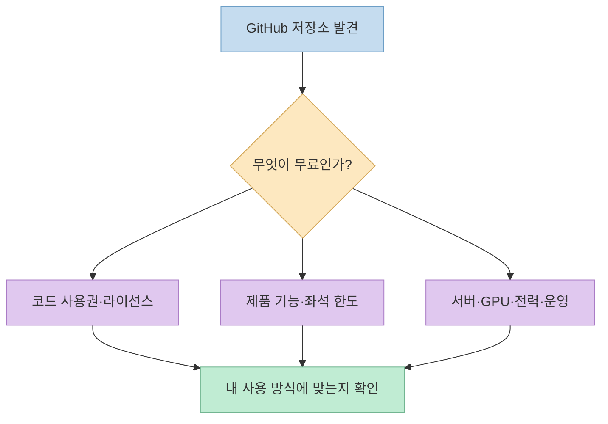
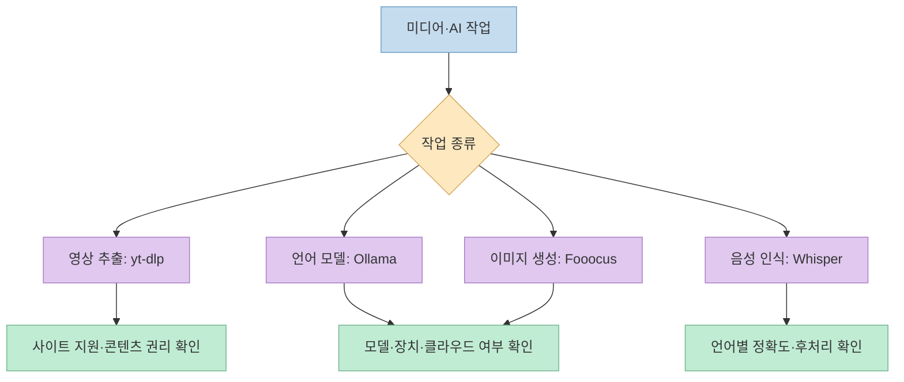
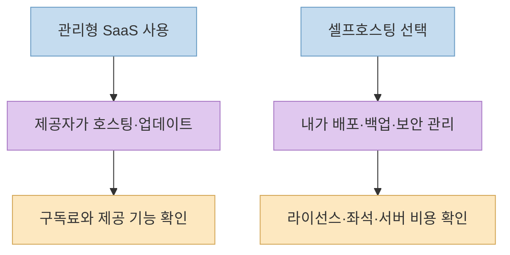
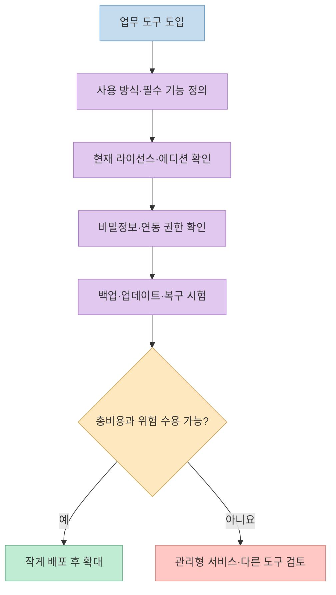

[X 게시물](https://x.com/yuliaisc/status/2110688037487128835)은 유료 서비스의 대안으로 GitHub 저장소 열 곳을 소개하며 모두 "100% 무료·100% 오픈소스"라고 주장한다. 목록 자체는 유용하지만, **코드가 공개된 것**, **사용료가 없는 것**, **운영 비용까지 0원인 것**, **기존 서비스와 기능이 동등한 것**은 서로 다르다. 특히 게시물의 가격 비교와 "연간 500억 달러 매출을 무너뜨린다"는 수치는 산출 근거가 제시되지 않아 사실로 받아들이기 어렵다.

<!--more-->

## Sources

- [원본 X 게시물: 유료 서비스 대안 GitHub 저장소 10곳](https://x.com/yuliaisc/status/2110688037487128835)
- [yt-dlp](https://github.com/yt-dlp/yt-dlp), [Ollama](https://github.com/ollama/ollama), [Fooocus](https://github.com/lllyasviel/Fooocus), [Whisper](https://github.com/openai/whisper)
- [Plausible Analytics](https://github.com/plausible/analytics), [AppFlowy](https://github.com/AppFlowy-IO/AppFlowy), [Penpot](https://github.com/penpot/penpot)
- [n8n](https://github.com/n8n-io/n8n), [Cal.com](https://github.com/calcom/cal.com), [Bitwarden Server](https://github.com/bitwarden/server)
- [n8n 공식 라이선스 설명](https://github.com/n8n-io/n8n-docs/blob/main/docs/n8n-community-license/README.md), [AppFlowy 셀프호스트 무료 티어](https://github.com/AppFlowy-IO/AppFlowy-SelfHost-Commercial/blob/main/README.md), [Bitwarden 라이선스 FAQ](https://github.com/bitwarden/server/blob/main/LICENSE_FAQ.md)

## 먼저 "무료"를 네 가지로 나누자

원문은 서로 다른 서비스의 구독료를 나열하고 오픈소스 대안을 "0달러"로 표시한다. 그러나 자체 호스팅에는 서버·저장소·백업·업데이트·장애 대응이 필요하다. 실제로 [Plausible 공식 README](https://github.com/plausible/analytics)는 Community Edition에 소프트웨어 이용료를 청구하지 않지만 서버·CDN·백업 비용은 사용자가 부담한다고 밝힌다. 따라서 비용 비교는 **구독료만**이 아니라 작업량과 운영 책임까지 포함해야 한다.

또 하나의 기준은 **대체 가능성**이다. 특정 작업을 해결할 수 있다는 것과 상용 제품의 모든 기능·성능·지원 체계를 똑같이 제공한다는 것은 다르다. 아래 목록은 원문의 순서를 유지하되, 공식 자료가 확인하는 기능과 비교가 무리인 부분을 함께 적었다.

## 1~4번: 미디어와 로컬 AI의 가능성과 제약

**1. [yt-dlp](https://github.com/yt-dlp/yt-dlp)**는 여러 사이트의 동영상을 추출·다운로드하는 CLI다. 원문은 YouTube·X·TikTok·Instagram에서 "어떤 영상이든" 받을 수 있다고 표현한다. 하지만 [공식 지원 사이트 문서](https://github.com/yt-dlp/yt-dlp/blob/master/supportedsites.md)는 목록에 있는 사이트조차 항상 작동하는 것은 아니며 사이트 변경으로 깨질 수 있다고 경고한다. 다운로드 도구의 사용 가능성과 특정 콘텐츠를 저장·재배포할 권리는 별개다. YouTube Premium의 오프라인 이용 경험과 CLI 다운로드도 같은 제품 기능으로 취급할 수 없다.

**2. [Ollama](https://github.com/ollama/ollama)**는 모델을 로컬에서 실행하는 경로를 제공한다. 그러나 원문의 "노트북에서 GPT-4급 모델을 API 비용 없이 실행"은 **모델 이름·크기·하드웨어·평가 과제 없는 성능 비교**다. 로컬 모델은 장치의 메모리와 연산 자원을 쓰며, Ollama에는 [별도의 클라우드 모델 경로](https://ollama.com/blog/cloud-models)도 있다. 비용과 데이터 처리 위치를 판단하려면 실제 선택한 모델이 로컬인지 클라우드인지부터 확인해야 한다.

**3. [Fooocus](https://github.com/lllyasviel/Fooocus)**는 로컬 이미지 생성 도구다. 원문은 Midjourney와 비슷한 품질에 "무제한 무료"라고 소개하지만 품질은 모델·프롬프트·작업 종류에 따라 달라진다. [공식 README의 최소 사양](https://github.com/lllyasviel/Fooocus)은 GPU 메모리와 시스템 메모리 요구량을 명시하고 CPU만 쓸 때의 큰 속도 차이도 경고한다. API 요금이 없더라도 GPU 확보와 전력·시간 비용은 남는다.

**4. [Whisper](https://github.com/openai/whisper)**는 OpenAI가 공개한 음성 인식 모델과 실행 코드다. [공식 README](https://github.com/openai/whisper/blob/main/README.md)는 다국어 받아쓰기·영어 번역과 MIT 라이선스를 설명한다. 원문은 특정 유료 회의록 서비스보다 싸고 "99개 언어"를 지원한다고 단정하지만, [모델 카드](https://github.com/openai/whisper/blob/main/model-card.md)에 따르면 언어·환경별 성능은 다르다. **음성을 텍스트로 바꾸는 모델**과 회의 녹화·화자 관리·공유까지 하는 서비스 전체를 일대일로 비교하면 빠지는 기능이 생긴다.

## 5~7번: 셀프호스팅은 통제권과 운영 책임을 함께 준다

**5. [Plausible Analytics](https://github.com/plausible/analytics)**는 개인정보 보호 중심 웹 분석 도구다. 원문은 비싼 Google Analytics 360과 무료 Plausible을 맞세우지만, Google은 [무료 표준 Analytics와 유료 360](https://support.google.com/analytics/answer/11202874?hl=en)을 별도로 제공한다. 비교의 출발점부터 같지 않다. Plausible의 [Community Edition](https://plausible.io/blog/community-edition)은 AGPL 기반 셀프호스팅이 가능하지만, 공식 README처럼 인프라와 백업을 직접 책임져야 한다. 단순하고 자체 통제되는 지표가 목표인지, 360의 기업용 기능이 필요한지에 따라 선택이 갈린다.

**6. [AppFlowy](https://github.com/AppFlowy-IO/AppFlowy)**는 문서·프로젝트 협업을 위한 오픈소스 제품이다. 원문은 셀프호스팅하면 "사용자 무제한 무료"라고 말하지만, [AppFlowy의 현행 셀프호스팅 무료 티어 안내](https://github.com/AppFlowy-IO/AppFlowy-SelfHost-Commercial/blob/main/README.md)는 **사용자 좌석 1개와 게스트 편집자 최대 3명**을 명시한다. 오픈소스 저장소와 상업용 셀프호스트 제품의 라이선스·기능 범위를 하나로 합치면 잘못된 구매 판단으로 이어진다.

**7. [Penpot](https://github.com/penpot/penpot)**은 디자인·프로토타이핑 도구로, [공식 저장소](https://github.com/penpot/penpot/blob/develop/README.md)는 클라우드와 셀프호스팅 환경을 소개한다. [저장소 라이선스](https://github.com/penpot/penpot/blob/develop/LICENSE)는 MPL 2.0이다. 다만 원문의 "Figma와 사실상 같은 경험을 영원히 무료"는 제품별 기능·협업 정책·플러그인·운영 조건을 비교한 검증 결과가 아니다. 기존 디자인 파일의 가져오기와 팀 작업 흐름을 작은 프로젝트에서 시험한 뒤 판단해야 한다.

## 8~10번: 기능보다 먼저 라이선스와 보안 운영을 확인한다

**8. [n8n](https://github.com/n8n-io/n8n)**은 워크플로 자동화 도구다. 원문은 "100% 오픈소스·자동화 무제한 0달러"라고 묶지만, [공식 라이선스 문서](https://github.com/n8n-io/n8n-docs/blob/main/docs/n8n-community-license/README.md)는 **Sustainable Use License는 OSI 의미의 오픈소스 라이선스가 아니므로 n8n을 오픈소스라고 부르지 않는다**고 명시한다. [무료 Community Edition](https://github.com/n8n-io/n8n-docs/blob/main/docs/deploy/host-n8n/community-edition-features.md)은 있지만 유료 에디션의 기능과 동일하지 않다. 자동화 횟수보다 필요한 노드·권한·운영 기능과 사용 방식의 허용 범위를 확인해야 한다.

**9. [Cal.com](https://github.com/calcom/cal.com)**은 일정 예약 도구다. 원문은 Calendly의 팀 요금과 무료 개인 사용을 비교하지만, 개인 예약과 팀 운영의 기능 범위가 다르다. [Cal.com FAQ](https://cal.com/scheduling/frequently-asked-questions)는 오픈소스 기반과 기업용 셀프호스트 라이선스를 구분하고, [최근 공식 변경 기록](https://next.cal.com/blog/calcom-v6-4)도 라이선스·배포 정책 변화를 다룬다. 도입 전에는 현재 배포판의 팀 기능, 외부 캘린더 연동, 데이터 보관과 라이선스를 다시 확인해야 한다.

**10. [Bitwarden](https://github.com/bitwarden/server)**은 비밀번호 관리자다. [공식 라이선스 FAQ](https://github.com/bitwarden/server/blob/main/LICENSE_FAQ.md)에 따르면 핵심 클라이언트·서버 코드는 GPL/AGPL 계열이지만 일부 조직·기업용 모듈에는 상업 라이선스가 적용된다. [공식 셀프호스팅 안내](https://bitwarden.com/help/licensing-on-premise/)도 서버를 직접 띄울 수 있어도 유료 기능은 구독 라이선스로 잠금 해제한다고 설명한다. 비밀번호 관리자에서는 가격뿐 아니라 **복구·백업·2단계 인증·조직 권한 관리**를 시험해야 한다.

## "500억 달러를 무너뜨린다"는 주장과 가격표의 문제

원문은 열 저장소가 대기업 매출 **연간 500억 달러 이상을 줄인다**고 말하지만 계산 방식·기간별 매출 자료·대체율을 제시하지 않는다. 따라서 이 숫자는 **검증되지 않은 홍보성 주장**으로 취급해야 한다. 각 상용 서비스의 월 구독료도 국가·플랜·청구 주기에 따라 달라져 글에 고정 가격표로 옮기지 않았다. [원본 게시물](https://x.com/yuliaisc/status/2110688037487128835)

비교할 때는 먼저 동일한 사용 사례를 정의한다. 예를 들어 웹 분석에서는 무료 Google Analytics 표준판과 Plausible CE를 비교하고, 협업 메모에서는 실제 필요한 사용자 수에 맞는 AppFlowy 에디션을 봐야 한다. "돈을 내던 제품"과 "로컬에서 실행 가능한 코드"를 나란히 놓는 것만으로 절감액은 계산되지 않는다. [Google의 표준·360 구분](https://support.google.com/analytics/answer/11202874?hl=en) · [AppFlowy 무료 티어](https://github.com/AppFlowy-IO/AppFlowy-SelfHost-Commercial/blob/main/README.md)

## 실전 적용 포인트

1. **교체하려는 기능을 한 문장으로 쓴다.** "회의 음성 전사"와 "회의록 공유 서비스"는 다른 범위다.
2. **현재 에디션과 라이선스를 확인한다.** 특히 n8n, AppFlowy, Cal.com, Bitwarden은 코드 공개와 상업 기능의 경계를 따로 봐야 한다.
3. **작은 데이터로 시험한다.** 품질·호환성·성능을 확인하고, 실제 비용에는 인프라와 운영 시간을 포함한다.
4. **보안·권리 조건을 점검한다.** 비밀번호 저장소와 자동화에는 백업·권한 관리가, 미디어 도구에는 콘텐츠 이용 권한이 중요하다.
5. **소셜 게시물의 가격과 수치를 그대로 옮기지 않는다.** 요금은 공식 플랜을, 효과는 내 사용 사례의 측정값을 기준으로 판단한다.

## 핵심 요약

- 열 저장소는 실제로 존재하지만, **"100% 무료·100% 오픈소스·완전 대체"는 목록 전체에 적용되지 않는다.**
- 로컬 AI와 셀프호스팅은 API·구독료를 줄일 수 있어도 하드웨어·인프라·운영 비용이 남는다.
- n8n은 공식적으로 OSI 오픈소스가 아니라고 밝히며, AppFlowy 무료 셀프호스트 티어에는 사용자 좌석 제한이 있다.
- 원문의 500억 달러 매출 영향과 개별 서비스 가격 비교에는 검증 가능한 산출 근거가 없다.

## 결론

이 게시물은 도구를 발견하는 **출발점**으로는 좋다. 도입 판단은 과장된 절감액이 아니라 **기능 범위, 라이선스, 운영 책임, 실제 시험 결과**로 내려야 한다. 좋은 대안은 "공짜처럼 보이는 도구"가 아니라 내 문제를 감당 가능한 비용과 위험으로 해결하는 도구다.
