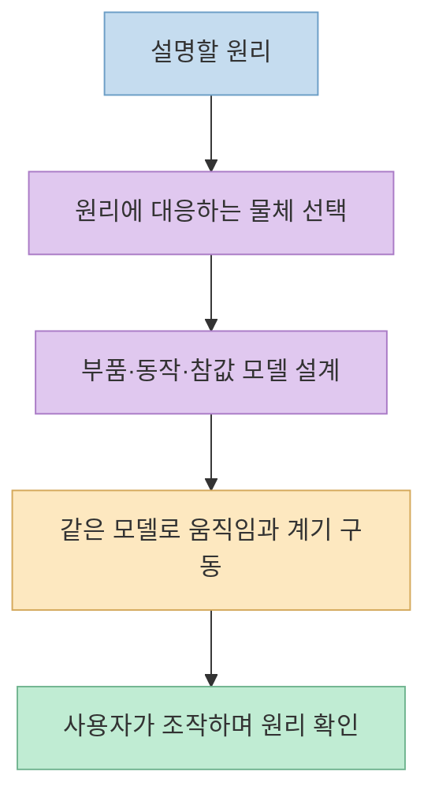
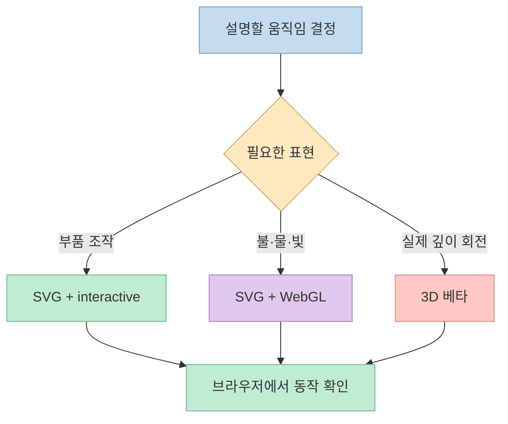
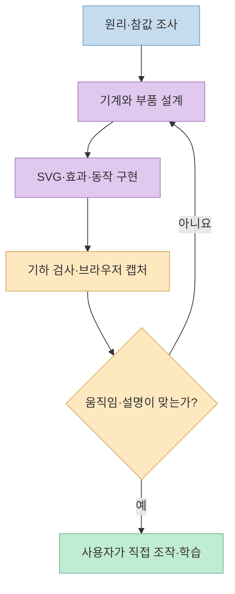

"자동차 엔진이 어떻게 움직이는지 보여 줘"라고 쓰면, AI가 설명 문장 대신 **직접 움직여 볼 수 있는 기계 모형**을 만든다면 어떨까? [소개 쇼츠](https://youtu.be/W5yShwpUxfA?t=0)는 Claude Code용 **Anatomy 스킬**을 그런 도구로 보여 준다. 다만 화면이 입체적으로 보인다고 모두 진짜 3D인 것은 아니다. [제작자의 공식 문서](https://skills.wheresryan.sh/anatomy)를 바탕으로 무엇을 만들고, 어떻게 설치·검증하며, 어떤 한계가 있는지 구분해 보자.

<!--more-->

## Sources

- [원본 YouTube Shorts: 요즘 난리난 클로드 미친 3D 스킬](https://youtube.com/shorts/W5yShwpUxfA?si=eCxIzOjkXIc-5ywz)
- [제작자 Ryan의 Anatomy 소개와 데모](https://skills.wheresryan.sh/anatomy)
- [Anatomy 공식 GitHub 저장소](https://github.com/wheresryan22/anatomy)

## Anatomy는 그림 생성기가 아니라 설명용 기계를 만드는 스킬

영상은 한 줄로 설명할 대상을 적으면 작동 원리를 보여 주는 기계가 나온다고 소개한다. 로켓 엔진, 기계식 시계, 항공기 엔진처럼 부품의 움직임이 중요한 대상을 예로 든다. [영상 0:03~0:14](https://youtu.be/W5yShwpUxfA?t=3) 제작자의 핵심 원칙은 **그 물체의 동작 자체가 설명이 되어야 한다**는 것이다. 화살표와 라벨이 붙은 상자가 아니라, 실제 부품이 제 역할을 하는 모형을 만든다. [제작자 설명: Objects, not diagrams](https://skills.wheresryan.sh/anatomy)

예를 들어 제작자의 항공기 엔진 데모에서는 레버를 움직이면 팬과 여러 회전축의 속도가 달라지고 추력 계기가 함께 반응한다. 영상의 "레버를 당기면 팬과 추력 숫자가 바뀐다"는 설명은 이 데모와 맞는다. 중요한 설계 원칙은 **보이는 수치와 부품 움직임이 같은 모델에서 나온다**는 점이다. 겉보기 애니메이션만 따로 돌리고 계기판에 임의 숫자를 띄우는 방식과는 다르다. [영상 0:11~0:15](https://youtu.be/W5yShwpUxfA?t=11) · [제작자 설명: turbofan 데모](https://skills.wheresryan.sh/anatomy)



## "3D 스킬"이라는 말은 정확히 나눠 읽어야 한다

영상은 Anatomy를 3D 스킬로 부르지만, 공식 저장소는 출력 방식을 **기본 SVG**, **SVG와 WebGL 효과**, **진짜 3D 회전 모드**로 나눈다. 기본은 여러 면을 음영 처리한 **등각 투영(isometric) SVG**다. 입체적으로 *보여도* 원근 카메라가 있는 3D 장면과 동일하지 않다. 불·물·연기·빛 같은 효과가 필요하면 WebGL 레이어를 SVG 앞뒤에 끼워 넣는다. 실제 깊이에서 부품이 돌아가고 매 프레임 다시 투영되는 3D 모드는 **베타**이며 제작 시간이 더 길다. [영상 0:00~0:11](https://youtu.be/W5yShwpUxfA?t=0) · [공식 저장소: What it makes](https://github.com/wheresryan22/anatomy#what-it-makes)

즉 "인터랙티브"와 "진짜 3D"는 다른 선택이다. 제작자 문서에 따르면 `interactive`는 드래그·키보드 같은 조작을, `WebGL`은 특수 효과를, `3D`는 깊이 회전 모드를 요청하는 신호다. 지정하지 않으면 정적인 도해가 나올 수 있다. 작은 교육용 시연은 **인터랙티브 등각 투영 SVG**부터 시작하고, 불꽃이 필요할 때 WebGL을, 회전하는 구조를 꼭 보여 줘야 할 때만 베타 3D를 요구하는 편이 비용과 복잡도를 통제하기 쉽다. [제작자 설명: Writing a prompt](https://skills.wheresryan.sh/anatomy)



## 설치와 첫 요청: 영상의 고정 댓글보다 공식 명령 확인

영상은 설치 명령어를 고정 댓글에 두었다고 말하고 `/anatomy` 명령으로 자동차 엔진을 요청한다. [영상 0:18~0:29](https://youtu.be/W5yShwpUxfA?t=18) 실제 설치 명령은 변경될 수 있으므로, 작성 시점의 [공식 GitHub 설치 안내](https://github.com/wheresryan22/anatomy#install)를 기준으로 확인하는 것이 안전하다. Claude Code 사용자 계정에 설치하는 예시는 다음과 같다. **이 글을 쓰면서 설치 명령을 실행한 것은 아니다.**

```bash
npx skills add wheresryan22/anatomy -g -a claude-code
```

설치 후 Claude Code에서 다음처럼 원리와 원하는 상호작용을 적는다. 공식 저장소는 "그림을 어떻게 그릴지"보다 **무엇을 설명할지**를 쓰라고 권한다. 출력 대상이 독립 HTML인지, SVG 파일인지, React 컴포넌트인지도 함께 지정할 수 있다. 외부 스킬을 프로젝트에 연결할 때는 저장소의 `SKILL.md`와 함께 실행될 스크립트를 먼저 검토한다. [공식 저장소: Usage](https://github.com/wheresryan22/anatomy#usage)

```text
/anatomy explain how a mechanical watch keeps time, interactive
```

영상의 "자동차 엔진"과 "심장 판막" 요청은 **활용 아이디어**로 볼 수 있다. [영상 0:24~0:41](https://youtu.be/W5yShwpUxfA?t=24) 제작자 사이트에는 기계식 시계와 항공기 엔진 데모가 공개되어 있지만, 이 글에서 자동차 엔진·심장 판막 결과의 정확성을 독립적으로 확인한 것은 아니다. 특히 생물학·의학 설명에는 겉으로 그럴듯한 운동보다 **혈류 방향, 판막 개폐 조건, 예외 상황을 신뢰할 수 있는 자료와 대조하는 과정**이 필요하다. [제작자 데모 모음](https://skills.wheresryan.sh/anatomy)

## 결과물은 어떤 순서로 만들어지고 검증되나

제작자 문서에 따르면 Anatomy는 먼저 작업 크기를 가늠하고, 정확한 수치와 동작을 조사해 작은 모델로 만든다. 그다음 개념과 일대일로 대응하는 물체를 고르고, 받침·구조·기구·조작부를 포함한 부품 목록을 만든다. 좌표와 카메라를 정해 부품을 배치한 뒤, 가려지는 순서대로 그린다. 마지막에는 조작 힌트와 실시간 계기를 붙이고, 포인터·키보드 입력과 움직임 감소 설정에 대응시킨다. 즉 한 줄 프롬프트는 **한 번의 이미지 생성**이 아니라 코드·모델·검사 단계를 시작하는 요청이다. [제작자 설명: What Claude does](https://skills.wheresryan.sh/anatomy)

검증도 화면이 뜨는지에서 끝나지 않는다. 공식 저장소의 기하 검사 도구는 부품이 서로 뚫고 지나가거나 잘못 가려지는 문제를 찾고, 브라우저 캡처 도구는 확대 이미지와 움직임을 확인한다. 제작자는 첫 결과를 직접 조작해 어색한 움직임을 찾아 수정하라고 권한다. 숫자와 코드가 맞아도 사람이 봤을 때 기계가 이상할 수 있기 때문이다. 복잡한 데모는 수십 분이 아니라 **몇 시간**이 걸릴 수 있고, 진짜 3D는 아직 베타다. [공식 저장소: How it works](https://github.com/wheresryan22/anatomy#how-it-works) · [제작자 설명: Limits](https://skills.wheresryan.sh/anatomy)



## 실전 적용 포인트

1. **처음에는 작은 물체를 고른다.** 시계 전체보다 톱니바퀴 하나의 전달 비율처럼 검증 가능한 범위를 요청하면 결과를 평가하기 쉽다. [제작자 설명: 크기와 시간](https://skills.wheresryan.sh/anatomy)
2. **움직임과 읽을 값을 함께 명시한다.** 예를 들어 "레버를 움직이면 회전 속도와 출력 계기가 같은 모델을 읽게 해 줘"처럼 동작의 의미를 적는다. [제작자 설명: 참값 모델](https://skills.wheresryan.sh/anatomy)
3. **필요한 형식만 요구한다.** SVG, WebGL 효과, 베타 3D를 구별하고, 조작이 필요하면 `interactive`를 넣는다. [제작자 설명: 프롬프트](https://skills.wheresryan.sh/anatomy)
4. **생성된 설명을 사실 검증한다.** 특히 의학·안전·공학 수치는 도식의 미려함과 무관하게 별도 자료 및 전문가 검토가 필요하다. 제작자도 첫 결과를 초안으로 보고 다시 살펴보라고 한다. [제작자 설명: Limits](https://skills.wheresryan.sh/anatomy)

## 핵심 요약

- Anatomy는 설명할 원리를 **조작 가능한 등각 투영 기계 도해**로 바꾸는 에이전트 스킬이다.
- 기본은 SVG이고, WebGL은 효과, 진짜 3D 회전은 **베타 옵션**이다.
- 영상의 자동차 엔진·심장 판막 예시는 아이디어로 유용하지만 이 글에서 결과의 정확성을 확인한 사례는 아니다.
- 좋은 결과는 한 줄 프롬프트만이 아니라 **참값 모델, 브라우저 확인, 기하 검사와 반복 수정**에 달려 있다.

## 결론

Anatomy의 강점은 "입체적인 그림" 자체가 아니라 **조작과 수치가 같은 원리를 설명하도록 코드로 묶는 것**이다. 교육용 시각화가 필요하다면 작은 개념을 `interactive` SVG로 시험하고, 직접 조작해 물리적·개념적 오류를 고친 뒤 복잡한 효과나 3D를 더하는 순서가 현실적이다.
