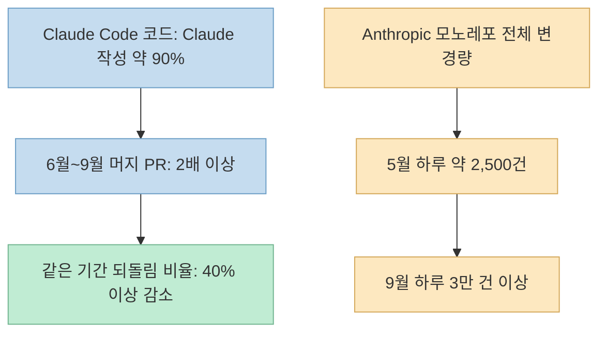
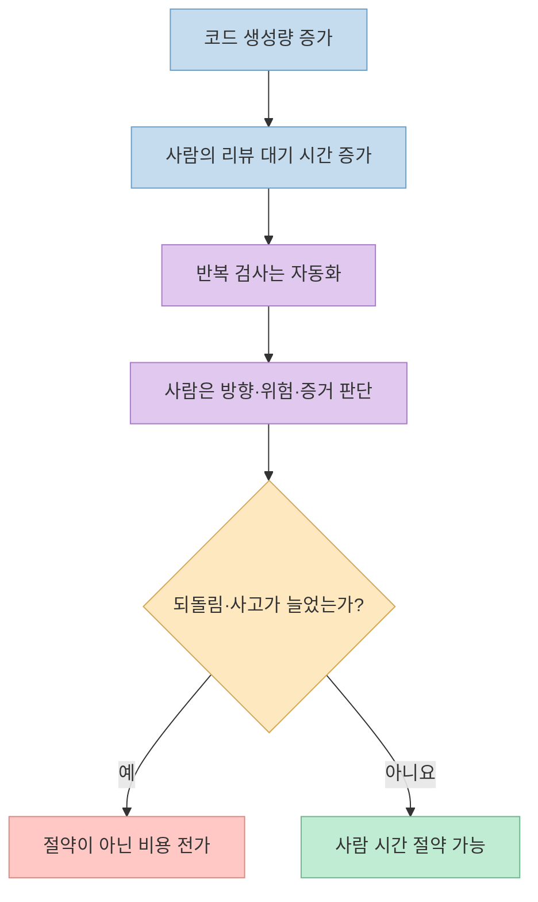
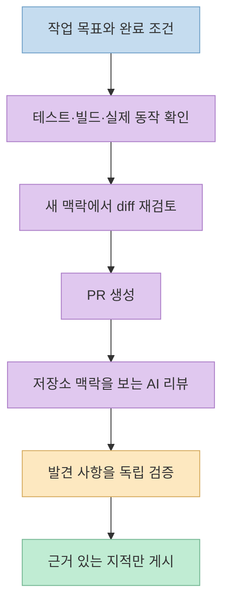
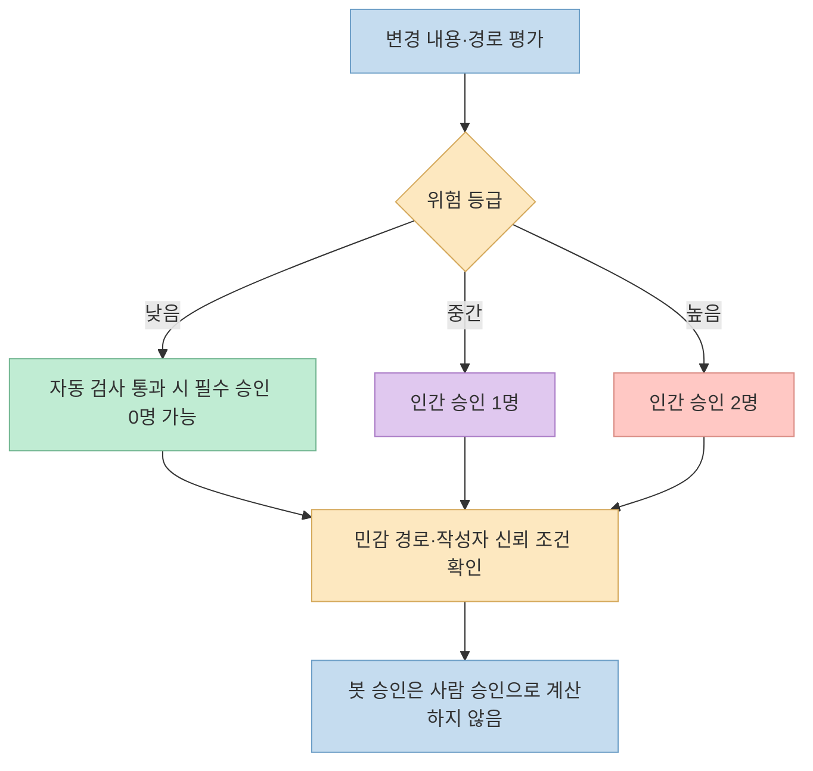
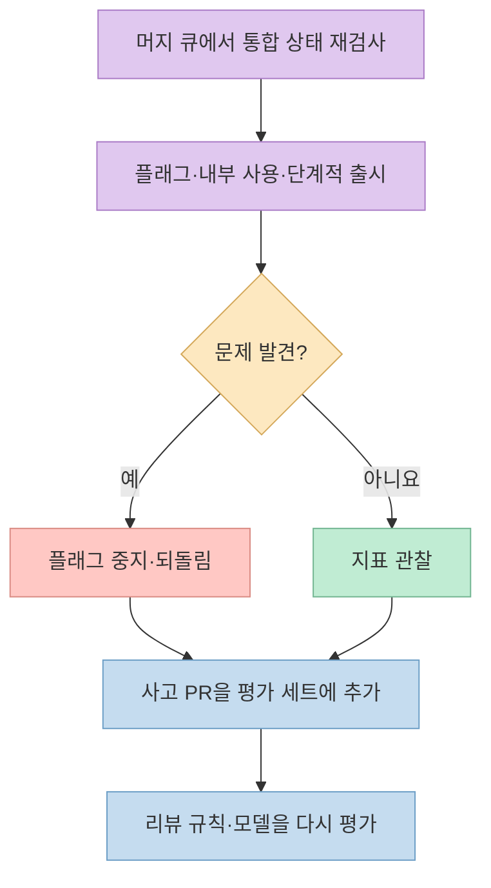

"Claude Code 코드의 약 90%를 Claude가 쓴다"는 [Threads 게시물](https://www.threads.com/share/BAldCcWx70/)은 더 중요한 질문을 던진다. 코드 생성량이 급증할 때 **누가 무엇을 검토하고, 잘못된 변경은 어떻게 되돌릴까?** 게시물이 인용한 [Anthropic의 공식 기술 글](https://claude.dev/blog/solving-code-review-at-anthropic/)을 기준으로 숫자의 범위를 확인하고, 코드 리뷰를 단일 승인 단계가 아닌 연속적인 검증 체계로 설계한 방식을 살펴본다.

<!--more-->

## Sources

- [원본 Threads 게시물: CHOI의 Claude Code 코드 리뷰 소개](https://www.threads.com/share/BAldCcWx70/)
- [Anthropic: How the Claude Code team does code review](https://claude.dev/blog/solving-code-review-at-anthropic/)

## 먼저 숫자의 범위를 정확히 읽자

Anthropic은 **Claude가 Claude Code 자체 코드의 약 90%를 작성한다**고 설명한다. 이는 모든 Anthropic 제품, 모든 팀, 또는 일반 개발자의 코드에 적용되는 수치가 아니다. 같은 공식 글에 따르면 2026년 **6월부터 9월까지 Claude Code 코드베이스에 머지된 PR 수는 두 배 이상**이 되었고, **머지된 PR 중 되돌려야 했던 비율은 40% 이상 감소**했다. 여기서 40%는 되돌림 *건수*가 아니라 **되돌림 비율의 변화**다. 원시 PR·리버트 건수나 통제된 비교 실험은 공개되지 않았으므로, 이 결과를 AI 리뷰만의 인과 효과로 단정할 수 없다. [원본 Threads 게시물](https://www.threads.com/share/BAldCcWx70/) · [Anthropic 원문](https://claude.dev/blog/solving-code-review-at-anthropic/)

공식 글의 다른 수치인 **5월 하루 약 2,500건 → 9월 하루 3만 건 이상**은 Anthropic *모노레포 전체*에 반영된 변경 수다. Claude Code는 별도 저장소에 있으므로 이 수치를 Claude Code PR 증가량과 같은 모집단으로 섞으면 안 된다. 대규모 변경량이 리뷰 체계를 압박한 배경으로만 읽는 것이 정확하다. [Anthropic 원문: 리뷰 목적](https://claude.dev/blog/solving-code-review-at-anthropic/)

## 목표는 인간 리뷰의 제거가 아니라 인간 시간을 아끼는 것

코드 리뷰에는 **출시 전 결함을 찾는 일**과 **팀이 코드베이스를 함께 이해하는 일**이라는 두 역할이 있다. Anthropic은 첫 번째 역할에서 "사람이 모든 줄을 읽었는가?"보다 "무슨 실패가 가능하며 어떤 검사가 그것을 가장 잘 잡는가?"를 묻는다. 개발자가 PR을 열기 전부터 에이전트가 검증·수정을 반복하고, 사람은 위험하거나 방향을 정해야 하는 변경에 집중한다. 두 번째 역할인 지식 공유는 별도로 보완해야 한다. [Anthropic 원문: 리뷰 목적](https://claude.dev/blog/solving-code-review-at-anthropic/)

측정 대상도 승인 횟수 하나가 아니다. 팀은 PR당 인간 승인 수의 중앙값과 95백분위수, 사람의 댓글 수, 사람이 처리하기를 기다린 시간을 본다. 동시에 **되돌림과 사고 발생률을 안전 지표**로 둔다. 리뷰 시간을 줄인 대신 장애 복구 시간이 늘었다면 비용을 절감한 것이 아니라 다른 단계로 옮긴 셈이기 때문이다. 목표는 대부분의 PR이 **최대 한 사람**을 거쳐 머지되되 사고와 되돌림을 늘리지 않는 것이다. 이것은 모든 PR에 무조건 인간 승인을 없앤다는 뜻이 아니다. [Anthropic 원문: 인간 시간](https://claude.dev/blog/solving-code-review-at-anthropic/)

## PR 이전부터 시작하는 검증과 맥락 있는 AI 리뷰

**첫 단계는 코드 작성자의 자기 검증**이다. Anthropic 팀은 Claude에게 테스트·빌드·디자인과 비교할 스크린샷처럼 실제로 실행하거나 확인할 수 있는 수단을 주고, "완료했다"는 말 대신 결과를 보여 달라고 한다. 이어 새로운 맥락의 서브에이전트가 diff를 검토한다. 팀 내부 스킬은 버그 탐색, 불필요한 복잡성 제거, 종단 간 동작 확인을 분담한다. 이 단계의 교훈은 특정 스킬 이름보다 **검증 명령과 산출물을 작업 지시에 포함하는 것**이다. [Anthropic 원문: 1단계](https://claude.dev/blog/solving-code-review-at-anthropic/)

반복해서 발견되는 문제는 매번 댓글로 고치기보다 규칙으로 끌어올린다. 짧은 `CLAUDE.md`에는 프로젝트의 기술 스택·관례·목표·비목표를 담고 상세 문서로 연결한다. 코드 소유자가 작성하는 `REVIEW.md`에는 그 영역에서 무엇이 실패인지, 어떤 경로를 건너뛸지, 어떤 근거를 요구할지 적는다. Anthropic은 파일과 줄 위치 같은 **구체적 증거 없는 추측성 지적**을 억제하고, 사소한 취향 지적의 수를 제한하라고 설명한다. 모든 저장소에 같은 `REVIEW.md` 템플릿이 자동으로 효과를 내는 것은 아니며, 리뷰어가 실제로 이 지시를 따르는지도 확인해야 한다. [Anthropic 원문: 프로젝트 지침](https://claude.dev/blog/solving-code-review-at-anthropic/)

PR이 열리면 Claude 리뷰어는 diff만 떼어 보지 않고 **저장소 전체의 맥락과 PR이 해결하려는 의도**를 비교한다. 버그 수정이라면 근본 원인을 고쳤는지 묻는다. 여러 탐색 에이전트가 찾은 지적은 다른 에이전트 집단이 다시 검증해 충분한 동의가 있을 때만 올린다. 스타일·진단성 소음은 걸러 내고, 기존 코드에 이미 있던 문제는 새 변경의 문제와 구별한다. 공개 제품과 Anthropic의 내부 운영이 동일하다고 가정해서는 안 된다. [Anthropic 원문: 2단계](https://claude.dev/blog/solving-code-review-at-anthropic/)

## 보안·CI는 별도 차단선, 인간 승인은 변경 위험에 비례

AI 코드 리뷰가 끝나도 **보안 리뷰와 일반적인 CI 검사는 독립된 차단선**이다. 미해결 버그·보안 지적이 남아 있으면 머지할 수 없고, 수정하거나 거짓 양성임을 이유와 함께 설명해야 한다. 린트·타입 검사·여러 플랫폼의 테스트·빌드도 통과해야 한다. PR 템플릿에는 어떻게 테스트했고 어떻게 되돌릴지 적으며, Claude가 초안을 쓰더라도 요청한 사람이 확인한다. 즉 AI가 리뷰했다는 사실이 실행 가능한 검사나 책임자의 판단을 대체하지 않는다. [Anthropic 원문: 3~4단계](https://claude.dev/blog/solving-code-review-at-anthropic/)

그다음 사람의 승인은 **작성자가 아니라 변경 자체의 위험도**로 정한다. 문서·문구·플래그 뒤의 추가 기능 같은 낮은 위험의 변경은 자동 검사를 통과하면 필수 인간 승인이 없을 수 있다. 일반 제품 변경이나 캐시·자동 업데이트·시스템 프롬프트 등 민감한 영역은 한 사람, 최고 위험 영역과 지정된 경로는 두 사람이 필요하다. 다만 낮은 승인 경로는 신뢰된 작성자에게만 허용하며, 팀 밖 작성자에게는 추가 사람이 필요하다. 분류기가 위험 등급을 추천하더라도 소유자가 민감 경로와 승인 규칙을 정한다. 에이전트의 승인은 인간 승인 칸을 채우지 못한다. 새 커밋이 들어오면 이전 승인도 다시 받아야 할 수 있다. [Anthropic 원문: 5단계](https://claude.dev/blog/solving-code-review-at-anthropic/)

## 머지 후에도 검증은 끝나지 않는다

Anthropic은 **머지 큐**에서 변경을 메인 브랜치와 합친 상태로 다시 검사한다. 따로 통과한 두 PR이 함께 들어가면 깨지는 문제를 줄이기 위해서다. 새 기능은 대체로 플래그 뒤에서 내부 직원에게 먼저 제공하고, 공개 릴리스도 `latest`를 거쳐 `stable`로 이동한다. 출시 후 문제가 나타나면 플래그를 끄거나 되돌리는 경로가 있어야 한다. 이는 사전 리뷰로 모든 실패를 막을 수 있다는 전제 대신 **발견과 복구 시간을 줄이는 전략**이다. 팀은 되돌림·사고 지표가 악화되면 승인을 자동 강화하는 회로 차단기는 아직 없다고 밝힌다. [Anthropic 원문: 6~7단계](https://claude.dev/blog/solving-code-review-at-anthropic/)

사고와 되돌림 기록은 다시 리뷰어의 평가 자료가 된다. 경험 있는 엔지니어가 실제 결함과 위치를 확인한 과거 PR을 **평가 세트**로 만들고, 리뷰어 변경이 이를 얼마나 잘 찾는지 매일 확인한다. 오탐도 비용이다. 사람이 사소한 지적을 무시할 수 있는 것과 달리 에이전트 작성자는 지적을 수정해 새 커밋과 또 다른 리뷰를 만들 수 있다. 한 CLI PR이 밤새 50회 넘게 리뷰·수정을 반복한 사례 이후, 팀은 **3회 뒤에는 방향 재검토를 요청**하고, 이후에는 새 diff 중심으로 살피며 같은 지적을 반복하지 않도록 바꿨다. 당시 반복 지적의 약 59%는 첫 검토 이전부터 있던 코드였다는 분석이다. [Anthropic 원문: 리뷰어 개선](https://claude.dev/blog/solving-code-review-at-anthropic/)

## 사람이 계속 맡는 결정과 팀의 지식 공유

Anthropic이 사람에게 남긴 판단은 **무엇을 만들지**, **결제·업데이트·CI처럼 위험한 코드가 안전한지**, **앞으로 다른 코드가 따를 아키텍처인지**, **테스트 결과와 스크린샷의 증거가 충분한지**, **출시 결과를 누가 책임지는지**다. "한 사람이 루프에 있다"는 목표는 소유권 포기가 아니다. 작은 변경이라도 실제로 사고가 나면 머지한 사람이 맥락을 가지고 고치는 관행을 둔다. 변경을 작게 나누고 플래그·되돌림을 준비하는 이유도 여기에 있다. [Anthropic 원문: 사람의 역할과 소유권](https://claude.dev/blog/solving-code-review-at-anthropic/)

한편 사람이 모든 diff를 읽지 않으면 **코드베이스 학습의 기회**가 줄 수 있다. Anthropic은 이 문제에 대해 정형화된 절차는 없다고 인정한다. 대신 개발자가 필요한 모듈을 지정해 Claude에게 현재 코드 기준 설명이나 시각화 자료를 만들게 하고, 공개적인 팀 채널에서 진행 상황을 공유한다. 이것은 모든 조직에서 동등하게 작동한다고 검증된 방법이 아니라 해당 팀의 현재 실천이다. 따라서 다른 팀이 인간 리뷰를 줄인다면 기술적 결함 탐지뿐 아니라 신규 구성원의 온보딩과 설계 결정 공유도 별도 지표로 봐야 한다. [Anthropic 원문: 팀 맥락 공유](https://claude.dev/blog/solving-code-review-at-anthropic/)

## 실전 적용 포인트

1. **한 저장소에서 시작한다.** PR을 열기 전에 에이전트가 실행할 테스트·빌드·동작 확인을 정하고, 결과를 PR에 첨부한다. [Anthropic의 도입 제안](https://claude.dev/blog/solving-code-review-at-anthropic/)
2. **반복되는 지적을 규칙으로 옮긴다.** 짧은 프로젝트 지침과 영역별 `REVIEW.md`에 실패 조건, 무시할 경로, 필요한 증거를 적고 실제 준수 여부를 확인한다. [Anthropic의 도입 제안](https://claude.dev/blog/solving-code-review-at-anthropic/)
3. **AI 리뷰와 CI·보안 검사를 구별한다.** 자동 리뷰가 "괜찮다"고 말해도 테스트 실패나 미해결 보안 지적이 있으면 머지하지 않는다. [Anthropic의 리뷰 단계](https://claude.dev/blog/solving-code-review-at-anthropic/)
4. **승인 규칙을 위험별로 문서화한다.** 인증·결제·CI·릴리스 경로에는 사람을 남기고, 봇 승인을 인간 승인으로 세지 않는다. 낮은 위험 경로도 소유자와 신뢰 조건을 먼저 정한다. [Anthropic의 승인 원칙](https://claude.dev/blog/solving-code-review-at-anthropic/)
5. **리뷰 루프와 배포의 출구를 만든다.** 검토 횟수를 제한하고, 플래그·단계적 출시·되돌림 절차를 마련한다. 사람 대기 시간이 줄어도 되돌림·사고가 늘면 개선으로 보지 않는다. [Anthropic의 운영 지표](https://claude.dev/blog/solving-code-review-at-anthropic/)

## 핵심 요약

- "90%"는 **Claude Code 자체 코드의 Claude 작성 비율**이라는 Anthropic의 설명이다. 다른 저장소나 기업 전체로 일반화할 수 없다.
- 6월~9월의 **PR 두 배 이상 증가**와 **되돌림 비율 40% 이상 감소**는 Anthropic의 내부 관찰이며, 인과 효과를 분리한 실험 결과는 아니다.
- 사전 실행 검증 → 맥락 있는 AI 리뷰 → 보안·CI → 위험별 인간 승인 → 머지 큐·단계적 출시 → 빠른 롤백이 핵심 흐름이다.
- 사람의 주된 역할은 모든 줄을 읽는 것보다 **방향·고위험 변경·증거·책임**을 판단하는 것이다.

## 결론

이 사례의 교훈은 "AI가 쓴 코드는 AI에게 맡기면 된다"가 아니다. **반복 검사는 자동화하되 실패 비용이 큰 곳에는 사람을 남기고, 잘못된 변경은 빨리 찾아 되돌리는 체계**를 만드는 것이다. PR 처리량만 늘리는 대신 사람 시간, 되돌림, 사고, 팀의 코드 이해도를 함께 측정해야 이 방식이 실제 개선인지 알 수 있다.
