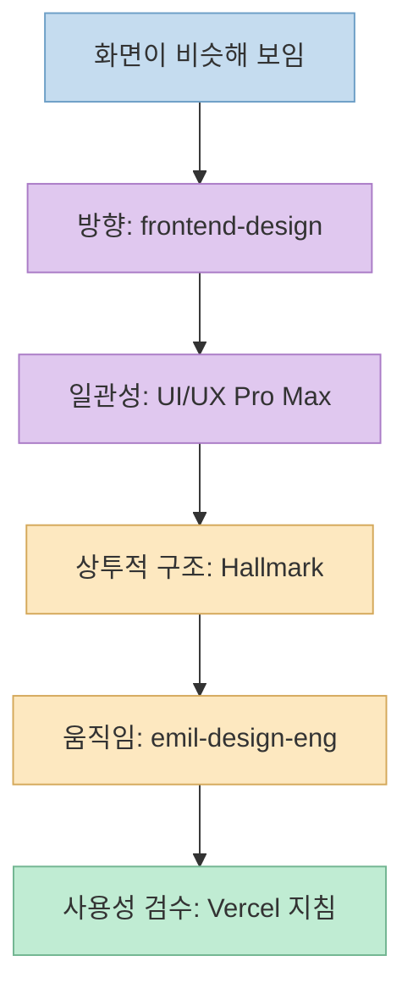
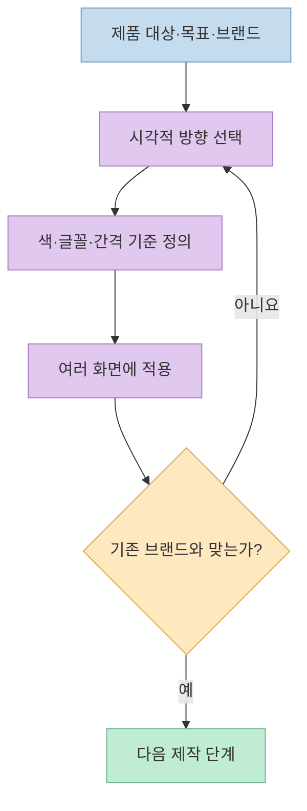
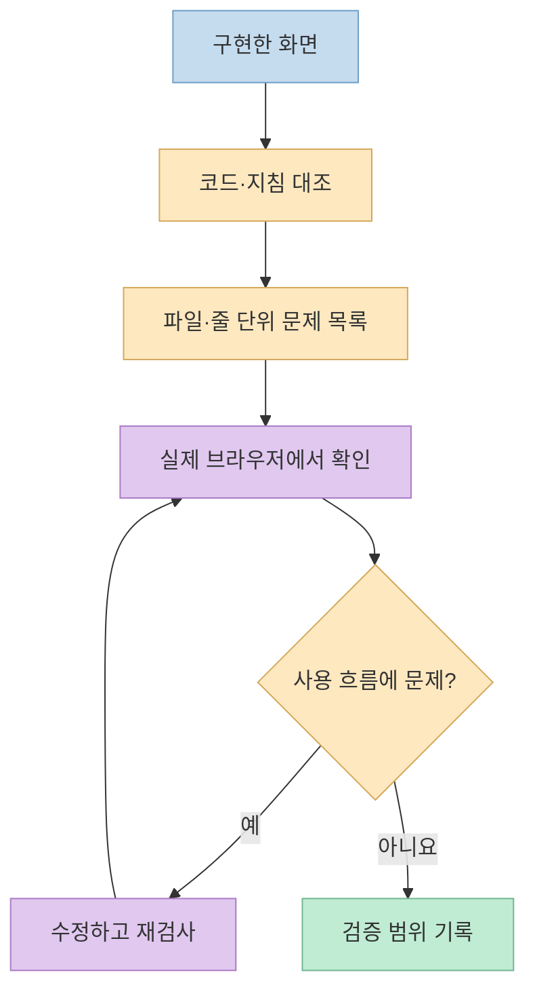

Claude로 만든 화면이 모두 비슷해 보인다면 스킬 다섯 개를 무조건 설치하는 것이 답일까? [이 쇼츠](https://youtu.be/bEbeQLCToBA?t=0)는 UI의 'AI 티'를 줄이는 다섯 스킬을 추천한다. 각 공식 저장소를 확인해 보니 이들은 같은 작업을 반복하는 패키지가 아니다. **시각 방향 결정 → 디자인 시스템 → 상투적 구성 점검 → 모션 다듬기 → 사용성 검수**라는 서로 다른 문제에 개입한다.

<!--more-->

## Sources

- [원본 YouTube Shorts: 클로드로 만든 화면이 밤티 난다면](https://youtube.com/shorts/bEbeQLCToBA?si=KuoC7ulMfuTxbsTX)
- [Anthropic `frontend-design` 플러그인](https://github.com/anthropics/claude-code/tree/main/plugins/frontend-design)
- [NextLevelBuilder `ui-ux-pro-max-skill`](https://github.com/nextlevelbuilder/ui-ux-pro-max-skill)
- [Nutlope `hallmark`](https://github.com/Nutlope/hallmark)
- [Emil Kowalski `emil-design-eng`](https://github.com/emilkowalski/skills/blob/main/skills/emil-design-eng/SKILL.md)
- [Vercel `web-design-guidelines`](https://github.com/vercel-labs/agent-skills/blob/main/skills/web-design-guidelines/SKILL.md) · [규칙 원문](https://github.com/vercel-labs/web-interface-guidelines)

## 다섯 이름을 먼저 정확히 확인하자

자동 생성 자막에는 `프ont 디자인`, `UIX 프로막스`, `홀마크`, `애밀 디자인`처럼 이름이 어색하게 나온다. 공식 저장소의 실제 이름은 순서대로 **`frontend-design`**, **`ui-ux-pro-max`**, **`hallmark`**, **`emil-design-eng`**, **`web-design-guidelines`**다. 영상에서는 Hallmark를 설명하면서 순서를 한 번 더 "두 번째"라고 말하지만, 내용상 세 번째 항목이다. [영상 0:06~0:32](https://youtu.be/bEbeQLCToBA?t=6) · [각 공식 저장소](https://github.com/anthropics/claude-code/tree/main/plugins/frontend-design)

이 이름들은 설치 위치와 명령도 다르다. Anthropic의 플러그인, 독립 저장소의 스킬, 여러 스킬을 묶은 모음, 기존 UI 코드를 검사하는 리뷰 스킬이 섞여 있다. 따라서 영상의 "다섯 개를 한 번에 설치"라는 안내를 **공식적으로 보장된 단일 명령**으로 이해해서는 안 된다. 영상이 예고한 댓글용 문서의 내용은 이 글에서 확인하지 못했다. [영상 0:33~0:40](https://youtu.be/bEbeQLCToBA?t=33) · [각 공식 설치 문서](https://github.com/nextlevelbuilder/ui-ux-pro-max-skill#installation)

## 제작 전: `frontend-design`과 `UI/UX Pro Max`는 다른 질문을 푼다

**`frontend-design`**은 Anthropic이 제공하는 플러그인 안의 스킬이다. 공식 설명은 대시보드·랜딩 페이지·설정 화면 같은 프런트엔드 작업에서 **고유한 미적 방향**, 타이포그래피, 색상, 시각적 디테일을 선택해 코드로 구현하는 데 초점을 둔다. 영상의 "화면 전에 주제에 맞는 방향을 잡는다"는 요약과 대체로 맞다. 다만 스킬이 있다는 사실만으로 브랜드 정체성이나 실제 사용자 반응이 자동 검증되는 것은 아니다. 시작 프롬프트에는 제품 대상, 원하는 분위기, 피해야 할 상투적 패턴을 구체적으로 적는 것이 좋다. [영상 0:06~0:13](https://youtu.be/bEbeQLCToBA?t=6) · [Anthropic 플러그인 README](https://github.com/anthropics/claude-code/blob/main/plugins/frontend-design/README.md)

**`UI/UX Pro Max`**는 NextLevelBuilder의 디자인 지식과 검색·설계 도구다. 공식 저장소는 제품 유형에 맞춘 **스타일, 색상, 글꼴 조합, 레이아웃 패턴, UX 규칙**을 검색하고 디자인 시스템으로 정리하는 기능을 설명한다. 영상의 "색과 폰트를 그때그때 고르지 않고 묶는다"는 설명은 이 기능의 한 부분이다. 프로젝트 전체에서 색상과 타이포그래피가 흔들리는 문제가 있다면, 화면마다 새로 생성하기보다 공통 기준을 정하는 데 적합하다. 반대로 추천안을 최종 브랜드 가이드처럼 무비판적으로 받아들이면 오히려 획일적인 결과가 될 수 있다. [영상 0:13~0:18](https://youtu.be/bEbeQLCToBA?t=13) · [UI/UX Pro Max 공식 README](https://github.com/nextlevelbuilder/ui-ux-pro-max-skill)

두 스킬은 **방향과 기준**이라는 점에서 겹치기도 한다. 동시에 쓸 때는 먼저 제품의 목표와 시각적 성격을 정하고, 디자인 시스템이 그것을 일관되게 구현하도록 해야 한다. 서로 다른 색상·글꼴 제안이 나오면 둘 다 반영하지 말고 기존 브랜드 자산과 실제 화면을 기준으로 하나를 선택해야 한다. 이는 두 저장소가 약속한 자동 연동 기능이 아니라 각 역할을 연결한 **실무적 적용 순서**다. [Anthropic README](https://github.com/anthropics/claude-code/blob/main/plugins/frontend-design/README.md) · [UI/UX Pro Max README](https://github.com/nextlevelbuilder/ui-ux-pro-max-skill)

## 제작 중: `Hallmark`는 상투적 구성을, `emil-design-eng`는 움직임을 본다

**`Hallmark`**는 Nutlope 저장소의 디자인 스킬로, 제작·감사·재설계·참조 디자인 분석이라는 용도를 구분한다. 공식 설명의 핵심은 "색만 바뀐 같은 랜딩 페이지"를 피하도록 **페이지의 큰 구조, 타이포그래피, 색, 마이크로인터랙션**을 함께 판단하는 것이다. 영상이 말하는 "뻔한 구성을 걸러 준다"는 설명은 이중 특히 구조 검토를 잘 짚는다. 다만 자동 규칙 통과가 좋은 정보 구조나 높은 전환율을 증명하지는 않는다. 기존 화면이라면 곧바로 전면 재작성하기보다 `hallmark audit`처럼 **수정 없는 진단**부터 시작할 수 있다. [영상 0:18~0:23](https://youtu.be/bEbeQLCToBA?t=18) · [Hallmark 공식 README](https://github.com/Nutlope/hallmark)

**`emil-design-eng`**는 Emil Kowalski의 스킬 모음 속 개별 스킬이다. 영상은 애니메이션의 곡선과 속도를 다듬는 도구로 소개하지만, 공식 문서는 **애니메이션이 필요한지부터 판단**하고, 목적·완화 곡선·길이·컴포넌트 디테일까지 다룬다. 예컨대 매일 수십 번 쓰는 조작에 장식적 전환을 더하면 정교해 보이는 대신 느리게 느껴질 수 있다. 따라서 "모든 움직임을 더 부드럽게"보다 "이 전환이 상태 변화를 설명하는가, 키보드 조작을 늦추는가"를 묻는 쪽이 문서의 취지에 가깝다. [영상 0:23~0:28](https://youtu.be/bEbeQLCToBA?t=23) · [Emil의 `SKILL.md`](https://github.com/emilkowalski/skills/blob/main/skills/emil-design-eng/SKILL.md)

이 둘은 화면의 **개성과 구조**와 **상호작용의 질감**이라는 다른 레벨을 다룬다. 한 화면의 문제를 먼저 구체화하지 않은 채 모든 규칙을 한꺼번에 켜면 구조를 바꾸는 피드백과 작은 모션을 다듬는 피드백이 섞인다. 우선 큰 배치와 정보 위계를 고치고, 그다음 자주 쓰는 버튼·모달·알림의 움직임을 조정하는 편이 결과를 비교하기 쉽다. [Hallmark README](https://github.com/Nutlope/hallmark) · [Emil 스킬 모음](https://github.com/emilkowalski/skills)

## 제작 후: Vercel `web-design-guidelines`는 새 화면보다 검수에 가깝다

Vercel의 **`web-design-guidelines`** 스킬은 기존 UI 코드가 웹 인터페이스 지침을 따르는지 검토하고, 파일·줄 위치를 근거로 문제를 보고하도록 되어 있다. 기반이 되는 [Web Interface Guidelines](https://github.com/vercel-labs/web-interface-guidelines)는 키보드 조작, 보이는 포커스, 모바일 터치 대상, 반응형 레이아웃, 애니메이션 축소 설정, 성능, 명확한 문구 같은 항목을 다룬다. 영상의 "접근성과 사용성의 빠진 곳을 점검한다"는 표현과 일치한다. 다만 지침은 **살아 있는 목록**이며 Vercel 고유의 브랜드·문구 선호도 포함하므로 모든 항목을 보편적 표준으로 취급하면 안 된다. [영상 0:28~0:33](https://youtu.be/bEbeQLCToBA?t=28) · [Vercel 스킬](https://github.com/vercel-labs/agent-skills/blob/main/skills/web-design-guidelines/SKILL.md) · [지침 원문](https://github.com/vercel-labs/web-interface-guidelines)

정적 코드 검토는 실제 사용성 테스트를 대체하지 못한다. 특히 키보드 포커스 이동, 작은 화면의 잘림, 로딩·오류 상태, 동작 축소 설정은 **실행한 화면에서** 확인해야 한다. 스킬을 "합격 도장"이 아니라 누락 지점을 찾는 리뷰어로 쓰고, 심각도에 따라 수정한 뒤 다시 확인하는 것이 적절하다. [Vercel 지침: Interactions·Animations·Layout](https://github.com/vercel-labs/web-interface-guidelines)

## 설치하기 전에 확인할 것

다섯 프로젝트의 설치 방식은 같지 않다. Anthropic `frontend-design`은 **Claude Code 플러그인**, UI/UX Pro Max는 **마켓플레이스 또는 별도 CLI**, Hallmark는 **독립 스킬**, Emil의 저장소는 **여러 스킬의 모음**, Vercel 항목은 **리뷰용 스킬**이다. 각 저장소의 README에 있는 현재 설치법을 확인해야 하며, 특히 전역 설치와 프로젝트별 설치를 혼동하지 말아야 한다. 이 글은 해당 스킬을 **실제로 설치·실행한 기록이 아니다**. [Anthropic 플러그인](https://github.com/anthropics/claude-code/tree/main/plugins/frontend-design) · [UI/UX Pro Max 설치](https://github.com/nextlevelbuilder/ui-ux-pro-max-skill#installation) · [Hallmark 설치](https://github.com/Nutlope/hallmark#install) · [Emil 설치](https://github.com/emilkowalski/skills#install) · [Vercel 설치](https://github.com/vercel-labs/web-interface-guidelines#review-command)

설치 전에는 각 스킬의 `SKILL.md`와 실행 스크립트, 가져올 외부 지침, 프로젝트 파일 변경 범위를 읽는 것이 안전하다. 한 화면이 밋밋할 뿐이라면 다섯 개를 모두 설치하기보다 **현재 병목에 맞는 한두 개**부터 적용하는 편이 효과를 확인하기 쉽다. 이는 "무조건 설치"라는 영상의 수사와 달리, 공식 저장소들의 서로 다른 역할을 바탕으로 한 실무적 판단이다. [영상 0:01~0:06](https://youtu.be/bEbeQLCToBA?t=1) · [Vercel 스킬의 외부 지침 조회 방식](https://github.com/vercel-labs/agent-skills/blob/main/skills/web-design-guidelines/SKILL.md)

## 실전 적용 포인트

1. **문제를 관찰 가능한 문장으로 쓴다.** "AI 티"보다 "모든 페이지가 같은 영웅 배너와 카드 3개로 시작한다"가 수정 기준으로 유용하다.
2. **처음 만들 때는 방향과 공통 기준을 정한다.** `frontend-design`으로 화면의 개성을, UI/UX Pro Max로 페이지 간 일관성을 검토한다. 서로 충돌하면 브랜드 기준을 우선한다.
3. **구조와 모션은 따로 다듬는다.** Hallmark로 상투적인 배치를 살피고, Emil 지침으로 필요한 움직임만 남긴다.
4. **마지막에는 실제 화면을 본다.** Vercel 지침으로 코드 문제를 찾은 다음 데스크톱·모바일·키보드·동작 축소 환경에서 결과를 확인한다.

## 핵심 요약

- 영상의 다섯 스킬은 **방향·시스템·구조·모션·검수**라는 서로 다른 단계에 대응한다.
- 자동 자막의 "애밀 디자인"은 공식 저장소의 **`emil-design-eng`**, "UIX 프로막스"는 **`ui-ux-pro-max`**다.
- 한꺼번에 설치해야 한다는 근거는 확인되지 않았다. 영상이 예고한 일괄 적용 문서도 이 글에서 확인하지 못했다.
- 스킬의 제안은 **실제 렌더링, 사용성, 접근성 확인**을 대신하지 못한다.

## 결론

디자인 스킬은 결과물을 대신 평가해 주는 마법 버튼이 아니다. **어떤 판단이 부족한지 먼저 찾고, 맞는 스킬을 선택한 뒤, 실제 화면에서 그 판단이 개선됐는지 확인하는 과정**이 핵심이다. 다섯 개를 모두 설치하는 것보다 이 순서를 지키는 편이 UI의 획일성을 줄이는 데 더 검증 가능하다.
