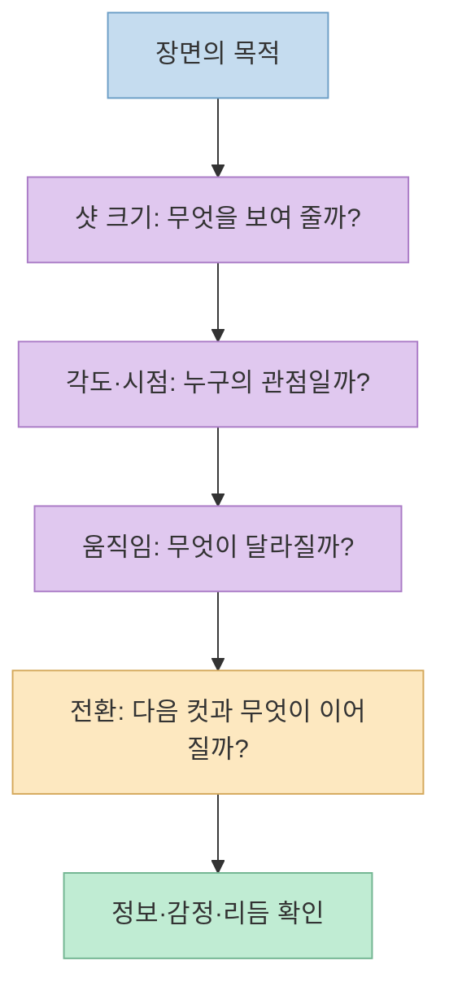
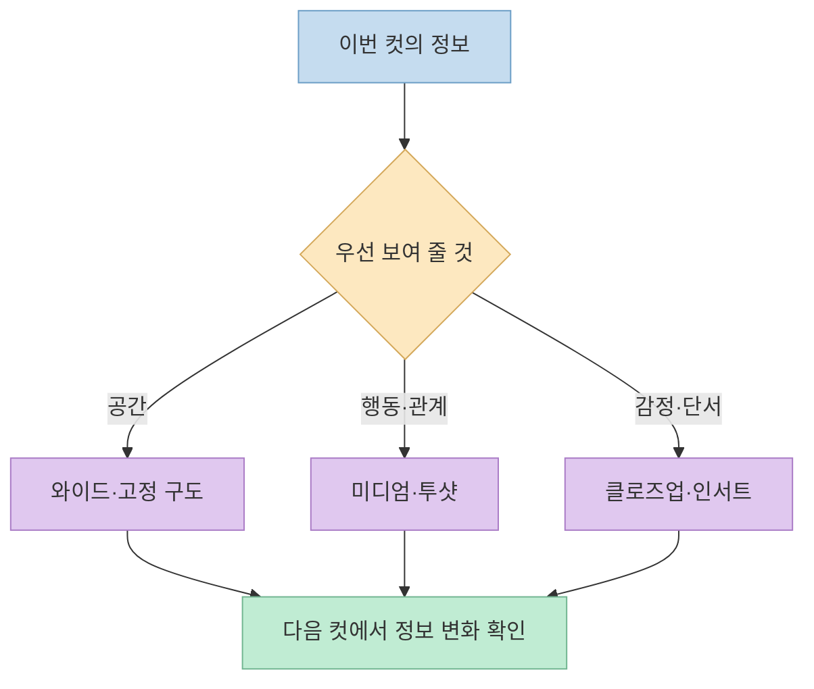
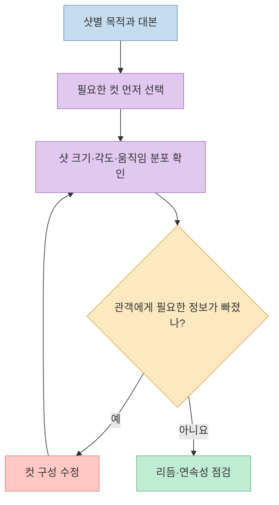
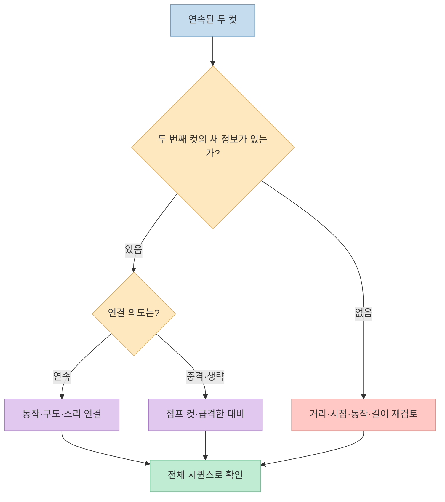
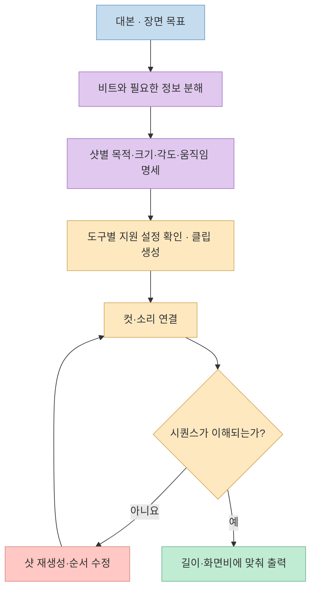

[Threads 게시물](https://www.threads.com/share/BAVqVismFO/)은 AI로 쇼츠와 롱폼을 자동 제작할 때 **카메라 구도나 움직임 하나만 고르는 것으로는 부족하다**고 말한다. 첨부된 세 장의 이미지에는 샷 크기·각도·움직임·전환의 용도와 조합, 추천 비율, 장면별 컷 연결 예시가 담겼다. 이 글은 그 자료를 제작용 의사결정 순서로 재구성한다. 이미지에 적힌 비율은 검증된 표준이 아니라 **작성자의 제안**으로 다룬다.

<!--more-->

## Sources

- [원본 Threads 공유 링크](https://www.threads.com/share/BAVqVismFO/) · [원본 게시물](https://www.threads.com/@pium.wedding/post/DenLebrEw0P)
- [Adobe: 샷 리스트를 만드는 방법](https://www.adobe.com/creativecloud/video/discover/shot-list.html) · [샷을 연결하는 방법](https://www.adobe.com/creativecloud/video/production/cinematography/camera-shots-and-angles/sequence-shot.html)
- [Adobe: 트래킹 샷](https://www.adobe.com/creativecloud/video/production/cinematography/camera-shots-and-angles/tracking-shot.html) · [매치 컷](https://www.adobe.com/in/creativecloud/video/discover/match-cut.html) · [J컷과 L컷](https://www.adobe.com/uk/creativecloud/video/discover/j-cut-and-l-cut.html)
- [Adobe Firefly: 영상 생성의 샷 크기·각도·움직임 설정](https://helpx.adobe.com/firefly/web/firefly-video-editor/generate-videos/generate-video-using-firefly-models.html)

## 세 장의 이미지는 각각 무엇을 정리하나

첫 번째 이미지는 **카메라 움직임 8가지**, 움직이거나 흔들리며 찍는 방식 8가지, **장면 사이 전환 8가지**를 묶는다. 팬·틸트·돌리·줌·트래킹·오빗처럼 카메라가 무엇을 하는지와, 핸드헬드·슬로모션·타임랩스처럼 화면이 어떻게 느껴지는지, 점프 컷·매치 컷·J컷·L컷처럼 다음 장면으로 어떻게 넘어가는지를 한 장에서 구별하게 한다. 둘째 이미지는 샷 크기와 시점·각도를 24개 항목으로 펼친다. 셋째 이미지는 앞의 용어를 **비율과 연속 사용, 상황별 컷 순서**로 연결한다. [원본 Threads 게시물의 첨부 이미지](https://www.threads.com/@pium.wedding/post/DenLebrEw0P)

게시물 작성자의 문제의식도 여기 있다. 한 컷의 카메라 움직임을 정하는 것과 **여러 컷이 연속될 때 정보·감정·리듬이 어떻게 바뀌는지**를 설계하는 것은 다른 일이다. Adobe의 샷 리스트 가이드 역시 와이드·미디엄·클로즈업 등 편집에 필요한 커버리지를 미리 확보하라고 한다. 다만 샷 리스트는 유연한 설계도이지, 항목을 모두 소진해야 하는 체크리스트가 아니다. [원본 게시물](https://www.threads.com/@pium.wedding/post/DenLebrEw0P) · [Adobe 샷 리스트 가이드](https://www.adobe.com/creativecloud/video/discover/shot-list.html)



## 샷 크기·각도·움직임을 별도 변수로 다뤄야 한다

**샷 크기**는 화면에서 인물과 환경을 얼마나 보여 주는지다. 원본 이미지의 익스트림 와이드·와이드·풀 샷은 장소와 동선을, 미디엄은 행동과 관계를, 클로즈업과 익스트림 클로즈업은 표정·사물의 세부 정보를 강조하는 예로 배치된다. 이는 Adobe가 설명하는 시퀀스의 기본인 **와이드 → 미디엄 → 클로즈업**과 방향이 같다. 무조건 먼 화면에서 가까운 화면으로만 가라는 뜻은 아니다. 관객이 이번 컷에서 알아야 할 것이 공간인지, 행동인지, 감정인지를 먼저 정하라는 뜻이다. [원본 이미지](https://www.threads.com/@pium.wedding/post/DenLebrEw0P) · [Adobe 시퀀스 샷 가이드](https://www.adobe.com/creativecloud/video/production/cinematography/camera-shots-and-angles/sequence-shot.html)

**각도와 시점**은 같은 피사체의 해석을 바꾼다. 원본 이미지는 눈높이, 로우앵글, 하이앵글, 탑샷, 인물 시점, 오버더숄더, 투샷 등을 소개하고 각각에 연출 의도를 붙인다. 그러나 "로우앵글=항상 권위", "하이앵글=항상 약함" 같은 고정 공식으로 읽으면 곤란하다. 같은 앵글도 인물의 동작, 앞뒤 컷, 음악과 대사에 따라 의미가 달라진다. 여기서는 **시점이 누구에게 귀속되는지와 다음 컷에서 관객이 새로 알게 되는 것**을 기준으로 선택하는 편이 낫다. [원본 이미지](https://www.threads.com/@pium.wedding/post/DenLebrEw0P) · [Adobe 샷·앵글 개요](https://www.adobe.com/creativecloud/video/production/cinematography/camera-shots-and-angles.html)

**움직임**은 다시 촬영 위치의 이동과 프레임 내부의 움직임을 구분해야 한다. 팬은 카메라 방향을 좌우로 돌리고, 틸트는 위아래로 돌린다. 트래킹은 피사체를 따라가고, 돌리는 카메라 자체를 이동시키는 촬영 방식이다. 원본 이미지에는 둘 다 등장하지만 동의어가 아니다. Adobe도 트래킹은 **피사체를 따라가는 기능**, 돌리는 **카메라를 이동시키는 장치·방식**이라는 차이를 설명한다. AI 영상 생성 프롬프트에서도 "카메라 움직임"만 쓰기보다 *어떤 대상이 드러나는지*를 함께 지정해야 목적 없는 흔들림을 줄일 수 있다. [원본 이미지](https://www.threads.com/@pium.wedding/post/DenLebrEw0P) · [Adobe 트래킹 샷 설명](https://www.adobe.com/creativecloud/video/production/cinematography/camera-shots-and-angles/tracking-shot.html)



## 추천 비율은 규칙이 아니라 검토용 기준이다

셋째 이미지에는 **20컷을 가정한 샷 크기 추천 비율**이 있다. 익스트림 와이드 5%, 와이드 15%, 풀 샷 10%, 미디엄과 미디엄 클로즈업 각 25%, 클로즈업 15%, 익스트림 클로즈업 5%다. 예컨대 20컷이면 미디엄 클로즈업 25%는 5컷에 해당한다. 별도로 움직임은 고정 카메라 60%, 팬·돌리·트래킹 각 10%, 틸트·크레인 각 5%를 제안한다. 눈높이 앵글을 약 70%로 두는 예시도 있다. **이 숫자들은 게시물 이미지의 권장안이지, 실험이나 업계 표준으로 검증된 최적값이 아니다.** [원본 Threads 이미지](https://www.threads.com/@pium.wedding/post/DenLebrEw0P)

이를 그대로 자동화 규칙으로 고정하면 부작용이 생긴다. 대화 중심 인터뷰, 제품 시연, 액션 시퀀스는 필요한 커버리지와 감정 곡선이 다르다. 같은 20컷이라도 20초 쇼츠와 몇 분짜리 롱폼의 컷 길이는 다르다. 더구나 장면마다 "와이드가 꼭 몇 컷"을 맞추면 정작 중요한 표정이나 동작을 놓칠 수 있다. 비율은 **샷 다양성이 지나치게 한쪽으로 치우쳤는지 확인하는 점검값**으로 쓰고, 각 컷의 존재 이유를 먼저 설명하는 편이 합리적이다. [원본 이미지](https://www.threads.com/@pium.wedding/post/DenLebrEw0P) · [Adobe 샷 리스트 가이드](https://www.adobe.com/creativecloud/video/discover/shot-list.html)



## 같은 기법을 연속 사용해도 되는 조건

원본 이미지의 유용한 대목은 "같은 기법을 두 번 쓰면 안 된다"가 아니라 **두 번째 컷이 무엇을 새로 주는가**를 묻는 부분이다. 하이앵글이 이어져도 거리나 드러나는 공간 정보가 달라지면 쓸 수 있고, 클로즈업이 이어져도 표정·감정의 단계가 바뀌면 의미가 생긴다. 반대로 거의 같은 거리·구도·정보의 두 컷을 붙이면 변화가 약하다. 움직이는 컷 뒤에 고정 컷을 두면 중요한 반응을 붙잡을 수 있지만, 단지 화면을 역동적으로 보이게 하려고 모든 컷에 이동을 넣으면 강조 지점이 흐려질 수 있다. 이는 원본의 **좋은 예/좋지 않은 예를 편집 판단으로 해석한 것**이다. [원본 이미지](https://www.threads.com/@pium.wedding/post/DenLebrEw0P)

**컷의 연결**도 효과 이름보다 관계가 먼저다. 매치 컷은 비슷한 형태·동작·구도·소리를 이용해 두 장면을 연결한다. 점프 컷은 시간이나 위치가 갑자기 뛰는 느낌을 의도적으로 만든다. J컷은 *다음 장면의 소리*가 영상보다 먼저 오고, L컷은 *이전 장면의 소리*가 다음 영상까지 남는다. 원본이 이 기법들을 소개한다고 해서 모든 장면에 전환 효과를 넣어야 하는 것은 아니다. 무엇을 부드럽게 잇고 무엇을 끊을지 결정한 뒤 기법을 고르는 편이 분명하다. [원본 이미지](https://www.threads.com/@pium.wedding/post/DenLebrEw0P) · [Adobe 매치 컷](https://www.adobe.com/in/creativecloud/video/discover/match-cut.html) · [Adobe J컷·L컷](https://www.adobe.com/uk/creativecloud/video/discover/j-cut-and-l-cut.html) · [Adobe 점프 컷](https://www.adobe.com/creativecloud/video/post-production/cuts-in-film/jump-cut.html)



## 장면별 컷 연결을 자동화에 옮기는 방법

셋째 이미지는 상황 소개에 **와이드 → 미디엄 → 클로즈업**, 발견 순간에 **미디엄 → 인서트 → 반응 클로즈업**, 대화에 **투샷 → 오버더숄더 → 반응 클로즈업**, 긴장 상승에 **고정 → 이동 → 세부 단서 → 정지** 같은 레시피를 제안한다. 이 순서가 정답이라기보다, 매 컷마다 **공간 정보 → 행동 → 감정 또는 단서** 중 무엇을 갱신할지 명시한 예로 읽는 편이 유용하다. Adobe의 시퀀스 가이드도 와이드·미디엄·클로즈업을 이야기의 기본 커버리지로 설명한다. [원본 이미지](https://www.threads.com/@pium.wedding/post/DenLebrEw0P) · [Adobe 시퀀스 샷 가이드](https://www.adobe.com/creativecloud/video/production/cinematography/camera-shots-and-angles/sequence-shot.html)

쇼츠·롱폼 제작 자동화라면 먼저 대본에서 **비트**를 나눈 뒤 컷마다 목적을 기록하는 방식이 좋다. 다음은 원본의 레시피를 구조화한 **제안 형식**이며, 어떤 영상 생성 서비스의 공식 입력 스키마도 아니다.

```yaml
scene: 인물이 닫힌 문 뒤의 소리를 듣는다
beat: 발견
shots:
  - purpose: 인물의 위치와 문까지의 거리 전달
    size: medium
    angle: eye-level
    movement: static
  - purpose: 문손잡이가 움직이는 단서 제시
    size: insert
    angle: eye-level
    movement: static
  - purpose: 인물의 반응으로 긴장 상승
    size: close-up
    angle: eye-level
    movement: subtle-push-in
transition: 단서와 반응의 순서가 이해되는 하드 컷
validation: 소리를 끄고 봐도 발견과 반응의 순서가 읽히는가
```

이 구조의 핵심은 "클로즈업 25%" 같은 전역 규칙을 앞세우지 않고, 각 샷에 **목적·크기·각도·움직임·다음 컷과의 연결·확인 방법**을 붙이는 데 있다. 생성 도구에는 지원되는 설정만 전달해야 한다. 예를 들어 Adobe Firefly의 영상 생성 기능은 샷 크기·각도·움직임 옵션을 제공하지만, 첫·마지막 프레임을 지정하면 일부 카메라 설정이 비활성화될 수 있다. 따라서 도구별 제약을 확인하지 않은 채 한 스키마를 모든 서비스에 그대로 적용할 수는 없다. [Adobe Firefly 영상 생성 도움말](https://helpx.adobe.com/firefly/web/firefly-video-editor/generate-videos/generate-video-using-firefly-models.html)

생성 후에는 클립 하나씩만 보지 말고 **이어 붙인 시퀀스**를 검토해야 한다. 화면 방향·인물 위치·동작의 연속성, 갑작스러운 시점 변화, 소리와 컷의 타이밍, 장면 목표의 전달 여부를 확인한다. 필요하면 샷을 다시 만들거나 컷 순서를 바꾼다. Adobe의 샷 리스트·연속성 편집 자료도 촬영 또는 생성 단계에서 다음 컷을 염두에 둔 커버리지와 편집 단계의 연결을 강조한다. [Adobe 샷 리스트](https://www.adobe.com/creativecloud/video/discover/shot-list.html) · [Adobe 연속성 편집](https://www.adobe.com/creativecloud/video/hub/ideas/what-is-continuity-editing-in-film.html)



## 실전 적용 포인트

1. **용어보다 장면 목표를 먼저 쓴다.** 이번 컷이 공간·행동·감정·단서 중 무엇을 전달하는지 정한다.
2. **샷 크기, 각도, 움직임, 전환을 독립적으로 결정한다.** 한 항목의 효과로 나머지를 대신 설명하지 않는다.
3. **추천 비율을 자동 할당 규칙으로 쓰지 않는다.** 원본의 20컷 예시는 결과를 점검하는 출발점이지, 모든 영상의 최적 분포가 아니다.
4. **반복 사용 여부는 두 번째 컷의 새 정보로 판단한다.** 같은 앵글이나 같은 크기를 연속해서 써도 장면의 변화가 명확하면 가능하다.
5. **클립이 아니라 완성된 연결을 검증한다.** 생성된 장면을 실제 순서로 붙여 시각·소리·리듬의 연속성을 확인한다.

## 핵심 요약

- 원본의 세 이미지는 **카메라 움직임·전환 24항목, 구도·시점 24항목, 비율과 컷 연결 예시**를 묶은 실무용 참고 자료다.
- 숫자로 제시된 샷·각도·움직임 비율은 **작성자의 권장안**이며 검증된 보편 규칙은 아니다.
- 자동화에 옮길 핵심은 "카메라를 움직여라"가 아니라 **샷의 목적과 다음 샷에서 바뀌는 정보를 기록하는 것**이다.
- 편집 품질은 개별 이미지보다 **연속된 컷과 소리의 관계**에서 판단해야 한다.

## 결론

카메라 용어 사전은 좋은 출발점이지만, 영상의 완성도를 결정하는 것은 **어떤 샷을 왜 이어 붙였는가**다. 원본 인포그래픽의 레시피를 그대로 복제하기보다, 장면 목표를 샷별 정보 변화로 바꾸고 완성된 시퀀스로 검증하는 편이 쇼츠와 롱폼 자동화 모두에 유용하다.
