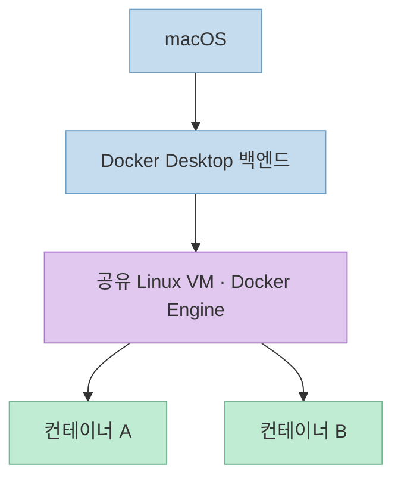
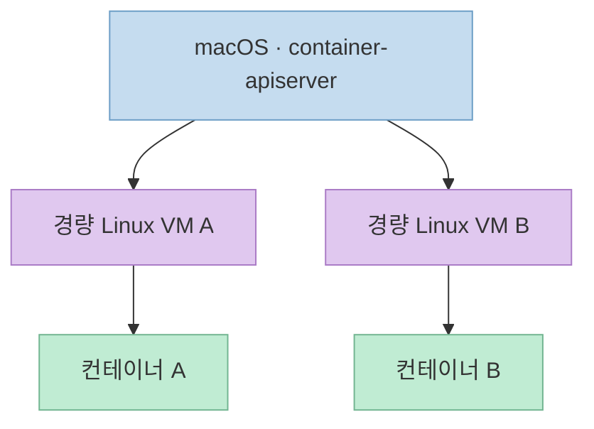
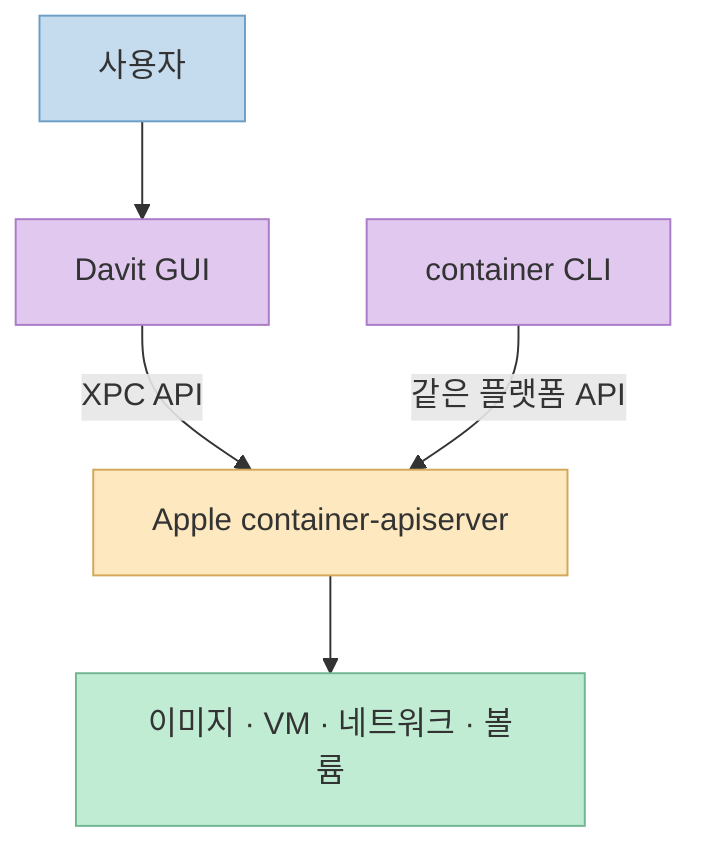
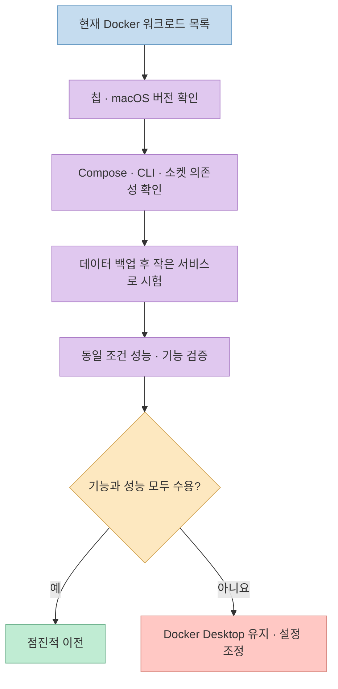

Mac에서 Docker Desktop을 제거하고 Apple의 `container` 도구를 쓰기 시작했더니 메모리 사용량이 줄고 디스크 I/O 체감이 좋아졌다는 [X 게시물](https://x.com/schotek/status/2111377289615384597)이 있다. 작성자는 관리 UI로 **Davit**을 추천한다. 흥미로운 사례지만, 게시물에는 하드웨어·워크로드·Docker 설정·측정값이 없다. **개인의 체감**과 **누구에게나 적용되는 성능 결론**을 분리해 살펴볼 필요가 있다.

<!--more-->

## Sources

- [원본 X 게시물: Docker Desktop에서 Apple container로 이동한 경험](https://x.com/schotek/status/2111377289615384597)
- [Apple `container` 공식 저장소](https://github.com/apple/container)
- [Apple `container` 기술 개요](https://github.com/apple/container/blob/main/docs/technical-overview.md) · [볼륨 가이드](https://github.com/apple/container/blob/main/docs/volumes.md)
- [Davit 공식 저장소](https://github.com/wouterdebie/davit)
- [Docker Desktop 네트워킹 문서](https://docs.docker.com/desktop/features/networking/) · [VM 관리자 문서](https://docs.docker.com/desktop/features/vmm/)

## 게시물이 말한 것과 말하지 않은 것

체코어로 작성된 원문은 Docker Desktop을 제거하고 Mac에서 Linux 개발 작업에 Apple의 컨테이너 도구를 사용한 뒤, **메모리 부담이 내려갔고 디스크 작업의 I/O가 훨씬 낫다고 느꼈다**고 전한다. 또한 UI 관리 도구로 Davit을 권한다. 하지만 구체적인 RAM 수치, I/O 작업 종류, 반복 횟수, 마운트 종류, 컨테이너 수는 제시하지 않는다. 따라서 "Apple `container`가 Docker Desktop보다 항상 빠르다"는 비교 시험으로 읽을 수 없다. [원본 X 게시물](https://x.com/schotek/status/2111377289615384597)

특히 "디스크 I/O"는 하나의 지표가 아니다. 이미지 빌드, 컨테이너 내부 파일 처리, Mac 디렉터리의 바인드 마운트, 이름 있는 볼륨의 데이터베이스 쓰기는 서로 다른 경로를 거친다. Apple 공식 가이드도 **호스트 폴더를 공유하는 바인드 마운트**와 **더 나은 I/O를 위한 이름 있는 볼륨**을 구분한다. 원문만으로 어떤 경로가 개선됐는지 판단할 수 없는 이유다. [Apple 볼륨 가이드](https://github.com/apple/container/blob/main/docs/volumes.md)

## 같은 OCI 이미지를 써도 실행 구조는 다르다

Docker Desktop은 Mac에서 Docker Engine을 **Linux VM 안에** 실행하고, 여러 컨테이너가 그 환경을 사용한다. Mac과 VM 사이의 파일·네트워크 연결에는 설정에 따라 백엔드 구성요소가 관여한다. 반면 Apple `container`는 **컨테이너마다 별도의 경량 Linux VM**을 띄운다. 두 방식 모두 Mac에서 Linux 워크로드를 돌리기 위해 가상화를 사용한다. "Apple 네이티브"라는 말이 Linux VM 없이 macOS 커널에서 컨테이너를 실행한다는 뜻은 아니다. [Docker Desktop 네트워킹 문서](https://docs.docker.com/desktop/features/networking/) · [Apple 기술 개요](https://github.com/apple/container/blob/main/docs/technical-overview.md)

Docker Desktop 구조:

Apple `container` 구조:

Apple의 기술 개요는 이 구조가 VM 수준의 격리를 제공하고 각 VM에 필요한 호스트 데이터만 마운트한다고 설명한다. 그러나 **VM이 여러 개라고 반드시 메모리를 덜 쓰거나, 더 쓴다고 단정할 수 없다.** 컨테이너 수와 실제 사용량에 따라 결과가 달라진다. Apple 문서는 VM 내부에서 해제된 메모리 페이지가 현재 호스트로 완전히 반환되지 않을 수 있어, 메모리 집약적 컨테이너를 많이 돌릴 때 재시작이 필요할 수 있다고도 밝힌다. [Apple 기술 개요](https://github.com/apple/container/blob/main/docs/technical-overview.md)

Docker Desktop 쪽도 고정된 비교 대상이 아니다. 공식 문서는 VM 관리자 선택에 따라 동작이 다르며, 최신 Docker VMM에는 유휴 메모리 반환과 Mac–컨테이너 파일 I/O 개선을 위한 기능이 있다고 설명한다. 원문 작성자가 어떤 Docker Desktop 버전과 VM 관리자를 사용했는지 모르므로, 게시물의 체감을 **아키텍처만의 효과**로 귀속할 수 없다. [Docker VM 관리자 문서](https://docs.docker.com/desktop/features/vmm/) · [원본 X 게시물](https://x.com/schotek/status/2111377289615384597)

## Davit은 무엇을 더하고, 무엇을 대체하지 않나

Davit은 Apple `container` 플랫폼을 관리하는 **SwiftUI 기반 macOS 앱**이다. 프로젝트 설명에 따르면 `container-apiserver`와 XPC로 직접 통신하며, 컨테이너 목록·실행 상태·로그·자원 통계·이미지·볼륨·네트워크 등을 GUI에서 다룬다. CLI 바이너리를 호출하지 않는다는 뜻이지, **Apple의 컨테이너 서비스 없이 독립 실행되는 엔진**이라는 뜻은 아니다. [Davit 공식 저장소](https://github.com/wouterdebie/davit)

Davit은 Compose 파일 가져오기와 자체 `Davit compose` 명령도 제공한다고 문서화한다. 그러나 이는 Apple `container`의 기본 명령도, Docker Compose의 모든 동작을 보증하는 기능도 아니다. Davit은 지원하지 않는 항목의 경고를 표시하고, 서비스 이름 조회를 위해 일부 상황에서 컨테이너의 `/etc/hosts`를 관리한다고 명시한다. 기존 `docker compose up` 워크플로를 무조건 그대로 바꿀 수 있다고 생각하지 말고, **프로젝트의 Compose 파일과 네트워크 동작을 검증**해야 한다. [Davit 공식 저장소: Compose 설명](https://github.com/wouterdebie/davit)

## 실제로 갈아타기 전에 확인할 네 가지

첫째, **운영체제와 칩**을 확인한다. Apple `container` 공식 저장소는 Apple silicon Mac을 요구하고 **macOS 26을 지원 대상**으로 명시한다. 기술 개요에는 macOS 15에서도 실행할 수 있으나 네트워크 등 기능 제한이 있고 해당 버전에서만 재현되는 문제를 지원하지 않는다고 적혀 있다. Davit의 macOS 15+ 실행 요건이 Apple 플랫폼의 macOS 15 공식 지원을 의미하지는 않는다. [Apple `container` README](https://github.com/apple/container) · [Apple 기술 개요](https://github.com/apple/container/blob/main/docs/technical-overview.md) · [Davit 요건](https://github.com/wouterdebie/davit)

둘째, **이미지와 데이터의 이동을 구분**한다. Apple `container`는 OCI 호환 이미지를 가져오고 만들 수 있으므로 이미지 형식은 이전의 출발점이 된다. 하지만 DB 데이터가 저장된 Docker 볼륨이나 Mac 바인드 마운트 경로까지 자동으로 이전된다는 뜻은 아니다. 이름 있는 볼륨을 쓰는 서비스라면 먼저 백업·복원 방법을 확인해야 한다. [Apple `container` README](https://github.com/apple/container) · [Apple 볼륨 가이드](https://github.com/apple/container/blob/main/docs/volumes.md)

셋째, **스크립트와 도구의 Docker 의존성**을 찾는다. `docker` CLI, Docker API 소켓, Compose 파일, IDE 통합, 테스트 자동화가 프로젝트에 있다면 이미지 호환성과 워크플로 호환성을 별도로 검증해야 한다. Apple이 문서화한 기본 인터페이스는 `container` CLI와 자체 서비스 API이며, Davit의 Compose 기능은 별도의 구현이다. [Apple 기술 개요](https://github.com/apple/container/blob/main/docs/technical-overview.md) · [Davit 공식 저장소](https://github.com/wouterdebie/davit)

넷째, **실제 워크로드로 같은 조건에서 측정**한다. 같은 Mac·이미지 아키텍처·컨테이너 수·메모리 제한을 맞추고, 콜드/웜 시작, 내부 파일 I/O, 바인드 마운트 I/O, 이름 있는 볼륨 I/O를 나눠 반복한다. 호스트의 메모리 압박과 벽시계 시간, 지연 분포를 함께 기록해야 한다. 이는 원문에 없는 실험 설계 제안이지, Apple 또는 Docker의 우위를 입증한 결과가 아니다. [원본 X 게시물](https://x.com/schotek/status/2111377289615384597) · [Apple 볼륨 가이드](https://github.com/apple/container/blob/main/docs/volumes.md) · [Docker VM 관리자 문서](https://docs.docker.com/desktop/features/vmm/)

## 실전 적용 포인트

1. X 게시물의 메모리·I/O 개선은 **작성자의 경험**으로 읽고, 내 환경의 예상 성능으로 옮기지 않는다.
2. Apple silicon과 macOS 버전, Docker 의존 스크립트, 데이터 저장 경로를 먼저 점검한다.
3. UI가 필요하면 Davit을 검토하되, Apple 플랫폼 위의 관리 도구라는 역할을 이해한다.
4. 기존 Docker Desktop의 VM 관리자와 파일 공유 설정도 비교 대상에 포함한다.
5. 전체 환경을 지우기 전에 한두 서비스로 기능·성능·복구를 검증한다.

## 핵심 요약

- Docker Desktop은 공유 Linux VM의 Docker Engine을 사용하고, Apple `container`는 컨테이너마다 경량 Linux VM을 사용한다.
- Davit은 Apple `container`의 GUI이며, Docker Engine의 완전한 대체품으로 동일시하면 안 된다.
- OCI 이미지 호환성은 Docker CLI·Compose·볼륨 데이터의 자동 호환성을 뜻하지 않는다.
- 원문에는 비교 조건과 측정값이 없어 **일반적인 성능 우위는 확인할 수 없다.**

## 결론

Apple `container`와 Davit은 Apple silicon Mac에서 Linux 컨테이너를 다루는 실질적인 선택지다. 다만 이전 여부는 SNS의 한 줄 성능 체감보다 **내 프로젝트의 호환성, 데이터 이전, 동일 조건의 측정 결과**로 결정해야 한다.
