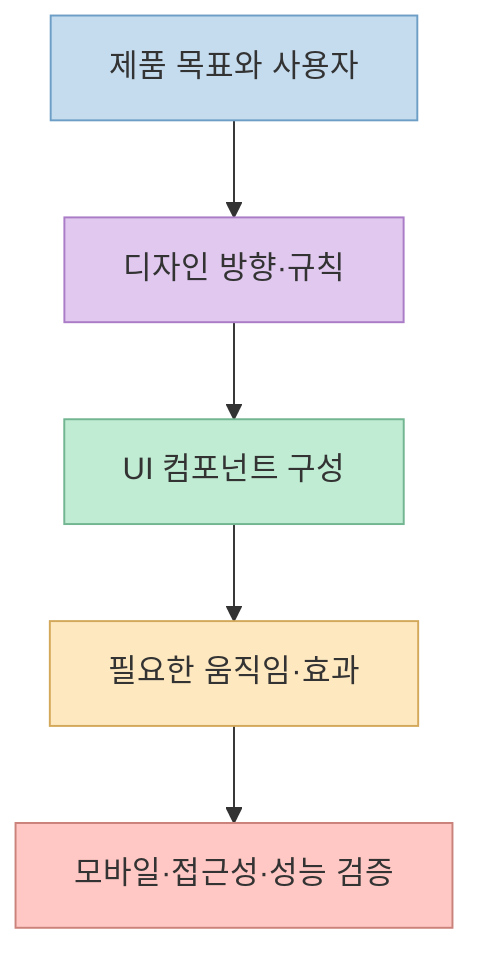
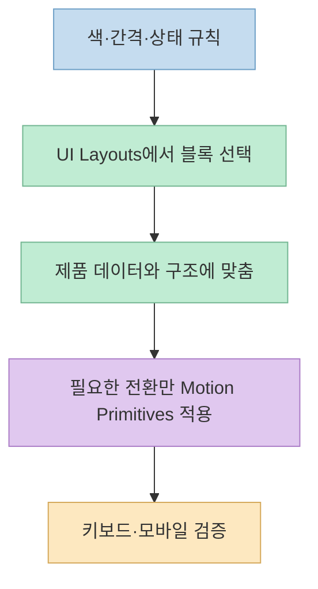
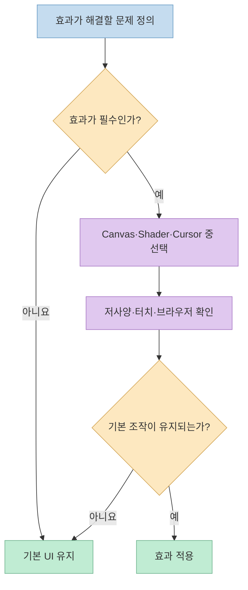

AI로 웹사이트를 만들 때 화면이 비슷해 보인다면, 도구를 여덟 개 설치하는 것보다 **어느 층의 문제인지** 먼저 구분해야 한다. [원본 Threads 글](https://www.threads.com/share/_nlAzkrMG/)은 디자인 규칙, UI 컴포넌트, 애니메이션, 셰이더 효과를 한 목록에 담았다. 각 저장소를 살펴보면 이들은 같은 종류의 도구가 아니며, "8개 모두 오픈소스"라는 표현도 라이선스 확인 없이 받아들이기 어렵다.

<!--more-->

## Sources

- [원본 Threads 포스트](https://www.threads.com/share/_nlAzkrMG/) · [원문 게시물](https://www.threads.com/@vibe.itji/post/Delyxx6D3gf)
- [SuperDesign](https://github.com/superdesigndev/superdesign)
- [Better Design](https://github.com/marvkr/better-design)
- [Design Taste](https://github.com/madebymustafa/design-taste)
- [Canvas UI](https://github.com/DavidHDev/canvas-ui)
- [Paper Shaders](https://github.com/paper-design/shaders)
- [UI Layouts](https://github.com/ui-layouts/uilayouts)
- [Motion Primitives](https://github.com/ibelick/motion-primitives)
- [Cursify](https://github.com/ui-layouts/cursify)

## 여덟 도구는 세 층에서 서로 다른 문제를 푼다

**디자인 판단을 돕는 도구**는 SuperDesign, Better Design, Design Taste다. 시안 생성, 디자인 시스템 전달, 생성 결과의 시각적 완성도 개선이 각각 중심이다. **화면을 구성하는 코드**는 UI Layouts와 Motion Primitives가 제공한다. **장식적인 시각 효과**는 Canvas UI, Paper Shaders, Cursify가 담당한다. 아래 분류는 각 저장소의 기능을 실무 흐름으로 재구성한 것이지, 도구 사이에 공식 연동이 있다는 뜻은 아니다. [SuperDesign](https://github.com/superdesigndev/superdesign) · [Better Design](https://github.com/marvkr/better-design) · [UI Layouts](https://github.com/ui-layouts/uilayouts)

이 순서가 중요한 이유는 효과를 먼저 고르면 제품의 정보 구조가 아니라 효과에 맞춰 화면을 구성하기 쉽기 때문이다. 반대로 색·글꼴·간격의 기준과 정보 위계를 먼저 정하면, 추가한 애니메이션이 **상태 변화를 설명하는지** 아니면 단순 장식인지 판단하기 쉬워진다. 이는 원문이 제안한 조합을 확장한 **실무적 판단**이다. [원본 Threads](https://www.threads.com/share/_nlAzkrMG/)

## 디자인 방향과 규칙: SuperDesign, Better Design, Design Taste

**SuperDesign**은 자연어로 디자인 시안과 UI를 생성하는 디자인 에이전트를 표방한다. 다만 [공식 README](https://github.com/superdesigndev/superdesign)는 기존 IDE 확장 프로그램이 더는 적극적으로 유지보수되지 않으며 새 웹 앱으로 방향을 옮겼다고 설명한다. 기존 확장 프로그램을 지금 설치하는 일과 [별도 `superdesign-skill` 저장소](https://github.com/superdesigndev/superdesign-skill)를 활용하는 일은 같지 않다. 기존 확장 프로그램의 사용 예시를 현재 제품의 지원 약속으로 읽지 말아야 한다.

**Better Design**은 AI 도구에 디자인 컨텍스트를 제공하는 MCP 서버다. [README](https://github.com/marvkr/better-design)는 디자인 토큰과 컴포넌트 규칙, 검토 기능을 소개한다. 따라서 "예쁜 화면을 바로 그리는 라이브러리"보다는 AI가 색·간격·컴포넌트 규칙을 참조하고 일관성을 검사하도록 만드는 층에 가깝다. 접근성 관련 검토 기능이 있어도 실제 키보드 조작과 화면 읽기 검증을 대신하지는 못한다.

**Design Taste**는 [공식 저장소](https://github.com/madebymustafa/design-taste)가 소개하는 24개 디자인 스킬 모음이다. 타이포그래피·브랜드 표현·랜딩 페이지 등 서로 다른 미적 문제에 사용할 수 있지만, 24개를 모두 한 프로젝트에 적용해야 한다는 뜻은 아니다. 화면이 밋밋하다는 추상적 요청보다, 예를 들어 "제목 위계가 약하다" 또는 "브랜드 색을 CTA와 구분하지 못한다"처럼 문제를 좁혀 필요한 스킬을 고르는 편이 결과를 평가하기 쉽다. 이 선택 기준은 저장소의 기능을 토대로 한 적용 제안이다.

## 화면을 조립할 때: UI Layouts와 Motion Primitives

**UI Layouts**는 [컴포넌트와 UI 블록](https://github.com/ui-layouts/uilayouts)을 제공한다. 즉, 디자인 기준을 실제 버튼·카드·섹션 코드로 옮기는 재료다. 저장소의 컴포넌트마다 필요한 의존성이 다를 수 있으며, README는 Motion, `clsx`, `tailwind-merge` 같은 패키지를 안내한다. 복사 전에 해당 예제의 프레임워크와 설치 지침을 확인해야 한다. 코드 조각을 가져오더라도 제품의 내용과 레이아웃 위계를 맞추는 작업은 남는다.

**Motion Primitives**는 [Motion과 Tailwind를 기반으로 한 애니메이션 UI 컴포넌트](https://github.com/ibelick/motion-primitives) 모음이다. 반복적인 전환 동작을 처음부터 구현하지 않아도 되는 장점이 있지만, README는 프로젝트를 **베타**로 표시한다. 따라서 실서비스에 넣는다면 현재 의존성 버전, API 변경 가능성, 기존 상태 관리·전환과의 충돌을 검토해야 한다. 제품의 모든 요소를 움직이기보다, 열림·닫힘이나 상태 변경을 이해시키는 곳부터 적용하는 편이 안전하다.

## 캔버스·셰이더·커서: 효과의 범위를 구분하자

**Canvas UI**는 페이지 위에 시각적 효과를 얹는 도구다. [README](https://github.com/DavidHDev/canvas-ui)는 React, Solid, Preact, Vue, Svelte, 바닐라 JavaScript의 여섯 환경과, 기본 WebGL 및 선택적 WebGPU 경로를 설명한다. HTML의 클릭·입력 기능을 유지하도록 설계됐다는 주장도 저장소 문서의 설명이다. 하지만 "상호작용 유지"가 모든 사이트·브라우저에서의 성능과 접근성을 보장한다는 뜻은 아니다. 실제 프로젝트의 저사양 모바일 장치에서 확인해야 한다.

**Paper Shaders**는 [캔버스 기반 셰이더 효과](https://github.com/paper-design/shaders)를 제공하며, Paper 디자인 도구에서 조절한 효과를 코드로 가져오는 흐름도 설명한다. React와 바닐라 JavaScript 사용 경로가 있다. 이 저장소는 `0.0.x` 버전 사이에도 호환성을 깨는 변경이 있을 수 있다고 밝힌다. 효과를 채택한다면 패키지 버전과 파라미터를 고정하고, 효과가 꺼졌을 때의 기본 화면도 유지하는 것이 좋다. 원문 댓글 역시 이 버전 고정 문제를 지적한다. [원문 댓글](https://www.threads.com/@vibe.itji/post/Delyxx6D3gf) · [Paper Shaders README](https://github.com/paper-design/shaders)

**Cursify**는 [React·Next.js용 커서 애니메이션 저장소](https://github.com/ui-layouts/cursify)다. 커서 따라오기나 포인터 시각 효과는 마우스 환경에서 의미가 있지만, 터치 화면에서는 같은 입력 방식이 없다. 따라서 핵심 동작을 커서 효과에 의존시키지 말고, 효과 없이도 링크와 버튼이 식별되는지 확인해야 한다. 이 역시 저장소 기능과 입력 장치의 차이를 연결한 적용 판단이다.

## “GitHub 오픈소스 8개”라는 표현은 라이선스를 나눠 읽어야 한다

원문은 목록 전체를 오픈소스라고 소개하지만, 공개 GitHub 저장소라는 사실과 각 코드의 **재사용 조건**은 별개다. [SuperDesign의 LICENSE](https://github.com/superdesigndev/superdesign/blob/main/LICENSE)는 코드의 상당 부분에 AGPLv3를 적용하면서 `@license Enterprise`로 표시된 파일에는 별도의 상업적 조건을 둔다. [Canvas UI의 LICENSE.md](https://github.com/DavidHDev/canvas-ui/blob/main/LICENSE.md)는 MIT에 Commons Clause를 결합해, 애플리케이션에서 사용하는 것과 컴포넌트 자체를 판매·재배포하는 것을 구분한다. 따라서 두 저장소를 단순한 "제약 없는 MIT 코드"로 소개할 수 없다.

[Cursify 저장소](https://github.com/ui-layouts/cursify)는 확인 시점에 루트 라이선스 파일과 GitHub의 라이선스 표시를 찾지 못했다. 이는 "사용할 수 없다"는 단정이 아니라, **공개된 소스만으로 재사용 허용 범위를 확인할 수 없었다**는 뜻이다. [GitHub의 라이선스 안내](https://docs.github.com/en/repositories/managing-your-repositorys-settings-and-features/customizing-your-repository/licensing-a-repository)도 명시적 라이선스가 없는 공개 저장소는 일반적인 재사용 허락을 자동으로 주지 않는다고 설명한다. 반면 확인 당시 Better Design·Design Taste·UI Layouts·Motion Primitives는 MIT, Paper Shaders는 Apache-2.0 라이선스를 표시했다. 프로젝트에 넣기 전에는 **실제로 복사·배포할 파일과 해당 버전의 라이선스**를 다시 확인해야 한다. [Better Design](https://github.com/marvkr/better-design) · [Design Taste](https://github.com/madebymustafa/design-taste) · [UI Layouts](https://github.com/ui-layouts/uilayouts) · [Motion Primitives](https://github.com/ibelick/motion-primitives) · [Paper Shaders](https://github.com/paper-design/shaders)

## 실전 적용 포인트: 한 번에 설치하지 말고 단계별로 검증한다

원문은 **Better Design → UI Layouts → Motion Primitives·Canvas UI**의 조합을 제안한다. 이를 그대로 고정된 추천 스택으로 보기보다, 디자인 규칙이 없다면 Better Design, 화면 블록이 부족하면 UI Layouts, 상태 전환이 밋밋하면 Motion Primitives, 실제로 시각 효과가 필요할 때만 Canvas UI라는 **조건부 선택 순서**로 읽는 편이 낫다. 시안 탐색이 주된 문제라면 SuperDesign, 디자인 판단의 폭이 문제라면 Design Taste가 앞 단계에 들어갈 수 있다. [원본 Threads](https://www.threads.com/share/_nlAzkrMG/) · [각 저장소 README](https://github.com/marvkr/better-design)

1. 먼저 페이지 목표, 대상 사용자, 기존 브랜드 규칙을 적고 기본 화면을 완성한다.
2. 필요한 UI 코드만 가져와 의존성, 반응형 레이아웃, 라이선스를 확인한다.
3. 움직임은 상태를 설명하는 요소에만 추가하고 **움직임 축소 설정**을 존중한다. [`prefers-reduced-motion` 문서](https://developer.mozilla.org/en-US/docs/Web/CSS/Reference/At-rules/%40media/prefers-reduced-motion)와 [WCAG의 상호작용 애니메이션 설명](https://www.w3.org/WAI/WCAG21/Understanding/animation-from-interactions)을 기준으로 비필수 동작을 끌 수 있게 한다.
4. 데스크톱 마우스뿐 아니라 모바일 터치, 키보드, 저사양 장치에서 효과를 끈 상태와 켠 상태를 모두 확인한다. 특히 WebGL/WebGPU 효과는 지원 여부뿐 아니라 실제 렌더링 부담을 시험해야 한다. [Canvas UI README](https://github.com/DavidHDev/canvas-ui)

## 핵심 요약

- **방향과 규칙:** SuperDesign은 시안 탐색, Better Design은 MCP 기반 디자인 규칙, Design Taste는 디자인 스킬 모음이다.
- **구현 재료:** UI Layouts는 화면 블록, Motion Primitives는 애니메이션 컴포넌트를 제공한다.
- **시각 효과:** Canvas UI는 캔버스 오버레이, Paper Shaders는 셰이더, Cursify는 커서 효과에 초점을 둔다.
- **검증 사항:** 유지보수 상태, 프레임워크 의존성, 모바일 성능, 움직임 축소 설정, **각 저장소의 실제 라이선스**를 따로 확인해야 한다.

## 결론

여덟 도구의 가치는 목록을 통째로 설치하는 데 있지 않다. 먼저 디자인 판단의 문제인지, 화면을 조립할 코드가 부족한지, 효과가 정말 필요한지를 구분하자. 그다음 한 도구씩 적용하고 실제 브라우저와 라이선스 조건을 확인하면, "더 화려한 화면"보다 **유지할 수 있는 화면**에 가까워진다.
