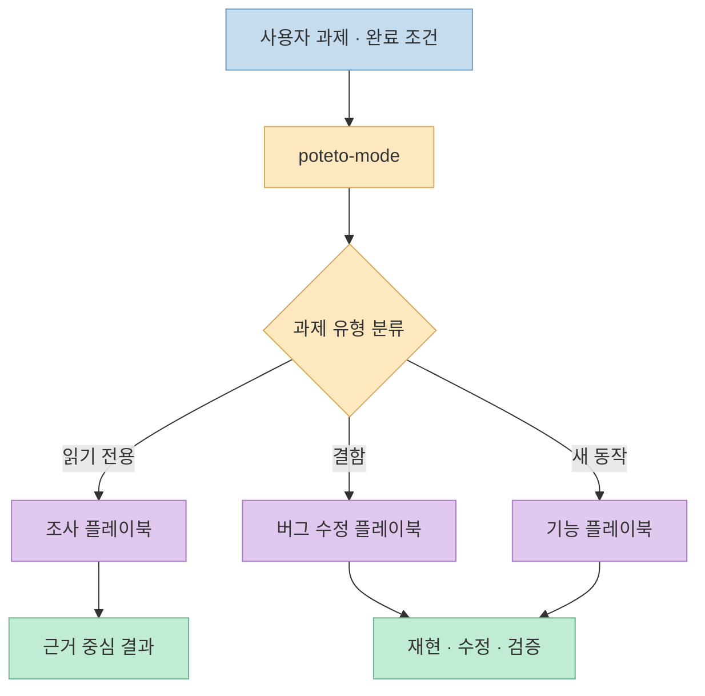
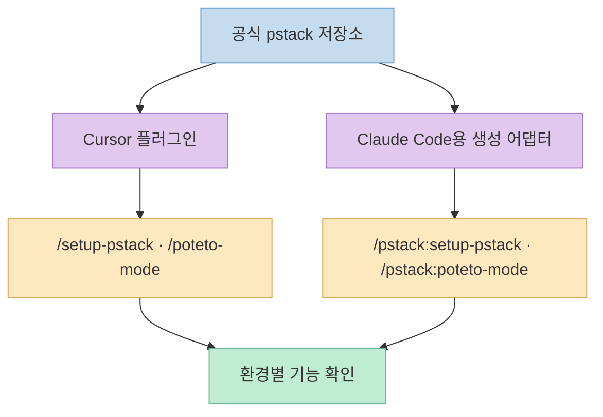
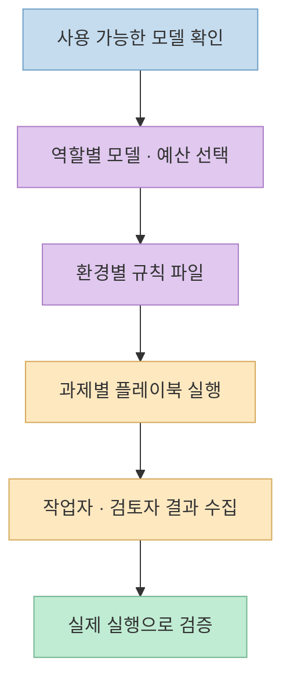

[pstack](https://github.com/cursor/plugins/tree/main/pstack)은 코드를 많이 생성하는 도구라기보다, **과제에 맞는 조사·구현·검증 절차를 고르는 플러그인**이다. 앞서 [소개 영상을 바탕으로 쓴 글](/post/2026/10/2026-10-16-pstack-cursor-engineering-workflow-evidence/)은 `/how`, `/architect`, `/interrogate` 등 대표 스킬의 흐름을 다뤘다. 이번에는 **현재 공식 저장소**를 직접 기준으로 설치 경로, 플레이북, 모델 설정, 포함되지 않은 기능을 구분한다.

<!--more-->

## Sources

- [입력 URL: Cursor 공식 플러그인 저장소의 pstack](https://github.com/cursor/plugins/tree/main/pstack)
- [pstack README](https://github.com/cursor/plugins/blob/main/pstack/README.md) · [플러그인 매니페스트](https://github.com/cursor/plugins/blob/main/pstack/.cursor-plugin/plugin.json)
- [`poteto-mode` 스킬 정의](https://github.com/cursor/plugins/blob/main/pstack/skills/poteto-mode/SKILL.md) · [`setup-pstack` 스킬 정의](https://github.com/cursor/plugins/blob/main/pstack/skills/setup-pstack/SKILL.md)

## 플러그인 구조: 단일 프롬프트가 아니라 라우터와 작업 절차

저장소의 `pstack` 디렉터리에는 **플러그인 매니페스트**, `skills/`, `agents/`, 가이드 문서가 있다. 매니페스트는 `skills`와 `agents`의 위치를 지정한다. README는 `/poteto-mode`를 기본 입구로 설명한다. 사용자의 요청을 읽고 플레이북을 고른 뒤 필요한 시점에 다른 스킬을 호출하는 구조다. 그래서 모든 스킬 이름을 외워 순서대로 실행할 필요는 없지만, 라우터가 고른 작업 경로는 검토해야 한다. [pstack 매니페스트](https://github.com/cursor/plugins/blob/main/pstack/.cursor-plugin/plugin.json) · [README: usage](https://github.com/cursor/plugins/blob/main/pstack/README.md)



README에는 조사, 버그 수정, 성능 개선, 기능 개발, 리팩터링, 시각적 일치, PR 검증·출시, 장시간 작업 등 **서로 다른 목적의 플레이북**이 나열돼 있다. 이것은 "한 과제에서 모든 스킬을 실행한다"는 뜻이 아니다. 예를 들어 원인만 알고 싶은 질문은 읽기 전용 조사로 끝날 수 있고, 버그 수정은 재현과 실행 결과가 필요하다. `/poteto-mode`의 실제 규칙은 별도 [`SKILL.md`](https://github.com/cursor/plugins/blob/main/pstack/skills/poteto-mode/SKILL.md)에 있으므로, README의 한 줄 소개보다 **선택된 플레이북의 단계와 중단 조건**을 먼저 확인하는 편이 안전하다. [README: 플레이북 목록](https://github.com/cursor/plugins/blob/main/pstack/README.md) · [`poteto-mode` 정의](https://github.com/cursor/plugins/blob/main/pstack/skills/poteto-mode/SKILL.md)

## Cursor와 Claude Code는 설치 명령과 호출 이름이 다르다

현재 공식 README는 Cursor에서 `/add-plugin pstack`을 안내한다. 이어 `/setup-pstack`으로 모델·추론 예산을 설정하고 `/poteto-mode`로 과제를 시작한다. README는 Cursor의 `/` 메뉴에서 스킬을 선택해 메시지에 붙이는 방식과, 별도의 사용자 지정 모드로 유지하는 방식을 구분한다. 즉 한 번 입력했다고 이후 모든 채팅에 영구 적용된다고 가정하면 안 된다. [README: install/get started/usage](https://github.com/cursor/plugins/blob/main/pstack/README.md)

```text
/add-plugin pstack
/setup-pstack
/poteto-mode 수정 전 실패를 재현하고, 원인을 확인한 뒤 같은 조건에서 수정 후 결과를 검증해 줘.
```

같은 README는 **Claude Code용 설치 경로**도 제공한다. 저장소를 플러그인 마켓플레이스로 추가한 뒤 `pstack@cursor-plugins`를 설치하고, 명령에는 플러그인 접두사 `pstack:`을 붙인다. Cursor 전용 기능은 Claude Code 어댑터에서 건너뛰는 경우가 있다고 문서에 적혀 있다. 따라서 **플러그인을 설치한 환경의 명령·지원 범위를 기준으로** 실행해야 한다. 이 글에서는 두 환경 중 어느 쪽에도 pstack을 실제 설치하지 않았다. [README: Claude Code 설치·어댑터](https://github.com/cursor/plugins/blob/main/pstack/README.md)

```text
/plugin marketplace add cursor/plugins
/plugin install pstack@cursor-plugins
/pstack:setup-pstack
/pstack:poteto-mode 먼저 현재 동작을 조사하고, 변경 후 실제 동작으로 완료를 입증해 줘.
```



앞선 [영상 기반 글](/post/2026/10/2026-10-16-pstack-cursor-engineering-workflow-evidence/)은 당시 확인한 자료를 바탕으로 Claude Code 포트를 커뮤니티 버전이라고 설명했다. **현재 README는 공식 저장소에 Claude Code 설치 명령과 생성 어댑터를 명시한다.** 이는 이전 글의 해당 설명을 현재 상태로 일반화하면 안 된다는 뜻이다. 플러그인 기능과 설치 문서는 변하므로 실제 도입 전 README를 다시 확인해야 한다. [현재 pstack README](https://github.com/cursor/plugins/blob/main/pstack/README.md)

## 모델 설정과 병렬 실행은 비용·권한 결정이다

`/setup-pstack`은 사용 가능한 모델을 확인하고 역할별 선택과 추론 예산을 설정하는 스킬이다. Cursor에서는 사용자 규칙 파일 `~/.cursor/rules/pstack-models.mdc`를 쓰도록 정의돼 있으며, Claude Code 어댑터는 README에 별도 규칙 경로를 안내한다. 이런 설정은 모델 이름 하나를 바꾸는 정도가 아니다. 코드 작업, 판단, 독립 검토 패널, 병렬 작업자에 어떤 모델을 쓰는지에 따라 실행 비용과 재현성이 달라질 수 있다. [setup-pstack 정의](https://github.com/cursor/plugins/blob/main/pstack/skills/setup-pstack/SKILL.md) · [README: Claude Code 설정](https://github.com/cursor/plugins/blob/main/pstack/README.md)



README의 `/arena`와 `/swarm`도 같은 "병렬"이 아니다. 전자는 **같은 문제에 대한 여러 시도**를 비교하고, 후자는 **서로 다른 범위**를 작업자에게 나눈다. 에이전트 수를 늘리는 것만으로 검증이 끝나지는 않는다. 저장소의 원칙에는 실제 산출물을 실행해 확인하라는 규칙이 있고, 변경·PR을 다루는 플레이북에는 그에 맞는 증거와 검토가 필요하다. [README: skills](https://github.com/cursor/plugins/blob/main/pstack/README.md) · [`poteto-mode` 원칙](https://github.com/cursor/plugins/blob/main/pstack/skills/poteto-mode/SKILL.md)

## README가 직접 그어 놓은 기능의 경계

README는 `/deslop`, `control-cli`, `control-ui`가 **pstack 자체에 포함되지 않고** 별도의 `cursor-team-kit` 플러그인에 있다고 적는다. 따라서 pstack만 설치한 뒤 모든 관련 명령이 들어왔다고 생각하면 안 된다. 반대로 `benny` 자동화 묶음은 저장소 안에 있지만 **기본적으로 비활성**이며 일반 슬래시 스킬로 등록된 것이 아니다. 해당 자동화는 별도 설정을 거쳐야 하므로 설치 직후 자동으로 Slack 이슈를 처리한다고 기대하면 오해다. [README: not shipped here / automations](https://github.com/cursor/plugins/blob/main/pstack/README.md)

실무에서는 설치 전 이 경계를 살피는 것이 중요하다. 플러그인 스킬은 조사·수정·리뷰·PR 작업을 지시하고, 일부 플레이북은 장시간 또는 병렬 실행을 전제로 한다. 개인 저장소에 먼저 설치해 어떤 파일을 읽고 어떤 외부 서비스를 연결하는지 확인한 뒤 팀 프로젝트로 넓히는 편이 안전하다. 이는 공식 기능 설명에서 도출한 **도입 시 권장 절차**이지, pstack이 특정 권한을 자동으로 얻는다는 주장은 아니다. [README: 플레이북·자동화](https://github.com/cursor/plugins/blob/main/pstack/README.md) · [`poteto-mode` 정의](https://github.com/cursor/plugins/blob/main/pstack/skills/poteto-mode/SKILL.md)

## 실전 적용 포인트

1. **먼저 실행 환경을 결정한다.** Cursor와 Claude Code는 설치 명령과 스킬 호출 이름이 다르다.
2. **한 번에 작은 과제로 검증한다.** 재현 가능한 버그나 읽기 전용 조사를 골라 플레이북 선택과 결과 근거를 확인한다.
3. **모델 설정을 명시한다.** 사용 가능한 모델과 역할별 비용을 확인하고 기본값을 당연하게 받아들이지 않는다.
4. **병렬화에는 합류 기준을 둔다.** 작업자 수가 아니라 실행 가능한 검증과 독립 검토를 완료 조건으로 삼는다.
5. **번들 밖 기능을 확인한다.** `cursor-team-kit`에 속한 명령과 별도 설정이 필요한 자동화를 pstack 기본 기능으로 세지 않는다.

## 핵심 요약

- pstack의 중심은 `/poteto-mode`가 과제에 맞는 플레이북과 스킬을 고르는 **작업 라우팅**이다.
- 현재 공식 README는 **Cursor와 Claude Code 설치 경로**를 모두 안내하지만 호출 명령과 일부 기능은 다르다.
- 모델 선택과 장시간·병렬 실행은 **비용과 검증 책임**을 함께 가져온다.
- 관련 이름이 README에 등장해도 모두 pstack에 번들된 기능은 아니다.

## 결론

pstack을 평가할 때는 스킬 개수보다 **작업을 어떤 절차로 진행하고, 무엇으로 결과를 입증하는지**를 봐야 한다. 현재 공식 저장소는 설치 환경별 차이와 기능 경계를 확인할 출발점이며, 이전 소개 글보다 먼저 읽어야 할 최신 기준이다.
