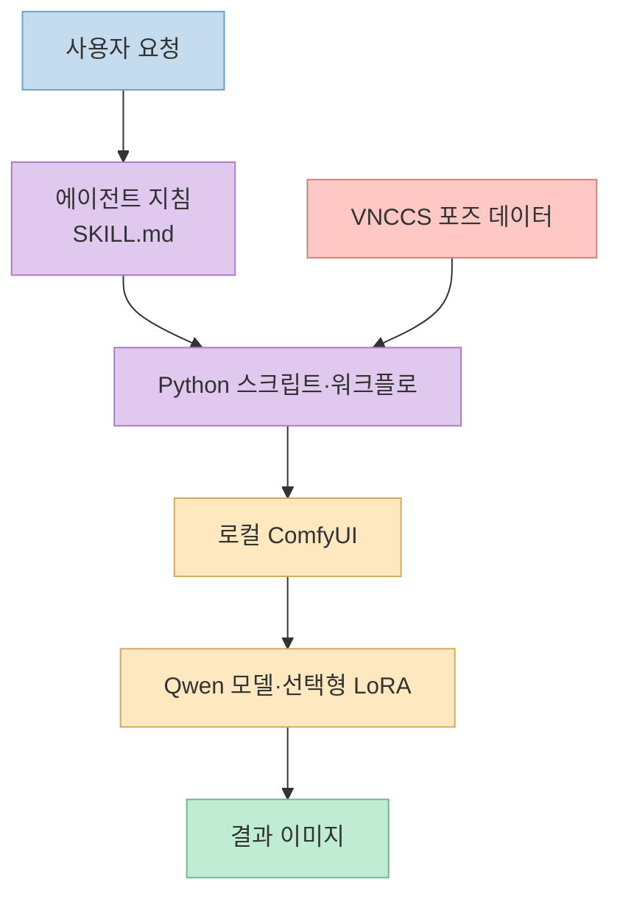
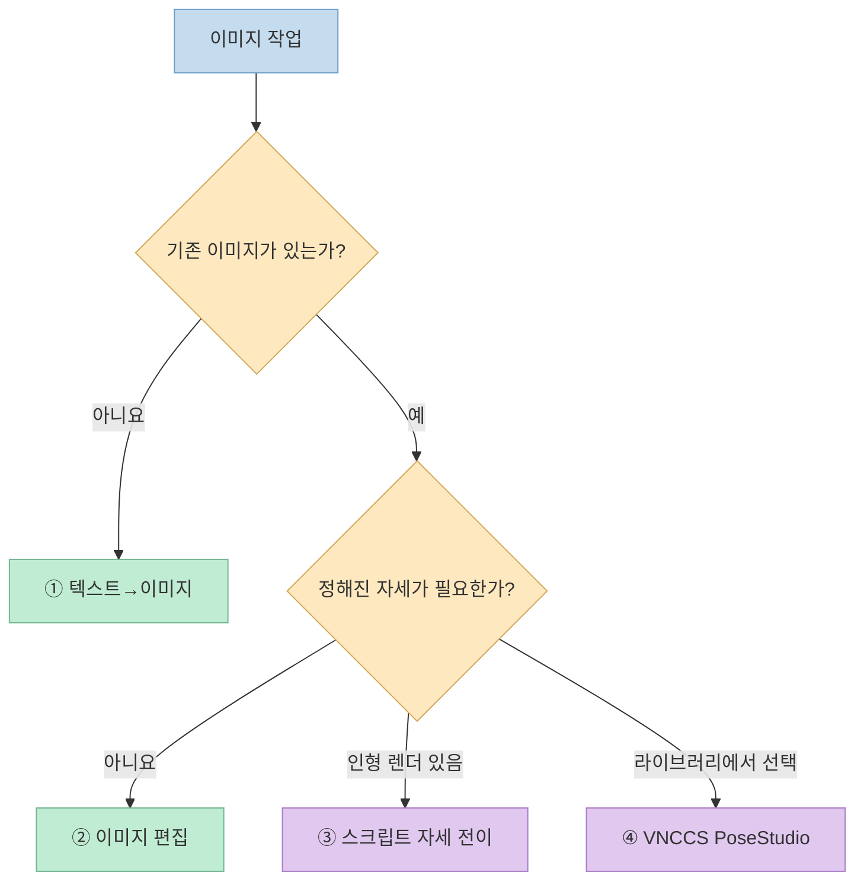
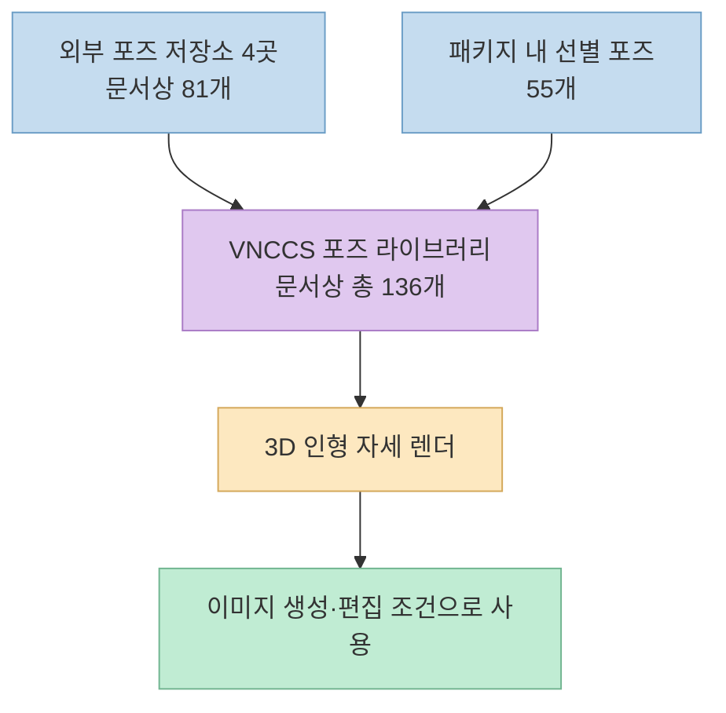
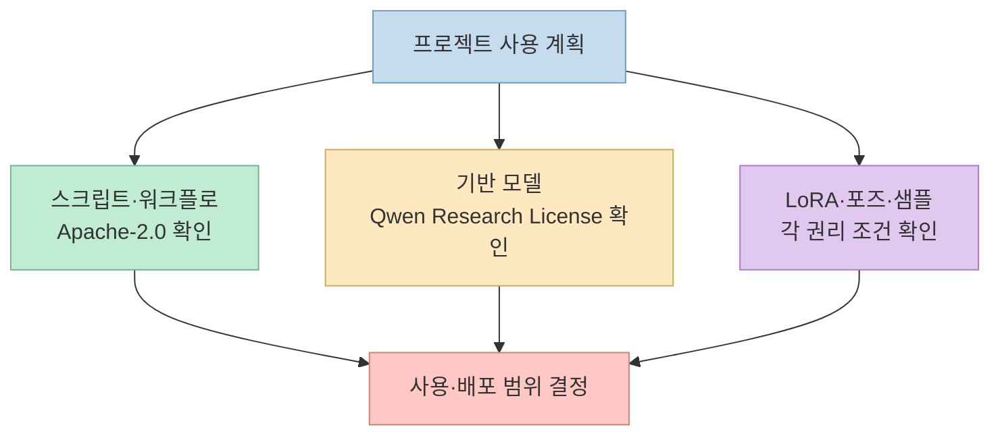

[X 게시물](https://x.com/grgerwcwetwet/status/2111413659620532534)은 성인용 이미지 생성에 특화된 `qwen21-nsfw-pose-skill`을 소개하며 136개 자세, 이미지 편집, AI 코딩 도구 연동을 강조한다. 저장소를 살펴보면 단일 모델의 새 기능이라기보다 **ComfyUI·Qwen-Image 2.1·LoRA·3D 인형 기반 자세 제어·에이전트 지침을 묶은 로컬 워크플로**다. 기능 못지않게 중요한 점은 저장소 코드의 라이선스가 기반 모델과 제3자 소재까지 덮지는 않는다는 것이다.

<!--more-->

## Sources

- [원본 X 게시물](https://x.com/grgerwcwetwet/status/2111413659620532534)
- [프로젝트 README](https://github.com/Arekejoker/qwen21-nsfw-pose-skill)
- [에이전트용 `SKILL.md`](https://github.com/Arekejoker/qwen21-nsfw-pose-skill/blob/main/SKILL.md)
- [설치 가이드](https://github.com/Arekejoker/qwen21-nsfw-pose-skill/blob/main/install/setup.md)
- [Qwen-Image 2.1 모델 카드](https://huggingface.co/Qwen/Qwen-Image-2.1) · [모델 라이선스](https://huggingface.co/Qwen/Qwen-Image-2.1/blob/main/LICENSE)

## 무엇을 묶은 스킬인가

프로젝트의 [README](https://github.com/Arekejoker/qwen21-nsfw-pose-skill)는 Qwen-Image 2.1의 ComfyUI용 모델 파일 위에 이미지 생성·편집 워크플로, 선택형 LoRA, VNCCS PoseStudio, 자세 라이브러리와 Python 스크립트를 얹는다고 설명한다. 저장소의 `SKILL.md`는 Claude Code·Codex·Cursor·OpenClaw 같은 에이전트가 **어떤 작업에 어느 스크립트를 쓸지** 판단하도록 하는 사용 지침이다. 따라서 "Claude Code가 자체적으로 자세를 생성한다"는 뜻이 아니다. 실제 추론은 로컬 ComfyUI와 설치한 모델·노드에서 일어난다. [프로젝트 README](https://github.com/Arekejoker/qwen21-nsfw-pose-skill) · [설치 가이드](https://github.com/Arekejoker/qwen21-nsfw-pose-skill/blob/main/install/setup.md)

X 게시물은 "정확한 자세 제어"라고 소개하지만, 저장소의 샘플과 설명은 **유지보수자의 자체 검증 자료**다. 공개된 문서만으로 모든 인물·입력 이미지·하드웨어에서 얼굴이나 의상이 유지된다고 보장할 수 없다. 자세 제어는 모델 추론의 조건을 강화하는 방법으로 이해하고, 결과의 신원 일치와 해부학적 오류는 실제 출력에서 별도로 확인해야 한다. [원본 X 게시물](https://x.com/grgerwcwetwet/status/2111413659620532534) · [프로젝트 SKILL.md](https://github.com/Arekejoker/qwen21-nsfw-pose-skill/blob/main/SKILL.md)

## 자세 제어는 네 경로로 나뉜다

[프로젝트의 작업 분류](https://github.com/Arekejoker/qwen21-nsfw-pose-skill#四条路线)는 요구가 새 이미지를 만드는 것인지, 기존 이미지를 수정하는 것인지, 3D 인형의 자세를 참조하는 것인지에 따라 나뉜다.

1. **텍스트→이미지:** 설명에서 새 이미지를 만든다. 저장소는 이 경로에 별도 LoRA를 사용하도록 설계했다.
2. **이미지 편집:** 이미지를 입력받아 변경한다. 저장소는 기존 캐릭터의 얼굴·의상 유지 목적을 설명하지만, 이는 결과 보장이 아니라 목표다.
3. **스크립트 자세 전이:** 신원 특징이 없는 3D 인형 렌더를 자세 참조로 써서 기존 캐릭터의 자세를 바꾼다. 브라우저 자동화는 필요하지 않다.
4. **VNCCS PoseStudio:** 라이브러리에서 자세를 선택하고 3D 인형을 렌더해 워크플로에 전달한다. 이 경로에는 VNCCS 노드와 연결 가능한 브라우저가 추가로 필요하다.

사진을 자세 참조로 그대로 넣는 것과 3D 인형 렌더를 사용하는 것은 다르다. [프로젝트 지침](https://github.com/Arekejoker/qwen21-nsfw-pose-skill/blob/main/SKILL.md)은 일반 사진·삽화가 참조 인물 자체를 결과에 섞거나 다시 그리게 만들 수 있다며, 3·4번 경로에서 특징 없는 인형 렌더를 권한다. 다만 이 설명 역시 프로젝트가 보고한 실패 사례에 근거한다. 목적이 단순한 새 이미지 생성이라면 전체 포즈 시스템을 설치할 이유가 없다. [설치 가이드](https://github.com/Arekejoker/qwen21-nsfw-pose-skill/blob/main/install/setup.md)

## 136개 자세는 어디서 오는가

[설치 가이드](https://github.com/Arekejoker/qwen21-nsfw-pose-skill/blob/main/install/setup.md)는 포즈 라이브러리를 **외부 저장소에서 받아오는 81개와 이 패키지의 로컬 선별 55개**, 합계 136개로 설명한다. 이 숫자는 설치·갱신 뒤 라이브러리 목록을 세는 프로젝트의 기준이지, 모든 자세에서 품질이 검증됐다는 점수는 아니다. 외부 포즈 저장소 네 곳과 `local_user_poses`의 55개를 함께 쓰므로, 저장소만 내려받고 외부 포즈를 설치하지 않으면 같은 수가 나오지 않는다. [프로젝트 README](https://github.com/Arekejoker/qwen21-nsfw-pose-skill)

## 실행 요건과 검증 범위

기본 경로에도 로컬 ComfyUI와 **확산 모델·텍스트 인코더·VAE 세 파일**이 필요하다. LoRA는 선택한 경로에 따라 달라지고, 4번 경로에는 VNCCS 노드·포즈 라이브러리·Playwright 또는 CDP로 연결할 브라우저가 더해진다. 설치 문서는 1~3번 스크립트는 Python 표준 라이브러리만으로 실행할 수 있다고 설명하지만, 이는 **스크립트의 Python 패키지 의존성**에 관한 말이다. ComfyUI와 모델 파일까지 필요 없다는 뜻이 아니다. [설치 가이드: 경로별 의존성](https://github.com/Arekejoker/qwen21-nsfw-pose-skill/blob/main/install/setup.md)

README의 하드웨어 기준은 모델 파일 약 16GB, NVIDIA GPU는 최소 12GB VRAM과 RAM 32GB, 원활한 사용에는 24GB VRAM을 권장한다. 저장 공간은 약 40GB를 잡는다. 이는 **프로젝트가 제시한 참고치**이며, 속도는 해상도·설정·메모리 오프로딩에 따라 달라진다. Apple Silicon 수치는 유지보수자가 직접 Mac에서 측정한 값이 아니라 커뮤니티 보고를 인용했다고 README가 명시한다. 따라서 "내 컴퓨터에서도 몇 초면 된다"는 보장으로 읽으면 안 된다. [프로젝트 README: 하드웨어·macOS](https://github.com/Arekejoker/qwen21-nsfw-pose-skill)

설치 후 [프로젝트의 `doctor.py` 설명](https://github.com/Arekejoker/qwen21-nsfw-pose-skill/blob/main/install/setup.md)은 ComfyUI 연결, 모델·LoRA, VNCCS 노드, 포즈 라이브러리와 브라우저 환경을 점검하는 읽기 전용 사전 검사를 제안한다. 다만 이 글은 **문서와 저장소를 검토한 결과**이지, 모델을 다운로드하거나 실제 성능·출력 품질을 재현한 벤치마크가 아니다.

## 코드가 Apache-2.0이어도 전체가 자유 이용은 아니다

[프로젝트 README의 라이선스 설명](https://github.com/Arekejoker/qwen21-nsfw-pose-skill#说明)은 이 저장소가 작성한 스크립트·워크플로·문서 등에 Apache-2.0을 적용한다. 동시에 제3자의 예시 이미지, 외부 포즈 데이터, 모델과 LoRA는 그 범위 밖이라고 명시한다. 따라서 X 게시물의 "오픈소스 프로젝트"라는 표현을 **포함된 모든 데이터와 모델을 상업적으로 쓸 수 있다**는 의미로 확대해서는 안 된다. [원본 X 게시물](https://x.com/grgerwcwetwet/status/2111413659620532534)

특히 [Qwen-Image 2.1 원본 모델 카드](https://huggingface.co/Qwen/Qwen-Image-2.1)는 `qwen-research` 라이선스를 표시한다. [라이선스 본문](https://huggingface.co/Qwen/Qwen-Image-2.1/blob/main/LICENSE)은 제공된 모델 자료의 사용·복제·배포·수정을 **비상업적 연구·평가 목적에 한정**하고, 상업적 사용에는 별도 라이선스를 요구한다. 이는 이 스킬의 Apache-2.0 표기가 기반 모델의 조건을 바꾸지 않는다는 뜻이다. LoRA와 외부 포즈·샘플 이미지에도 각각의 배포 조건이 있을 수 있으므로, 실제로 가져올 파일 단위로 확인해야 한다. 여기서의 설명은 라이선스 문구의 요약이며 개별 사용 사례에 대한 법률 판단은 아니다. [Qwen 라이선스](https://huggingface.co/Qwen/Qwen-Image-2.1/blob/main/LICENSE) · [프로젝트 README](https://github.com/Arekejoker/qwen21-nsfw-pose-skill)

## 실전 적용 포인트

1. **경로를 먼저 고른다.** 새 이미지, 기존 이미지 수정, 인형 렌더를 통한 자세 참조, 포즈 라이브러리 선택 중 실제 필요한 것 하나를 정하고 그 경로의 의존성만 확인한다. [설치 가이드](https://github.com/Arekejoker/qwen21-nsfw-pose-skill/blob/main/install/setup.md)
2. **"136개"와 품질을 분리한다.** 숫자는 선택 가능한 포즈 항목 수이며, 원하는 결과의 정확도는 별도 검증이 필요하다. 얼굴·의상 유지도 저장소가 추구하는 기능이지 보증이 아니다. [프로젝트 README](https://github.com/Arekejoker/qwen21-nsfw-pose-skill)
3. **파일마다 권리를 확인한다.** 저장소 코드, Qwen 모델, LoRA, 외부 포즈, 예시 이미지는 동일한 라이선스 묶음이 아니다. 상업용 서비스라면 특히 모델의 별도 허가 요구를 먼저 검토한다. [Qwen 라이선스](https://huggingface.co/Qwen/Qwen-Image-2.1/blob/main/LICENSE) · [프로젝트 README](https://github.com/Arekejoker/qwen21-nsfw-pose-skill)
4. **실존 인물 이미지는 동의와 성인 여부를 확인한다.** 성인용 합성 이미지에 타인의 얼굴·초상이나 허가되지 않은 샘플을 사용하는 것은 별도의 권리·안전 문제를 만든다. 이 글은 노골적인 생성 프롬프트나 예시 이미지를 재현하지 않는다.

## 핵심 요약

- 이 저장소는 독립적인 이미지 모델이 아니라 **Qwen-Image 2.1과 ComfyUI를 엮은 스킬·스크립트·워크플로 패키지**다.
- 문서의 136개 자세는 외부 포즈 81개와 패키지 내 선별 55개의 합계다. 수량은 곧 생성 품질 보증이 아니다.
- 네 작업 경로는 텍스트→이미지, 이미지 편집, 인형 렌더 기반 자세 전이, VNCCS 포즈 라이브러리 선택이다.
- 저장소 작성 코드의 Apache-2.0과 기반 모델의 **비상업적 연구용 Qwen 라이선스**는 다르다.

## 결론

이 프로젝트의 실질적인 특징은 "포즈 136개"라는 숫자보다 **작업별 경로와 의존성을 분리한 설계**에 있다. 다만 결과의 일관성은 직접 시험해야 하며, 성인용 이미지와 관련된 동의·초상권 문제, 모델과 제3자 자료의 라이선스는 설치 전에 확인해야 한다.
