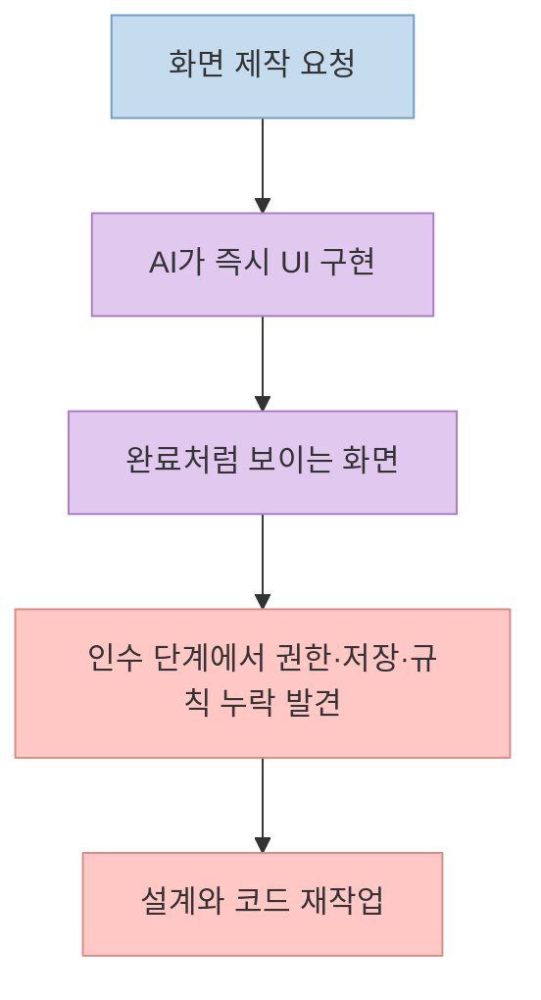
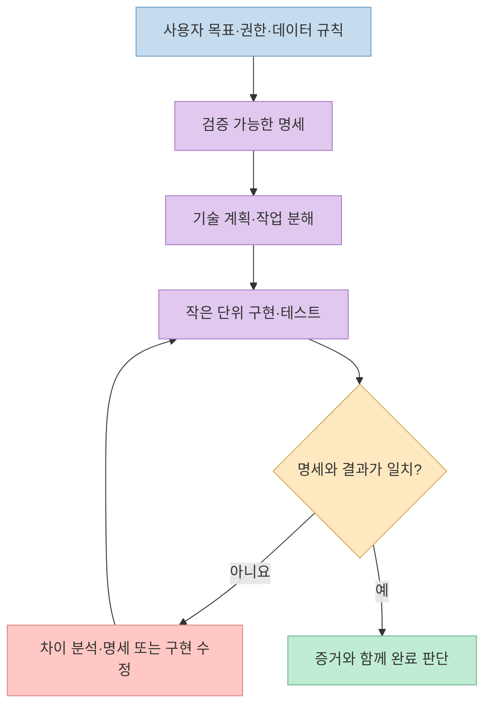
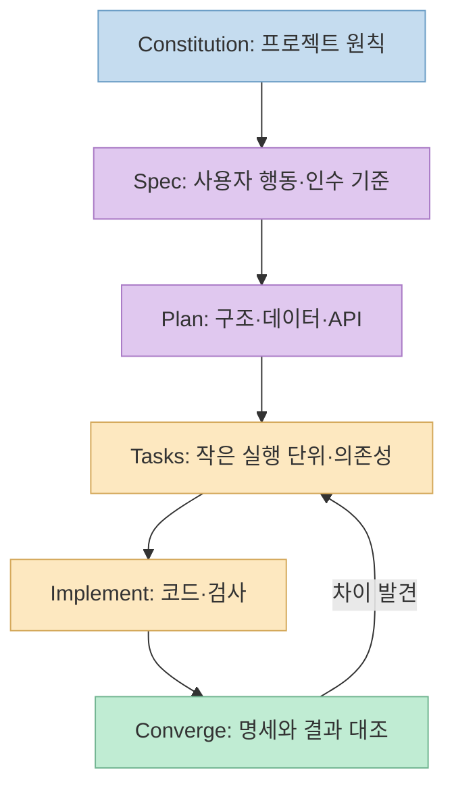
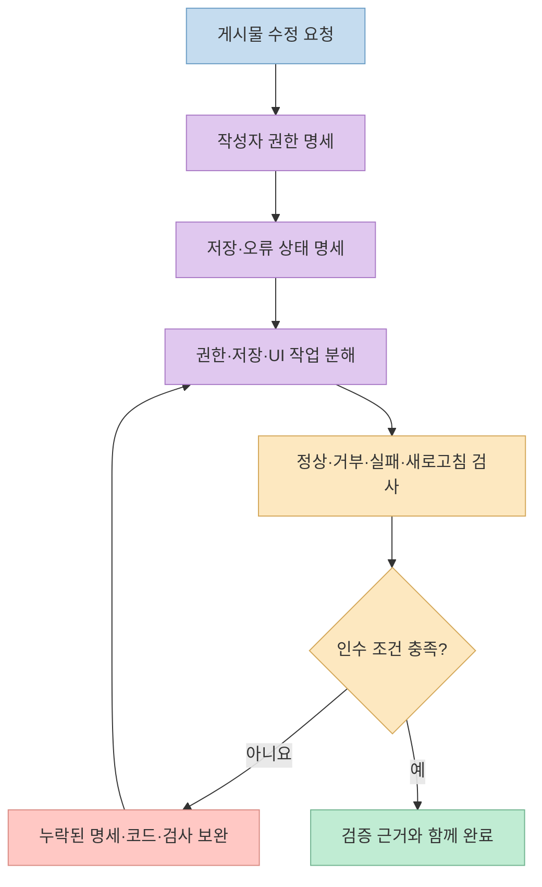

"Codex에 Spec Kit을 붙이면 재작업이 90% 줄어든다"는 [X 게시물](https://x.com/goan999999/status/2111340068048867383)의 제목은 눈길을 끈다. 본문에서 더 유용한 부분은 숫자보다 **AI가 코드를 쓰기 전에 요구사항·권한·데이터 저장·비즈니스 규칙·인수 기준을 먼저 분명히 하자**는 제안이다. [GitHub Spec Kit 공식 문서](https://github.com/github/spec-kit)를 기준으로 이 주장이 어디까지 확인되는지, 실제 도구 사용은 무엇이 다른지 살펴본다.

<!--more-->

## Sources

- [원본 X 게시물: Codex와 GitHub Spec Kit](https://x.com/goan999999/status/2111340068048867383)
- [GitHub Spec Kit 공식 저장소](https://github.com/github/spec-kit)
- [Spec Kit: 기존 프로젝트 도입 가이드](https://github.com/github/spec-kit/blob/main/docs/guides/existing-projects.md) · [진화하는 명세 가이드](https://github.com/github/spec-kit/blob/main/docs/guides/evolving-specs.md)
- [Spec Kit: 에이전트 연동 안내](https://github.com/github/spec-kit/blob/main/docs/reference/integrations.md) · [구현 단계 정의](https://github.com/github/spec-kit/blob/main/templates/commands/implement.md)

## 먼저 90%라는 숫자와 도구의 실제 기능을 분리하자

게시물은 작성자의 경험처럼 **재작업이 90% 줄었다**고 말하지만, 본문에는 재작업의 정의, 적용 전후 기간, 작업 수, 비교 대상, 측정 방법이 제시되지 않는다. 첨부된 짧은 영상의 존재만으로 그 수치를 재현 가능한 측정으로 볼 수 없다. [GitHub Spec Kit 공식 저장소](https://github.com/github/spec-kit)도 모든 프로젝트의 재작업률을 90% 줄인다는 성능 보증을 하지 않는다. 따라서 이 숫자는 **게시물의 미검증 주장**으로 남겨 두고, 검증 가능한 대상은 개발 과정의 변화로 한정해야 한다. [원본 X 게시물](https://x.com/goan999999/status/2111340068048867383)

게시물이 지적하는 실패 유형은 구체적이다. 버튼이 동작하는 화면을 만들었지만 권한 검사가 빠졌거나, 데이터가 저장되지 않거나, 비즈니스 규칙이 구현되지 않았다면 **화면 완성**과 **기능 수용**을 혼동한 것이다. 작성자는 요구사항과 경계 조건을 먼저 적고, 일을 작은 단위로 나눈 뒤, 구현마다 인수 기준과 비교하라고 제안한다. 이는 Spec Kit의 방향과 맞지만 **그 프롬프트를 Codex에 붙여 넣는 것만으로 Spec Kit이 설치되거나 공식 워크플로가 실행되는 것은 아니다.** [원본 X 게시물](https://x.com/goan999999/status/2111340068048867383) · [Spec Kit README](https://github.com/github/spec-kit)





## Spec Kit은 프롬프트 한 줄이 아니라 산출물 사이의 연결이다

GitHub는 Spec Kit을 AI 코딩 에이전트가 **구조화된 절차와 재사용 가능한 템플릿**을 쓰도록 돕는 오픈소스 툴킷으로 설명한다. 기능 개발의 기본 흐름은 프로젝트 원칙인 **constitution**을 정한 뒤, 기능별로 **specify → plan → tasks → implement → converge**를 진행하는 것이다. `spec.md`는 *무엇을 왜 만드는가*, `plan.md`는 *어떻게 구현하는가*, `tasks.md`는 *어떤 단위와 순서로 실행하는가*를 분리한다. 구현 후 `converge`는 결과가 명세·계획·작업과 일치하는지 살핀다. [Spec Kit README: SDD](https://github.com/github/spec-kit) · [진화하는 명세 가이드](https://github.com/github/spec-kit/blob/main/docs/guides/evolving-specs.md)

이 분리가 중요한 이유는 **잘못된 추정을 이른 단계에 드러낼 수 있기 때문**이다. 예컨대 "사용자가 게시물을 수정한다"는 한 줄만 있으면 소유자만 수정 가능한지, 관리자는 예외인지, 수정 이력은 남기는지, 저장 실패 시 UI는 어떻게 반응하는지 에이전트가 임의로 결정할 수 있다. 명세 단계에서 관찰 가능한 행동과 예외를 적고, 계획에서 데이터·API 경계를 설계하고, 작업으로 나누면 구현 중 변경 이유를 추적하기 쉬워진다. 이는 Spec Kit이 모든 모호함을 자동 해결한다는 뜻은 아니다. **사람이 모호한 선택을 확인하고 인수 기준을 승인**해야 한다. [원본 X 게시물](https://x.com/goan999999/status/2111340068048867383) · [Spec Kit 가이드](https://github.com/github/spec-kit/blob/main/docs/guides/evolving-specs.md)



## Codex에서 쓴다면 "일반 지시"와 "설치된 워크플로"를 구분하자

게시물의 중국어 예시 프롬프트는 Codex에게 **요구사항·경계·업무 규칙·인수 기준을 먼저 정리하고, 승인 전 대규모 코딩을 하지 말라**고 지시한다. 이 정도 지시는 Spec Kit 없이도 유용하다. 그러나 GitHub의 실제 통합은 CLI로 프로젝트를 초기화해 Spec Kit의 파일·스킬을 배치하는 별도 단계다. 공식 문서에서 Codex 연동 키는 `codex`이고, 스킬은 프로젝트의 `.agents/skills`에 설치되며 **`$speckit-specify`**처럼 호출한다. 다른 에이전트의 `/speckit-*` 표기를 Codex에서 그대로 쓸 수 있다고 가정하면 안 된다. [원본 X 게시물](https://x.com/goan999999/status/2111340068048867383) · [Spec Kit Codex 연동](https://github.com/github/spec-kit/blob/main/docs/reference/integrations.md)

Spec Kit 공식 README는 시작 조건으로 Python 3.11 이상, `uv`, 지원되는 코딩 에이전트를 안내하고 `specify init` 사용을 설명한다. **기존 저장소**에 도입할 때는 [기존 프로젝트 가이드](https://github.com/github/spec-kit/blob/main/docs/guides/existing-projects.md)를 먼저 읽어 기존 요구사항·아키텍처 결정·CI와 충돌하지 않게 해야 한다. `specify init --here --force` 같은 명령은 현재 디렉터리 파일을 병합·덮어쓸 수 있으므로, 이 블로그 저장소에서 예시 설치를 실행하지 않았다. 실제 적용 전에는 변경될 파일을 확인하고 버전 관리 상태를 보존해야 한다. [Spec Kit README: Get started](https://github.com/github/spec-kit) · [초기화 명령 참조](https://github.github.com/spec-kit/reference/core.html)

실제 기능 개발에서도 모든 단계를 한 번에 자동 실행할 필요는 없다. 공식 README는 각 스킬을 **한 단계씩 호출하고 결과를 검토**하라고 한다. 새 기능은 명세와 계획을 승인한 뒤 작업·구현으로 넘어가고, 버그 수리는 별도의 진단→수정→검증 흐름을 쓸 수 있다. Spec Kit의 기능 개발 프로세스를 작은 버그 수정마다 강제하면 오히려 준비 비용이 더 클 수 있다. [Spec Kit README: Choose your process](https://github.com/github/spec-kit)

## 권한·저장·업무 규칙을 인수 기준으로 바꾸는 예

게시물의 실패 사례를 "게시물 수정" 기능에 적용한다면, 먼저 **누가 무엇을 언제 할 수 있는가**를 정한다. 소유자와 비소유자의 수정 권한, 저장 후 새로고침했을 때의 지속성, 입력 값의 제한, 네트워크 실패 시 사용자에게 보일 상태를 명세한다. 다음은 특정 서비스의 사실이 아니라 **명세를 구체화하는 예시**다. [원본 X 게시물의 누락 사례](https://x.com/goan999999/status/2111340068048867383) · [Spec Kit의 계약 중심 개발 가이드](https://github.com/github/spec-kit/blob/main/docs/guides/contract-driven-development.md)

```text
기능: 게시물 수정
권한: 작성자만 자신의 게시물을 수정할 수 있다.
저장: 성공 응답 뒤 새로고침해도 수정 내용이 유지된다.
실패: 저장 요청이 실패하면 기존 내용이 사라지지 않고 재시도할 수 있다.
검증: 작성자 성공, 다른 사용자 거부, 저장 실패, 새로고침 지속성을 확인한다.
```

그다음 계획에서 인증 정보, 저장소 계층, API 응답을 어떻게 연결할지 결정하고, 작업을 **권한 검사 → 저장 경로 → 화면 상태 → 거부·허용 테스트**로 나눈다. 구현 완료 판단은 "버튼이 눌린다"가 아니라 **위 네 조건을 실제 코드와 실행 결과로 확인했는가**여야 한다. 테스트가 자동으로 생성된다는 보장도 없다. Spec Kit의 작업 생성 템플릿은 테스트를 명세가 요구하거나 TDD를 요청한 경우에 생성하도록 설명하므로, 필요한 보안·권한·통합 테스트는 명세와 작업에 명시해야 한다. [Spec Kit 작업 생성 정의](https://github.com/github/spec-kit/blob/main/templates/commands/tasks.md) · [구현 단계 정의](https://github.com/github/spec-kit/blob/main/templates/commands/implement.md)



## 재작업 감소를 정말 확인하려면 무엇을 측정할까

프로세스가 효과적이었는지 알려면 시작 전후를 같은 기준으로 비교해야 한다. 예를 들어 **인수 단계에서 발견된 요구사항 누락 수**, **권한·저장 관련 결함 수**, **기능 승인까지 걸린 총 시간**, **요구사항 변경 때문에 폐기한 코드량**을 기록할 수 있다. 기능 규모와 팀 구성, 테스트 수준이 달라지면 단순 전후 비교만으로 원인을 분리할 수 없으므로 같은 성격의 작업을 비교하고 측정 방법을 함께 공개해야 한다. 게시물의 90% 주장에는 이런 정보가 없어 재현을 판단할 수 없다. [원본 X 게시물](https://x.com/goan999999/status/2111340068048867383)

반대로 모든 변경에 명세 문서를 늘리는 것이 항상 이득인 것도 아니다. 공식 Spec Kit에는 가벼운 프리셋과 버그 수정 전용 흐름도 있다. 명세의 목적은 문서 수가 아니라 **구현과 검증이 공유할 기준을 만드는 것**이다. 작은 수정은 간단한 재현·완료 조건으로, 모듈이 많고 권한·데이터 경계가 복잡한 기능은 더 자세한 명세·계획·작업 분해로 접근하는 것이 합리적이다. [Spec Kit README: process 선택](https://github.com/github/spec-kit) · [Lean preset](https://github.com/github/spec-kit/blob/main/presets/lean/README.md)

## 실전 적용 포인트

1. **코드 생성 전에 실패 조건을 묻는다.** "누가 접근할 수 없는가", "저장 실패 시 무엇을 보여 주는가"를 기능 설명에 포함한다.
2. **Codex에 프롬프트를 붙이는 것과 Spec Kit 설치를 혼동하지 않는다.** 전자는 작업 지시, 후자는 프로젝트 파일과 스킬을 추가하는 도구 연동이다.
3. **각 산출물마다 사람의 판단을 둔다.** 명세의 비즈니스 규칙, 계획의 아키텍처, 작업의 검증 범위를 확인한 뒤 구현으로 넘어간다.
4. **테스트를 명시적으로 요구한다.** 정상 경로 외에 권한 거부·저장 실패·데이터 지속성을 실제 실행으로 확인한다.
5. **성과 수치는 직접 측정한다.** 재작업 건수뿐 아니라 전체 소요 시간과 출시 후 결함도 함께 본다.

## 핵심 요약

- "재작업 90% 감소"는 X 게시물의 **근거가 공개되지 않은 주장**이며 GitHub Spec Kit의 공식 보증이 아니다.
- Spec Kit의 핵심은 **명세 → 계획 → 작업 → 구현 → 결과 대조**를 서로 연결하는 것이다.
- Codex에서는 공식 통합으로 설치된 스킬을 **`$speckit-*`** 형태로 호출한다. 일반 프롬프트만으로 설치되지는 않는다.
- 권한·저장·비즈니스 규칙은 화면 구현 전에 **관찰 가능한 인수 조건과 검사**로 적어야 한다.

## 결론

Spec Kit은 AI의 코딩 속도를 높이는 마법 같은 추가 모델이 아니다. **무엇을 만들었을 때 완료인지 먼저 합의하고, 구현을 그 기준에 반복해서 대조하는 구조**다. 큰 기능일수록 이 구조가 도움이 될 여지는 있지만, 재작업이 얼마나 줄었는지는 각 팀이 동일한 기준으로 측정해야 한다.
