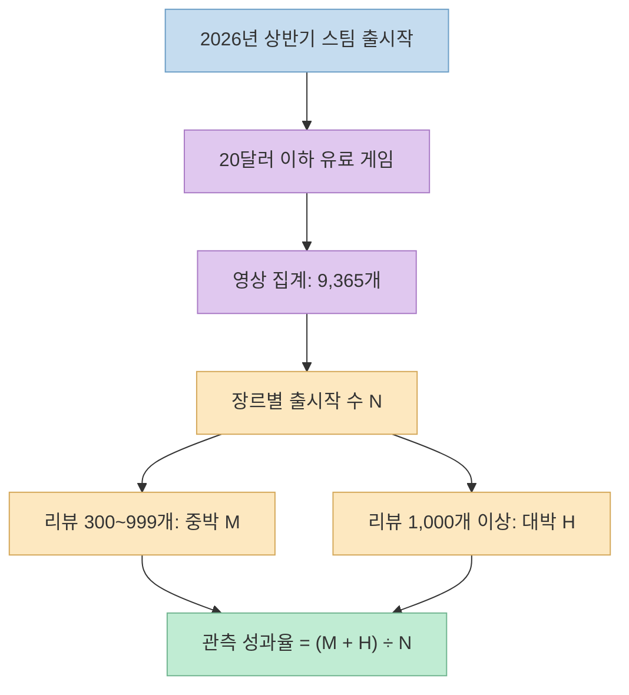
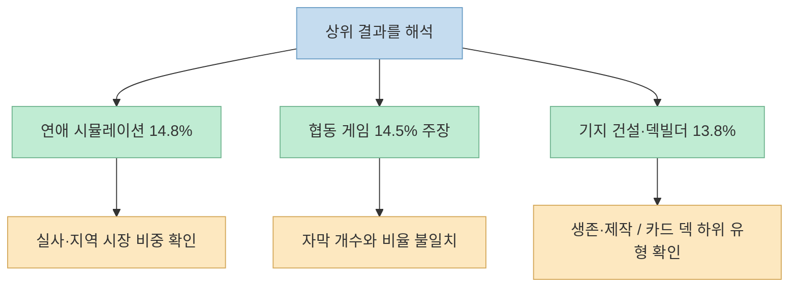
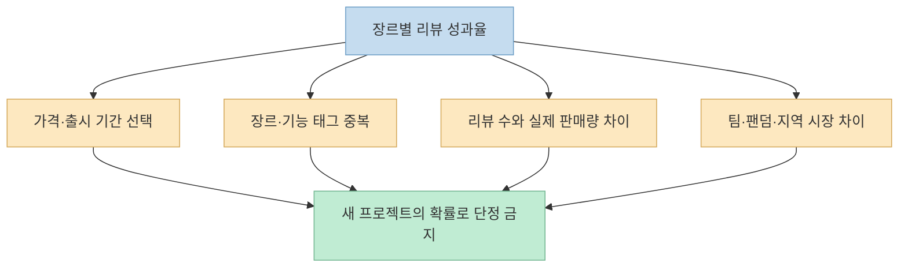

"인디 게임을 만든다면 어떤 장르가 유리할까?" [MGD의 쇼츠](https://youtube.com/shorts/C2forfJeSkQ?si=IhgSJt40yYij9CNO)는 2026년 상반기 스팀 출시작을 장르별로 세어 **연애 시뮬레이션, 협동 게임, 기지 건설·로그라이크 덱빌더** 순으로 높은 리뷰 성과율을 제시한다. 흥미로운 출발점이지만, 여기서 말하는 "성공률"은 관측된 게임들의 **리뷰 수 기준 비율**이지 새 게임의 흥행 확률을 보장하는 예측값은 아니다.

<!--more-->

## Sources

- [원본 YouTube Shorts: EP 20. 어떤 장르가 인디에게 유리할까](https://youtube.com/shorts/C2forfJeSkQ?si=IhgSJt40yYij9CNO) — MGD - Midnight Game Devs, 2026-10-18
- [Steamworks: 사용자 리뷰의 집계 방식](https://partner.steamgames.com/doc/store/reviews)
- [Steamworks: 장르·기능·분위기 태그의 구성](https://partner.steamgames.com/doc/store/tags)
- [GameDiscoverCo: 리뷰 수로 판매량을 추정할 때의 배수와 범위](https://newsletter.gamediscover.co/p/epic-advances-steam-reviews-oh-my)

## 영상은 무엇을 어떻게 셌나

영상의 설명과 자막에 따르면, 제작자는 **2026년 상반기** 스팀 출시작을 살펴본 뒤, "인디"를 좁혀 보기 위한 대리 조건으로 **20달러 이하 유료 게임**만 남겼다. 이때 표본은 **9,365개**라고 밝힌다. 장르별 출시 수를 분모로 두고, 리뷰가 **1,000개 이상**인 작품을 "대박", **300~999개**인 작품을 "중박"으로 나눠 두 집단의 비율을 비교했다. 이 숫자와 분류는 영상 제작자의 자체 집계이며, 원자료와 분류 코드가 함께 제시되지는 않아 이 글에서 재현 검증하지 못했다. [영상 0:10~0:34](https://youtu.be/C2forfJeSkQ?t=10) · [영상 설명](https://www.youtube.com/watch?v=C2forfJeSkQ)

영상은 "리뷰 하나에 약 30장 판매"라는 업계의 경험칙을 적용해 리뷰 300개를 약 **9,000장**, 1,000개를 약 **3만 장**으로 환산한다. 계산 자체는 맞지만 **판매량 관측값이 아니다**. [GameDiscoverCo의 리뷰-판매량 분석](https://newsletter.gamediscover.co/p/epic-advances-steam-reviews-oh-my)은 출시 시기 등에 따라 배수가 크게 달라지며, 한 분석에서는 2020년 이후 게임에 대해 중앙 추정 30배와 20~55배 범위를 제시했다고 소개한다. 따라서 영상의 "대박·중박"은 이 글에서도 **리뷰 문턱의 별칭**으로만 사용한다. [영상 0:15~0:26](https://youtu.be/C2forfJeSkQ?t=15)

영상이 제시하는 전체 평균은 출시작 **100개당 대박 약 2개, 중박 약 4개**다. 즉 표본 내부의 대략적인 관측 기준선은 두 구간 합계 **약 6%**다. 이 값을 비교 기준으로 삼을 수는 있지만, 동일 장르의 다음 작품이 6% 확률로 성공한다는 인과적 의미는 아니다. [영상 0:29~0:39](https://youtu.be/C2forfJeSkQ?t=29)

## 상위권의 공통점과 예외

영상의 1위는 **연애 시뮬레이션**이다. **149개 중 대박 7개, 중박 15개**라는 수치가 제시되어, 합계 **22÷149≈14.8%**와 일치한다. 다만 22개 중 다수가 중국 게임이고 절반 가까이는 실사 배우가 등장한다고 영상은 설명한다. 실사 연애 게임은 19개이며 절반 이상이 중박 이상이라고도 말한다. 배우 섭외·촬영이 필요한 하위 유형의 성과를 일반적인 소규모 개발자의 2D 연애 게임에 그대로 옮기면 안 된다. 영상은 실사 작품을 빼면 약 **9.2%**라고 덧붙인다. 이 분리 계산의 개별 작품 목록은 확인할 수 없으므로 제작자의 주장으로 취급한다. [영상 1:31~1:56](https://youtu.be/C2forfJeSkQ?t=91)

**협동 게임**은 영상에서 **14.5%**로 2위다. 그런데 자동 자막은 "332개 중 대박이나 중박이 27"로 받아쓰며, **27÷332≈8.1%**이므로 같은 구간의 14.5%와 양립하지 않는다. 음성 인식 오류 또는 문장 생략일 수 있으나, 공개된 자막만으로 정확한 대박·중박 개수를 확정할 수 없다. 그래서 이 글은 **14.5%라는 영상의 표시·발화와 332개라는 분모는 소개하되, 성공작 개수는 미확인**으로 남긴다. 영상은 상위 성과작 중 일부가 10달러 미만의 가벼운 게임이었다고 덧붙인다. [영상 1:22~1:32](https://youtu.be/C2forfJeSkQ?t=82)

공동 3위는 **기지 건설**과 **로그라이크 덱빌더**로, 영상은 둘 모두 **13.8%**라고 말한다. 덱빌더는 **116개 중 대박 6개·중박 10개**, 즉 **16÷116≈13.8%**로 계산이 맞는다. 기지 건설은 123개 중 대박 6개로 설명되며, 대박 6개 중 5개가 생존·제작 요소를 포함했다고 한다. 이는 "기지 건설" 하나만의 효과라기보다 결합된 플레이 구조가 결과를 좌우할 가능성을 시사한다. 영상은 로그라이크 전체는 **5.9%**로 평균 수준인데 덱빌더만 따로 보면 높다고 설명한다. [영상 1:01~1:22](https://youtu.be/C2forfJeSkQ?t=61)

## 하위권에서 읽을 수 있는 것

영상은 **2D 플랫포머**를 불리한 유형으로 든다. **671개**가 출시됐고, **대박 3개·중박 4개**라면 합계는 **7÷671≈1.0%**다. 자동 자막은 네 작품 중 세 작품의 리뷰가 한 자릿수였다고 옮긴다. 특히 대박 3개 중 2개는 이미 팬 기반이 있는 제작사였다는 영상의 설명은, 장르만 보고 소규모 신규 팀의 성과를 예상하기 어렵다는 점을 보여준다. 다만 개별 게임 목록은 제시되지 않아 이 사례의 외부 검증은 제한적이다. [영상 0:39~0:55](https://youtu.be/C2forfJeSkQ?t=39)

**2D 격투와 러너**는 각각 100개 이상 출시됐지만 영상 기준의 중박·대박은 없었다고 한다. 이것은 "해당 장르에서 성공할 수 없다"가 아니라 **선정된 기간·가격·리뷰 문턱 아래에서는 관측된 사례가 없었다**는 뜻이다. 반대로 표본이 충분히 크지 않거나 분류가 달라지면 비율도 달라질 수 있다. [영상 0:54~1:01](https://youtu.be/C2forfJeSkQ?t=54)

출시작 수가 많은 **캐주얼·액션**은 영상에서 모두 **3.6%**, **방치형·공포**는 모두 **7.7%**로 소개된다. 이 숫자만으로 "공포를 만들면 액션보다 두 배 잘 팔린다"고 결론 내릴 수는 없다. 각각 어떤 태그 조합을 장르로 인정했는지, 리뷰가 쌓일 시간을 얼마나 주었는지, 가격·마케팅·팀 규모가 어떻게 다른지 알 수 없기 때문이다. [영상 1:56~2:06](https://youtu.be/C2forfJeSkQ?t=116)

## 숫자가 말하지 않는 것

첫째, **리뷰 수는 판매량의 대리 지표**다. 스팀은 플레이 기록이 있는 사용자가 리뷰를 쓸 수 있고, 구매·키 활성화 등 획득 경로에 따라 화면에 표시되는 리뷰와 점수 집계에 차이가 있음을 설명한다. 리뷰 수에 일정한 배수를 곱하는 방식은 시장의 대략적인 크기를 짐작하는 데 유용할 수 있지만, 특정 게임의 실제 판매량을 확인한 것은 아니다. [Steamworks 사용자 리뷰 문서](https://partner.steamgames.com/doc/store/reviews) · [영상 0:18~0:24](https://youtu.be/C2forfJeSkQ?t=18)

둘째, **분류가 단일·배타적 장르라고 보기 어렵다.** 스팀의 태그에는 장르뿐 아니라 기능, 시점, 분위기, 플레이 방식도 함께 들어간다. 한 게임이 기지 건설·생존·협동 태그를 동시에 가질 수 있다. 따라서 영상의 장르별 집계가 다중 태그를 허용했다면 각 장르의 분모는 서로 겹칠 수 있고, 단일 대표 태그만 썼다면 어떤 태그를 선택했는지에 따라 결과가 바뀐다. 영상에서는 이 분류 규칙이 충분히 공개되지 않았다. [Steamworks 태그 문서](https://partner.steamgames.com/doc/store/tags) · [영상 0:10~0:34](https://youtu.be/C2forfJeSkQ?t=10)

셋째, **20달러 이하·2026년 상반기라는 표본 경계**가 결과를 만든다. 가격이 더 높은 유료작, 무료 게임, 다른 출시 시기의 게임은 빠진다. "20달러"가 최초 출시 가격인지 관측 당시 가격인지도 영상만으로는 확실하지 않다. 상반기 초 출시작과 말 출시작은 리뷰가 쌓일 시간도 다르다. 그러므로 이 비율을 향후 모든 인디 게임의 보편적인 성공 확률로 옮길 수 없다. [영상 0:24~0:34](https://youtu.be/C2forfJeSkQ?t=24)

## 실전 적용 포인트

1. **유력 장르를 고르기보다 비교군을 정한다.** 만들고 싶은 게임의 핵심 루프, 인원수, 제작 규모, 가격대를 먼저 적는다. 협동은 장르인 동시에 플레이 방식이므로 같은 기획을 "협동·생존" 또는 "협동·캐주얼"과 비교해야 한다. [Steamworks 태그 문서](https://partner.steamgames.com/doc/store/tags) · [영상 1:22~1:31](https://youtu.be/C2forfJeSkQ?t=82)
2. **상위권 내부의 하위 집단을 본다.** 연애 시뮬레이션의 실사·지역 시장, 기지 건설의 생존·제작, 로그라이크의 덱빌딩처럼 결과를 주도한 하위 유형을 분리해야 한다. "1위 장르"라는 이름만 따라 만들면 필요한 자원과 경쟁 상대를 오판할 수 있다. [영상 1:01~1:22](https://youtu.be/C2forfJeSkQ?t=61) · [영상 1:31~1:56](https://youtu.be/C2forfJeSkQ?t=91)
3. **데이터를 재사용하려면 원자료가 필요하다.** 출시일, 출시 가격, 리뷰 관측일, 중복 태그 처리, 얼리 액세스 처리, 집계 스크립트를 기록해야 9,365개와 장르별 비율을 재현할 수 있다. 영상 설명에는 그 원자료가 제공되지 않으므로 이 글도 독립 재현이라고 주장하지 않는다. [영상 0:10~0:34](https://youtu.be/C2forfJeSkQ?t=10) · [영상 설명](https://www.youtube.com/watch?v=C2forfJeSkQ)

## 핵심 요약

- 영상은 2026년 상반기 출시된 20달러 이하 유료 스팀 게임 **9,365개**를 리뷰 문턱으로 분류했다고 설명한다. [영상 0:10~0:29](https://youtu.be/C2forfJeSkQ?t=10)
- 연애 시뮬레이션 **22/149≈14.8%**, 로그라이크 덱빌더 **16/116≈13.8%**, 2D 플랫포머 **7/671≈1.0%**는 영상 속 개수와 비율이 계산상 맞는다. [영상 0:39](https://youtu.be/C2forfJeSkQ?t=39) · [영상 1:08](https://youtu.be/C2forfJeSkQ?t=68) · [영상 1:31](https://youtu.be/C2forfJeSkQ?t=91)
- 협동 게임은 영상의 **14.5%**와 자동 자막의 **27/332**가 일치하지 않아 성공작 개수를 확정하지 않았다. [영상 1:22](https://youtu.be/C2forfJeSkQ?t=82)
- 리뷰 수×30은 실제 판매량이 아닌 거친 추정이며, 장르 내부의 하위 유형과 중복 태그·표본 선택을 함께 봐야 한다. [영상 0:18](https://youtu.be/C2forfJeSkQ?t=18) · [Steamworks 태그 문서](https://partner.steamgames.com/doc/store/tags)

## 결론

이 영상의 가치는 "1위 장르를 복사하라"는 처방보다 **비슷한 규모와 조건의 게임을 나눠 비교하는 질문**에 있다. 연애 시뮬레이션의 실사 제작 여건과 협동 게임의 수치 불일치를 빼고 순위만 읽으면 결론이 달라진다. 다음 프로젝트의 장르를 결정할 때는 이 순위를 탐색의 출발점으로 쓰고, 실제 경쟁작과 제작 역량을 별도로 검토하는 편이 타당하다.
