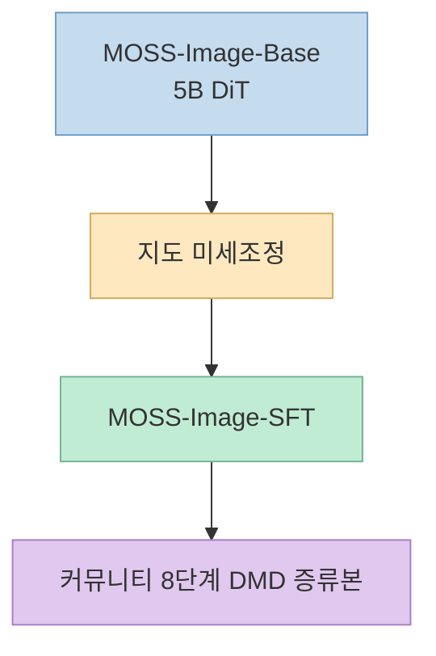
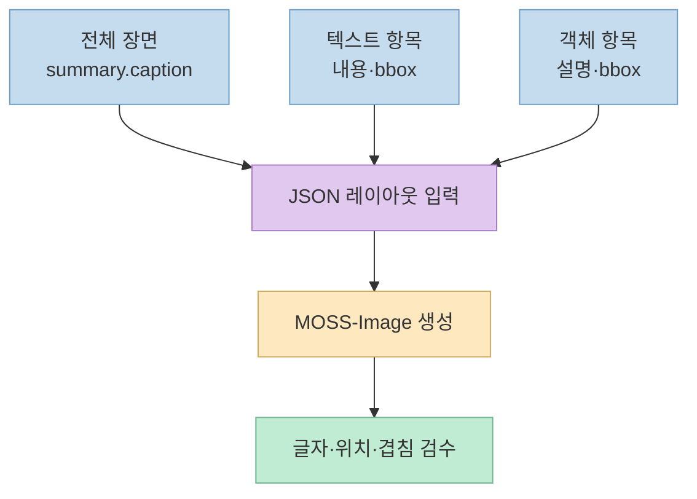
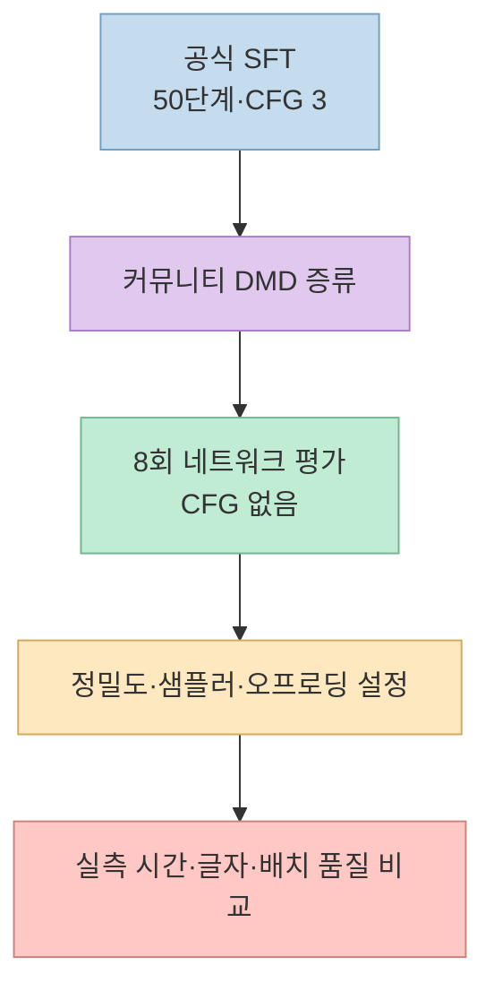

[Threads 게시물](https://www.threads.com/share/_ojuVyFlL/)은 MOSS-Image를 "검열이 적은" 오픈소스 이미지 모델로 소개하며, 텍스트·사물의 위치 지정과 약 5배 빠른 8단계 버전을 강조한다. [OpenMOSS의 공식 저장소](https://github.com/OpenMOSS/MOSS-Image)를 대조하면 핵심은 **5B 파라미터 기반의 텍스트-이미지 모델과 JSON 레이아웃 제어**다. 다만 "검열이 적다"는 비교는 공식 평가에서 확인되지 않으며, 8단계 증류본도 원 개발팀의 기본 모델과 구분해야 한다.

<!--more-->

## Sources

- [원본 Threads 게시물](https://www.threads.com/share/_ojuVyFlL/) · [원문](https://www.threads.com/@choi.openai/post/DeqdSTHjBxY)
- [OpenMOSS 공식 MOSS-Image 저장소](https://github.com/OpenMOSS/MOSS-Image)
- [MOSS-Image-Base 모델 카드](https://huggingface.co/OpenMOSS-Team/MOSS-Image-Base)
- [MOSS-Image-SFT 모델 카드](https://huggingface.co/OpenMOSS-Team/MOSS-Image-SFT)
- [공식 ComfyUI 사용 설명](https://github.com/OpenMOSS/MOSS-Image/blob/main/comfyui/README.md)
- [MOSS-Image 기술 보고서](https://arxiv.org/abs/2610.23374)
- [커뮤니티 8단계 DMD 증류본](https://huggingface.co/lodestones/MOSS-Image-SFT-8-steps-dmd)

## 먼저 Base, SFT, 8단계를 구분하자

OpenMOSS는 **MOSS-Image-Base**와 이를 지도 미세조정한 **MOSS-Image-SFT**를 함께 공개했다. 둘은 같은 계열의 텍스트-이미지 모델이며 자연어, 태그 나열, 구조화된 JSON 레이아웃을 입력으로 받는다. 공식 예시는 SFT가 Base보다 글자 묶음과 화이트보드 구성을 더 명확하게 만드는 사례를 보여준다. 하지만 한 예시가 모든 프롬프트의 품질 우위를 보장하는 것은 아니다. [공식 README](https://github.com/OpenMOSS/MOSS-Image) · [Base 모델 카드](https://huggingface.co/OpenMOSS-Team/MOSS-Image-Base) · [SFT 모델 카드](https://huggingface.co/OpenMOSS-Team/MOSS-Image-SFT)

공식 저장소는 **5B 파라미터 DiT**를 기반으로 긴 중국어·영어 텍스트와 복잡한 배치를 다룬다고 설명한다. [기술 보고서](https://arxiv.org/abs/2610.23374)는 자체 평가셋 LongLongTextBench에서 오픈 가중치 모델 중 선두 성능과 평균 **텍스트 커버리지 96.3%**를 보고한다. 여기서 커버리지는 해당 평가 기준의 지표이지, 임의의 포스터에서 모든 글자가 정확히 쓰인다는 뜻은 아니다. 다른 데이터·언어·폰트 조건에서의 재현은 별도 검증이 필요하다.

이 계보를 분리해야 하는 이유는 **기능·권장 설정·배포 주체가 다르기 때문**이다. 원 프로젝트의 Base/SFT는 공식 체크포인트다. 8단계 DMD는 `lodestones`가 SFT를 대상으로 공개한 진행 중인 커뮤니티 증류본이다. "MOSS-Image에 8단계 공식 버전이 포함됐다"고 쓰면 두 출처를 혼동하게 된다. [공식 모델 목록](https://github.com/OpenMOSS/MOSS-Image#-models) · [8단계 모델 카드](https://huggingface.co/lodestones/MOSS-Image-SFT-8-steps-dmd)

## 텍스트와 사물의 위치를 어떻게 지정하나

일반 자연어 프롬프트에 "제목을 위에"라고 쓰는 대신, MOSS-Image는 **장면의 전체 설명과 항목별 위치를 담은 JSON 레이아웃**을 입력으로 받을 수 있다. 공식 예시는 `summary.caption`에 장면·스타일을 쓰고, `items`에 텍스트 또는 객체마다 `label`, `caption`, `bbox`를 넣는다. 글자로 렌더할 내용은 `text` 필드에 둔다. 이 구조는 **어떤 요소를 어디에 배치할지**를 생성 입력에 명시하는 방법이지, 픽셀 단위 배치를 무조건 보장하는 편집기 기능은 아니다. [공식 README: Layout-to-image](https://github.com/OpenMOSS/MOSS-Image#-layout-to-image-generation) · [Base 모델 카드](https://huggingface.co/OpenMOSS-Team/MOSS-Image-Base)

공식 포맷의 `bbox_format`은 `yxyx`로, 네 좌표를 **`[y_min, x_min, y_max, x_max]`** 순서로 읽는다. `bbox_coord_space`가 `abs_centralized`이면 값은 캔버스 중심을 원점으로 하는 픽셀 좌표다. 예컨대 1024×1024 캔버스에서 각 축의 범위는 대략 −512~512가 된다. 이미지 크기를 바꾸면 좌표도 같은 기준으로 바꿔야 한다. 자연어로만 지시했을 때 요소 위치가 흔들리는 문제를 줄이는 입력 형식이지만, 실제 출력에서 글자 정확도·겹침·잘림을 다시 확인해야 한다. [공식 README: 레이아웃 좌표 설명](https://github.com/OpenMOSS/MOSS-Image#-layout-to-image-generation)

이 기능은 포스터나 안내 그래픽처럼 **정보 위계와 텍스트 위치가 중요한 이미지**에 적합하다. 반대로 장면 묘사만 필요한 작업이라면 자연어 프롬프트로 시작해도 된다. 공식 저장소에 포함된 프롬프트 확장 스킬은 아이디어를 상세 캡션이나 레이아웃 초안으로 바꾸는 보조 도구이며, 스킬 자체가 이미지 생성 서비스를 호출하는 것은 아니다. [공식 README: Prompt enhancer skill](https://github.com/OpenMOSS/MOSS-Image#prompt-enhancer-skill)

## ComfyUI에서의 사용 경로와 실행 조건

OpenMOSS의 저장소에는 **ComfyUI용 네이티브 플러그인과 예제 워크플로**가 들어 있다. 공식 설명은 플러그인을 `custom_nodes`에 넣고 ComfyUI를 다시 시작한 뒤, 모델의 로컬 디렉터리를 로더에 지정하도록 안내한다. 그 디렉터리에는 `transformer/`, `text_encoder/`, `tokenizer/`, `vae/`가 있어야 한다. 예제 워크플로는 **50단계, CFG 3, Shift 5, 1024×1024** 설정을 제시한다. 플러그인이 제공된다는 사실과 ComfyUI 본체에 이미 통합됐다는 사실은 다르며, 공식 README는 본체 통합을 **진행 중**이라고 적는다. [공식 ComfyUI README](https://github.com/OpenMOSS/MOSS-Image/blob/main/comfyui/README.md) · [공식 저장소](https://github.com/OpenMOSS/MOSS-Image)

Python 경로도 있다. [Base](https://huggingface.co/OpenMOSS-Team/MOSS-Image-Base)와 [SFT](https://huggingface.co/OpenMOSS-Team/MOSS-Image-SFT)의 모델 카드는 Python 3.10 이상, CUDA를 지원하는 NVIDIA GPU, 호환되는 PyTorch와 Diffusers 환경을 전제로 예시를 제공한다. `trust_remote_code=True`를 사용하는 예시는 모델 저장소의 사용자 지정 파이프라인 코드를 실행하므로, 운영 환경에서는 내려받는 코드와 버전을 검토·고정하는 편이 안전하다. 이는 공식 예시의 실행 방식을 토대로 한 일반적인 보안 판단이다. [Base 모델 카드: Quick start](https://huggingface.co/OpenMOSS-Team/MOSS-Image-Base)

GPU 메모리가 부족한 경우 공식 README는 모델 구성요소를 CPU와 GPU 사이에 옮기거나 순차적으로 실행하는 모드를 안내한다. **메모리를 절약하는 대신 속도가 느려질 수 있다**는 절충이다. 따라서 소셜 게시물의 고속화 수치를 자신의 PC 환경에 그대로 적용할 수 없다. 사용 가능한 장치, 모델 정밀도, 해상도와 오프로딩 방식을 함께 기록해 비교해야 한다. [공식 README: Memory and performance](https://github.com/OpenMOSS/MOSS-Image#-memory-and-performance)

## 8단계는 왜 곧바로 ‘5배 빠른 공식 버전’이 아닌가

[커뮤니티 8단계 모델 카드](https://huggingface.co/lodestones/MOSS-Image-SFT-8-steps-dmd)는 **50단계·CFG 3**의 MOSS-Image-SFT를 **8회 네트워크 평가·CFG 없음**으로 줄이는 DMD 증류를 "진행 중"이라고 설명한다. 출처는 원 개발팀 `OpenMOSS-Team`이 아니라 별도 계정 `lodestones`다. 공식 저장소의 기본 체크포인트 목록은 Base와 SFT이고, 원문이 말한 8단계는 이 **파생 모델을 함께 언급한 것**으로 해석하는 것이 정확하다. [OpenMOSS 모델 목록](https://github.com/OpenMOSS/MOSS-Image#-models) · [8단계 모델 카드](https://huggingface.co/lodestones/MOSS-Image-SFT-8-steps-dmd)

**50단계와 8단계는 연산 횟수이지 벽시계 시간의 배수가 아니다.** 기본 모델 카드에 따르면 CFG 기본 경로는 단계당 변환기 순전파가 두 번이고, 커뮤니티 증류본은 CFG 없는 8회 평가를 사용한다. 네트워크 평가 수만 보면 약 **100회 대 8회**이지만, 프롬프트 인코딩·VAE 디코딩·데이터 이동·정밀도·샘플러 구현이 전체 시간을 결정한다. 따라서 숫자를 나누어 "12.5배 빠르다"고 말할 수도 없고, 게시물의 "약 5배"를 하드웨어와 조건이 명시된 **공식 벤치마크**로 취급할 수도 없다. [Base 모델 카드: Sampling settings](https://huggingface.co/OpenMOSS-Team/MOSS-Image-Base) · [8단계 모델 카드](https://huggingface.co/lodestones/MOSS-Image-SFT-8-steps-dmd) · [원본 Threads](https://www.threads.com/share/_ojuVyFlL/)

더구나 [8단계 카드](https://huggingface.co/lodestones/MOSS-Image-SFT-8-steps-dmd)는 증류 델타가 `bf16` 반올림보다 작을 수 있어 일부 경로는 `fp32`로 유지해야 하며, **샘플러가 공식 릴리스의 스케줄러와 다르다**고 설명한다. 단순히 공식 SFT의 단계 수를 50에서 8로 바꾸는 것과, 해당 파생 모델·어댑터·샘플러를 함께 쓰는 것은 다른 작업이다. 속도뿐 아니라 글자 렌더링과 배치 품질도 같은 프롬프트·시드·해상도로 별도 비교해야 한다.

## 라이선스와 ‘검열이 적다’는 표현의 검증 범위

[공식 Base와 SFT 모델 카드](https://huggingface.co/OpenMOSS-Team/MOSS-Image-Base)는 **모델 가중치와 번들 추론 코드**를 Apache-2.0으로 표시한다. [공식 GitHub 저장소](https://github.com/OpenMOSS/MOSS-Image)도 Apache-2.0 라이선스를 명시한다. 따라서 이 모델 계열을 공개 가중치·Apache-2.0이라고 소개하는 것은 근거가 있다. 다만 실제 제품에 포함할 때는 사용한 체크포인트, 커뮤니티 어댑터, 다른 패키지의 라이선스를 각각 확인해야 한다. [SFT 모델 카드](https://huggingface.co/OpenMOSS-Team/MOSS-Image-SFT) · [8단계 어댑터 카드](https://huggingface.co/lodestones/MOSS-Image-SFT-8-steps-dmd)

반면 Threads의 **"검열이 적다"**, **"자연스러운 피부 표현"**은 비교 대상·테스트 프롬프트·판정 기준이 함께 제시되지 않은 평가다. [공식 기술 보고서](https://arxiv.org/abs/2610.23374)는 장문 텍스트와 레이아웃 생성의 평가를 설명하지만, 이 표현을 입증하는 검열 비교 실험은 초록에 제시하지 않는다. 이 글은 해당 문구를 모델의 검증된 안전 정책 또는 성능 지표로 받아들이지 않는다. 어떤 모델이든 생성물이 적절한지, 실존 인물·저작물의 권리를 침해하지 않는지는 사용자가 별도로 검토해야 한다. [원본 Threads](https://www.threads.com/share/_ojuVyFlL/) · [MOSS-Image 기술 보고서](https://arxiv.org/abs/2610.23374)

## 실전 적용 포인트

1. **먼저 목적에 맞는 체크포인트를 고른다.** 기본 생성 품질·레이아웃을 시험할 때는 공식 Base와 SFT를 같은 조건에서 비교한다. 공식 예시는 SFT의 정돈된 텍스트 배치를 보여주지만, 자신의 한국어 문구·폰트·도메인에도 맞는지 따로 확인해야 한다. 공식 자료가 강조하는 텍스트 성능은 중국어·영어 중심이다. [공식 README](https://github.com/OpenMOSS/MOSS-Image) · [기술 보고서](https://arxiv.org/abs/2610.23374)
2. **텍스트가 많은 이미지라면 레이아웃 입력을 시험한다.** 제목·보조 문구·객체를 항목으로 나누고 실제 캔버스 크기에 맞춰 `bbox`를 잡는다. 결과에서는 누락된 글자, 오탈자, 요소 겹침을 확인한다. [공식 레이아웃 예시](https://github.com/OpenMOSS/MOSS-Image#-layout-to-image-generation)
3. **ComfyUI와 Python 경로를 구분한다.** 공식 ComfyUI 플러그인은 로컬 모델 디렉터리를 읽고, Python 예시는 사용자 지정 파이프라인 코드를 가져온다. 설치와 보안 검토 절차가 같지 않다. [ComfyUI README](https://github.com/OpenMOSS/MOSS-Image/blob/main/comfyui/README.md) · [Base 모델 카드](https://huggingface.co/OpenMOSS-Team/MOSS-Image-Base)
4. **고속화는 직접 측정한다.** 공식 SFT와 8단계 커뮤니티 증류본을 같은 GPU·해상도·입력·정밀도에서 실행하고, 시간뿐 아니라 글자 정확도와 배치 충실도를 함께 기록한다. [8단계 모델 카드](https://huggingface.co/lodestones/MOSS-Image-SFT-8-steps-dmd)

## 핵심 요약

- MOSS-Image의 공식 공개 계열은 **5B Base와 SFT**이며, 두 모델은 중국어·영어 텍스트와 JSON 레이아웃 입력을 지원한다. [공식 저장소](https://github.com/OpenMOSS/MOSS-Image)
- ComfyUI 플러그인은 공식 저장소에 있지만, ComfyUI 본체 통합은 확인 시점 **진행 중**이다. [공식 ComfyUI 안내](https://github.com/OpenMOSS/MOSS-Image/blob/main/comfyui/README.md)
- **8단계 DMD는 커뮤니티 파생 모델**이다. 게시물의 "약 5배"는 조건이 공개된 공식 실측치로 확인되지 않았다. [8단계 모델 카드](https://huggingface.co/lodestones/MOSS-Image-SFT-8-steps-dmd) · [원본 Threads](https://www.threads.com/share/_ojuVyFlL/)
- 공식 모델 가중치와 추론 코드는 **Apache-2.0**을 명시하지만, "검열이 적다"는 비교는 근거가 부족하다. [Base 모델 카드](https://huggingface.co/OpenMOSS-Team/MOSS-Image-Base) · [기술 보고서](https://arxiv.org/abs/2610.23374)

## 결론

MOSS-Image는 **텍스트가 많은 이미지의 구성 요소를 구조적으로 배치할 수 있다는 점**에서 살펴볼 가치가 있다. 다만 제품 선택은 소셜 게시물의 "검열이 적다" 또는 "5배"라는 문구보다, 공식 Base·SFT와 커뮤니티 파생본을 분리하고 실제 작업 조건에서 품질과 시간을 측정한 결과에 근거해야 한다.
