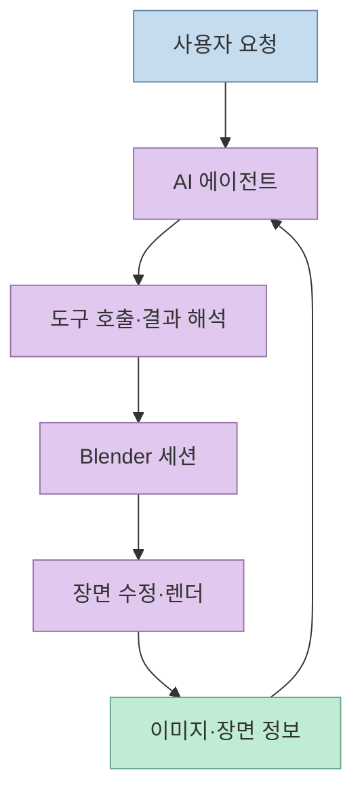
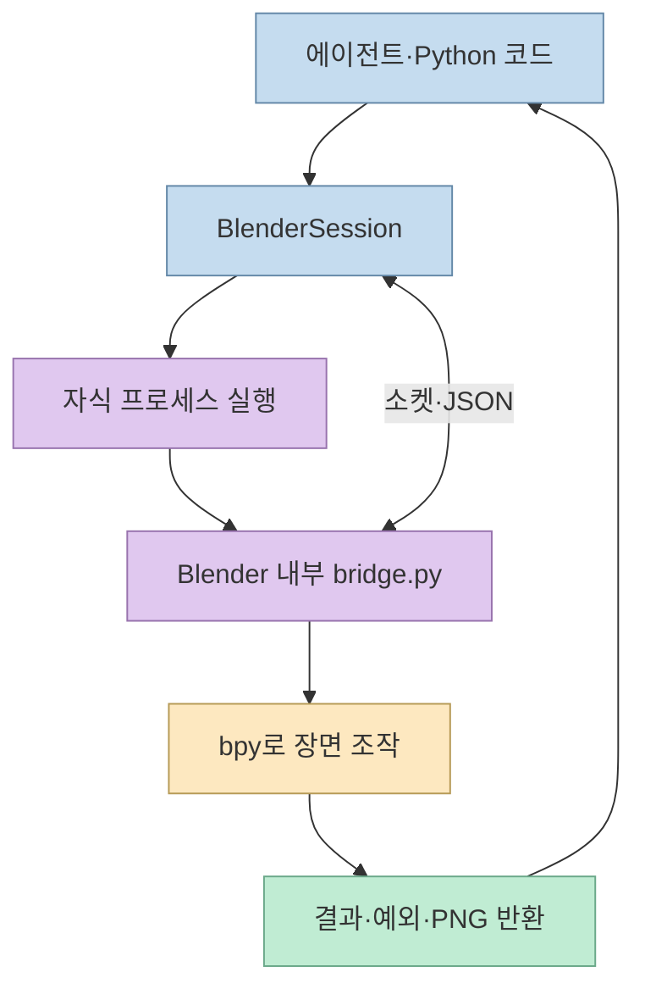
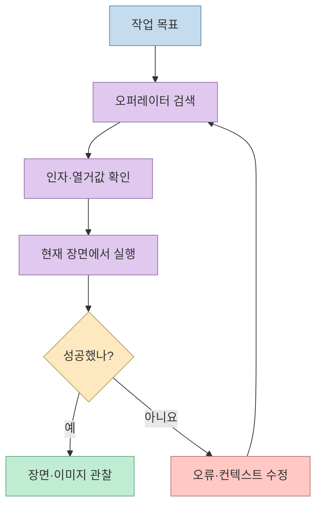

"AI 에이전트에게 눈사람을 만들어 달라고 하면 터미널에 3D 렌더링이 나온다." [개발자의 Threads 게시물](https://www.threads.com/share/_ltRRroZ7/)이 소개한 [Blender Agent SDK](https://github.com/yazzang-homelab/blender-agent-sdk)는 Blender에 애드온을 설치하는 대신, Python 프로그램이 Blender를 별도 프로세스로 실행하고 내부 브리지와 통신하는 도구다. 단순한 자연어 생성기가 아니라, 에이전트가 **장면을 관찰하고, 가능한 동작을 찾고, 실행 결과를 이미지로 확인하는** 작업 환경에 가깝다.

<!--more-->

## Sources

- [원문 Threads 게시물](https://www.threads.com/share/_ltRRroZ7/) — 본문과 개발자의 댓글에서 프로젝트 링크·MCP·CLI 설명을 확인했다. 동적 페이지라 일반 가져오기에서 본문이 빠져 브라우저 렌더링 방식으로 추출했다.
- [Blender Agent SDK 저장소 및 README](https://github.com/yazzang-homelab/blender-agent-sdk) — 구현 구조, 지원 범위, 설치법, 테스트·보안 정책의 1차 자료.
- [Blender 5.2 Python API 안내](https://docs.blender.org/api/5.2/info_api_reference.html) — 오퍼레이터가 이미 공개 Python API에 있다는 점을 확인하는 공식 자료.
- [Blender의 Python 모듈 사용 안내](https://docs.blender.org/api/main/info_advanced_blender_as_bpy.html) — 외부 Python에서 `bpy`를 사용하는 별도 접근법과 제약을 확인하는 공식 자료.

## 무엇을 해결하나: AI와 Blender 사이의 지속적인 작업 공간

일회성 Python 스크립트로 Blender를 실행하면 스크립트가 끝날 때 프로세스도 종료된다. 반면 장면을 대화 여러 턴에 걸쳐 수정하려면 **동일한 Blender 세션을 유지하고**, 현재 객체와 렌더 결과를 에이전트에게 되돌려줘야 한다. 프로젝트는 이를 `BlenderSession`과 관찰·탐색·조작 도구로 묶는다. 핵심은 MCP 자체가 아니라 Python SDK이며, MCP 서버와 CLI는 같은 기능을 이용하는 선택적 진입점이다. [프로젝트 README의 세션·인터페이스 설명](https://github.com/yazzang-homelab/blender-agent-sdk#work-on-a-scene-in-a-conversation)

## 애드온 없는 연결은 어떻게 동작하나

`BlenderSession`은 Blender를 자식 프로세스로 띄우고 `--python` 인자로 작은 브리지 스크립트를 실행한다. 브리지는 **Blender 내부의 Python 인터프리터**에서 `bpy`를 사용한다. 외부 SDK와 브리지 사이에는 Linux·macOS에서 전용 Unix 소켓을, Windows에서는 세션 토큰으로 확인하는 `127.0.0.1` TCP를 사용한다. 따라서 사용자가 Blender 설정 화면에서 애드온을 설치할 필요는 없지만, **Blender 실행 파일과 Python 패키지는 별도로 필요하다**. [프로세스·전송 구조](https://github.com/yazzang-homelab/blender-agent-sdk#how-it-works), [설치 요구 사항](https://github.com/yazzang-homelab/blender-agent-sdk#install)

헤드리스 기본 모드는 `-b`로 GUI 없이 실행하며, `screenshot`은 장면 카메라를 기준으로 렌더링한다. GUI 모드에서는 3D 뷰포트의 오프스크린 캡처도 가능하다. 헤드리스 모드에는 GUI의 실행 취소 스택이 없어서 SDK는 `.blend` 파일을 이용한 `checkpoint`·`restore`를 제공한다. 이 차이를 모르면 "스크린샷"과 "되돌리기"를 두 모드에서 똑같이 기대하기 쉽다. [README의 모드별 차이](https://github.com/yazzang-homelab/blender-agent-sdk#background-vs-gui-sessions)

## 2,498개 오퍼레이터: 숫자보다 중요한 것은 탐색·실행 방식

개발자는 REA·Ghidra로 Blender 5.2.2 바이너리를 분석하고 소스 및 런타임 RNA 정보와 대조했다고 설명한다. 프로젝트 기록상 바이너리에서 찾은 오퍼레이터 식별자는 2,247개였고, **실행 중 등록된 오퍼레이터는 2,498개**였다. SDK가 고정 목록 대신 실제 등록 목록을 대상으로 `search_operators`를 제공하는 이유다. `describe_operator`로 매개변수를 확인하고 `call_operator`로 실행할 수 있으며, `get_property`·`set_property`로 RNA 속성도 읽고 바꾼다. 단, 2,498개는 해당 버전의 등록 수이지 모든 오퍼레이터가 헤드리스 세션이나 모든 장면 상태에서 성공한다는 보장은 아니다. [README의 역분석 결과](https://github.com/yazzang-homelab/blender-agent-sdk#reverse-engineering), [도구 목록](https://github.com/yazzang-homelab/blender-agent-sdk#tools)

여기서 **역분석이 Blender 자동화의 필수 조건은 아니다**. Blender 자체가 `bpy.ops`와 Python API를 공식 문서로 공개하고 있으며, `bpy`를 Python 모듈로 빌드·설치하는 접근법도 설명한다. 이 프로젝트에서 역분석은 기본 API를 새로 발견했다기보다, 내부 실행 경로와 헤드리스·GUI 동작 차이를 확인해 SDK 설계 근거로 활용한 작업이다. Blender 공식 문서는 오퍼레이터가 실행 컨텍스트에 의존할 수 있다고 명시한다. [공식 오퍼레이터 문서](https://docs.blender.org/api/5.2/info_api_reference.html), [Python 모듈 안내](https://docs.blender.org/api/main/info_advanced_blender_as_bpy.html), [프로젝트의 역분석 설명](https://github.com/yazzang-homelab/blender-agent-sdk#reverse-engineering)

## 결과를 어떻게 보나: SDK·MCP·CLI

Python 코드에서는 `BlenderSession()`을 열어 오퍼레이터를 호출하고 `screenshot()`으로 PNG 바이트를 받는다. 저장소의 예제는 `mesh.primitive_monkey_add`로 객체를 만들고 수정자를 추가한 뒤 장면 정보와 렌더 이미지를 얻는다. 이 방식은 에이전트 프레임워크의 함수 호출 루프와 직접 결합할 때 적합하다. 저장소는 OpenAI·Anthropic 함수 호출 스키마와 `dispatch()`도 제공하지만, 실제 모델 호출 비용이나 렌더 시간을 자동으로 없애주는 것은 아니다. [SDK 예제와 에이전트 연결](https://github.com/yazzang-homelab/blender-agent-sdk#plug-it-into-an-agent)

대화형 작업에서는 `blender-agent mcp`로 기존 MCP 호스트에 붙이거나, `blender-agent start` → `call` → `show` → `stop` 명령으로 백그라운드 세션을 유지한다. `show`는 렌더를 저장하고 터미널에 표시하며, `watch`는 새 이미지를 계속 보여준다. 갤러리 폴더의 `index.html`이나 선택적 HTTP 서버로도 결과를 볼 수 있다. 즉 원문의 "터미널에서 3D 렌더링"은 Blender GUI를 터미널 안에 넣는다는 뜻이 아니라, **렌더된 이미지를 터미널에 표시**한다는 뜻이다. [README의 MCP·CLI·갤러리 설명](https://github.com/yazzang-homelab/blender-agent-sdk#seeing-what-the-agent-did)

## 실전 적용 포인트: 버전과 신뢰 경계

저장소는 Python 3.10 이상과 **별도 Blender 설치**를 요구하며, CI의 전체 테스트 대상은 Blender 5.2.2의 Linux x64·Windows x64·macOS arm64다. 다른 Blender 버전은 저장소가 검증하지 않았다고 명시한다. 시작할 때는 자신의 Blender 경로와 버전을 확인하고, 간단한 장면 생성·스크린샷부터 재현하는 편이 안전하다. 원문의 눈사람 사례는 개발자의 시연 설명이며, 여기서는 동일한 환경에서 결과를 독립 재현하지 않았다. [설치·CI 범위](https://github.com/yazzang-homelab/blender-agent-sdk#install), [원문 게시물](https://www.threads.com/share/_ltRRroZ7/)

보안 면에서 `exec_python`은 기본 비활성이고, 브리지도 에이전트가 임의 Python을 실행하는 경로를 제한한다고 설명한다. 그러나 프로젝트 스스로 **파일시스템 샌드박스는 아니라고** 경고한다. 일반 오퍼레이터만으로도 접근 가능한 파일을 읽거나 쓸 수 있으므로, 신뢰하지 않는 에이전트·파일을 다룰 때는 필요한 경로만 노출한 컨테이너 또는 VM에서 실행해야 한다. 외부에 갤러리를 노출하는 `--http-bind 0.0.0.0`도 네트워크 접근 범위를 검토한 뒤 써야 한다. [README의 신뢰 모델](https://github.com/yazzang-homelab/blender-agent-sdk#trust-model), [갤러리 서버 옵션](https://github.com/yazzang-homelab/blender-agent-sdk#seeing-what-the-agent-did)

## 핵심 요약

- Blender Agent SDK는 **애드온 설치 대신 자식 프로세스와 내부 Python 브리지**로 Blender를 조작한다. [구현 구조](https://github.com/yazzang-homelab/blender-agent-sdk#how-it-works)
- 관찰·탐색·조작·렌더 확인을 한 루프로 묶고, 순수 Python SDK 위에 선택적 MCP·CLI를 올렸다. [도구와 인터페이스](https://github.com/yazzang-homelab/blender-agent-sdk#tools)
- 2,498개는 Blender 5.2.2 런타임 등록 오퍼레이터 수다. API 공개 여부나 개별 동작 성공 여부와 혼동하면 안 된다. [역분석 설명](https://github.com/yazzang-homelab/blender-agent-sdk#reverse-engineering)
- 기본 실행 제한은 있지만 파일시스템 격리는 제공하지 않는다. 비신뢰 작업에는 별도 격리가 필요하다. [신뢰 모델](https://github.com/yazzang-homelab/blender-agent-sdk#trust-model)

## 결론

이 프로젝트의 강점은 "AI가 3D를 만든다"는 구호보다 **에이전트가 Blender의 실제 상태를 확인하며 반복 수정할 수 있는 연결 방식**에 있다. 다만 Blender 공식 API가 이미 존재한다는 점, 5.2.2 외 버전의 검증 공백, 파일 접근 권한이라는 현실적인 경계를 함께 봐야 한다.
