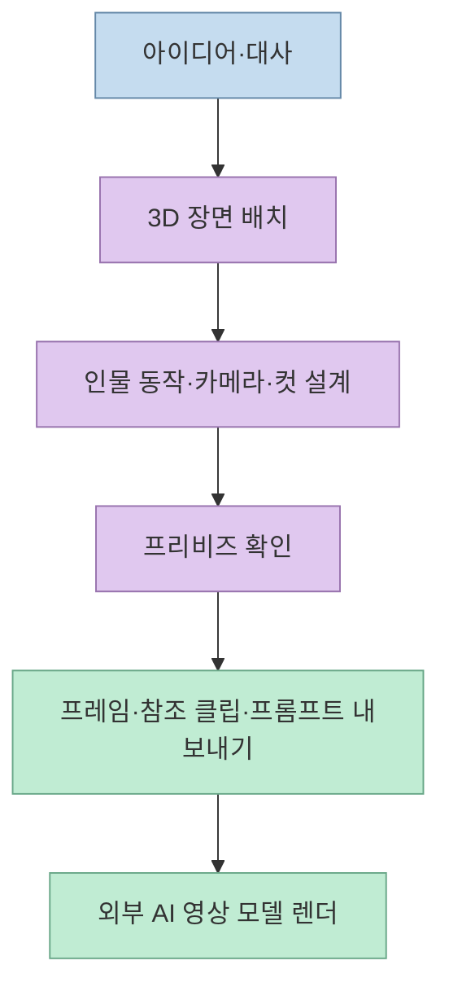
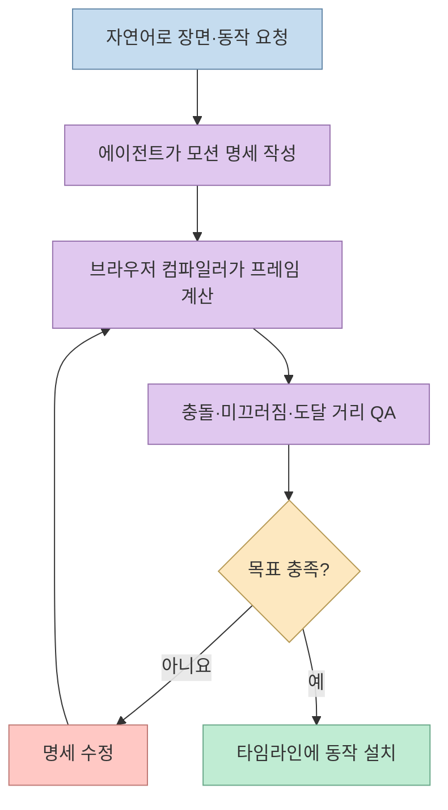
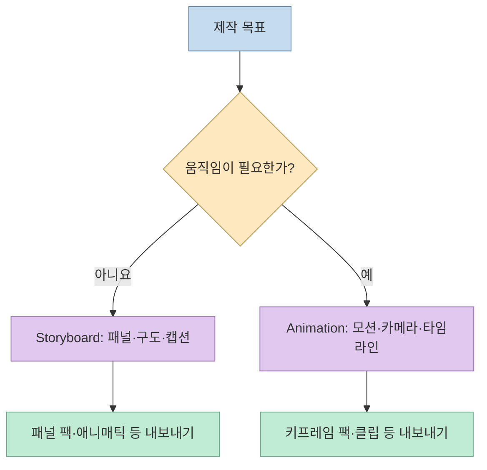

"캡슐을 세워 놓고 Seedance 결과를 기다리는 대신, 샷은 CozyClay에서 정하고 렌더만 모델에 맡기자." [Threads 게시물](https://www.threads.com/share/BBrTuEGT6E/)의 제안은 AI 영상 제작에서 **장면·동선·카메라를 먼저 통제**하자는 뜻이다. [CozyClay](https://github.com/NomaDamas/CozyClay)는 브라우저에서 3D 프리비즈(previsualization)를 만들고, 이를 AI 영상 모델에 전달할 참조 자료로 내보내는 오픈소스 도구다. 다만 "말로 쓰면 움직인다"는 설명과 "최종 영상까지 무료로 생성된다"는 해석은 구분해야 한다.

<!--more-->

## Sources

- [원문 Threads 게시물](https://www.threads.com/share/BBrTuEGT6E/) — 프로젝트 소개와 저장소 링크. 일반 HTTP 추출에서는 본문이 누락되어 브라우저 렌더링 추출(`scrapling-fetch`)로 확인했다.
- [CozyClay 공식 저장소·README](https://github.com/NomaDamas/CozyClay) — 현재 기능, 실행 방법, 내보내기와 외부 영상 모델 연결의 기준.
- [CozyClay 3.0 변경 기록](https://github.com/NomaDamas/CozyClay/blob/main/CHANGELOG.md) — 2.x와 달라진 모션 처리 및 이전 프로젝트 호환성.
- [CozyClay 3 모션 에이전트 가이드](https://github.com/NomaDamas/CozyClay/blob/main/docs/motion3-agent-guide.md) — 동작 명세, 컴파일, QA와 재수정 루프.
- [CozyClay 라이선스 설명](https://github.com/NomaDamas/CozyClay/blob/main/LICENSING.md) — 공개 소스의 사용·배포 조건.

## 프리비즈가 맡는 일과 영상 모델이 맡는 일

CozyClay는 Three.js·React Three Fiber로 만든 **브라우저 기반 3D 프리비즈 스튜디오**다. 프리비즈는 완성 영상 이전에 인물 위치, 움직임, 렌즈 느낌, 카메라 경로, 컷 길이를 미리 결정하는 단계다. 사용자는 장면을 구성하고 타임라인에서 샷을 정한 뒤 첫·마지막 프레임, 회색 모델(greybox) 참조 클립, 카메라 정보, 프롬프트 등을 내보낼 수 있다. 그 자료를 Seedance·Kling·Veo 또는 직접 연결한 영상 모델에 전달하는 것이 별도 단계다. [README의 제품 설명과 내보내기 기능](https://github.com/NomaDamas/CozyClay#what-you-can-do)

이 분리는 중요한 실무적 이점이 있다. 프롬프트만 바꾸며 원하는 구도가 우연히 나오기를 기다리는 대신, **같은 샷의 구도와 동선**을 먼저 설계할 수 있다. 그러나 참조 클립을 전달했다고 외부 모델이 카메라·인물 움직임을 픽셀 단위로 그대로 재현하는 것은 아니다. 최종 결과의 일치도는 해당 모델의 입력 형식과 해석에 달려 있다. CozyClay의 설명도 프리비즈 자료를 영상 모델에 "전달"한다고 말하지, 모든 모델에서 결과를 보장한다고 말하지 않는다. [README의 워크플로 설명](https://github.com/NomaDamas/CozyClay#what-you-can-do)

## 3.0의 핵심: 자연어를 곧바로 영상으로 바꾸는 것이 아니다

[3.0.0 변경 기록](https://github.com/NomaDamas/CozyClay/blob/main/CHANGELOG.md)은 이전의 모션 생성 백엔드를 제거하고, 에이전트가 **동작 명세(motion spec)** 를 쓰면 브라우저의 결정적 컴파일러가 프레임별 리그 동작을 계산하도록 바뀌었다고 설명한다. 명세에는 키 포즈, 걷기·앉기·잡기 같은 동작 스킬, 손의 고정점, 소품, 접촉과 목표 조건이 들어간다. "말로 쓰면 움직인다"는 게시물 표현은 이 **자연어 → 에이전트의 명세 작성 → 컴파일** 과정을 가리킨다. 사용자가 애니메이션 곡선을 직접 그리지 않아도 된다는 뜻이지, 영상 생성 모델이 3D 모션 자체를 만들어 준다는 뜻은 아니다. [3.0 변경 기록](https://github.com/NomaDamas/CozyClay/blob/main/CHANGELOG.md), [모션 가이드](https://github.com/NomaDamas/CozyClay/blob/main/docs/motion3-agent-guide.md)

가이드의 권장 루프는 장면을 조사하고, 동작 구간을 계획하고, `motion.compile`을 시험 실행한 뒤 QA의 원인·수정 힌트를 읽어 명세를 다시 컴파일하는 방식이다. 충돌, 발 미끄러짐, 손이 물체에 닿는지 등을 수치로 확인할 수 있지만, **QA 통과가 곧 최종 영상의 미학적 완성도를 보장하지는 않는다**. 마지막에는 접촉 시트 등으로 눈으로 검토해야 한다. [모션 에이전트 가이드의 작업 순서](https://github.com/NomaDamas/CozyClay/blob/main/docs/motion3-agent-guide.md#loop)

## 스토리보드와 애니메이션, 두 작업 모드

프로젝트는 **Storyboard** 또는 **Animation** 모드로 시작한다. 스토리보드는 컷별 정지 패널, 배치, 캡션과 유지 시간을 정할 때 쓴다. 애니메이션은 시간에 따라 움직이는 인물·카메라 샷과 컴파일된 동작을 다룬다. 따라서 정지 구도만 필요한 단계에서 바로 복잡한 모션을 만들 필요가 없다. 반대로 스토리보드 모드에는 모션 도구와 애니메이션용 키프레임 팩이 없으므로, 움직임이 필요한 샷은 애니메이션 프로젝트로 전환해야 한다. [README의 모드별 기능](https://github.com/NomaDamas/CozyClay#modes)

## 에이전트 연결과 영상 출력의 경계

자연어 제어에는 스튜디오의 Agent 패널, 외부 에이전트용 MCP 서버, 터미널의 `cclay live`라는 세 경로가 있다. README에 따르면 패널은 ChatGPT 계정 로그인 또는 별도 제공자의 API 키를 사용할 수 있다. 에이전트가 장면을 바꾸면 영수증 형태로 수정 결과가 표시되고 실행 취소도 가능하다. MCP는 편집기가 열려 있으면 보이는 장면을 조작하지만, 일부 화면 캡처 기능은 실행 중인 편집기를 필요로 한다. [README의 AI control 설명](https://github.com/NomaDamas/CozyClay#ai-control)

영상 출력도 둘로 나뉜다. **내보내기** 는 참조 영상·프레임·프롬프트를 파일로 만드는 기능이다. **실제 AI 영상 렌더링** 은 외부 서비스나 사용자가 연결한 ComfyUI·fal 등을 이용한다. 프로젝트의 Workflow 캔버스도 사용자 자신의 `COZYCLAY_COMFY_URL` 또는 `FAL_KEY`를 쓰도록 안내한다. 그러므로 "CozyClay가 무료 오픈소스"라는 말이 **영상 모델의 이용료, 계정, GPU 자원까지 무료**라는 의미는 아니다. [README의 내보내기 및 Workflow 설명](https://github.com/NomaDamas/CozyClay#workflow-canvas)

## 실전 적용 포인트: 설치·이전 버전·라이선스

저장소의 빠른 시작은 Node.js 22.19 이상, npm 또는 bun, Chromium 계열 브라우저를 요구한다. 로컬 실행 명령은 `npx cozyclay`이며, 브라우저에서 먼저 시험해 볼 수도 있다. 설치 전에는 자신의 환경에서 필요한 것이 **정지 스토리보드인지, 모션이 있는 샷인지**, 그리고 어떤 외부 영상 모델을 쓸지 정하면 좋다. [README의 빠른 시작](https://github.com/NomaDamas/CozyClay#quick-start)

2.x 프로젝트를 쓰던 사람에게는 더 큰 주의점이 있다. 3.0 변경 기록은 새 동작 저장 형식 `cozyclay.take.v3`를 도입했으며, **기존 2.x 프로젝트는 열리지만 이전 생성 모션은 읽을 때 버려진다**고 밝힌다. 중요한 프로젝트는 원본을 백업하고, 3.0에서 동작을 다시 컴파일할 준비가 필요하다. 이 내용은 실제 마이그레이션의 핵심이므로 "3.0은 단순 기능 추가"로 볼 수 없다. [3.0.0 변경 기록](https://github.com/NomaDamas/CozyClay/blob/main/CHANGELOG.md)

프로젝트 코드는 [AGPL-3.0-or-later](https://github.com/NomaDamas/CozyClay/blob/main/LICENSING.md) 조건으로 공개된다. 오픈소스라는 말은 재배포·개작·네트워크 서비스 제공 시 라이선스 의무를 확인해야 한다는 뜻이기도 하다. 또한 공식 npm 패키지와 호스팅 사이트에는 사용량 분석이 있으나, README는 `cclay telemetry off` 등으로 끌 수 있다고 안내한다. [README의 라이선스·개인정보 설명](https://github.com/NomaDamas/CozyClay#analytics--privacy)

## 핵심 요약

- CozyClay는 **3D 프리비즈 제작 도구**이고, 외부 AI 영상 모델은 그 결과를 받아 최종 화면을 렌더링하는 별도 단계다. [README](https://github.com/NomaDamas/CozyClay)
- 3.0의 자연어 애니메이션은 에이전트가 명세를 쓰고 결정적 컴파일러가 동작을 계산하는 구조다. [변경 기록](https://github.com/NomaDamas/CozyClay/blob/main/CHANGELOG.md)
- 스토리보드는 정지 패널, 애니메이션은 모션·카메라 타임라인에 적합하며 내보내기 형식도 다르다. [모드 설명](https://github.com/NomaDamas/CozyClay#modes)
- 도구가 오픈소스여도 외부 모델·API·GPU 비용은 별개다. 2.x 생성 모션의 3.0 호환성도 확인해야 한다. [Workflow 설명](https://github.com/NomaDamas/CozyClay#workflow-canvas), [3.0 변경 기록](https://github.com/NomaDamas/CozyClay/blob/main/CHANGELOG.md)

## 결론

CozyClay 3.0의 가치는 영상 모델을 대체하는 데 있지 않다. **영상 모델에 보내기 전에 장면과 움직임을 설계·검증할 수 있게 하는 것**이 핵심이다. 자연어 지시만으로 시작할 수 있지만, 좋은 결과에는 3D 샷 확인, QA 검토, 외부 모델 결과 평가가 여전히 필요하다.
