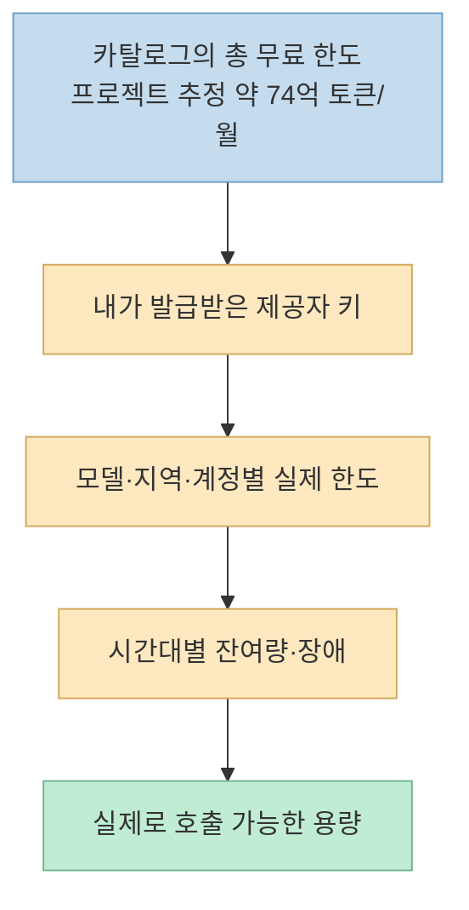
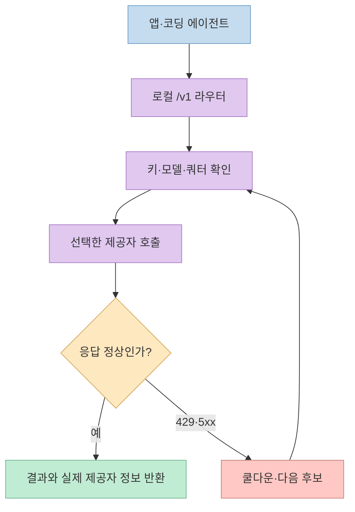
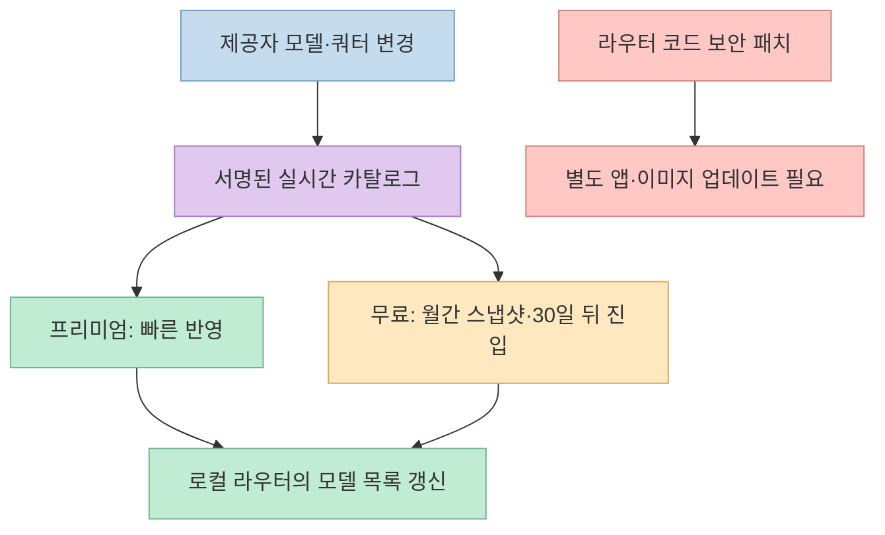
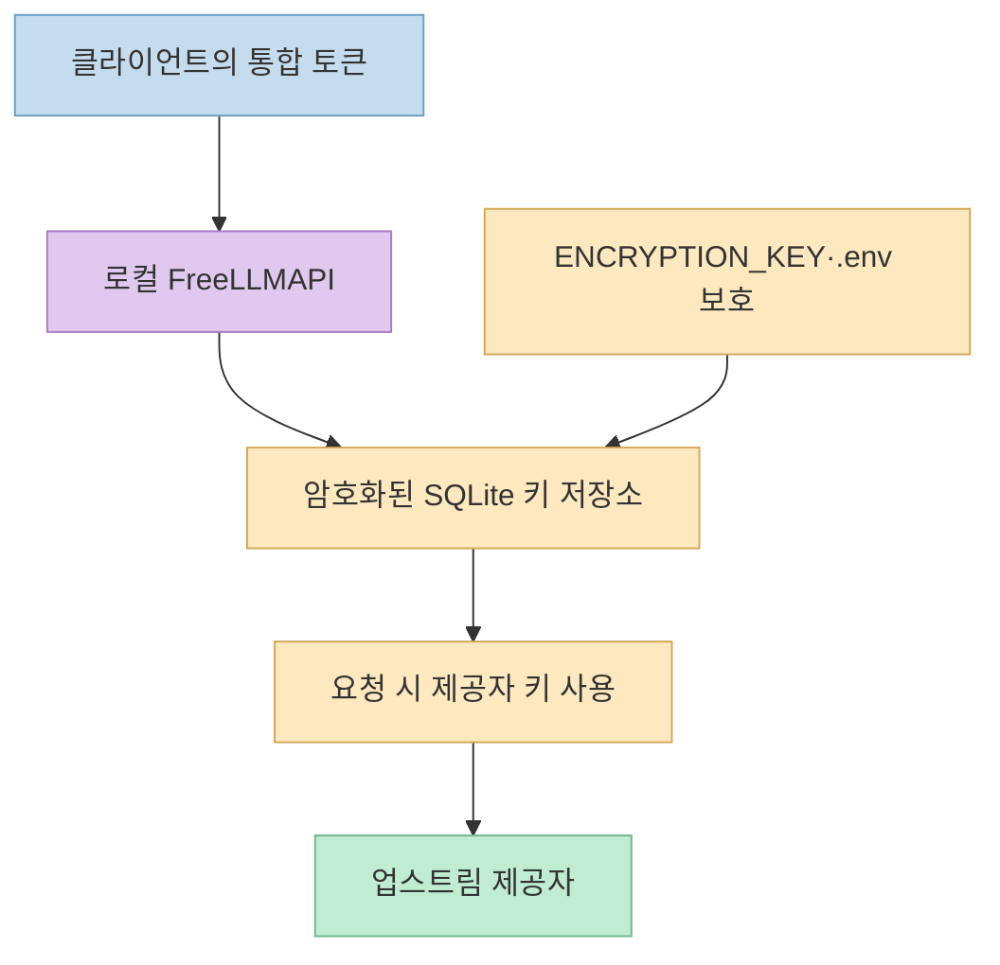

[FreeLLMAPI](https://github.com/tashfeenahmed/freellmapi)는 여러 제공자의 무료 LLM API를 하나의 로컬 `/v1` 엔드포인트로 묶는다. 이 블로그의 [2026년 8월 소개 글](https://gyuha.com/post/2026/08/2026-08-08-freellmapi-open-source-llm-router/)은 당시 README의 **29개 제공자·월 약 40억 토큰**을 인용했다. 2026년 10월 현재 저장소는 **34개 제공자·635개 무료 엔드포인트·월 약 74억 토큰**을 내세운다. 그러나 이 수치는 사용자가 계정을 만들자마자 받는 보장된 예산이 아니며, 프로젝트 자체도 **개인 실험용**이라고 명시한다.

<!--more-->

## Sources

- [원본 GitHub 저장소](https://github.com/tashfeenahmed/freellmapi)
- [기존 8월 블로그 글](https://gyuha.com/post/2026/08/2026-08-08-freellmapi-open-source-llm-router/)
- [공식 아키텍처·제한·약관 검토](https://github.com/tashfeenahmed/freellmapi/blob/main/docs/en/architecture/00-high-level-index.md)
- [공식 API 문서](https://github.com/tashfeenahmed/freellmapi/blob/main/docs/en/api/01-rest-api.md)
- [공식 보안 정책](https://github.com/tashfeenahmed/freellmapi/blob/main/SECURITY.md)

## 숫자를 읽는 단위부터 달라졌다

현재 README는 **34개 제공자, 474개 모델 계열, 635개 제공자×모델 엔드포인트**를 카탈로그에 등록했다고 밝힌다. 같은 모델이 여러 제공자에 걸쳐 있으면 엔드포인트 수가 모델 계열 수보다 커진다. README의 분류는 채팅 584개, 임베딩 41개, 전사 7개, 비디오 3개로 합계 635개다. 이 숫자는 **카탈로그에 실린 항목**이지, 내 계정에서 모두 호출 가능한 모델 개수는 아니다. 키 발급 여부, 지역, 계정 상태, 각 제공자의 현재 무료 정책에 따라 실제 목록이 달라질 수 있다. [공식 README: Premium catalog](https://github.com/tashfeenahmed/freellmapi#premium-live-catalog)

**월 약 74억 토큰** 역시 여러 제공자의 등록된 무료 한도를 합산한 프로젝트의 추정치다. 사용자가 그만큼을 한 계정으로 보장받는다는 뜻이 아니다. 제공자마다 RPM·RPD·TPM·TPD가 다르고, 일부 한도는 일 단위로 먼저 소진된다. README도 상위 모델의 일일 할당량이 줄어들면 다른 모델로 넘어가면서 응답 품질이 달라질 수 있다고 경고한다. 이 수치를 "무료 인퍼런스의 시장 총량을 보여주는 홍보 지표"로 읽는 것이 안전하며, 개별 워크로드의 처리 가능량은 **실제 발급받은 키와 호출 결과**로 확인해야 한다. [공식 README](https://github.com/tashfeenahmed/freellmapi) · [아키텍처 문서: Limitations](https://github.com/tashfeenahmed/freellmapi/blob/main/docs/en/architecture/00-high-level-index.md#limitations)

## 요청 하나가 제공자를 고르는 과정

클라이언트는 로컬 FreeLLMAPI의 **OpenAI 호환 `/v1`**에 통합 베어러 토큰으로 요청한다. 라우터는 등록한 제공자 키, 해당 모델의 건전성·속도·능력 점수, 남은 호출 한도를 고려해 경로를 고른다. 업스트림에서 **429나 5xx**가 나면 해당 키에 쿨다운을 주고 다음 후보로 시도한다. README는 채팅·Responses·임베딩·이미지·음성 등 여러 API 표면과 Anthropic Messages 호환 경로도 설명하지만, **모든 제공자가 모든 기능을 지원한다는 뜻은 아니다**. 미지원 기능은 현재 연결한 제공자·모델 조합을 확인해야 한다. [공식 README: Features](https://github.com/tashfeenahmed/freellmapi#features) · [API 문서](https://github.com/tashfeenahmed/freellmapi/blob/main/docs/en/api/01-rest-api.md)

자동 페일오버는 **가용성 보완**이지 모델의 동등성 보증이 아니다. 다른 모델로 바뀌면 응답 형식, 도구 호출 해석, 지연 시간, 출력 품질이 달라질 수 있다. 유지할 대화 맥락과 원하는 모델 수준이 중요한 코딩 에이전트라면, 추상적인 `auto`만 쓰기보다 허용할 모델과 폴백 체인을 좁혀 시험하는 편이 낫다. README는 모델별 경로를 통합하고 사용자 지정 체인을 구성하는 기능을 설명한다. [공식 README: Unified models & profiles](https://github.com/tashfeenahmed/freellmapi#features) · [아키텍처 문서: Limitations](https://github.com/tashfeenahmed/freellmapi/blob/main/docs/en/architecture/00-high-level-index.md#limitations)

## 무료 라우터와 유료 카탈로그의 차이

**라우터 소프트웨어는 MIT 라이선스**이며 저장소는 로컬 무료 사용을 계속 제공한다고 설명한다. 반면 제공자·모델·쿼터 변경을 반영한 **실시간 카탈로그 피드**는 별도 프리미엄 기능이다. 무료 설치판도 서명된 카탈로그를 받지만 **월간 스냅샷**을 따르며, 새 모델은 실시간 피드에 들어온 뒤 **30일 후** 무료 목록에 들어온다고 README가 적는다. 프리미엄은 변경 사항을 같은 날 반영하는 구조다. 즉 "오픈소스 라우터를 무료로 쓴다"와 "최신 모델·쿼터 정보를 즉시 받는다"는 다른 약속이다. [공식 README: Premium live catalog](https://github.com/tashfeenahmed/freellmapi#premium-live-catalog)

카탈로그가 자동으로 동기화된다고 해서 **라우터 실행 코드가 자동으로 보안 패치되는 것은 아니다**. 모델 목록·제공자별 설정과 애플리케이션 버전은 별개의 갱신 경로다. 보안 문서는 지원되는 최신 릴리스 계열을 유지하고 Docker 이미지 또는 소스를 주기적으로 갱신하라고 안내한다. 무료 피드의 30일 지연 기간에는 새 모델 추가뿐 아니라 바뀐 쿼터·호환성 정보도 뒤늦게 반영될 수 있으므로, 실패가 늘면 업스트림 제공자의 현재 정책을 직접 확인해야 한다. [공식 README](https://github.com/tashfeenahmed/freellmapi) · [보안 정책: Hardening tips](https://github.com/tashfeenahmed/freellmapi/blob/main/SECURITY.md)

## 보안과 제공자 약관은 여전히 사용자 책임이다

FreeLLMAPI는 제공자 API 키를 **SQLite에 AES-256-GCM으로 암호화해 저장**하고, 애플리케이션에는 별도 통합 토큰만 노출한다고 설명한다. 이는 여러 앱에 원본 제공자 키를 직접 넣지 않아도 되는 이점이지만, 통합 토큰이나 암호화 키가 새면 영향 범위가 커진다. [공식 보안 정책](https://github.com/tashfeenahmed/freellmapi/blob/main/SECURITY.md)은 `.env`와 `ENCRYPTION_KEY`를 Git·공유 드라이브에 올리지 말고, 토큰이 유출되면 교체하라고 안내한다. 기본 바인딩이 `127.0.0.1`인 것도 **단일 사용자 로컬 도구**라는 설계와 연결된다. [공식 README: Features](https://github.com/tashfeenahmed/freellmapi#features)

**로컬에 키를 저장한다는 사실과 프롬프트가 로컬에서만 처리된다는 주장은 다르다.** 요청은 선택된 외부 제공자의 API로 보내진다. 따라서 코드, 개인 정보, 사내 문서를 넣을 때는 해당 제공자의 데이터 처리·보관 정책을 확인해야 한다. 라우터는 여러 서비스의 무료 한도를 한 인터페이스로 모을 뿐, 제공자별 약관을 우회하거나 일괄 허가하지 않는다. 저장소의 약관 검토도 **2026년 5월 시점의 프로젝트 자체 요약**이므로 법적 확약으로 받아들이지 말아야 한다. [공식 아키텍처: ToS review](https://github.com/tashfeenahmed/freellmapi/blob/main/docs/en/architecture/00-high-level-index.md#terms-of-service-review) · [공식 README: Disclaimer](https://github.com/tashfeenahmed/freellmapi#disclaimer)

가장 중요한 운영 한계는 **프로젝트가 스스로 "개인 실험·학습용이며 프로덕션용이 아니다"라고 적었다는 점**이다. 무료 티어에는 SLA가 없고, 제공자가 언제든 한도를 바꾸거나 모델을 내릴 수 있다. 보안 정책도 다중 사용자 인증을 제공하지 않으므로 인터넷에 직접 노출하지 말라고 명시한다. MIT 코드 라이선스와 안정적인 운영 서비스라는 약속은 별개다. [공식 README: Disclaimer](https://github.com/tashfeenahmed/freellmapi#disclaimer) · [공식 보안 정책](https://github.com/tashfeenahmed/freellmapi/blob/main/SECURITY.md) · [아키텍처: Limitations](https://github.com/tashfeenahmed/freellmapi/blob/main/docs/en/architecture/00-high-level-index.md#limitations)

## 실전 적용 포인트

1. **목적을 개인 실험으로 한정한다.** 코딩 에이전트·프로토타입에 사용할 수 있어도 고객 트래픽을 받는 서비스의 안정적인 무료 백엔드로 전제하지 않는다. [공식 README: Disclaimer](https://github.com/tashfeenahmed/freellmapi#disclaimer)
2. **필요한 제공자 키만 등록한다.** 34개를 모두 등록해야 동작하는 구조가 아니다. 등록한 키의 실제 모델·지역·쿼터를 확인하고, 반환된 라우팅 정보를 기록해 예상치 못한 모델 변경을 발견한다. [공식 README: Quick start](https://github.com/tashfeenahmed/freellmapi#quick-start) · [API 문서](https://github.com/tashfeenahmed/freellmapi/blob/main/docs/en/api/01-rest-api.md)
3. **카탈로그와 코드 업데이트를 분리해 관리한다.** 무료 월간 스냅샷의 지연을 감안하고, 라우터 자체도 보안 패치가 있는 버전으로 따로 갱신한다. 제공자 정책이나 요금은 수시로 달라지므로 설치 전 최신 문서를 다시 읽는다. [공식 README: Premium catalog](https://github.com/tashfeenahmed/freellmapi#premium-live-catalog) · [공식 보안 정책](https://github.com/tashfeenahmed/freellmapi/blob/main/SECURITY.md)
4. **비밀과 네트워크 경계를 보호한다.** 기본 localhost 바인딩을 유지하고, 설치 스크립트를 읽은 뒤 실행하며, 암호화 키와 통합 토큰을 백업·교체할 절차를 마련한다. [공식 보안 정책: Hardening tips](https://github.com/tashfeenahmed/freellmapi/blob/main/SECURITY.md)

## 핵심 요약

- 2026년 10월 README 기준 숫자는 **34개 제공자·474개 모델 계열·635개 무료 엔드포인트·월 약 74억 토큰**이다. 모두 프로젝트의 카탈로그 집계이며 개인에게 보장되는 용량이 아니다. [공식 README](https://github.com/tashfeenahmed/freellmapi)
- `/v1` 라우터는 키·쿼터·장애를 보고 제공자를 고르며 429/5xx에서 다른 후보로 넘어간다. 가용성은 보완하지만 모델 품질·응답 형식의 동일성까지 보장하지는 않는다. [공식 README: Features](https://github.com/tashfeenahmed/freellmapi#features)
- **무료 라우터 소프트웨어**와 **최신 카탈로그 피드**는 구분된다. 무료 설치판은 월간 스냅샷, 프리미엄은 빠른 갱신을 제공한다고 설명한다. [공식 README: Premium live catalog](https://github.com/tashfeenahmed/freellmapi#premium-live-catalog)
- 프로젝트는 **개인 실험용·단일 사용자용**이라고 명시한다. 업스트림 제공자 약관과 보안은 사용자 책임이다. [공식 README: Disclaimer](https://github.com/tashfeenahmed/freellmapi#disclaimer) · [보안 정책](https://github.com/tashfeenahmed/freellmapi/blob/main/SECURITY.md)

## 결론

FreeLLMAPI의 장점은 **무료 모델을 보장해 주는 것**이 아니라, 여러 무료 티어를 로컬의 일관된 API로 시험하고 폴백하는 수고를 줄이는 데 있다. 8월 글의 숫자보다 10월의 숫자가 커졌더라도 제품 채택 기준은 같다. 내 계정의 실제 호출 가능량, 응답 품질, 제공자 약관과 장애 허용 범위를 확인한 뒤 개인 실험에 쓰고, 서비스 운영에는 별도의 안정적인 백엔드를 준비해야 한다.
