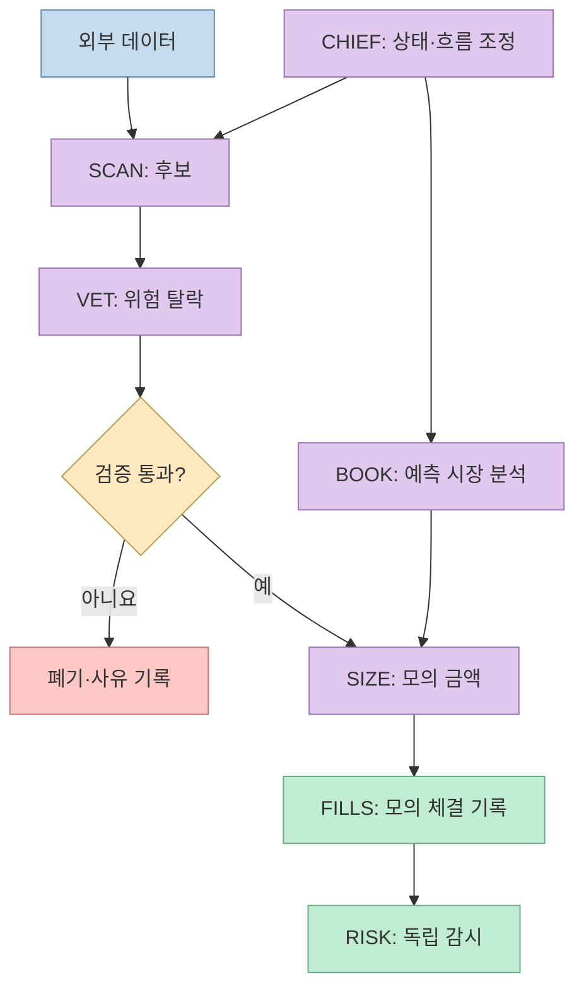
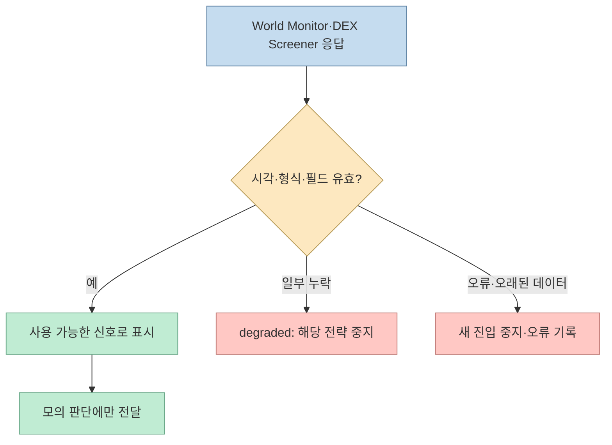
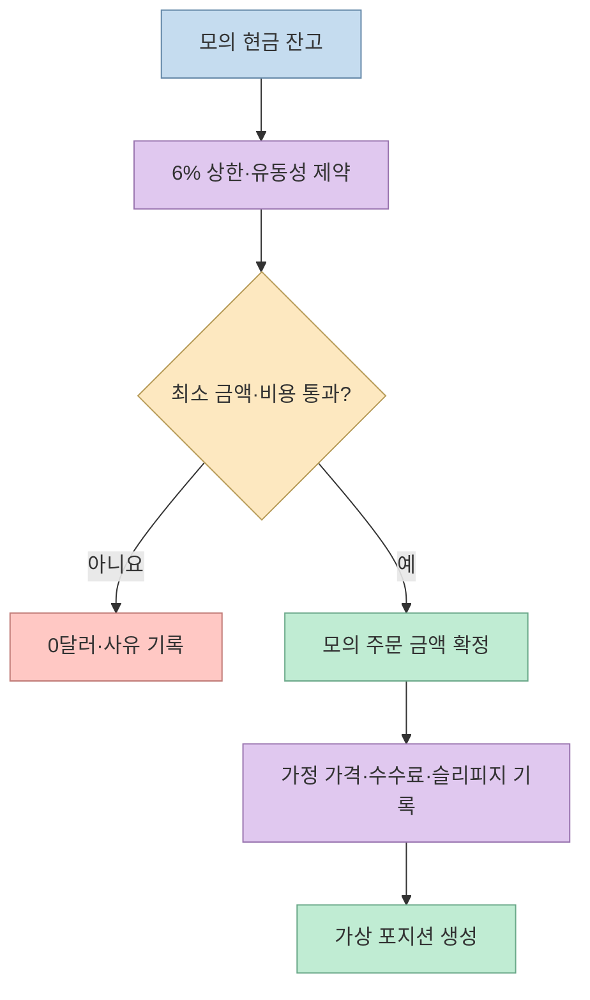
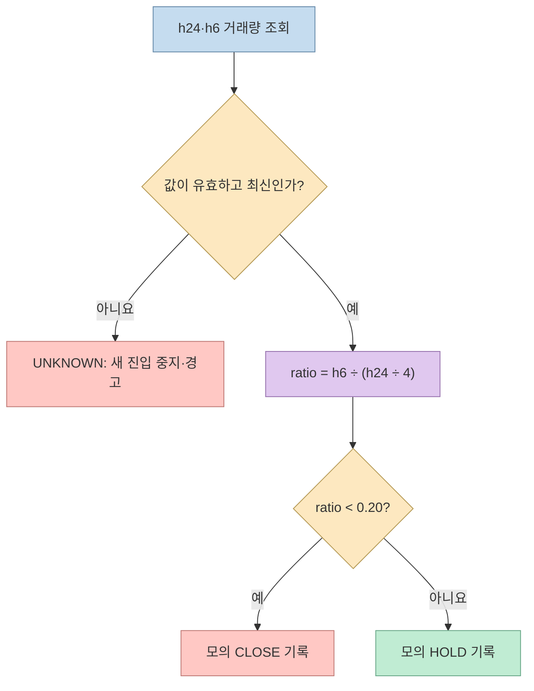

[게으른 빌더의 가이드](https://lazyowen.com/guides/grok-bot-trading-team-setup)는 Grok Bot 일곱 개를 역할별로 나눠 **실제 주문을 내지 않는 모의 트레이딩 팀**을 만드는 예를 보여준다. 핵심은 에이전트 수가 아니라 후보 탐색, 위험 심사, 모의 체결, 사후 감시의 책임을 분리하는 것이다. 다만 제시된 데이터와 규칙을 그대로 붙이면 일부 신호는 계산할 수 없으므로, 자동화 전에 입력의 출처와 실패 동작부터 확인해야 한다.

<!--more-->

## Sources

- [원문: 그록 에이전트 7개로 트레이딩 팀 만드는 법](https://lazyowen.com/guides/grok-bot-trading-team-setup#step-1-%EA%B7%B8%EB%A1%9D-%EB%B4%87-%EC%84%A4%EC%B9%98%ED%95%98%EA%B3%A0-%EC%B4%9D%EA%B4%84-%EB%B4%87-%EB%A7%8C%EB%93%A4%EA%B8%B0-10%EB%B6%84) — 역할, 예시 규칙과 모의 운영 흐름. 일반 HTTP 추출이 연결 오류로 실패해 Jina Reader로 본문을 확인했다(`jina-reader`). 공개 안내 범위를 요약하며 긴 봇 지시문은 재수록하지 않는다.
- [Grok Bot 시작하기](https://docs.x.ai/grok-bot/get-started), [스킬·루틴](https://docs.x.ai/grok-bot/skills-routines-and-automations), [승인·보안](https://docs.x.ai/grok-bot/approvals-security-and-privacy), [팀 봇](https://docs.x.ai/grok-bot/team-bots) — 제품의 자격, 예약 실행, 권한 경계.
- [World Monitor 저장소](https://github.com/koala73/worldmonitor), [환경 변수 예시](https://github.com/koala73/worldmonitor/blob/main/.env.example) — 로컬 실행과 데이터 공급원 설정.
- [DEX Screener 공식 API 명세](https://docs.dexscreener.com/api/reference) — 검색·토큰·페어 응답의 확인 가능한 필드.

## 일곱 봇은 하나의 의사결정자가 아니다

원문은 **CHIEF** 를 조정자로 두고, **SCAN** 은 후보 탐색, **VET** 은 부적합 후보 탈락, **BOOK** 은 예측 시장, **SIZE** 는 모의 배분 금액, **FILLS** 는 모의 체결 장부, **RISK** 는 열린 모의 포지션의 청산 신호를 담당하게 한다. CHIEF가 모든 결정을 내리는 구조가 아니다. 특히 VET을 통과하지 않은 후보가 SIZE로 넘어가면 역할 분리의 의미가 사라진다. 원문은 업무가 다른 BOOK을 별도 대화 그룹에 두는 등 협업 채널도 나눈다. 이는 제공되는 완성형 거래 시스템이라기보다 **업무 분장을 위한 운영 설계안**이다. [원문](https://lazyowen.com/guides/grok-bot-trading-team-setup)

이 흐름에서 CHIEF의 할 일은 응답 누락과 기능 저하를 보고하고 각 봇이 책임 범위를 벗어나지 않도록 하는 것이다. RISK가 별도 주기로 움직인다는 원문의 아이디어는 감시 지연을 줄이지만, **봇의 자연어 지시만으로 안전한 청산 시스템이 완성되지는 않는다**. 상태 저장, 동일 이벤트 중복 처리, 가격 시각, 실패 기록은 별도 검증이 필요하다. 이는 원문 구조를 실제 운영 관점에서 읽은 설계상 추론이다. [원문](https://lazyowen.com/guides/grok-bot-trading-team-setup), [Grok Bot 루틴 문서](https://docs.x.ai/grok-bot/skills-routines-and-automations)

## 데이터 연결: 설치 성공과 신호 유효성은 다르다

원문은 World Monitor를 정보 서버, DEX Screener를 토큰 가격·거래량의 출처로 제안한다. World Monitor 공식 README의 로컬 시작 절차는 저장소 복제 후 `npm install`, `npm run dev`이고 기본 주소는 `localhost:3000`이다. **포트 변경 변수는 원문의 `WM_PORT`가 아니라 현재 공식 설정의 `DEV_PORT`** 이며 `.env.local`에 둔다. 또한 앱은 환경 변수 없이 실행되더라도 기능별 외부 피드에는 별도 자격증명이 필요할 수 있다. 따라서 HTTP 200과 빈 목록을 같은 의미로 처리하거나, 화면이 뜬다는 이유만으로 데이터를 `READY`로 표시해서는 안 된다. [World Monitor README](https://github.com/koala73/worldmonitor#quick-start), [환경 변수 예시](https://github.com/koala73/worldmonitor/blob/main/.env.example)

원문은 World Monitor의 일부 기본 응답이 비거나 오류일 때 CHIEF가 `degraded`로 보고하고 BOOK을 쉬게 하도록 한다. 이는 좋은 실패 처리 방향이다. 다만 원문이 제시한 특정 응답 코드가 **모든 설치 환경에서 재현된다고 보장할 수는 없다**. 엔드포인트별로 응답 코드뿐 아니라 데이터 건수, 갱신 시각, 필수 필드를 검사해야 한다. World Monitor의 특정 로컬 엔드포인트는 이 글을 위해 직접 실행 검증하지 않았다. [원문](https://lazyowen.com/guides/grok-bot-trading-team-setup), [World Monitor 저장소](https://github.com/koala73/worldmonitor)

더 큰 재현 문제는 **보유자 수 변화**다. 원문은 SCAN에서 보유자 증가 속도를 가격 변화와 비교하고, VET에서도 큰 지갑 비율을 확인하라고 한다. 하지만 DEX Screener의 공식 페어 응답 명세에는 가격, 거래량, 유동성, 거래 건수 등은 보이지만 `holders` 시계열 필드가 없다. 그러므로 DEX Screener만 연결하고 보유자 증가를 계산했다고 보고하면 근거가 비어 있다. 해당 신호는 별도의 온체인 데이터 공급원과 기준 시점별 스냅샷을 마련한 뒤에만 사용해야 한다. 큰 지갑 비율 역시 체인 RPC의 공급량·계정 자료를 별도로 검증해야 한다. 이 판단은 [원문의 SCAN·VET 규칙](https://lazyowen.com/guides/grok-bot-trading-team-setup)과 [DEX Screener 공식 응답 스키마](https://docs.dexscreener.com/api/reference)를 대조한 **추론**이다.

## 모의 계좌의 숫자는 성과 증거가 아니다

원문 예시는 시작 잔고 **1,000달러**, 단일 포지션의 계좌 대비 **6% 상한**, 최소 모의 주문 **50달러**를 둔다. 이 경우 최초 상한은 60달러이므로 최소 금액을 넘지만, 현금 부족이나 위험 심사 탈락 시 SIZE는 0을 내야 한다. VET의 최소 유동성 1만 달러, 주문 금액의 50배, 30분 경과, 2% 슬리피지 예산 등도 원문이 정한 **초기 가정**이지 검증된 수익 조건은 아니다. [원문](https://lazyowen.com/guides/grok-bot-trading-team-setup)

FILLS는 거래소에 주문하지 않고 시점별 가정 가격과 비용을 기록한다. 원문의 수수료 가정은 `max(거래액 × 0.45%, 0.95달러)`다. 따라서 20달러 모의 주문의 유효 수수료율은 `0.95 / 20 = 4.75%`이고, 50달러라면 최소 수수료만으로도 `0.95 / 50 = 1.9%`다. 양방향 비용, 슬리피지, 부분 체결을 포함하면 모의 손익은 더 나빠질 수 있다. 이는 **원문의 비용 모델을 계산한 값**이며 실제 거래소의 보편적 요율을 뜻하지 않는다. [원문](https://lazyowen.com/guides/grok-bot-trading-team-setup)

BOOK의 예측 시장 경로도 시세가 없는 시장 목록을 가격이나 확률로 오해하지 않는 것이 중요하다. 원문은 World Monitor의 시장 목록을 발견 용도로, 가격은 별도 시장 API에서 얻도록 구분한다. 목록에 `dataAvailable=false` 또는 갱신 시각 부재가 표시되면 확률을 만들지 말고 분석을 멈추는 식이다. 예측 시장 접근 가능 여부와 서비스 약관은 사용 지역·계정·시점에 따라 따로 확인해야 한다. [원문](https://lazyowen.com/guides/grok-bot-trading-team-setup)

## 6시간 거래량 청산 규칙을 정확히 읽기

원문의 RISK 규칙은 DEX Screener 거래량 필드에서 `volume.h24 / 4`를 **과거 24시간의 6시간 평균치**로 간주하고, `volume.h6`을 그 값으로 나눈다. 예시 입력이면 `4,717.70 / 4 = 1,179.425`, `167.75 / 1,179.425 ≈ 0.142`다. `0.142 < 0.20`이므로 원문 규칙의 결과는 **모의 포지션 CLOSE 신호**다. 이 값은 6시간 거래량이 직전 24시간 균등 평균의 약 14.2%라는 뜻일 뿐, 가격 하락이나 실제 청산 체결을 보장하지 않는다. 6시간 구간은 24시간 구간 안에 포함되므로 두 값은 독립 표본도 아니다. [원문](https://lazyowen.com/guides/grok-bot-trading-team-setup), [DEX Screener API 명세](https://docs.dexscreener.com/api/reference)

원문은 RISK가 5분마다 확인하고 데이터 조회가 반복 실패해도 포지션을 닫는다고 적는다. **모의 장부에서는** 미확인 상태를 `UNKNOWN`으로 기록하고 보수적인 가상 청산 시나리오를 따로 계산할 수 있다. 그러나 **실계좌에서는** 오래된 시세나 API 장애를 근거로 안전한 즉시 매도가 가능하다고 가정하면 안 된다. 신규 진입 중지, 운영자 알림, 현재 주문·잔고 대조가 먼저다. 이 구분은 원문의 시뮬레이션 범위를 지키기 위한 안전 설계 권고다. [원문](https://lazyowen.com/guides/grok-bot-trading-team-setup), [Grok Bot 자동화 권고](https://docs.x.ai/grok-bot/skills-routines-and-automations)

## 예약 실행과 권한 경계

Grok Bot 공식 문서에 따르면 루틴은 **특정 봇 하나에 귀속**되며 예약 간격은 최소 5분이다. 권장 순서는 먼저 일회성 작업을 수행하고, 결과·실패 처리를 확인한 뒤 스킬을 만들고 루틴을 켜는 것이다. `Test run`도 실제 파일 변경이나 연결된 도구 호출을 수행할 수 있으므로 안전한 샘플과 승인 경계로 시험해야 한다. 팀 봇 환경에서도 루틴이 팀 전체의 공용 서비스 계정으로 저절로 실행되는 것은 아니므로 소유자와 접근 권한을 확인해야 한다. [Grok Bot 스킬·루틴 문서](https://docs.x.ai/grok-bot/skills-routines-and-automations), [팀 봇 문서](https://docs.x.ai/grok-bot/team-bots)

실습의 권한 경계는 간단하다. **실거래 키·지갑 서명·출금 권한을 연결하지 않는다.** 분석과 모의 장부 작성은 자동화할 수 있어도, 금전 이동이나 실제 거래는 별도 승인·인증·위험 관리가 필요한 다른 단계다. Grok Bot 공식 보안 문서도 구매와 금융 관련 작업에서 명시적인 승인 경계를 요구한다. 원문의 시간·가격·무료 이용 표현은 계정 자격과 요금제에 따라 달라질 수 있으므로 현재 [시작하기 문서](https://docs.x.ai/grok-bot/get-started)에서 확인해야 한다. [Grok Bot 승인·보안 문서](https://docs.x.ai/grok-bot/approvals-security-and-privacy)

## 실전 적용 포인트

1. **봇을 늘리기 전에 입력 계약을 정한다.** 각 후보에 체인, 토큰·페어 주소, 데이터 출처, 관측 시각, 결측 여부를 남긴다. DEX Screener에 없는 보유자 수는 계산하지 않는다. [DEX Screener API 명세](https://docs.dexscreener.com/api/reference)
2. **실행 상태를 세 가지로 나눈다.** `READY`는 필수 데이터가 최신이고 유효한 경우, `degraded`는 일부 분석만 가능한 경우, `STOP`은 새 모의 진입조차 금지하는 경우다. 이는 원문의 상태 구분을 확장한 운영 제안이다. [원문](https://lazyowen.com/guides/grok-bot-trading-team-setup), [Grok Bot 루틴 권고](https://docs.x.ai/grok-bot/skills-routines-and-automations)
3. **고정된 샘플로 RISK를 시험한다.** `h24=4,717.70`, `h6=167.75`는 `ratio≈0.142`, `CLOSE`가 나와야 한다. 그다음 0, 누락, 오래된 값, 중복 실행을 시험한다. 실제 주문은 보내지 않는다. [원문](https://lazyowen.com/guides/grok-bot-trading-team-setup)
4. **루틴은 마지막에 켠다.** SCAN·VET·SIZE·FILLS의 장부가 일회성 테스트에서 서로 맞고, RISK 알림의 누락·중복 처리까지 확인한 뒤 예약한다. [Grok Bot 루틴 문서](https://docs.x.ai/grok-bot/skills-routines-and-automations)

## 핵심 요약

- 일곱 봇의 장점은 예측력이 아니라 **책임과 실패 지점을 분리할 수 있다는 것**이다.
- 원문의 6%, 50달러, 2%, 20%는 모의 실험의 가정이며 수익성을 입증하지 않는다.
- DEX Screener의 공식 페어 스키마만으로는 보유자 수 변화가 나오지 않는다. World Monitor의 현재 로컬 포트 변수는 `DEV_PORT`다.
- 데이터 장애의 결과는 실제 자동 청산 명령이 아니라 **모의 장부의 불확실성 기록과 신규 진입 중지**여야 한다.

## 결론

이 가이드는 Grok Bot을 이용한 **모의 트레이딩 데스크의 역할 분리 실험**으로 읽으면 유용하다. 먼저 데이터 스키마와 결측 상태를 검증하고, 비용을 포함한 가상 체결과 청산 규칙을 재현하자. 그 과정이 끝나기 전에는 에이전트 일곱 개를 붙였다는 사실을 실거래 준비 완료로 해석해서는 안 된다.
