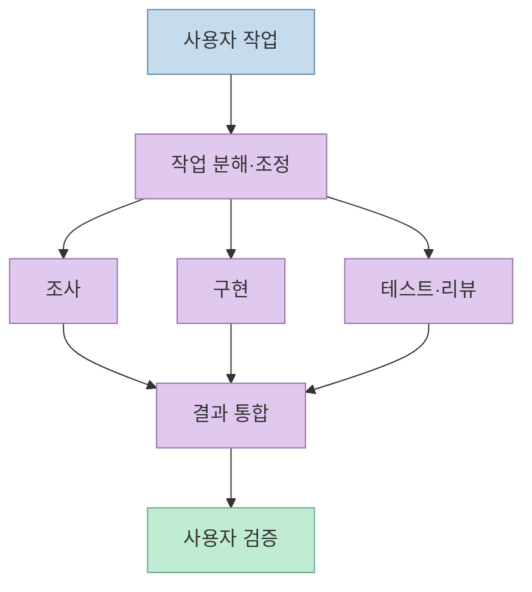
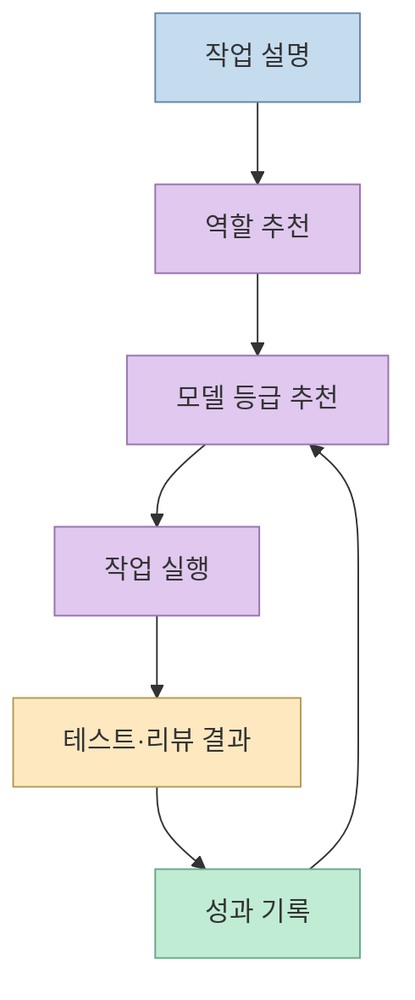
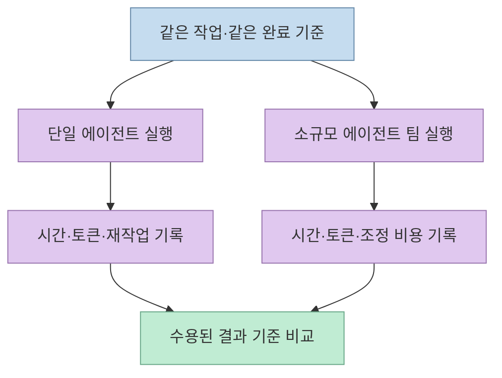

[짧은 영상](https://youtube.com/shorts/3JPHHaZPtfc?si=EYdZmeFg5xH7VOor)은 Claude Code에 [Ruflo](https://github.com/ruvnet/ruflo)를 붙이면 한 일을 여러 에이전트에 나누고, 난이도에 맞는 모델을 골라 비용까지 관리한다고 소개한다. 방향은 맞지만, **"100명 직원"은 성능 보장이 아닌 비유**이고 분업·라우팅·비용 추적이 모두 한 번의 설치만으로 검증되는 것도 아니다. 이 글은 약 37초의 자동 생성 한국어 자막과 프로젝트 공식 문서를 나란히 읽어, 가능한 기능과 확인이 필요한 조건을 구분한다.

<!--more-->

## Sources

- [원본 YouTube Shorts](https://youtube.com/shorts/3JPHHaZPtfc?si=EYdZmeFg5xH7VOor) — 영상의 주장과 시점. YouTube MCP가 없어 `youtube-transcript-api`의 자동 생성 한국어 자막으로 확인했다. 고유명사·숫자 인식에는 오류 가능성이 있다.
- [Ruflo 공식 저장소](https://github.com/ruvnet/ruflo) — 지원 기능과 설치 경로.
- [Ruflo 공식 설명서](https://github.com/ruvnet/ruflo/blob/main/docs/ruflo-explained.md) — 구성요소의 차이, 비용·검증에 관한 프로젝트 자체의 단서.
- [Ruflo Intelligence Routing 스킬](https://github.com/ruvnet/ruflo/blob/main/plugins/ruflo-intelligence/skills/intelligence-route/SKILL.md) — 에이전트·모델 추천 절차.
- [기존 Ruflo 입문 글](/post/2026/09/2026-09-04-ruflo-claude-code-agent-team-guide/) — 기본 개념과 초기 구성은 이 글에서 다뤘다.

## "혼자 조사·코딩·테스트"에서 무엇이 바뀌나

영상은 단일 Claude에게 일을 주면 조사, 코딩, 테스트가 한 흐름에 섞이지만 Ruflo는 큰 일을 여러 에이전트로 나누어 코딩·테스트·리뷰를 함께 진행한다고 말한다. [영상 2초](https://youtu.be/3JPHHaZPtfc?t=2), [영상 15초](https://youtu.be/3JPHHaZPtfc?t=15) Ruflo 저장소는 이를 모델을 대체하는 기능이 아니라 **에이전트 호스트 주변의 조정 계층**으로 설명한다. 사용자의 요청이 라우터와 스웜 조정을 거쳐 역할별 에이전트·모델에 전달되고, 결과를 다시 통합하는 개념이다. [공식 아키텍처 설명](https://github.com/ruvnet/ruflo#ruflo)

하지만 **독립적인 하위 작업이 있을 때** 효과가 있다는 전제가 붙는다. 공식 설명서도 간단한 수정에는 단일 에이전트가 낫고, 팀을 쓰려면 조정자가 충돌하는 결과를 해결해야 한다고 한다. "100명"은 병렬 실행 권장 규모가 아니며, 프로젝트가 많은 역할 정의를 제공한다는 사실과 한 작업에 그만큼 투입하는 것은 다르다. [공식 설명서의 단일·다중 에이전트 기준](https://github.com/ruvnet/ruflo/blob/main/docs/ruflo-explained.md)

## 쉬운 일은 작은 모델, 어려운 일은 큰 모델?

영상은 쉬운 일을 저렴한 모델에, 어려운 일을 더 강한 모델에 배분한다고 설명한다. [영상 22초](https://youtu.be/3JPHHaZPtfc?t=22) Ruflo의 Intelligence Routing 스킬은 작업 설명으로 **에이전트 추천**과 **모델 등급 추천**을 각각 구하고, 완료 뒤 결과를 기록해 다음 판단에 반영하는 절차를 적고 있다. 일부 단순 코드 변환은 LLM 없이 처리하는 경로도 설명한다. 따라서 "라우팅 기능이 존재한다"는 점은 공식 자료로 확인되지만, 모든 요청이 자동으로 최저비용·최고품질 모델에 배정된다고 읽으면 과장이다. [공식 라우팅 스킬](https://github.com/ruvnet/ruflo/blob/main/plugins/ruflo-intelligence/skills/intelligence-route/SKILL.md)

실제로는 선택한 **설치 경로·플러그인·호스트**에 따라 쓰는 훅과 도구가 다르다. 공식 설명서는 스킬 설치, MCP 서버 연결, 런타임·플러그인 구성을 서로 다른 단계로 구분한다. 라우터가 추천한 모델이 실행에 사용됐는지는 결과 로그에서 확인해야 하며, 역할 정의만 발견됐다는 사실은 작업 완료의 증거가 아니다. [공식 설명서의 구성요소 구분](https://github.com/ruvnet/ruflo/blob/main/docs/ruflo-explained.md), [라우팅 절차](https://github.com/ruvnet/ruflo/blob/main/plugins/ruflo-intelligence/skills/intelligence-route/SKILL.md)

## 예산 경고는 토큰 절약의 증명인가

영상은 사용량을 살펴보고 예산 경고도 걸 수 있다고 말한다. [영상 27초](https://youtu.be/3JPHHaZPtfc?t=27) 공식 저장소에는 토큰 사용량·예산·비용 경고용 **`ruflo-cost-tracker` 플러그인**이 있고, 콘솔에도 Cost 화면이 소개된다. 다만 비용을 표시하는 기능과 실제 비용이 줄어드는 것은 다른 주장이다. 여러 에이전트가 같은 맥락을 반복해서 읽고 결과를 통합하면 **대기 시간은 줄어도 토큰 사용량은 늘 수 있다**고 Ruflo 공식 설명서도 명시한다. [공식 플러그인 목록](https://github.com/ruvnet/ruflo#devops--observability), [공식 비용 설명](https://github.com/ruvnet/ruflo/blob/main/docs/ruflo-explained.md)

비교할 때는 **총 토큰·모델 요금, 재시도, 통합 시간, 통과한 테스트, 사람의 리뷰 시간**을 함께 기록해야 한다. 별 개수나 에이전트 수, 모델의 단가만으로 생산성과 비용 효율을 판정할 수 없다. 영상의 GitHub 스타·포크 수는 촬영 시점의 가변 수치일 뿐이고, 자동 분업의 품질을 입증하는 지표도 아니다. [영상 10초](https://youtu.be/3JPHHaZPtfc?t=10), [Ruflo 공식 비용 평가 기준](https://github.com/ruvnet/ruflo/blob/main/docs/ruflo-explained.md)

## 실전 적용 포인트: "한 줄 설치" 다음에 확인할 것

영상은 설치가 한 줄이면 된다고 요약한다. [영상 31초](https://youtu.be/3JPHHaZPtfc?t=31) 저장소에는 `npx ruflo@latest init wizard` 같은 시작 명령이 있지만, **Claude Code 플러그인 경로와 전체 프로젝트 초기화 경로는 설치 범위가 다르다**. 전체 초기화는 프로젝트의 설정·훅·파일을 만들 수 있고, MCP 연결·플러그인 활성화는 호스트마다 확인해야 한다. 설치 명령을 바로 실행하기 전에 변경될 파일과 허용 권한을 살펴보는 편이 안전하다. [공식 설치 경로 비교](https://github.com/ruvnet/ruflo#quick-start), [공식 구성 검증 설명](https://github.com/ruvnet/ruflo/blob/main/docs/ruflo-explained.md)

첫 시험은 실제 프로젝트 전체가 아니라 **독립된 작은 작업 하나**로 한다. 단일 에이전트 기준 결과를 먼저 기록하고, 소규모 팀에서 조사·테스트처럼 서로 분리 가능한 역할만 추가한다. 그런 다음 MCP 도구 발견, 실제 호출, 결과 파일, 테스트 로그, 비용 경고가 각각 작동했는지 확인한다. 프로젝트 문서 역시 "연결됨"과 "실행·검증됨"을 구분하라고 권한다. [공식 검증 안내](https://github.com/ruvnet/ruflo/blob/main/docs/ruflo-explained.md)

## 핵심 요약

- 영상의 Ruflo는 **다중 에이전트 조정 도구**이지 Claude 자체를 100명으로 만드는 모델이 아니다. [영상 0초](https://youtu.be/3JPHHaZPtfc?t=0), [공식 설명](https://github.com/ruvnet/ruflo)
- 역할·모델 라우팅 기능은 있지만, 설치 구성과 결과 기록에 따라 실제 동작이 달라진다. [영상 22초](https://youtu.be/3JPHHaZPtfc?t=22), [라우팅 스킬](https://github.com/ruvnet/ruflo/blob/main/plugins/ruflo-intelligence/skills/intelligence-route/SKILL.md)
- 비용 추적·예산 경고는 비용 절감 보증이 아니다. **단일 에이전트와 동일 과제를 비교**해야 한다. [영상 27초](https://youtu.be/3JPHHaZPtfc?t=27), [공식 비용 설명](https://github.com/ruvnet/ruflo/blob/main/docs/ruflo-explained.md)
- 한 줄 시작 명령 뒤에도 프로젝트 변경, MCP 연결, 권한, 테스트 로그를 확인해야 한다. [영상 31초](https://youtu.be/3JPHHaZPtfc?t=31), [공식 설치 안내](https://github.com/ruvnet/ruflo#quick-start)

## 결론

Ruflo는 **독립된 작업을 나누고 결과를 검증할 수 있을 때** 유용한 조정 계층이다. 영상의 장점을 활용하려면 에이전트를 많이 띄우는 것보다 작은 작업에서 설치 범위·실제 라우팅·총비용·테스트 결과를 먼저 측정해야 한다.
