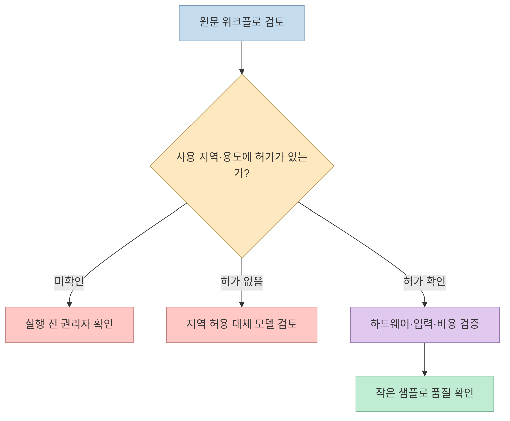
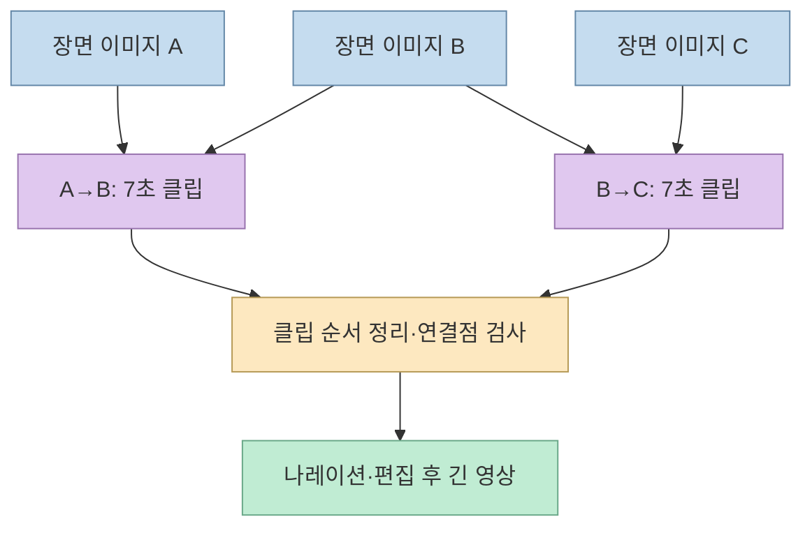
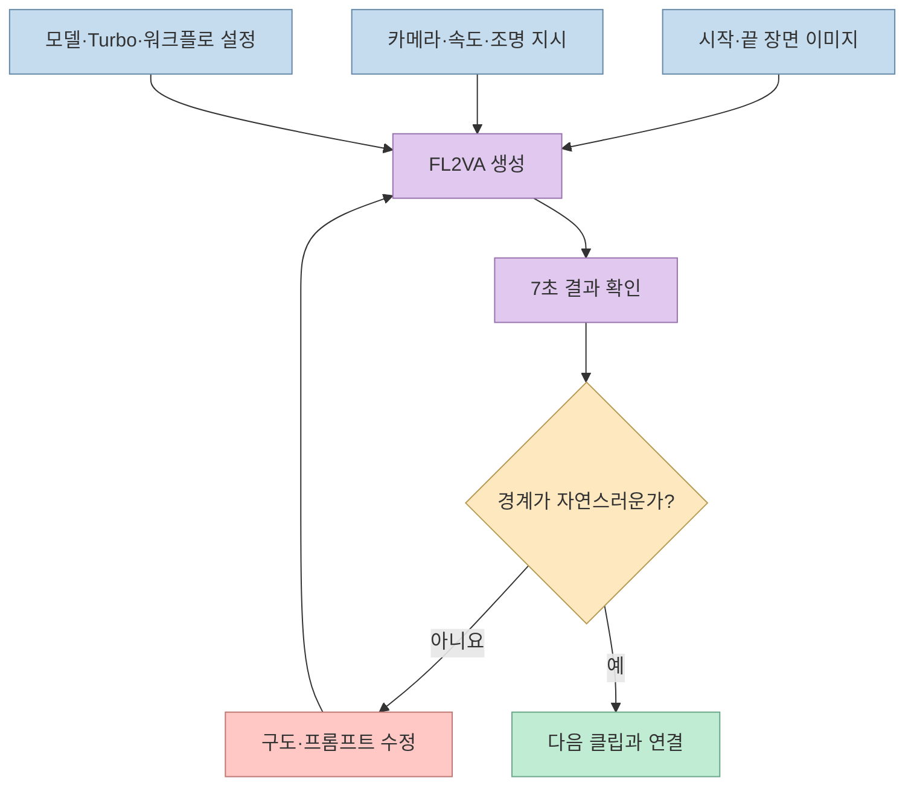

[@unjeon_auto의 Threads 글](https://www.threads.com/share/BAVDiXg4tY/)은 PC에서 약 10분짜리 전쟁 영상을 만들었다며 작업 순서를 공개한다. 눈에 띄는 것은 모델 한 번 실행해서 긴 영상을 얻은 것이 아니라, **장면 이미지 90장을 먼저 만들고 인접한 두 장 사이를 7초 클립 89개로 채운 방식**이다. 다만 게시글의 "0원"은 전체 제작 비용이나 누구나 실행 가능한 권리를 뜻하지 않는다. 특히 **MiniMax H3 공식 라이선스는 대한민국을 적용 지역에서 제외**하므로, 아래 내용은 국내 사용자를 위한 무조건적인 설치 안내가 아닌 사례 분석이다. [원문과 작성자 답글](https://www.threads.com/@unjeon_auto/post/Dev4yDrgsN-), [MiniMax H3 공식 라이선스](https://huggingface.co/MiniMaxAI/MiniMax-H3/blob/main/LICENSE)

<!--more-->

## Sources

- [입력된 Threads 공유 링크](https://www.threads.com/share/BAVDiXg4tY/) — 원본 [@unjeon_auto 게시물](https://www.threads.com/@unjeon_auto/post/Dev4yDrgsN-)로 연결된다. Threads 공개 본문과 작성자의 연속 답글을 Jina Reader(`jina-reader`)로 확인했다.
- 작성자 답글: [1/5 준비 도구](https://www.threads.com/@unjeon_auto/post/Dev5mvCgV5Q), [2/5 워크플로·용량·생성 수치](https://www.threads.com/@unjeon_auto/post/Dev5uPEAWPz), [3/5 모션 프롬프트](https://www.threads.com/@unjeon_auto/post/Dev505wgdJY), [4/5 연결 프롬프트](https://www.threads.com/@unjeon_auto/post/Dev57WoAYPw), [5/5 마무리](https://www.threads.com/@unjeon_auto/post/Dev6B1GAdkg).
- [완성 영상](https://www.youtube.com/watch?v=lNttwRrVgnc) — 작성자가 답글에서 연결한 결과물. 이 글은 영상 자체의 화질·소요 시간을 독립 측정하지 않았다.
- [MiniMax H3 모델 카드](https://huggingface.co/MiniMaxAI/MiniMax-H3), [커뮤니티 라이선스](https://huggingface.co/MiniMaxAI/MiniMax-H3/blob/main/LICENSE), [ComfyUI의 H3 소개](https://blog.comfy.org/p/minimax-h3-day-0-support-in-comfyui) — 모델 기능과 이용 조건.
- [LightX2V Turbo 파일](https://huggingface.co/lightx2v/Minimax-h3-Turbo/tree/main), [Kijai 실험 파일](https://huggingface.co/Kijai/MiniMax-H3-experimental/tree/main), [ComfyUI](https://github.com/Comfy-Org/ComfyUI), [axiomgraph 워크플로 모음](https://github.com/axiomgraph/ComfyUIWorkflow), [edge-tts](https://github.com/rany2/edge-tts) — 게시글에서 언급한 구성요소의 원 출처.

## 먼저 확인할 것: 한국에서는 라이선스가 선행 조건

MiniMax H3는 다운로드 가능한 가중치를 공개하지만, **공개 가중치가 전 세계 무조건 사용 허가를 뜻하지는 않는다**. 공식 커뮤니티 라이선스는 적용 지역에서 대한민국·미국·유럽연합·영국을 제외하고, 제외 지역에서 배포·활용하려는 사람에게 별도 라이선스 문의를 안내한다. 라이선스의 지역 제한은 모델의 사용뿐 아니라 결과물 이용에 관한 조항에도 나타난다. 한국에서 이 게시글의 H3 구성 그대로 작업하기 전에 권리자에게 현재 적용 가능한 허가를 확인하거나, 해당 지역에서 사용 가능한 다른 모델을 선택해야 한다. 이는 라이선스 문서의 명시 조항을 요약한 것이며, 구체적 이용 허가는 개별 계약에 따라 달라질 수 있다. [MiniMax H3 공식 라이선스](https://huggingface.co/MiniMaxAI/MiniMax-H3/blob/main/LICENSE), [모델 카드의 라이선스 안내](https://huggingface.co/MiniMaxAI/MiniMax-H3)

## 90장의 정지 이미지를 89개의 전환 클립으로 바꾸기

작성자는 조선 수군과 거북선 같은 역사 소재를 H3만으로 정확히 그리기 어려웠다고 평가한다. 그래서 **Gemini 앱에서 장면 이미지 90장**을 먼저 만들고, 이미지 A를 시작 프레임, 이미지 B를 마지막 프레임으로 지정해 두 장 사이의 움직임을 생성했다. 다음 클립은 B→C로 이어 붙인다. H3 공식 모델 카드의 `FL2VA`는 첫 프레임과 마지막 프레임 두 장을 받는 모드를 명시하므로, 이 연결 방식의 핵심 기능 자체는 공식 자료와 부합한다. 다만 역사적 고증이 개선됐는지, 모든 경계가 자연스럽게 이어졌는지는 작성자의 결과물에 대한 별도 평가가 필요하다. [작성자 2/5 답글](https://www.threads.com/@unjeon_auto/post/Dev5uPEAWPz), [MiniMax H3 입력 모드](https://huggingface.co/MiniMaxAI/MiniMax-H3)

90개 이미지를 이웃끼리 한 번씩 연결하면 **89개 클립**이 된다. 각 클립을 정확히 7초로 이어 붙였을 때의 원시 길이는 `89 × 7 = 623초`, 즉 **10분 23초**다. 실제 완성 길이는 장면 전환, 중복 프레임 제거, 편집에 따라 달라진다. 특히 B가 첫 클립의 마지막과 다음 클립의 첫 프레임으로 겹치므로 컷의 중복·프레임 불연속을 확인해야 한다. 이 계산은 작성자가 공개한 수치에 기반한 산술이며 실제 영상 타임라인의 독립 측정값은 아니다. [작성자 2/5 답글](https://www.threads.com/@unjeon_auto/post/Dev5uPEAWPz)

## 도구 구성과 프롬프트는 어떻게 역할을 나누나

작성자가 나열한 구성은 **MiniMax H3 모델**, LightX2V의 **Turbo 4·8스텝 파일 중 8스텝**, Kijai의 인코더·양자화 관련 파일, ComfyUI, axiomgraph의 FL2VA Turbo 워크플로, 나레이션용 Edge TTS다. 모델은 영상 생성, Turbo는 샘플링 단축, 첫·마지막 프레임 워크플로는 입력과 노드를 연결하는 역할이다. axiomgraph 저장소에는 H3 이름의 JSON 워크플로가 여러 개 있으므로, 단순히 저장소만 내려받아도 작성자와 동일 설정이 자동 재현된다고 보면 안 된다. 정확한 파일, 버전, 모델 배치 경로, 누락된 커스텀 노드를 확인해야 한다. [작성자 1/5 답글](https://www.threads.com/@unjeon_auto/post/Dev5mvCgV5Q), [작성자 2/5 답글](https://www.threads.com/@unjeon_auto/post/Dev5uPEAWPz), [axiomgraph 저장소](https://github.com/axiomgraph/ComfyUIWorkflow)

ComfyUI는 H3의 첫·마지막 프레임 영상 생성 기능을 지원한다고 설명한다. 그렇지만 **첫·마지막 이미지가 같으면 무조건 자연스러운 움직임이 나온다는 뜻은 아니다**. 작성자의 모션 지시문은 시작·종료 구도와 카메라 이동 경로, 조명 변화, 프레임 경계에서의 속도를 서술한다. 즉, 정지 이미지가 "어디서 어디로"를 정의하고 프롬프트가 "그 사이를 어떻게 움직일지"를 정의한다. 원문의 긴 영어 지시문을 복사하기보다 장면마다 카메라, 피사체, 조명, 움직임, 연속성 조건을 따로 적는 방식이 핵심이다. [작성자 3/5 답글](https://www.threads.com/@unjeon_auto/post/Dev505wgdJY), [작성자 4/5 답글](https://www.threads.com/@unjeon_auto/post/Dev57WoAYPw), [ComfyUI의 H3 설명](https://blog.comfy.org/p/minimax-h3-day-0-support-in-comfyui)

원문은 ComfyUI의 포터블 배포본을 언급하지만, 이는 **작성자가 선택한 환경**이지 H3의 필수 형식이라고 볼 근거는 없다. 또 `edge-tts`는 PC에서 호출할 수 있는 도구이지만 **Microsoft Edge의 온라인 음성 합성 서비스를 사용**한다. 따라서 영상 추론이 로컬에서 수행돼도 전체 제작 과정이 오프라인이라고 표현하면 부정확하다. Gemini 앱의 이미지 생성 역시 별도 서비스 단계다. [ComfyUI 공식 저장소](https://github.com/Comfy-Org/ComfyUI), [edge-tts 저장소](https://github.com/rany2/edge-tts), [작성자 2/5 답글](https://www.threads.com/@unjeon_auto/post/Dev5uPEAWPz)

## "0원"과 16GB 그래픽카드 주장을 분리해서 읽기

작성자의 수치는 **RTX 5090, 8스텝 Turbo, 1536×864, 7초 클립 하나에 약 7분**이라는 단일 환경의 경험이다. 이를 89개에 단순 적용하면 `89 × 7 = 623분`, 즉 **약 10시간 23분의 순차 생성 시간**이다. 장면 이미지 90장의 제작, 모델 다운로드, 재시도, 업스케일, TTS, 편집·렌더링은 포함되지 않는다. 작성자는 RTX 5080 16GB에서도 실행했다고 했지만, 같은 해상도·길이·속도로 재현됐다는 독립 검증이나 더 낮은 VRAM의 하한을 제시하지 않았다. "RTX 그래픽카드면 누구나"라는 문구는 이 결과만으로 입증되지 않는다. [작성자 1/5 답글](https://www.threads.com/@unjeon_auto/post/Dev5mvCgV5Q), [작성자 2/5 답글](https://www.threads.com/@unjeon_auto/post/Dev5uPEAWPz)

또 작성자는 모델 약 19.5GB, 인코더 약 14.6GB, Turbo 약 2GB를 언급한다. 이 세 숫자의 합은 **36.1GB**로, 다른 모델 구성요소·캐시·출력 파일을 빼고 센 값이다. 이는 **디스크 파일 크기**에 관한 사례이지 그래픽카드의 필수 **VRAM**을 계산한 결과가 아니다. 양자화·오프로딩·해상도·프레임 수·다른 프로세스가 실제 메모리 요구량과 속도를 바꾼다. "0원"도 기존 GPU 비용, 전기료, 인터넷 연결, 이미지 생성 서비스의 이용 조건, 시간비용을 제외한 표현이다. 모델 가중치의 무상 다운로드 가능성과 합법적으로 무상 이용할 수 있는 권리는 분리해야 한다. [작성자 2/5 답글](https://www.threads.com/@unjeon_auto/post/Dev5uPEAWPz), [MiniMax H3 라이선스](https://huggingface.co/MiniMaxAI/MiniMax-H3/blob/main/LICENSE)

## 실전 적용 포인트

1. **라이선스부터 확인한다.** 한국에서 H3를 그대로 실행해도 된다고 가정하지 말고 권리자의 적용 조건을 먼저 확인한다. 허가가 없다면 동일한 첫·마지막 프레임 기법을 허용 지역·용도에 맞는 다른 모델로 검토한다. [MiniMax H3 라이선스](https://huggingface.co/MiniMaxAI/MiniMax-H3/blob/main/LICENSE)
2. **긴 영상을 즉시 목표로 잡지 않는다.** 사용 권리가 확인된 환경에서 시작 이미지 2~3장과 짧은 연결 클립으로 구도·프레임 경계·소요 시간을 먼저 측정한다. 이는 작성자의 90장·89개 구조를 작게 축소한 검증 제안이다. [작성자 2/5 답글](https://www.threads.com/@unjeon_auto/post/Dev5uPEAWPz)
3. **생성비와 전체 제작비를 나눠 기록한다.** GPU·전력·디스크·재시도·온라인 TTS·이미지 생성 서비스의 조건을 각각 적는다. [작성자 2/5 답글](https://www.threads.com/@unjeon_auto/post/Dev5uPEAWPz), [edge-tts 저장소](https://github.com/rany2/edge-tts)
4. **연결 품질을 별도 평가한다.** 시작/종료 이미지의 일치뿐 아니라 카메라 속도, 인물·배·의상 일관성, 컷 사이의 중복 프레임을 확인한다. [작성자 3/5 답글](https://www.threads.com/@unjeon_auto/post/Dev505wgdJY), [작성자 4/5 답글](https://www.threads.com/@unjeon_auto/post/Dev57WoAYPw)

## 핵심 요약

- 이 사례의 본질은 **90장 키프레임 사이를 89개 영상으로 메우는 편집 가능한 구조**다.
- 7초×89개는 약 10분 23초의 원시 길이이며, 7분×89개는 약 10시간 23분의 순차 생성 시간이라는 계산이다.
- RTX 5080 16GB 실행, 저장공간, 생성 속도는 작성자 환경의 관찰이지 보편적인 최소 사양이 아니다.
- **한국은 MiniMax H3 공식 커뮤니티 라이선스의 적용 지역에서 제외**된다. 지역·용도에 맞는 허가를 확인하기 전에는 원문을 그대로 실행 지침으로 받아들이지 않는다.

## 결론

짧은 첫·마지막 프레임 클립을 여러 개 잇는 방식은 장편 AI 영상 제작을 **검사 가능한 단위**로 나눈다. 하지만 이 사례를 따라 하기 전에 비용 표현과 재현 가능한 하드웨어 수치를 분리하고, 무엇보다 모델의 지역별 이용 허가를 먼저 확인해야 한다.
