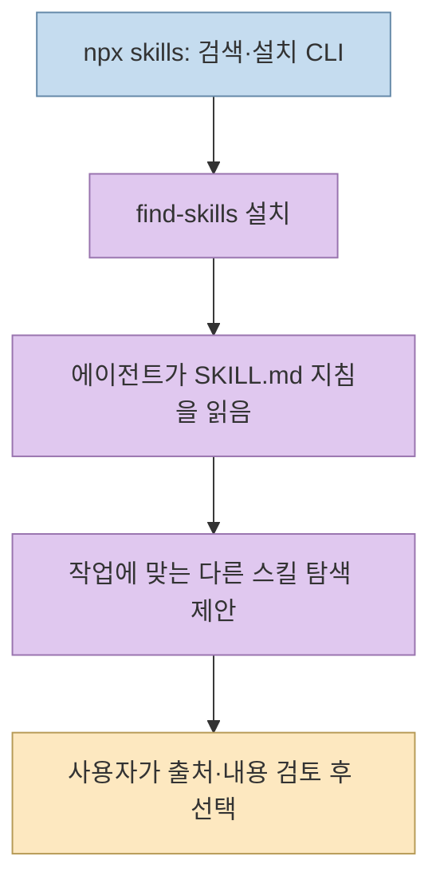
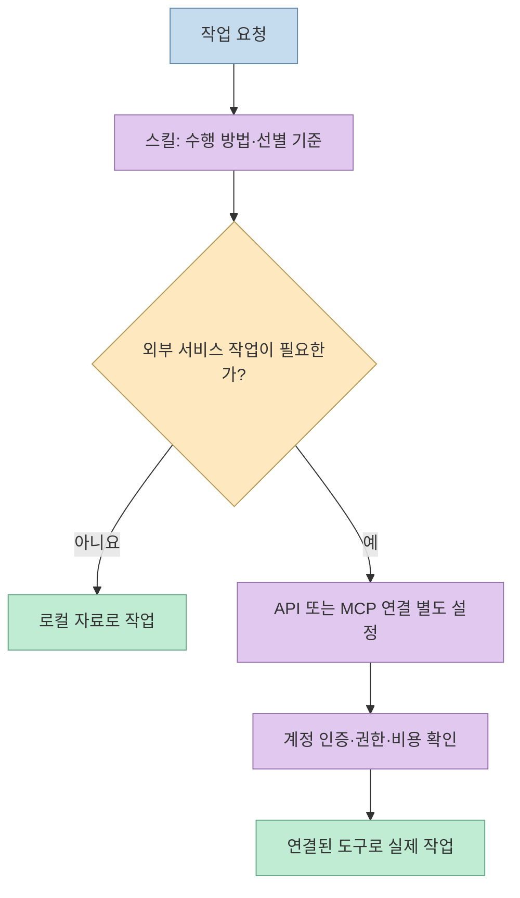
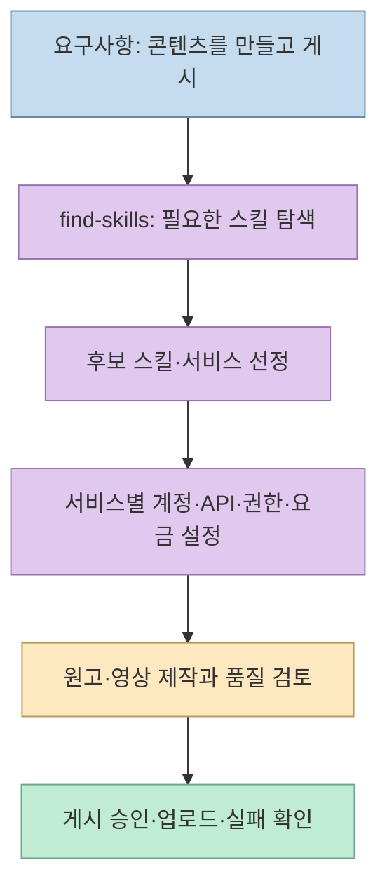
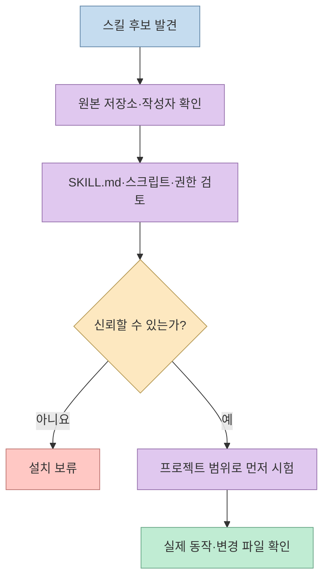

"Claude Code에 원하는 결과만 말하면 콘텐츠가 만들어지고 여러 서비스에 자동 게시된다"는 식의 소개가 돌자, [@joseongwoo82의 Threads 글](https://www.threads.com/share/BAY1iZnAIm/)은 화면에 나온 명령어가 실제로 무엇을 하는지 짚었다. 결론은 간단하다. **`find-skills`는 필요한 에이전트 스킬을 찾고 설치하도록 돕는 도구**이지, Notion·Veo3·Sora·Buffer를 한 번에 연결하는 콘텐츠 제작 엔진이 아니다. 설치 화면만으로 완성된 자동화 파이프라인을 입증할 수도 없다. [원문](https://www.threads.com/@joseongwoo82/post/De1j45UCebd), [Vercel의 `find-skills` 설명](https://skills.sh/vercel-labs/skills/find-skills)

<!--more-->

## Sources

- [입력된 Threads 공유 링크](https://www.threads.com/share/BAY1iZnAIm/) — [@joseongwoo82의 원본 게시물](https://www.threads.com/@joseongwoo82/post/De1j45UCebd)로 연결된다. 공개 본문과 작성자의 답글을 Jina Reader(`jina-reader`)로 확인하고 Threads 페이지의 공개 메타데이터와 대조했다.
- 작성자 답글: [2/5 설치 명령과 MCP 구분](https://www.threads.com/@joseongwoo82/post/De1kIhKCR2z), [3/5 외부 서비스 연결 주장](https://www.threads.com/@joseongwoo82/post/De1kGxOiRgv), [4/5 유용한 사용처와 설치 범위](https://www.threads.com/@joseongwoo82/post/De1kFi-CS8O), [5/5 설치 전 검토](https://www.threads.com/@joseongwoo82/post/De1kEVSCVzd). 원본 게시물이 서론이며 별도의 `1/5` 답글은 확인되지 않았다.
- [Vercel `skills` 공식 저장소](https://github.com/vercel-labs/skills), [`find-skills`의 `SKILL.md`](https://github.com/vercel-labs/skills/blob/main/skills/find-skills/SKILL.md), [CLI 명령 문서](https://github.com/vercel-labs/skills/blob/main/docs/commands.md), [skills.sh의 스킬 페이지](https://skills.sh/vercel-labs/skills/find-skills) — 실제 설치·검색·범위.
- [Agent Skills 형식 명세](https://agentskills.io/specification), [MCP 공식 소개](https://modelcontextprotocol.io/docs/getting-started/intro) — 지침 파일과 외부 도구 연결 방식의 차이.

## 화면 속 한 줄이 실제로 설치하는 것

작성자가 검토한 스크린샷에는 Vercel 저장소의 `find-skills`를 추가하는 명령이 보인다. 공식 스킬 페이지의 명령은 다음과 같다. **이 글을 위해 명령을 실행하거나 설치한 것은 아니다.** [원문 2/5 답글](https://www.threads.com/@joseongwoo82/post/De1kIhKCR2z), [공식 스킬 페이지](https://skills.sh/vercel-labs/skills/find-skills)

```bash
npx skills add https://github.com/vercel-labs/skills --skill find-skills
```

여기서 `npx skills`는 Vercel이 공개한 **스킬 검색·설치 CLI**이고, `find-skills`는 에이전트가 작업에 맞는 스킬을 찾아보도록 하는 **개별 스킬**이다. 공식 저장소에서 `skills/find-skills/` 아래에는 `SKILL.md`가 있으며, 스킬 페이지도 이를 도메인·작업별 스킬 발견과 설치를 돕는 것으로 설명한다. 스크린샷의 명령어가 Vercel 저장소를 가리킨다는 사실은 확인되지만, 이것만으로 "일본 개발자가 새로운 콘텐츠 자동화 시스템을 만들었다"는 서사를 뒷받침하지는 않는다. [Vercel 저장소](https://github.com/vercel-labs/skills), [`find-skills` 디렉터리](https://github.com/vercel-labs/skills/tree/main/skills/find-skills), [원문 2/5 답글](https://www.threads.com/@joseongwoo82/post/De1kIhKCR2z)



CLI 자체에도 `npx skills find [query]`라는 검색 명령이 있다. 반면 `find-skills`는 사용자가 "이 일을 돕는 스킬이 있나?"라고 물을 때 에이전트가 검색·선별 절차를 따르게 하는 지침이다. 두 이름이 비슷하다고 같은 제품 기능으로 합쳐 설명하면 검색 명령, 설치 관리자, 설치된 지침의 책임이 뒤섞인다. [Vercel README와 명령 목록](https://github.com/vercel-labs/skills), [`find-skills` 내용](https://github.com/vercel-labs/skills/blob/main/skills/find-skills/SKILL.md)

## 스킬과 MCP는 어느 지점에서 다른가

Agent Skills 명세에서 스킬은 최소한 `SKILL.md`를 포함한 폴더다. 지침 이외에 스크립트·참고 문서·자산을 추가할 수도 있으므로 **모든 스킬이 단순 Markdown 한 장**이라는 뜻은 아니다. 다만 이 게시물에서 다룬 `find-skills`의 역할은 스킬을 발견하고 설치하도록 안내하는 것이며, 설치 명령 자체가 Notion이나 동영상 서비스의 API 연결을 생성하지는 않는다. [Agent Skills 명세](https://agentskills.io/specification), [`find-skills` 원본](https://github.com/vercel-labs/skills/blob/main/skills/find-skills/SKILL.md)

MCP는 AI 애플리케이션이 외부 데이터·도구와 연결되는 표준이다. 따라서 "MCP로 연결"이라는 표현은 실제 **MCP 서버와 클라이언트 설정, 필요한 인증**이 존재할 때에만 해당한다. `find-skills` 설치는 외부 서비스에 접근할 권한을 주는 단계가 아니다. 나중에 발견한 *다른* 스킬이 MCP 사용법을 안내할 수는 있지만, 그 경우에도 별도 연결과 권한 설정이 필요하다. [MCP 공식 소개](https://modelcontextprotocol.io/docs/getting-started/intro), [Vercel 스킬 페이지](https://skills.sh/vercel-labs/skills/find-skills)



## "목표만 말하면 유튜브 자동 운영"에 빠진 단계

Threads 작성자는 Notion·Veo3·Sora·Buffer가 자동으로 연결되고 유튜브가 알아서 운영된다는 설명을 가장 큰 과장으로 지목한다. 공식 `find-skills` 문서에 있는 기능은 **스킬을 발견·추천·설치하는 절차**이지, 이 서비스들의 계정을 만들거나 인증 토큰을 발급받거나 영상 생성 요금을 대신 내거나 게시 권한을 획득하는 것이 아니다. 실제 콘텐츠 자동화에는 아이디어·원고·영상 생성뿐 아니라 서비스별 연동, 권한, 비용, 실패 재시도, 게시 전 검토가 필요하다. 마지막 목록은 공식 도구 범위와 소셜 주장 사이의 간극을 드러내기 위한 **설계상 추론**이다. [원문 3/5 답글](https://www.threads.com/@joseongwoo82/post/De1kGxOiRgv), [`find-skills` 공식 설명](https://skills.sh/vercel-labs/skills/find-skills)



반대로 이 도구가 무용하다는 뜻도 아니다. 작성자가 예로 든 **PR 리뷰**나 **React 성능 개선**처럼 목적이 분명한 요청에서는 기존 스킬을 찾는 출발점이 될 수 있다. 그러나 `find-skills`가 PR을 직접 리뷰하거나 React 코드를 자동 수정하는 것은 아니다. 검색된 개별 스킬의 지침·도구·범위를 다시 읽고, 현재 저장소에 맞는지 평가해야 한다. [원문 4/5 답글](https://www.threads.com/@joseongwoo82/post/De1kFi-CS8O), [`find-skills` 공식 지침](https://github.com/vercel-labs/skills/blob/main/skills/find-skills/SKILL.md)

## 설치 범위와 보안: 전역 옵션은 작은 차이가 아니다

Vercel README의 현재 요구 조건은 **Node.js 22.20 이상**이다. `npx skills add ...`의 기본 설치 범위는 **현재 프로젝트**이고, `-g`를 붙이면 **사용자 전역**으로 설치해 여러 프로젝트에서 사용할 수 있게 한다. 글의 `-g` 예시는 편리하지만 개인 개발 환경 전체에 영향을 주므로, 처음에는 프로젝트 범위에서 검토하는 편이 변경 범위를 줄인다. 설치 대상 에이전트를 정하려면 CLI의 `-a` 옵션도 확인해야 한다. 이는 실제 사용자 환경에 무엇을 넣을지 통제하기 위한 제안이며, 이 글은 명령을 직접 실행하지 않았다. [Vercel README](https://github.com/vercel-labs/skills), [CLI 설치 범위 문서](https://github.com/vercel-labs/skills/blob/main/docs/commands.md), [원문 4/5 답글](https://www.threads.com/@joseongwoo82/post/De1kFi-CS8O)

작성자의 마지막 경고도 중요하다. 스킬의 `SKILL.md`는 에이전트가 따를 지침이고, 형식상 추가 스크립트가 포함될 수도 있다. 출처를 모르는 스킬을 전역 설치하기 전에는 **원본 저장소, `SKILL.md`, 부속 스크립트, 요구 권한, 네트워크 전송과 업데이트 경로**를 확인해야 한다. 설치 수·별점은 검토 우선순위를 정하는 참고일 뿐 안전성 보증서가 아니다. 스킬 디렉터리의 설치 수는 변하는 값이므로 이 글에서는 순위를 고정해 적지 않는다. [원문 5/5 답글](https://www.threads.com/@joseongwoo82/post/De1kEVSCVzd), [Agent Skills 형식](https://agentskills.io/specification), [Vercel CLI 문서](https://github.com/vercel-labs/skills)



## 실전 적용 포인트

1. **요구를 분해한다.** "React 성능 개선 스킬 찾기"와 "React 코드를 실제로 수정하기"는 서로 다른 단계다. 먼저 검색 결과와 설치 후보를 확인한다. [Vercel CLI 명령 목록](https://github.com/vercel-labs/skills)
2. **설치 전에 내용을 읽는다.** `find-skills` 자체의 `SKILL.md`뿐 아니라 다음에 설치하려는 개별 스킬의 지침과 실행 파일도 검토한다. [공식 `find-skills` 지침](https://github.com/vercel-labs/skills/blob/main/skills/find-skills/SKILL.md), [Agent Skills 명세](https://agentskills.io/specification)
3. **서비스 연결을 별도 작업으로 둔다.** 스킬이 Notion·영상 생성·게시 서비스를 언급해도 인증·도구 연결·요금·게시 권한이 자동으로 생기는 것은 아니다. [원문 3/5 답글](https://www.threads.com/@joseongwoo82/post/De1kGxOiRgv), [MCP 공식 개요](https://modelcontextprotocol.io/docs/getting-started/intro)
4. **프로젝트 범위에서 검증한다.** 전역 설치를 선택하기 전 에이전트가 어떤 지침을 읽고 어떤 파일·도구를 건드리는지 작은 작업으로 확인한다. [Vercel 설치 범위 문서](https://github.com/vercel-labs/skills/blob/main/docs/commands.md)

## 핵심 요약

- 화면 속 명령은 Vercel의 **`find-skills` 스킬 설치**이지, 자체 콘텐츠 자동화 엔진이나 MCP 서버 설치가 아니다.
- 스킬 검색과 실제 외부 서비스 작업 사이에는 **도구 연결·인증·비용·검토·게시** 단계가 남는다.
- `npx skills` CLI와 `find-skills` 스킬은 역할이 다르다. 기본은 프로젝트 설치, `-g`는 사용자 전역 설치다.
- 스킬의 지침과 부속 파일은 설치 전에 검토해야 한다.

## 결론

`find-skills`는 이미 만들어진 좋은 작업 지침을 **발견하는 입구**로 유용하다. 하지만 검색 도우미를 전체 콘텐츠 제작·배포 파이프라인으로 설명하면 중요한 연결과 책임이 보이지 않게 된다. 무엇을 찾았는지, 무엇이 실제로 연결됐는지, 무엇을 사람이 승인해야 하는지를 따로 확인하는 편이 정확하다.
