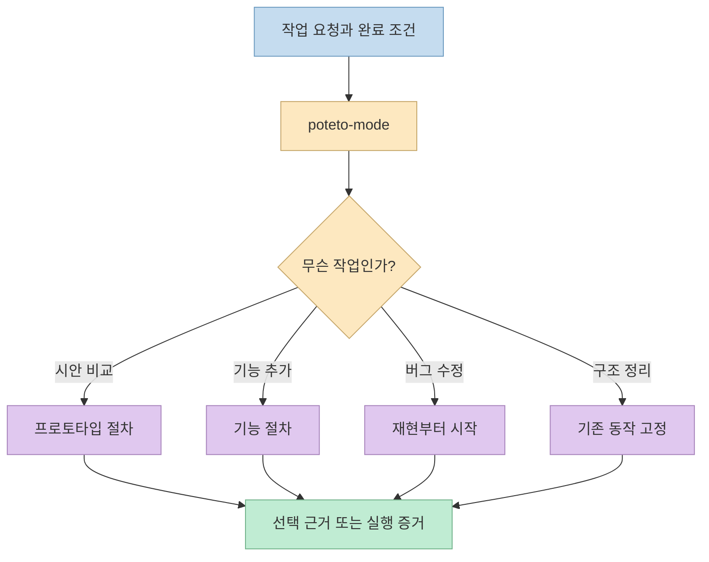
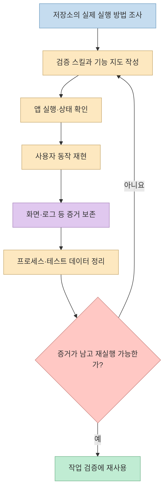
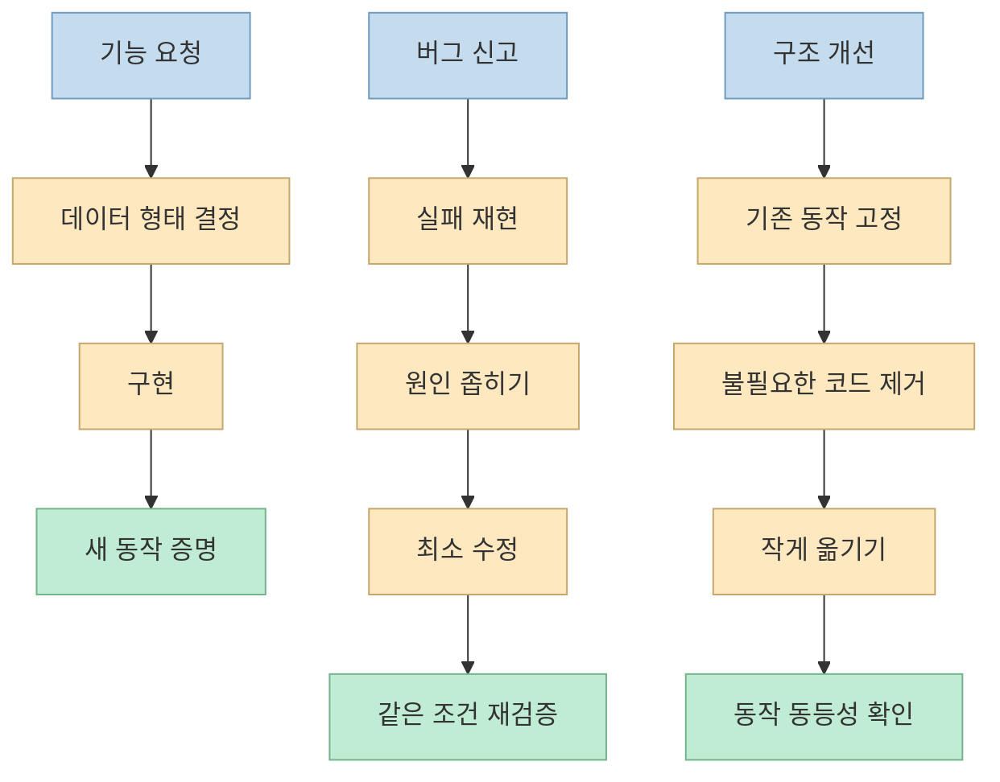
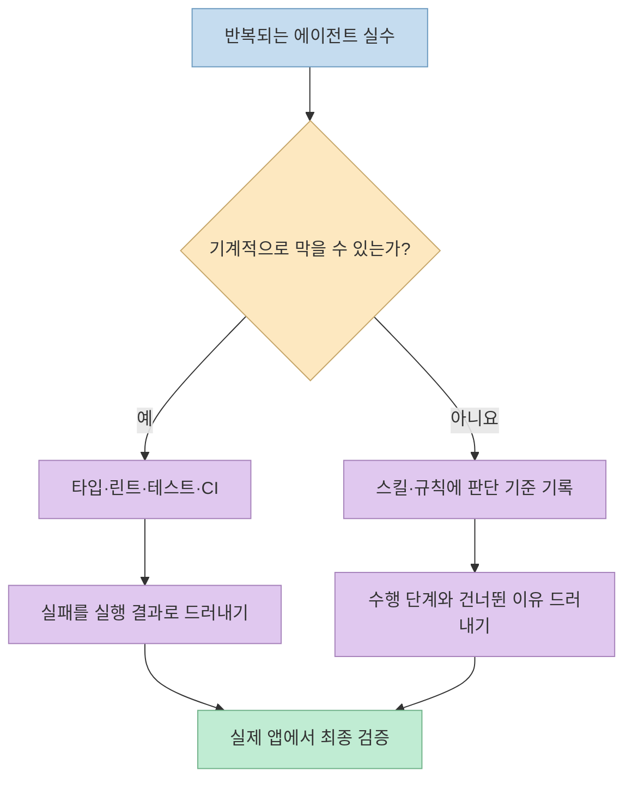

[김플립의 pstack 해설 영상](https://youtu.be/u2oDdU6z4Bw?t=0)은 플러그인의 스킬 목록을 읽는 데서 멈추지 않고, **투두앱에 새 기능을 넣고 버그를 고치는 순서**로 pstack의 의미를 보여 준다. 핵심은 에이전트를 많이 부르는 것이 아니라, 각 작업에 맞는 절차를 고르고 **실행한 결과로 완료를 증명하는 것**이다. 이 글은 영상의 예시를 중심으로 정리한다. 설치·전체 스킬 목록은 앞서 쓴 [pstack 공식 플러그인 안내 글](/post/2026/10/2026-10-18-pstack-official-plugin-cursor-claude-code-guide/)에서 별도로 다뤘다.

<!--more-->

## Sources

- [입력 영상: 요즘 자꾸 뜨는 pstack 어설프게 말고 제대로 파헤쳐 보기](https://www.youtube.com/watch?v=u2oDdU6z4Bw)
- [pstack 공식 README](https://github.com/cursor/plugins/blob/main/pstack/README.md) · [설정 가이드](https://github.com/cursor/plugins/blob/main/pstack/docs/guide/01-setup.md)
- [구현 가이드](https://github.com/cursor/plugins/blob/main/pstack/docs/guide/05-build-and-clean.md) · [검증 가이드](https://github.com/cursor/plugins/blob/main/pstack/docs/guide/06-verify-and-ship.md) · [`poteto-mode` 정의](https://github.com/cursor/plugins/blob/main/pstack/skills/poteto-mode/SKILL.md)
- [gstack 공식 README](https://github.com/garrytan/gstack/blob/main/README.md)

> 영상 설명에는 **pstack 0.15.28, 2026년 10월 18일**을 기준으로 삼았다고 적혀 있다. 아래의 시나리오는 그 영상의 설명이며, 설치 명령처럼 변할 수 있는 항목은 현재 공식 README와 구분해 대조했다. 영상에 나오는 주당 사용 횟수와 월별 PR 수는 제작자·원저자의 주장으로, 독립 검증된 성능 지표가 아니다.

## gstack과 pstack은 무엇을 다르게 모방하는가

영상은 먼저 [gstack을 “가상의 회사”에 비유](https://youtu.be/u2oDdU6z4Bw?t=161)한다. CEO·엔지니어링 매니저·QA 같은 관점으로 계획과 결과를 검토하는 접근이다. [gstack 공식 README](https://github.com/garrytan/gstack/blob/main/README.md)도 `/plan-ceo-review`, `/plan-eng-review`, `/qa`처럼 역할과 작업 단계가 드러나는 명령을 안내한다. 단순히 같은 모델에 다른 직함을 씌우는 것이라는 영상의 평가는 **발표자의 사용 경험과 해석**이지, gstack의 기능 전체를 입증한 비교 실험은 아니다.

[pstack을 설명하는 비유](https://youtu.be/u2oDdU6z4Bw?t=263)는 다르다. 사람의 직함보다 버그 수정·기능 개발·리팩터링 같은 **작업 유형**에 따라 절차를 고른다. 공식 README도 `/poteto-mode`를 기본 입구로 두고 요청에 맞는 플레이북을 선택한다고 설명한다. 영상 시점에는 23개 플레이북과 24개 원칙을 소개하지만, 스킬 수와 내용은 저장소 개정에 따라 달라질 수 있다. 따라서 개수보다 라우팅 구조를 이해하는 편이 오래간다.



**pstack은 새 모델이나 독립 실행 앱이 아니라, 플러그인에 포함된 스킬·플레이북·에이전트 지침**이다. [영상 4분 33초](https://youtu.be/u2oDdU6z4Bw?t=273)는 이를 “결국 `SKILL.md`”라고 압축한다. 이 표현은 이해를 돕지만, 설치 패키지 전체가 Markdown 파일 하나라는 뜻은 아니다. 공식 저장소에는 README, 가이드, 플러그인 설정, 스킬 정의 등이 함께 있다.

## 설치와 설정: 환경별 명령은 구분해야 한다

[영상의 설치 설명](https://youtu.be/u2oDdU6z4Bw?t=405)은 Claude Code를 기준으로 한다. [현재 공식 README](https://github.com/cursor/plugins/blob/main/pstack/README.md)에는 다음 경로가 명시돼 있다. 설치 후에는 역할별 모델·추론 예산을 설정하고 새 대화에서 실행한다. 이는 **사용 예시**이며 이 글을 쓰는 과정에서 플러그인을 설치하거나 실행하지는 않았다.

```text
/plugin marketplace add cursor/plugins
/plugin install pstack@cursor-plugins
/pstack:setup-pstack
/pstack:poteto-mode 현재 동작을 재현하고, 변경 후 같은 조건에서 검증해 줘.
```

Cursor에서는 `/add-plugin pstack`, `/setup-pstack`, `/poteto-mode`를 쓴다. Claude Code에서는 플러그인 접두사 `pstack:`이 붙는다. [공식 설정 가이드](https://github.com/cursor/plugins/blob/main/pstack/docs/guide/01-setup.md)는 `inherit-parent`나 `auto`로 설정한 역할은 부모 대화의 모델을 상속한다고 설명한다. 따라서 영상의 특정 모델 조합을 그대로 쓸 수 있는지, 교차 모델 검토가 실제로 이뤄지는지는 **자신의 환경·설정에 달려 있다**. 영상의 [모델 설정 설명](https://youtu.be/u2oDdU6z4Bw?t=415)에서도 이 지점을 주의하라고 말한다.

## 투두앱 시나리오 1: 시안은 버릴 코드로 비교한다

영상은 이미 돌아가는 투두앱을 가정한다. [처음부터 앱을 생성하는 전용 절차가 아니라](https://youtu.be/u2oDdU6z4Bw?t=466), 기존 앱을 키우고 고치는 맥락에서 pstack을 쓴다는 설명이다. 첫 요청은 할 일 목록의 카드형·리스트형·칸반형 시안을 비교하는 것. [프로토타입 단계](https://youtu.be/u2oDdU6z4Bw?t=498)는 무엇을 결정할지 먼저 정하고, 실제 소스와 분리된 임시 시안을 만든 뒤 스크린샷과 장단점을 비교한다. 선택을 위해 만든 코드는 제품 코드로 바로 승격하지 않는다는 점이 중요하다.

이 단계의 완료 조건은 “코드가 예쁜가?”가 아니라 **세 안 중 어떤 상호작용을 채택할지 결정할 근거가 생겼는가?**다. 공식 [구현 가이드](https://github.com/cursor/plugins/blob/main/pstack/docs/guide/05-build-and-clean.md)도 프로토타입을 실제 결정을 싸게 확인하는 경로로 구분한다. 영상이 소개하는 “계획보다 실행 가능한 시안”이라는 철학은 문서화 자체를 금지한다는 뜻이 아니라, 검증할 수 있는 질문을 추상적 논의만으로 오래 끌지 말자는 취지로 읽는 편이 안전하다. [영상 9분 10초](https://youtu.be/u2oDdU6z4Bw?t=550)

## 투두앱 시나리오 2: 검증 방법을 먼저 만든다

기능 추가 전에 영상은 [`create-verification-skill`을 가장 중요한 준비](https://youtu.be/u2oDdU6z4Bw?t=572)로 둔다. 이 스킬은 저장소를 읽고 앱의 실행 명령, 정상 기동을 확인할 신호, 사용자가 누르는 조작, 남겨야 할 증거, 종료·정리 절차를 프로젝트 전용 지침으로 작성한다. [공식 검증 가이드](https://github.com/cursor/plugins/blob/main/pstack/docs/guide/06-verify-and-ship.md)는 `.cursor/skills/verify-<app>/`와 기능 지도 `features/`를 만들고, 한 기능을 실제로 구동해 증거를 남긴 뒤 정리까지 확인해야 한다고 설명한다.



영상은 [자동화된 E2E 테스트와의 차이](https://youtu.be/u2oDdU6z4Bw?t=1234)도 짚는다. 테스트가 이미 있으면 검증 스킬은 그것을 활용할 수 있다. 다만 새로 바꾼 동작이 **실제 앱에서 지금 동작하는지** 확인하고 증거를 보고하는 절차는 테스트 통과 한 줄과 동일하지 않다. 반대로 스크린샷만 붙였다고 검증이 성립하는 것도 아니다. 검증 스킬이 엉뚱한 버튼을 누르지 않는지 사람도 살펴야 한다. [영상 20분 55초](https://youtu.be/u2oDdU6z4Bw?t=1254)

## 투두앱 시나리오 3: 기능·버그·리팩터링은 서로 다른 절차다

**기능 추가.** [마감일을 넣고 지난 할 일을 빨간색으로 표시](https://youtu.be/u2oDdU6z4Bw?t=603)하라는 요청에서는 기존 저장·표시 경로를 먼저 파악한다. 영상은 `completed`와 `overdue` 같은 불리언 값을 따로 영속화하면 서로 모순되는 상태가 생길 수 있다고 설명한다. 대신 완료 상태와 마감일을 저장하고, 지났는지는 날짜에서 계산하는 예를 든다. 실제 설계는 앱의 데이터 모델과 시간대 규칙에 맞춰야 하지만, **계산 가능한 파생 상태를 불필요하게 저장하지 않는다**는 원리는 유효하다. [영상 10분 18초](https://youtu.be/u2oDdU6z4Bw?t=618) 기능을 만든 뒤에는 전날 날짜의 항목이 빨간색인지, 새로고침 후에도 유지되는지를 확인한다. [영상 11분 5초](https://youtu.be/u2oDdU6z4Bw?t=665)

**버그 수정.** 예시는 [완료 체크 후 새로고침하면 다시 미완료가 되는 현상](https://youtu.be/u2oDdU6z4Bw?t=687)이다. 먼저 동일 조작으로 실패를 재현한다. 이후 저장 자체가 안 된 것인지, 앱 시작 시 읽기 과정에서 상태가 덮인 것인지 가설을 구분한다. 원인이 확인되면 그 지점만 바꾸고 **같은 절차로 재검증**한다. 영상에서 제시한 “시작 시 빈 목록으로 저장값을 덮는다”는 원인은 설명용 가정이지, 이 글에서 실제 코드를 디버깅해 확인한 사실은 아니다. [공식 구현 가이드](https://github.com/cursor/plugins/blob/main/pstack/docs/guide/05-build-and-clean.md)도 버그 수정의 출발점을 재현으로 둔다.

**리팩터링.** [흩어진 상태를 한곳으로 모으는 예시](https://youtu.be/u2oDdU6z4Bw?t=771)에서는 기능을 추가하지 않는다. 먼저 추가·완료·삭제·마감일 동작을 테스트나 재현 가능한 기록으로 고정한다. 사용하지 않는 코드를 덜어내고 구조를 작은 단계로 옮기며, 매번 관찰 가능한 동작이 동일한지 확인한다. 새 구조가 읽기 쉬워지지 않았다면 단순한 코드 이동에 그쳤을 수 있다. [공식 리팩터링 플레이북](https://github.com/cursor/plugins/blob/main/pstack/skills/poteto-mode/playbooks/refactoring.md)은 기존 출력과 변경 후 출력을 비교하는 동등성 검사 같은 방법도 제시한다.



## 단독 스킬과 장시간 작업은 언제 유용한가

영상은 전체 플레이북 없이 [`blast-radius`로 작은 변경의 영향 범위만 조사](https://youtu.be/u2oDdU6z4Bw?t=812)하는 예를 보여 준다. 또 [기능 둘을 별도 PR로 만들고 결정 기록을 남기는 장시간 작업](https://youtu.be/u2oDdU6z4Bw?t=827)을 소개한다. 공식 README에도 `/blast-radius`, `/show-me-your-work`, `/ketchup`이 각각 영향 범위 증명, 결정 기록, 지난 작업 따라잡기 용도로 나온다. 하지만 **분리된 작업과 PR이 자동으로 안전해지는 것은 아니다**. 실행 환경, 저장소 권한, 모델 설정, 실제 검증 방법을 확인해야 한다.

반대로 [버튼 색만 바꾸는 한 줄짜리 수정](https://youtu.be/u2oDdU6z4Bw?t=865)에 전체 절차와 여러 에이전트를 동원하면 시간과 토큰만 늘 수 있다. 영상도 pstack을 모든 일의 기본값으로 쓰지 말라고 한다. 엄격한 절차가 이득인 작업은 결함 비용이 높거나, 여러 파일에 걸치거나, 나중에 다른 사람이 근거를 검토해야 하는 경우다. 이 기준은 영상과 공식 가이드에서 도출한 **실무적 해석**이다.

## 왜 “규칙을 적기”보다 강한 제약이 필요한가

영상 후반은 [`poteto-mode`가 단계 누락을 드러내는 방식](https://youtu.be/u2oDdU6z4Bw?t=927)을 설명한다. 공식 설정 가이드에 따르면 선택한 플레이북의 단계를 할 일 목록에 복사하고, 건너뛸 때도 `skip: <reason>`으로 남긴다. “검증을 해라”라는 선언만 하는 것보다, 빠진 단계를 눈에 보이게 만들어 검토하기 쉽다. 다만 이것은 **문서로 규정한 절차**이지, 모든 환경에서 코드로 강제되는 머지 게이트라고 보장할 수는 없다. [공식 설정 가이드](https://github.com/cursor/plugins/blob/main/pstack/docs/guide/01-setup.md)

[하네스의 강도에 대한 영상의 설명](https://youtu.be/u2oDdU6z4Bw?t=1306)은 대략 “코드 구조와 아키텍처 → 타입·린트·컴파일러 같은 실행 검사 → 규칙 파일과 리뷰 → 스킬 → 스타일 가이드”다. 에이전트가 반복해서 저지르는 실수라면 같은 문장을 프롬프트에 계속 추가하기보다, **가능하면 실행 가능한 검사나 잘못된 상태를 표현하기 어려운 구조로 옮기라**는 뜻이다. 이것은 영상의 실무 원칙이지 모든 프로젝트에 동일한 층위가 적용된다는 공식 표준은 아니다.



## 실전 적용 포인트

1. 처음에는 **재현 가능한 작은 버그 하나**로 시도한다. 실패 화면·로그가 남는지, 원인이 분리되는지, 수정 후 같은 조건에서 통과하는지 본다. [영상 11분 27초](https://youtu.be/u2oDdU6z4Bw?t=687)
2. 앱의 검증 방법이 흩어져 있다면 `create-verification-skill`의 접근을 참고한다. 생성된 지침은 한 번 실제 실행해 보고, 잘못된 조작이나 남지 않는 증거를 수정한다. [영상 19분 14초](https://youtu.be/u2oDdU6z4Bw?t=1154) · [공식 검증 가이드](https://github.com/cursor/plugins/blob/main/pstack/docs/guide/06-verify-and-ship.md)
3. CI로 막을 수 있는 반복 실수는 자연어 규칙보다 CI에 둔다. 사람의 판단이 필요한 선택만 플레이북과 검토 기록으로 남긴다. [영상 21분 46초](https://youtu.be/u2oDdU6z4Bw?t=1306)
4. 모델 수·에이전트 수·PR 수를 성공 지표로 삼지 않는다. 비용과 소요 시간이 늘 수 있고, 지침을 설치해도 실행하지 않으면 효과가 없다. [영상 18분 15초](https://youtu.be/u2oDdU6z4Bw?t=1095) · [공식 README](https://github.com/cursor/plugins/blob/main/pstack/README.md)

## 핵심 요약

- pstack의 차별점은 스킬 개수가 아니라 **작업 유형별 절차와 검증 증거를 연결하는 방식**이다.
- 투두앱 예시는 프로토타입으로 결정하고, 기능은 새 동작을 증명하고, 버그는 재현부터, 리팩터링은 기존 동작 고정부터 시작한다.
- `create-verification-skill`은 저장소별 실행·조작·증거·정리 절차를 재사용 가능한 지침으로 만들지만, 생성 결과도 실제로 검증해야 한다.
- 간단한 수정에는 전체 플레이북이 과할 수 있고, 문서의 규칙만으로 자동 강제가 성립하지는 않는다.

## 결론

영상에서 가져갈 가장 실용적인 질문은 “pstack을 깔았는가?”보다 **“이 변경이 실제로 동작한다는 증거를 어떤 순서로 확보했는가?”**다. pstack을 쓰든 직접 팀의 절차를 만들든, 재현 가능한 검증이 없다면 빠른 코드 생성은 신뢰할 수 있는 개발 흐름이 되지 않는다.
