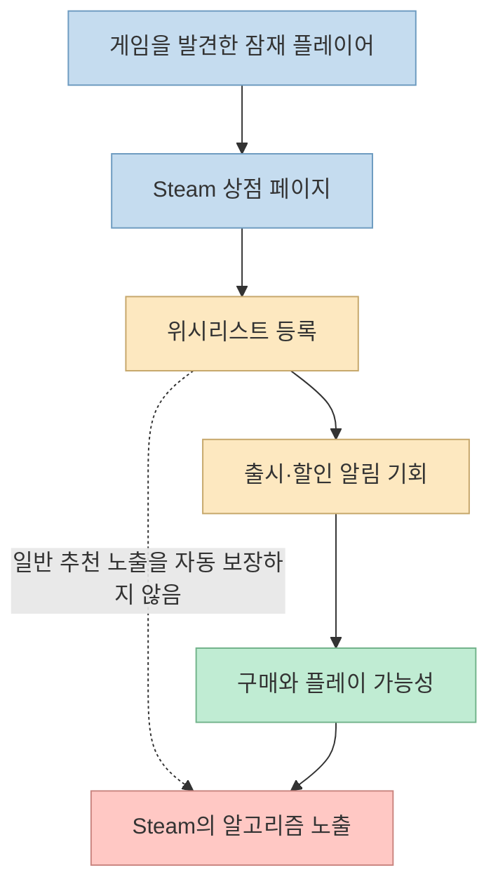
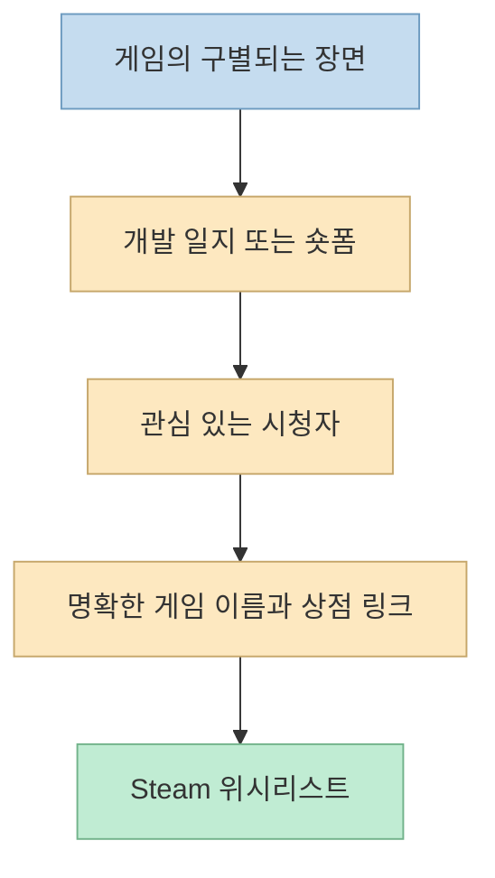
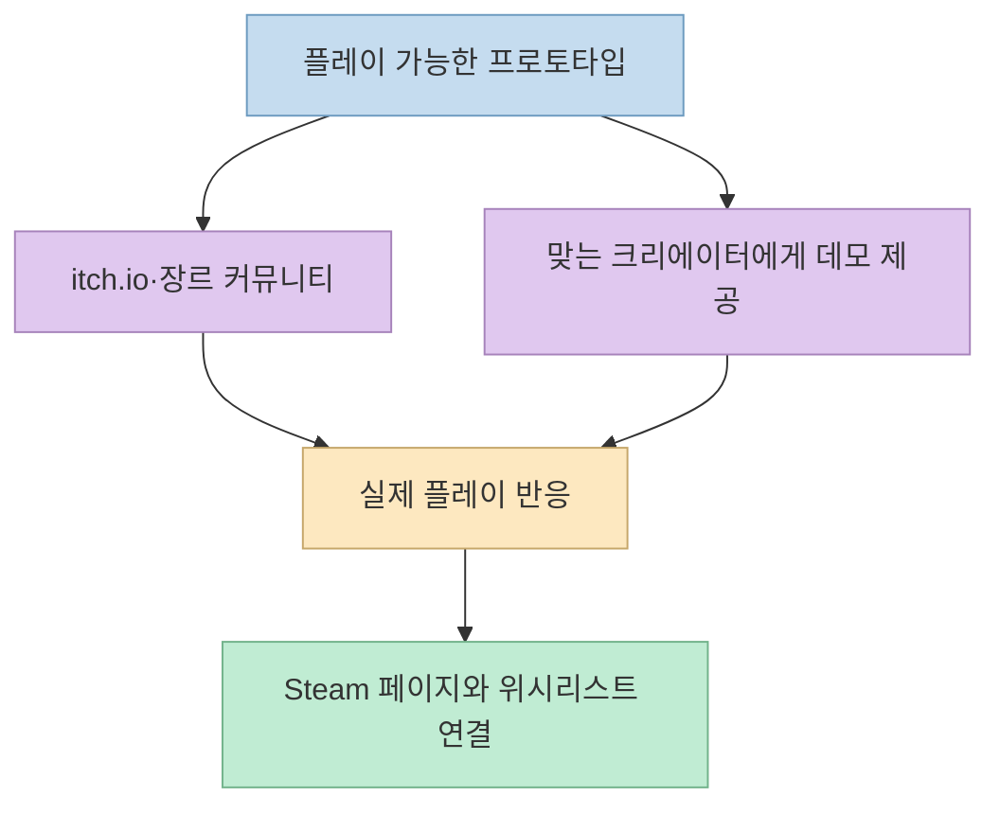
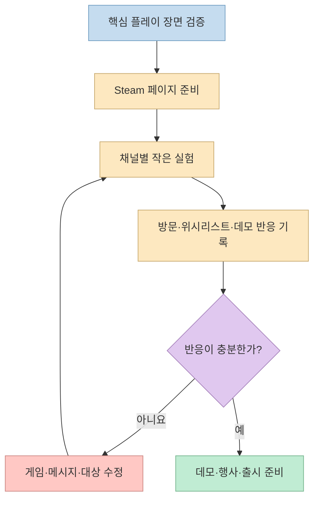

[MGD의 114초 영상](https://youtu.be/e7FLpmUq_1A)은 인디 게임 개발자가 출시 전 Steam 위시리스트를 모은 여섯 가지 경로를 빠르게 소개한다. 숫자보다 중요한 것은 **어떤 경로로 게임의 재미를 보여 주고, 관심을 Steam 상점 페이지로 연결했는가**이다. 다만 영상의 “위시리스트가 많이 쌓이면 Steam이 더 보여 준다”는 설명은 공식 문서의 표현보다 강하다.

- 원본: [EP 24. 게임이 쏟아지는 스팀, 인디는 어떻게 홍보할까?](https://youtu.be/e7FLpmUq_1A)
- 대조 자료: [Steamworks 노출 문서](https://partner.steamgames.com/doc/marketing/visibility), [Steamworks 위시리스트 문서](https://partner.steamgames.com/doc/marketing/wishlist), [Steam Next Fest 안내](https://partner.steamgames.com/doc/marketing/upcoming_events/nextfest)
- 사례 자료: [Gamblers Table 개발 일지](https://greenpixels.itch.io/gamblers-table/devlog/945763/wishlists-0-to-10000-in-just-three-weeks-), [Jonas Tyroller 사례 분석](https://howtomarketagame.com/2024/10/07/what-jonas-tyrollers-games-reveal-about-the-steam-algorithm/), [Sir, We Have an Orc Problem 사례](https://howtomarketagame.com/2026/08/18/the-week-of-the-golden-age/), [Bills Must Be Paid 사례](https://howtomarketagame.com/2026/08/20/part-2-the-week-of-the-golden-age/)

<!--more-->

## 위시리스트는 무엇을 해 주는가

영상은 [약 15초부터](https://youtu.be/e7FLpmUq_1A?t=15) 위시리스트의 중요성을 설명한다. 출시나 일정 수준 이상의 할인 때 관심을 표시한 고객에게 알림을 보낼 수 있다는 점은 [Steamworks 문서](https://partner.steamgames.com/doc/marketing/wishlist)와 맞다. 그러나 “위시리스트 수가 늘면 Steam의 일반 추천 알고리즘이 자동으로 노출을 늘린다”는 인과관계는 성립하지 않는다. [Valve의 노출 문서](https://partner.steamgames.com/doc/marketing/visibility)는 *Popular Upcoming* 같은 일부 예외를 제외하면 위시리스트가 알고리즘 노출 요소가 아니라고 명시한다. 구매와 플레이, 언어 지원, 적절한 태그 등은 별도로 다룬다.

따라서 위시리스트는 **출시 때 다시 만날 수 있는 관심 고객의 규모**로 해석하는 편이 안전하다. 일반 노출이나 판매를 보장하는 마법의 점수는 아니다.

## 경로 1·2: 개발 일지와 숏폼으로 반복 노출하기

첫째는 [YouTube 개발 일지](https://youtu.be/e7FLpmUq_1A?t=34)다. 영상은 Jonas Tyroller의 *Will You Snail?* 이 출시 때 약 6만 위시리스트를 가졌다고 소개한다. [Chris Zukowski가 Jonas의 자료를 바탕으로 분석한 글](https://howtomarketagame.com/2024/10/07/what-jonas-tyrollers-games-reveal-about-the-steam-algorithm/)에도 약 6만이라는 수치가 나온다. 다만 이 수치만으로 “대부분이 개발 일지에서 왔다”는 기여도를 독립적으로 계산할 수는 없다.

둘째는 [짧은 플레이 영상](https://youtu.be/e7FLpmUq_1A?t=48)이다. *Sir, We Have an Orc Problem* 팀은 TikTok·Instagram·YouTube Shorts용 영상을 하루 10~15분 정도 만들어 올렸다고 [개발자 인터뷰 기반 사례](https://howtomarketagame.com/2026/08/18/the-week-of-the-golden-age/)에서 밝혔다. 출시 전 위시리스트 약 15만 건은 개발자 추정치다. 이 사례를 “숏폼 하나로 15만 건”이라고 단순화할 수는 없다. 같은 사례에는 데모, 플레이테스트, Steam 행사 등 다른 접점도 등장한다.

두 형식의 공통점은 개발 과정 자체보다 **처음 보는 사람이 곧바로 이해할 만한 플레이 장면**을 보여 주는 데 있다. 콘텐츠를 만든 뒤 상점 페이지가 준비되지 않았다면 관심을 모으고도 전환할 곳을 놓칠 수 있다.

## 경로 3·4·5: 플레이 공간, 커뮤니티, 크리에이터

셋째는 [itch.io에서 먼저 플레이 가능한 버전을 공개](https://youtu.be/e7FLpmUq_1A?t=59)하는 방법이다. *Gamblers Table* 개발진은 설명도 거의 없는 무료 웹 프로토타입을 올렸고, 반응이 온 뒤 Steam 페이지를 열었다. 개발자는 페이지 공개 후 18일 만에 위시리스트 1만 건을 기록했다고 [직접 쓴 개발 일지](https://greenpixels.itch.io/gamblers-table/devlog/945763/wishlists-0-to-10000-in-just-three-weeks-)에 적었다. 하지만 성장 원인을 itch.io 하나에만 돌리지 않는다. Reddit 게시글, YouTube 플레이 영상, 게임 안의 위시리스트 버튼도 함께 작동했고, 개발자 자신도 정확한 유입 인과관계에는 선을 그었다.

넷째는 [장르 커뮤니티에 공유](https://youtu.be/e7FLpmUq_1A?t=74)하는 방법이다. 영상은 어떤 게임이 데모 전에 Reddit 장르 게시판을 통해 위시리스트 약 3천 건을 모았다고 소개한다. 이 게임의 이름은 자동 자막에서 명확히 확인되지 않아 여기서는 특정하지 않는다. 실무적으로는 무관한 게시판에 홍보문을 반복하는 것보다, 해당 장르의 플레이어가 평가할 수 있는 영상·GIF·질문을 준비하는 편이 타당하다.

다섯째는 [게임을 다룰 만한 크리에이터에게 직접 연락](https://youtu.be/e7FLpmUq_1A?t=82)하는 방법이다. 영상은 한 팀이 천 건 넘는 개별 메일을 보내고, 한 유명 유튜버의 플레이 이후 다른 채널로 확산됐다고 설명한다. 이 수치와 전파 순서는 영상의 사례 주장으로 보아야 한다. 복제할 수 있는 핵심은 무작정 발송량을 늘리는 것이 아니라, **그 크리에이터의 시청자가 실제로 즐길 만한 게임인지** 판단하고 플레이 가능한 자료를 전달하는 것이다.

## 경로 6: 데모와 Steam Next Fest

여섯째는 [데모와 Steam Next Fest](https://youtu.be/e7FLpmUq_1A?t=93)다. 영상의 *Bills Must Be Paid* 사례는 Steam 페이지 공개 첫날 위시리스트 11건, Next Fest에서 약 7천 건 증가, 출시 후 20일간 33만 장 판매로 요약된다. [개발자 인터뷰 기반 분석](https://howtomarketagame.com/2026/08/20/part-2-the-week-of-the-golden-age/)에 같은 수치가 있다. 그러나 행사 시작 전에도 이미 약 1만 5,623건의 위시리스트가 있었다. 따라서 **행사에서 늘어난 7천 건이 33만 장 판매를 단독으로 만들었다**고 해석하면 안 된다. 데모 출시, 기존 관심, 게임 자체의 반응, 행사 노출, 출시 시점이 함께 작용했다.

[Valve의 Next Fest 안내](https://partner.steamgames.com/doc/marketing/upcoming_events/nextfest)에 따르면 이 행사는 출시 예정 게임의 플레이 가능한 데모를 보여 주는 이벤트다. Steam 페이지와 안정적인 데모를 미리 준비하고 참가 자격·일정을 확인해야 한다. 행사는 품질 검증을 대신하지 않는다.

## 실전 적용 포인트

1. **게임의 한 장면부터 검증한다.** 처음 보는 플레이어가 핵심 재미와 차별점을 짧은 영상만으로 이해하는지 확인한다. 영상도 [약 23초](https://youtu.be/e7FLpmUq_1A?t=23)에 이를 먼저 강조한다.
2. **상점 페이지를 전환 지점으로 준비한다.** 이름, 캡슐 이미지, 플레이 장면, 데모 정보가 실제 게임을 정확히 설명해야 한다. *Gamblers Table* 개발진은 초반 유입 때 Steam 페이지가 없어 기회를 놓칠까 우려했다고 기록했다.
3. **채널별 가설을 따로 세운다.** 개발 일지는 긴 맥락, 숏폼은 즉시 이해되는 장면, 커뮤니티는 장르 적합성, 크리에이터는 플레이 경험을 시험한다. 모든 채널을 동시에 운영하기보다 팀이 지속할 수 있는 경로를 고른다.
4. **도달과 전환을 구분해 기록한다.** 조회수만 보지 말고 게시 날짜별 상점 방문·위시리스트 변화·데모 반응을 함께 본다. [Steamworks의 트래픽 분석](https://partner.steamgames.com/doc/marketing/visibility)도 상점 내 노출과 방문을 구분해 제공한다. 동시 발생은 인과관계의 증거가 아니라는 점을 기록에 남긴다.
5. **행사 전에 데모를 테스트한다.** 첫 실행 오류나 이해하기 어려운 초반 경험을 Next Fest 당일에 발견하지 않도록 한다. 행사 성과를 예측값처럼 취급하지 않는다.

## 핵심 요약

- 영상의 여섯 경로는 개발 일지, 숏폼, itch.io, 장르 커뮤니티, 크리에이터, 데모·Next Fest다.
- 위시리스트는 출시·할인 알림과 관심 규모 파악에 유용하지만, 일부 예외를 빼면 Steam 일반 추천 노출의 직접 요인이 아니다.
- 사례 수치는 각 개발자의 공개 자료나 인터뷰에 근거하며, 한 채널만의 성과로 분리할 수 없다.
- 먼저 검증할 대상은 홍보 횟수가 아니라 **플레이어가 알아볼 수 있는 게임의 매력**이다.

## 결론

이 영상은 “어디에 올릴까?”라는 막연한 질문을 여섯 가지 유입 실험으로 바꿔 준다. 다만 성공 사례의 큰 숫자를 목표치나 알고리즘 공식으로 받아들이면 잘못된 결정을 내리기 쉽다. 게임의 매력을 보여 주고, 관심을 상점 페이지로 연결하며, 실제 플레이 반응을 측정하는 순서가 더 재현 가능한 출발점이다.
