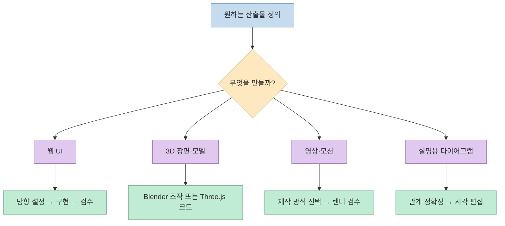
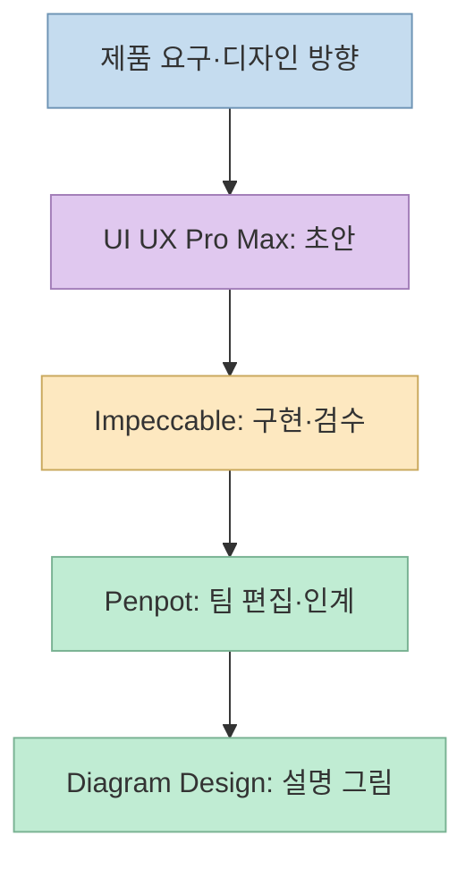
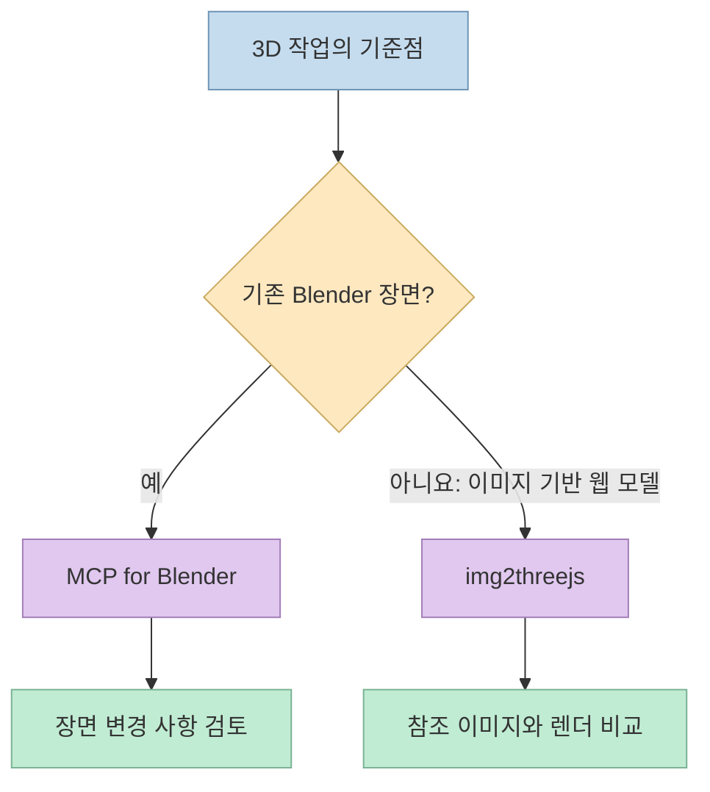
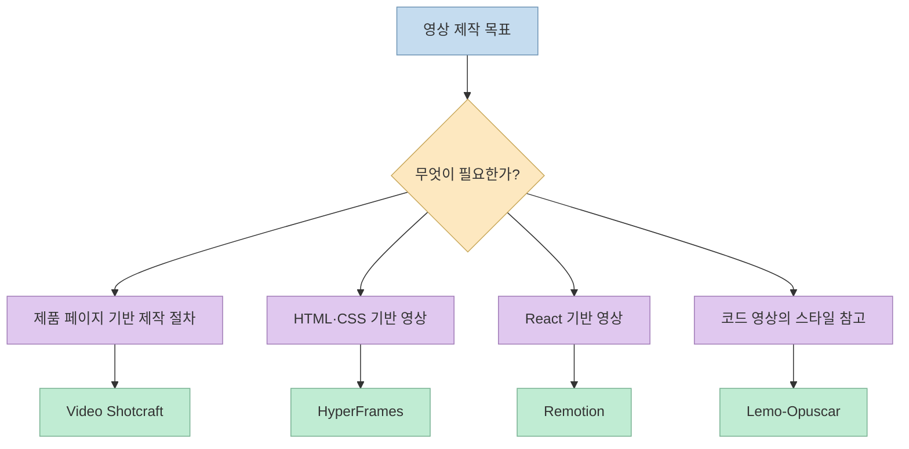

"AI가 만든 티 나는 디자인"에서 벗어나려면 도구를 열 개 설치하는 것보다 **어느 단계에서 판단이 부족한지** 먼저 찾는 편이 낫다. [Threads 게시물](https://www.threads.com/share/BAWh3yZvgI/)은 디자인에 도움이 되는 GitHub 저장소 열 개를 소개한다. 공식 저장소를 확인해 보니 같은 범주의 제품이 아니라 **에이전트 스킬, 3D 연결 도구, 협업 디자인 플랫폼, 코드 기반 영상 프레임워크** 가 섞여 있다. 그래서 스타 순위가 아닌 산출물과 작업 단계로 다시 묶었다.

<!--more-->

## Sources

- [원본 Threads 공유 글](https://www.threads.com/share/BAWh3yZvgI/) — 10개 프로젝트를 소개한 게시물
- [Impeccable](https://github.com/pbakaus/impeccable), [UI UX Pro Max](https://github.com/nextlevelbuilder/ui-ux-pro-max-skill), [Penpot](https://github.com/penpot/penpot), [Diagram Design](https://github.com/cathrynlavery/diagram-design)
- [MCP for Blender](https://github.com/ahujasid/mcp-for-blender), [img2threejs](https://github.com/img2threejs/img2threejs)
- [Video Shotcraft](https://github.com/Vincentwei1021/video-shotcraft), [HyperFrames](https://github.com/heygen-com/hyperframes), [Remotion](https://github.com/remotion-dev/remotion), [Lemo-Opuscar](https://github.com/lemomo-ai/lemo-opuscar)

게시물의 **GitHub 스타 수는 계속 변하는 값** 이므로 여기서는 재인용하지 않는다. 아래 기능·제약 설명은 각 프로젝트의 공식 README를 기준으로 했으며, 어떤 조합이 적절한지는 그 설명에서 도출한 실무적 판단이다. 실제 설치·출력 품질을 이 글에서 재현 시험한 것은 아니다.

## 1. 먼저 고를 것은 도구가 아니라 산출물

이 열 개를 모두 "AI 디자인 스킬"로 부르면 중요한 차이가 사라진다. Impeccable과 UI UX Pro Max는 에이전트의 **UI 판단을 돕는 지침·검색 도구** 에 가깝다. Penpot은 사람이 함께 디자인하고 개발자에게 전달할 수 있는 **협업 플랫폼** 이다. Remotion과 HyperFrames는 코드로 화면을 만들고 **영상 파일로 렌더링** 하는 제작 기반이다. [Impeccable](https://github.com/pbakaus/impeccable), [UI UX Pro Max](https://github.com/nextlevelbuilder/ui-ux-pro-max-skill), [Penpot](https://github.com/penpot/penpot), [Remotion](https://github.com/remotion-dev/remotion), [HyperFrames](https://github.com/heygen-com/hyperframes)

## 2. 웹 UI: 디자인 판단, 협업, 편집을 분리하기

**[Impeccable](https://github.com/pbakaus/impeccable)**은 AI 코딩 에이전트에 디자인 기준을 제공하는 스킬이다. 공식 README는 **스킬 1개, 명령 24개, 결정적 탐지 규칙 62개** 를 설명한다. `init`이 제품 맥락을 기록하고, 이후 `audit`·`polish` 등의 명령으로 화면을 다듬는 구조다. 단순히 "예쁜 화면을 만들어 줘"라고 반복하는 대신, 제품의 목적·대상·제약을 지속적인 판단 근거로 남기는 데 초점이 있다. 탐지 규칙은 모든 미감 문제를 자동 판정하는 만능 점수가 아니며, README도 별도의 LLM 비평 검사를 구분한다.

**[UI UX Pro Max](https://github.com/nextlevelbuilder/ui-ux-pro-max-skill)**는 요구사항에 맞는 스타일·타이포그래피·색상 등 **디자인 시스템의 출발안** 을 탐색하는 스킬이다. README에는 `search.py`의 `--design-system` 옵션과 `MASTER.md`·페이지별 오버라이드로 결정을 저장하는 흐름이 있다. Impeccable과 경쟁 순위로 보기보다 **초기 방향 제안** 과 **구현 후 품질 점검** 중 어느 문제가 더 큰지에 따라 고르는 편이 실용적이다. 두 도구가 자동으로 완성 UI의 접근성이나 제품 적합성을 보증하는 것은 아니다. [UI UX Pro Max README](https://github.com/nextlevelbuilder/ui-ux-pro-max-skill), [Impeccable README](https://github.com/pbakaus/impeccable)

**[Penpot](https://github.com/penpot/penpot)**은 에이전트 스킬이 아니라 오픈소스 디자인 플랫폼이다. 화면 설계·프로토타이핑·팀 협업이라는 **작업 공간** 을 제공하며 저장소에는 MCP 관련 코드도 있다. 코딩 에이전트의 텍스트 지침만으로 충분한지, 디자이너와 개발자가 함께 편집하고 인계할 공간이 필요한지에 따라 선택이 달라진다. "MCP 지원"은 프로젝트 전체가 단일 명령으로 곧바로 에이전트에 연결된다는 뜻으로 받아들이지 말고, 사용 환경의 통합 절차를 별도로 확인해야 한다. [Penpot 저장소](https://github.com/penpot/penpot)

**[Diagram Design](https://github.com/cathrynlavery/diagram-design)**은 관계를 설명하는 결과물을 **자체 포함 HTML·SVG** 로 만드는 에이전트 스킬이다. 공식 설명은 45가지 다이어그램 유형과 브랜드 색상·서체 적용, SVG·PNG 내보내기 경로를 제시한다. Penpot 같은 범용 디자인 편집기와 달리 구조도·설명 그림이 최종 산출물일 때 적합하다. 단, 보기 좋은 도식도 원래의 노드·연결 관계가 틀리면 쓸모없으므로 생성 후 의미 검수가 필요하다. [Diagram Design README](https://github.com/cathrynlavery/diagram-design)

위 흐름은 **선택 가능한 예시** 다. 네 제품을 순서대로 설치해야 한다는 뜻이 아니다. UI 스킬의 상세 비교가 필요하면 기존의 [AI UI 디자인 스킬 10개 비교](/post/2026/10/2026-10-06-ai-ui-design-ten-skills-fact-check/)도 참고할 수 있다.

## 3. 3D: Blender 장면 조작과 Three.js 모델 생성은 다르다

**[MCP for Blender](https://github.com/ahujasid/mcp-for-blender)**는 Blender 애드온과 MCP 서버를 연결해 에이전트가 3D 장면을 조작하게 한다. 즉, 이미 **Blender라는 작업 환경** 을 쓰고 있고 그 안의 오브젝트·재질·장면을 에이전트와 함께 편집하고 싶을 때의 선택이다. 공식 README는 Blender 측 애드온 설정과 MCP 클라이언트 설정을 별도 단계로 안내한다. 연결 도구인 만큼 에이전트가 어떤 프로젝트에 어떤 변경을 가하는지 확인해야 한다. [MCP for Blender README](https://github.com/ahujasid/mcp-for-blender)

**[img2threejs](https://github.com/img2threejs/img2threejs)**는 참고 이미지의 물체를 **코드만으로 구성한 절차적 Three.js 모델** 로 재구성하는 데 초점을 둔다. 결과가 이미지 속 실제 물체의 정확한 3D 스캔이라는 뜻은 아니다. 가려진 뒷면과 깊이는 추론해야 하므로, 참조 이미지와 렌더를 비교하고 수정하는 품질 검증 단계가 중요하다. 브라우저에서 회전·상호작용·애니메이션할 **코드 자산** 이 필요한 경우에 더 직접적이다. [img2threejs README](https://github.com/img2threejs/img2threejs)

## 4. 영상: 레시피, HTML, React, 스타일 샘플 중 고르기

**[Video Shotcraft](https://github.com/Vincentwei1021/video-shotcraft)**는 제품 홍보 영상 제작을 돕는 에이전트 스킬과 Remotion 템플릿·샷 레시피 모음이다. 실제 제품 페이지를 캡처해 재료로 활용할 수 있고, 스토리보드·사운드·최종 QA까지 제작 흐름을 안내한다. 따라서 "영상 프레임워크 하나"라기보다 **제품 화면을 소재로 한 제작 절차** 에 가깝다. 공식 README는 렌더링을 위한 Node.js와 npm, 프레임 검사를 위한 ffmpeg/ffprobe를 요구한다. [Video Shotcraft README](https://github.com/Vincentwei1021/video-shotcraft)

**[HyperFrames](https://github.com/heygen-com/hyperframes)**는 HTML·CSS와 탐색 가능한 애니메이션으로 구성을 작성하고 영상으로 렌더링한다. 저장소는 React 프로젝트나 별도 빌드 단계를 요구하지 않는 HTML 기반 방식을 강조한다. 반면 **[Remotion](https://github.com/remotion-dev/remotion)**은 React 컴포넌트로 영상·모션 그래픽을 프로그래밍하는 프레임워크다. 둘 다 코드 기반 영상이지만, 팀이 **HTML 중심으로 작업하는지 React 컴포넌트 중심으로 작업하는지** 가 선택 기준이다. Remotion은 일반적인 "무조건 무료 오픈소스"로 단순화하기 어렵다. 저장소가 특정 기업 사용 사례에 별도 라이선스가 필요할 수 있다고 명시하므로 상업적 사용 전 조건을 확인해야 한다. [HyperFrames README](https://github.com/heygen-com/hyperframes), [Remotion README](https://github.com/remotion-dev/remotion#license)

**[Lemo-Opuscar](https://github.com/lemomo-ai/lemo-opuscar)**는 코드로 만든 데모 영상과 스타일 프롬프트를 묶은 **59개 영상 스타일 도구상자** 다. 저장소는 영상 생성 모델 없이 Canvas·WebGL 등의 코드를 사용했다고 밝히며, 스타일이 Claude Opus 5.5에 맞춰져 있어 다른 모델에서 같은 결과를 기대하기 어렵다고 경고한다. "영상 모델이 불필요하다"는 말이 **코딩 에이전트 사용이나 렌더링 자원까지 무료** 라는 뜻은 아니다. [Lemo-Opuscar README](https://github.com/lemomo-ai/lemo-opuscar)

## 실전 적용 포인트

1. **산출물부터 적기:** 웹 화면, 3D 장면, 재사용할 3D 코드, MP4, 다이어그램 중 무엇을 제출할지 먼저 정한다.
2. **스킬과 기반 도구를 구분하기:** Impeccable·Diagram Design은 에이전트 스킬이고, Penpot·Remotion은 더 큰 작업 환경이다. 설치 비용과 학습 범위를 같게 보지 않는다.
3. **작은 샘플로 검증하기:** UI는 모바일·접근성, 3D는 참조 정확도, 영상은 프레임·오디오·라이선스를 따로 확인한다.
4. **숫자보다 현재 README를 보기:** 스타 수와 레시피 수는 바뀔 수 있고, 필요한 명령·지원 환경·제약도 프로젝트별로 다르다.

## 핵심 요약

- 원본 글의 10개는 한 분야의 경쟁 제품이 아니라 **UI·3D·영상·다이어그램 제작 단계에 걸친 도구 묶음** 이다.
- 웹 UI에는 디자인 방향과 검수, 3D에는 Blender 장면과 Three.js 코드, 영상에는 HTML과 React 같은 **서로 다른 선택 기준** 이 있다.
- "AI가 만든 티"를 줄이는 일은 도구를 더하는 것보다 **요구사항을 구체화하고 결과를 눈으로 검증하는 과정** 에 달려 있다.

## 결론

열 개를 한꺼번에 설치하기보다 지금 막힌 산출물 하나를 선택하자. 그다음 공식 README의 입력·출력·필수 환경을 확인하고 작은 예제로 품질을 검증하면, 도구 이름보다 **내 작업에 맞는 제작 방식** 이 먼저 보인다.
