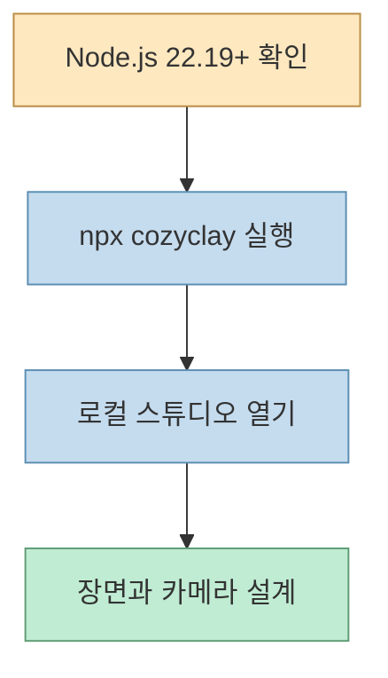
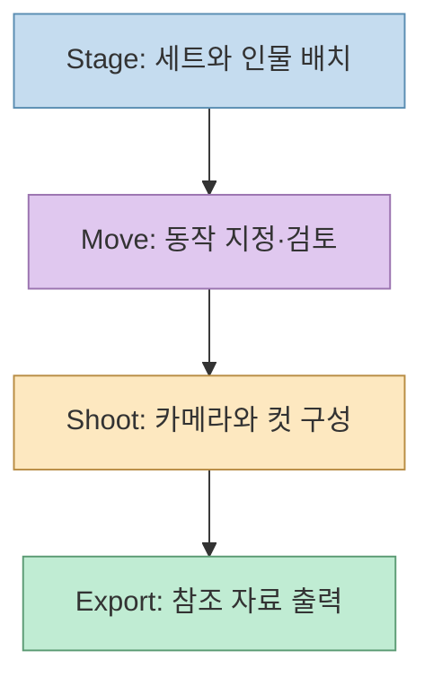
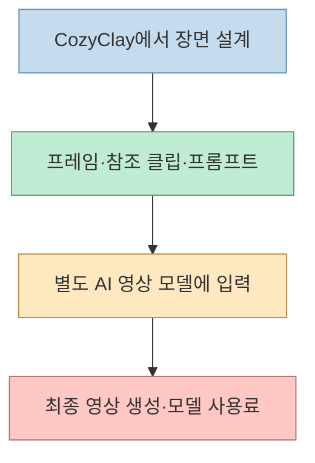

AI 영상을 여러 번 다시 뽑는 이유가 인물의 동선이나 카메라 구도라면, 생성 전에 장면을 시험해 보는 편이 낫다. [Threads 게시물](https://www.threads.com/share/BAdLZn90i9/)은 이 용도의 도구인 CozyClay를 `npx cozyclay` 한 줄로 시작할 수 있다고 소개한다. 핵심은 **프리비즈(previs) 스튜디오를 여는 명령** 이지, 영상 생성 모델까지 무료로 실행하는 명령은 아니라는 점이다.

<!--more-->

## Sources

- [원본 Threads 공유 글](https://www.threads.com/share/BAdLZn90i9/) — 실행 명령과 사용 범위를 소개한 출발점
- [CozyClay 공식 README](https://github.com/NomaDamas/CozyClay) — 요구 사항, 스튜디오 기능, 출력물과 AI 연동
- [CozyClay 공식 사이트](https://cozyclay.org/) — 빠른 시작과 로컬 스튜디오 주소
- [CozyClay 개인정보 문서](https://github.com/NomaDamas/CozyClay/blob/main/docs/privacy.md) — 선택적 사용량 정보와 비활성화 방법
- [npm의 npx 문서](https://docs.npmjs.com/cli/v9/commands/npx/) — 패키지 실행과 설치 확인 동작

CozyClay의 장면 설계 개념과 모션 파이프라인이 궁금하다면 앞서 작성한 [CozyClay 3.0 프리비즈 워크플로 분석](/post/2026/10/2026-10-20-cozyclay-3-previs-motion-ai-video-workflow/)을 참고하면 된다. 여기서는 **처음 실행할 때 무엇을 확인해야 하는가** 에만 집중한다.

## 1. 실행 전 확인: Node.js와 브라우저

공식 README가 제시하는 조건은 **Node.js 22.19 이상** 과 **Chromium 계열 브라우저** 다. 터미널에서 Node 버전을 확인하고, 조건에 맞으면 아래 명령으로 스튜디오를 실행한다. 프로젝트는 브라우저의 `http://127.0.0.1:5180/app/` 주소가 열린다고 설명한다. [공식 README](https://github.com/NomaDamas/CozyClay#quick-start)

```bash
node --version
npx cozyclay
```



README의 "GPU·Python·모델 다운로드 불필요"는 **스튜디오를 위해 별도의 로컬 AI 모델을 설치할 필요가 없다는 의미** 로 읽어야 한다. 브라우저 그래픽 처리까지 하드웨어와 무관하다는 뜻은 아니다. 또한 `npx` 실행 중 npm이 패키지 설치 확인을 요청할 수 있으므로, 처음부터 아무 입력 없이 끝난다고 단정하지 말자. [공식 README](https://github.com/NomaDamas/CozyClay), [npm npx 문서](https://docs.npmjs.com/cli/v9/commands/npx/)

## 2. 첫 사용: 영상보다 장면을 먼저 검증하기

스튜디오가 열리면 곧바로 최종 영상을 만들려 하기보다 **세트·인물·동작·촬영 구도** 를 작은 장면 하나로 시험하는 것이 좋다. 공식 README는 작업을 Stage(세트와 캐스트), Move(동작), Shoot(카메라), Export(참조 자료 내보내기)로 나눈다. 동작에는 명세 작성과 브라우저 컴파일, 충돌·발 미끄러짐·도달 가능성 등을 살피는 QA 단계가 포함된다. [공식 README](https://github.com/NomaDamas/CozyClay#what-you-can-do)



처음에는 "인물이 문 쪽으로 걸어가 멈추고, 측면 카메라로 전환한다"처럼 짧은 동선 하나만 잡아 보자. 이는 **공식 기능을 이용한 예시 작업 순서** 이며, 이 글에서 실제 실행 결과를 검증했다는 뜻은 아니다. 움직임과 컷이 의도대로 보이는지 확인한 뒤 참조 프레임이나 그레이박스 클립을 내보내면, 영상 모델에 넘길 자료를 만들 수 있다.

## 3. 비용의 경계: 프리비즈와 최종 영상은 별개

CozyClay는 장면의 **첫 프레임, 그레이박스 참조 클립, 프롬프트** 등을 영상 생성 모델에 전달하는 워크플로를 설명한다. 최종 픽셀을 생성하는 서비스는 별도이므로 그 서비스의 계정, 사용 한도, 과금 정책을 따로 확인해야 한다. `npx cozyclay`만으로 유료 영상 생성 비용이 사라지는 것은 아니다. [공식 README](https://github.com/NomaDamas/CozyClay#make-the-scene-first-then-make-the-video)



프리비즈가 재생성 횟수를 줄이는 데 **도움이 될 수는 있지만**, 모든 영상 모델이 참조 동선과 카메라를 그대로 재현한다는 보장은 없다. 이는 도구가 제공하는 입력 자료와 외부 모델의 결과를 구분해서 내린 판단이다. 모델별 참조 영상 지원 범위와 단가를 확인하고, 짧은 테스트 컷으로 일치도를 살피는 편이 안전하다.

## 4. 재실행과 데이터 설정

Threads 글은 같은 명령을 다시 실행하면 최신 버전을 받는다고 설명하고, 프로젝트 README도 이를 안내한다. 다만 실제 실행 시에는 npm의 로컬 설치·캐시·실행 환경에 따라 어떤 패키지가 선택되는지 확인하는 것이 좋다. **프로젝트의 업데이트 안내를 모든 환경의 버전 고정 보장으로 해석하지 않는 것** 이 핵심이다. [공식 README](https://github.com/NomaDamas/CozyClay#quick-start), [npm npx 문서](https://docs.npmjs.com/cli/v9/commands/npx/)

공식 개인정보 문서에 따르면 npm 패키지는 첫 실행과 사용 흐름에 관한 익명화된 사용량 정보를 보낼 수 있다. 프로젝트명·경로·프롬프트 내용은 수집하지 않는다고 설명하며, 원치 않으면 다음처럼 실행할 수 있다. 팀·회사 환경이라면 정책에 맞는지 먼저 확인하자. [공식 개인정보 문서](https://github.com/NomaDamas/CozyClay/blob/main/docs/privacy.md)

```bash
COZYCLAY_TELEMETRY=0 npx cozyclay
```

## 실전 적용 포인트

1. **작은 장면부터 시작하기:** 복잡한 스토리 전체보다 동선 한 개와 카메라 컷 한두 개를 먼저 점검한다.
2. **출력물을 구분하기:** CozyClay의 참조 영상·프레임과 외부 모델의 최종 영상을 같은 결과물로 취급하지 않는다.
3. **비용을 따로 계산하기:** 장면 설계 도구의 실행 조건과 영상 모델의 호출 비용·사용량을 별도 항목으로 본다.
4. **AI 연동은 선택 사항으로 보기:** 스튜디오 자체 실행과 에이전트 패널/API 키를 쓰는 작업은 요구 조건이 다를 수 있다. [공식 README](https://github.com/NomaDamas/CozyClay#agent-control)

## 핵심 요약

- `npx cozyclay`는 **로컬 프리비즈 스튜디오의 시작점** 이다.
- Node.js 22.19 이상과 Chromium 브라우저가 필요하지만, 스튜디오 시작을 위해 별도의 GPU·Python·AI 모델 다운로드는 요구하지 않는다.
- 최종 AI 영상 생성은 별도 모델에서 이루어지므로, 비용과 결과 일치도는 그 모델에 달려 있다.

## 결론

Threads 글의 "한 줄 실행"은 맞는 출발점이다. 다만 이 한 줄로 얻는 것은 완성 영상이 아니라 **촬영 전에 동선과 구도를 시험할 작업 공간** 이다. 먼저 짧은 장면을 설계하고 참조 자료를 확인한 다음, 외부 영상 모델의 비용과 입력 지원 범위를 검증해 생성 단계로 넘어가자.
