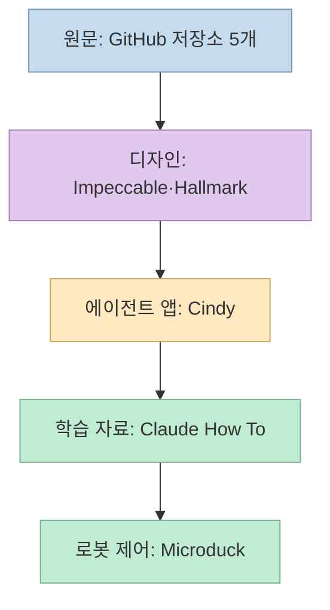
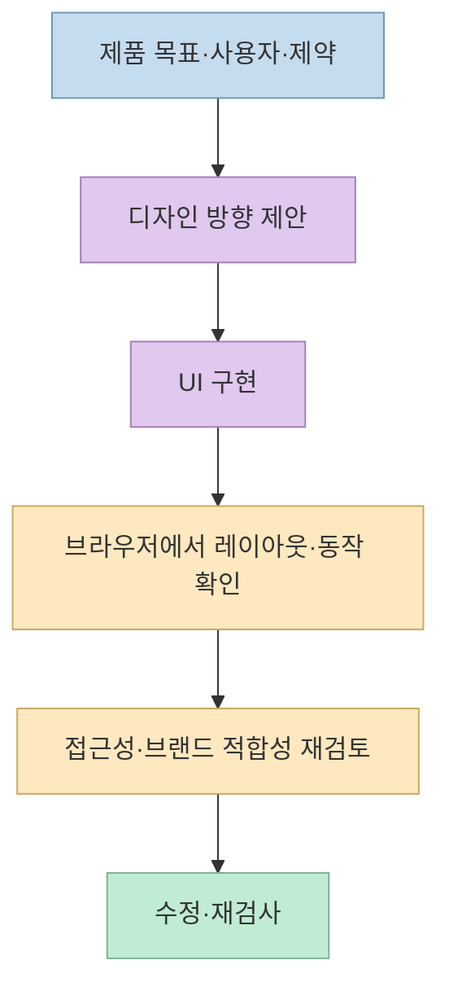
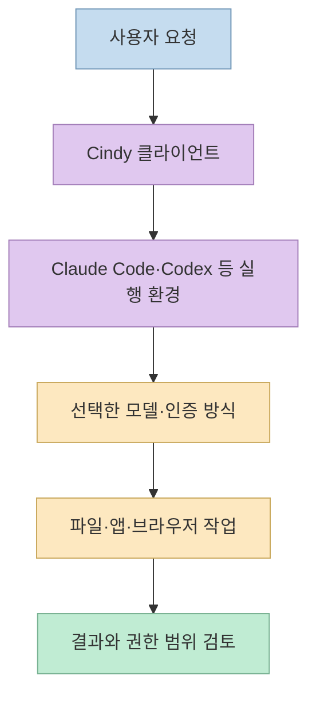
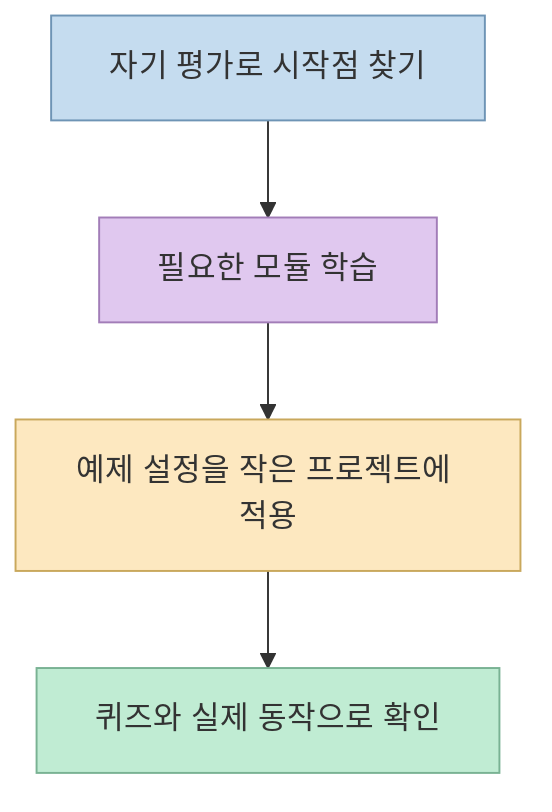
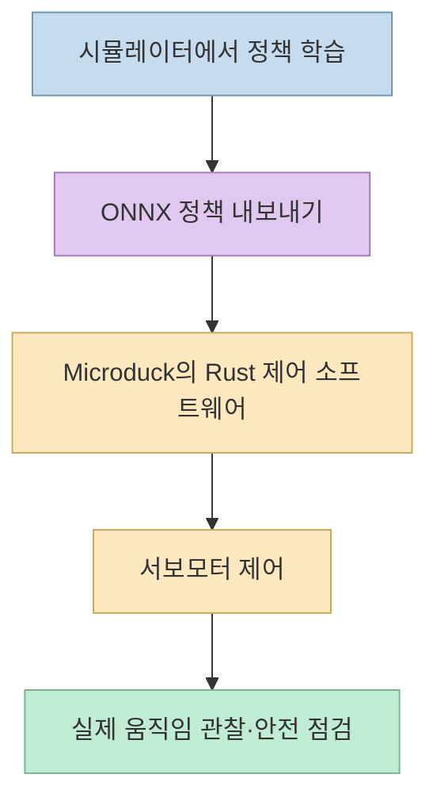

"AI가 만든 웹사이트는 왜 다 비슷할까?"라는 질문으로 시작한 [Threads 게시물](https://www.threads.com/share/BAazddzw0S/)은 GitHub 프로젝트 다섯 개를 소개한다. 하지만 **디자인 문제를 직접 다루는 것은 앞의 두 개** 다. 나머지는 개인 에이전트, Claude Code 학습 자료, 실제 로봇의 제어 소프트웨어다. 별 수로 한 줄에 세우기보다 **무엇을 만들거나 운영하는 저장소인지** 구분해야 유용하다.

<!--more-->

## Sources

- [원본 Threads 공유 글](https://www.threads.com/share/BAazddzw0S/) — 다섯 프로젝트와 수치를 소개한 게시물
- [Impeccable 공식 저장소](https://github.com/pbakaus/impeccable)
- [Hallmark 공식 저장소](https://github.com/Nutlope/hallmark)
- [Cindy 공식 저장소](https://github.com/makecindy/cindy)
- [Claude How To 공식 저장소](https://github.com/luongnv89/claude-howto)
- [Microduck 공식 저장소](https://github.com/pollen-robotics/microduck)

원문의 스타 수와 "오늘 트렌딩" 순위는 시간에 따라 달라지며, 이 글에서 GitHub의 특정 시점 트렌딩 순위를 따로 재현하지는 않았다. 기능과 범위는 각 저장소 README의 설명을 기준으로 확인했다. 특히 프로젝트가 스스로 주장하는 기능은 **실제 설치·성능 검증 결과와 구분** 해서 읽어야 한다.

## 1. 다섯 저장소의 공통점보다 차이가 중요하다

Impeccable과 Hallmark는 코딩 에이전트가 **웹 UI를 만들고 점검할 때** 쓰는 디자인 스킬이다. Cindy는 여러 에이전트 실행 환경과 모델을 묶는 **앱** 이다. Claude How To는 사용법을 배우는 **가이드** 이고, Microduck은 물리 장치에 탑재되는 **로봇 소프트웨어** 다. 모두 GitHub에서 볼 수 있다는 것 외에는 입력, 출력, 설치 대상이 다르다. [Impeccable](https://github.com/pbakaus/impeccable), [Hallmark](https://github.com/Nutlope/hallmark), [Cindy](https://github.com/makecindy/cindy), [Claude How To](https://github.com/luongnv89/claude-howto), [Microduck](https://github.com/pollen-robotics/microduck)

## 2. 웹 UI 두 도구: Impeccable과 Hallmark는 어디서 다른가

**[Impeccable](https://github.com/pbakaus/impeccable)**은 에이전트를 위한 디자인 지침과 실행 명령을 묶는다. README는 **스킬 1개, 명령 24개, 결정적 탐지 규칙 62개** 라고 설명한다. `/impeccable init`이 제품의 대상·목적·제약을 기록하고, `shape`·`critique`·`audit`·`polish` 같은 명령이 설계부터 품질 점검까지 다른 작업을 맡는다. 게시물의 "보라색 그라데이션과 과도한 카드"는 탐지 대상의 예시일 뿐이다. 규칙 통과가 그 제품에 맞는 좋은 디자인의 증명은 아니다. [Impeccable README](https://github.com/pbakaus/impeccable)

**[Hallmark](https://github.com/Nutlope/hallmark)**는 Together AI가 만든 디자인 스킬이다. README의 **48개 테마** 는 완성 페이지 템플릿 48개가 아니라 종이·색·표면·타이포그래피 등 **시각 재료의 후보** 에 가깝다. 프로젝트는 방문자가 하려는 일에 맞게 페이지를 구성하고, 실제 브라우저의 여러 화면 너비에서 상투적인 요소·대비·포커스·동작 축소 등의 문제를 검사한다고 설명한다. 기존 화면에는 이름을 지정해 `audit`이나 `redesign`을 적용할 수 있다. [Hallmark README](https://github.com/Nutlope/hallmark)

두 도구를 동시에 깔아야 하는 것은 아니다. 제품 맥락을 오래 유지하며 **여러 종류의 디자인 작업을 명령으로 반복** 하려면 Impeccable 쪽이, **테마를 제안받고 실제 화면을 브라우저에서 검사** 하는 흐름이 필요하면 Hallmark 쪽이 먼저 맞을 수 있다. 이는 기능 비교에서 내린 **선택 기준** 이며, 어느 쪽이 결과 품질에서 더 낫다는 실험 결론은 아니다. 두 프로젝트 모두 정적 또는 자동 검사만으로 실제 사용자의 반응을 보장할 수 없다.

Impeccable을 더 자세히 다룬 [기존 분석](/post/2026/10/2026-10-03-impeccable-design-skill-product-context-detector-live-workflow/)과 Hallmark가 포함된 [UI 스킬 비교](/post/2026/10/2026-10-17-five-ai-ui-design-skills-by-workflow/)도 있다. 이 글은 다섯 저장소 전체의 **역할 구분** 에 초점을 둔다.

## 3. Cindy는 디자인 스킬이 아니라 에이전트 작업 환경이다

**[Cindy](https://github.com/makecindy/cindy)**는 Claude Code와 Codex 같은 에이전트 실행 환경과 여러 모델을 한 앱에서 연결하는 오픈소스 클라이언트다. 공식 설명은 데스크톱·모바일 앱, 로컬 파일과 로그인한 앱을 다루는 작업, 모델·실행 환경을 바꾸어도 작업 맥락을 이어가는 기능을 제시한다. 이는 UI의 색상과 레이아웃을 평가하는 디자인 스킬과 목적이 다르다. [Cindy README](https://github.com/makecindy/cindy)

"오픈소스"와 "모든 기능이 로컬에서 무료"는 다르다. README에 따르면 저장소에는 **클라이언트 코드** 가 있으며 백엔드 서비스는 별도다. Cindy 계정 없이 로컬 에이전트를 쓸 수 있는 모드가 있지만 서버 기반 기능은 제한된다. 공식 서비스, 기존 코딩 플랜, 자체 API 키, 로컬 모델은 각각 인증·비용 조건이 다르므로 도입 전 확인해야 한다. 앱이 파일·브라우저·휴대폰에 접근할 수 있다는 설명만큼 **권한 범위** 도 점검 대상이다. [Cindy README의 구성과 계정 모드](https://github.com/makecindy/cindy)

## 4. Claude How To는 도구보다 학습 경로다

**[Claude How To](https://github.com/luongnv89/claude-howto)**는 Claude Code를 배우는 **커뮤니티 제작 가이드** 다. 공식 Anthropic 문서나 새로운 코딩 모델이 아니다. 저장소는 명령, 메모리, 체크포인트, 스킬, 훅, MCP, 서브에이전트, 플러그인 등을 **10개 학습 모듈** 로 구성하고, 자기 평가·퀴즈와 복사해 적용할 수 있는 예제 설정을 제공한다고 설명한다. [Claude How To README](https://github.com/luongnv89/claude-howto)

학습 자료의 강점은 기능을 하나씩 연결해 보는 데 있다. 다만 복사 가능한 템플릿이라도 내 프로젝트의 권한·비밀정보·자동 실행 조건에 맞는지 읽고 적용해야 한다. 특히 훅이나 배포 자동화 예제를 그대로 실행하기보다 **무슨 파일을 읽고 어떤 명령을 실행하는지** 확인하는 것이 안전하다. 이는 가이드에 대한 사용 권고이며 특정 템플릿의 결함을 발견했다는 뜻은 아니다.

## 5. Microduck은 실물 로봇의 제어 시스템이다

**[Microduck](https://github.com/pollen-robotics/microduck)**은 이 목록에서 가장 성격이 다르다. 공식 README는 약 **25cm·800g** 의 이족 보행 오리 로봇이 **15개 서보모터** 를 50Hz 제어 루프로 움직이고, 강화학습 정책을 실행한다고 설명한다. 제어 코드와 업데이트·통신용 데몬은 Rust로 작성됐다. 학습 자체는 별도 [`microduck_rl`](https://github.com/pollen-robotics/microduck_rl) 저장소에서 MuJoCo·PPO를 사용하고, 결과를 ONNX로 내보내 이 프로젝트가 실행한다. [Microduck README](https://github.com/pollen-robotics/microduck)

저장소를 내려받는 것과 로봇 하드웨어를 갖는 것은 다르다. README는 로봇 구매 경로와 함께 실제 장치가 없을 때의 **MuJoCo 시뮬레이션** 경로도 안내한다. 따라서 단순히 "오픈소스 로봇"이라고 소개하기보다, **실물 장치·제어 코드·학습 코드가 분리된 시스템** 으로 이해하는 편이 정확하다. [Microduck README](https://github.com/pollen-robotics/microduck)

## 실전 적용 포인트

1. **UI가 문제라면 첫 두 개만 검토:** Impeccable 또는 Hallmark로 실제 화면의 문제를 정의하고, 모바일·포커스·대비를 다시 확인한다.
2. **에이전트 운영이라면 권한과 비용부터:** Cindy의 계정 모드, 모델 연결, 파일·앱 접근 범위를 살핀다.
3. **학습 목적이라면 작은 예제부터:** Claude How To의 모듈을 따라가되 자동화 템플릿은 읽고 적용한다.
4. **로봇이라면 시스템 경계를 구분:** Microduck 제어 저장소, 별도 학습 저장소, 시뮬레이터, 실제 하드웨어를 혼동하지 않는다.

## 핵심 요약

- 다섯 프로젝트 중 **Impeccable과 Hallmark만 웹 UI 디자인 스킬** 이다.
- Cindy는 에이전트 클라이언트, Claude How To는 학습 가이드, Microduck은 로봇의 제어 소프트웨어다.
- 원문에 나온 주요 기능·규모 설명은 README와 대체로 맞지만, **스타 수·트렌딩 순위와 실제 성능은 별도 문제** 다.

## 결론

이 목록의 가치는 다섯 개를 한꺼번에 설치하는 데 있지 않다. 현재 문제가 **화면 품질, 에이전트 운영, 학습, 실물 제어** 중 무엇인지 먼저 구분하면, 필요한 저장소와 확인해야 할 비용·권한·하드웨어 조건이 분명해진다.
