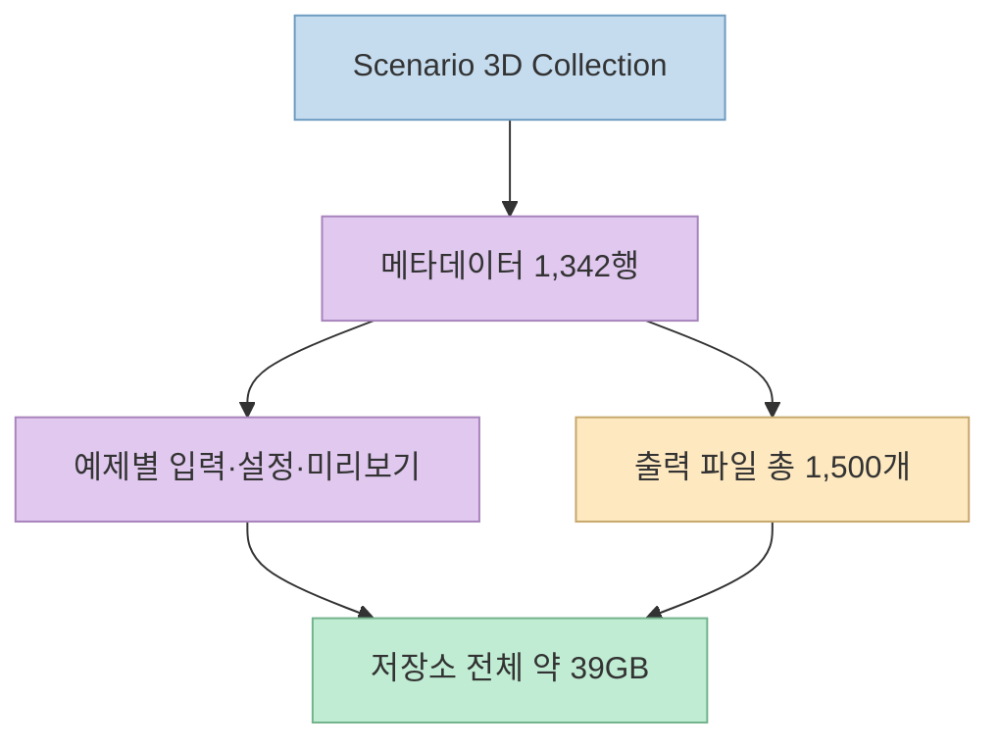
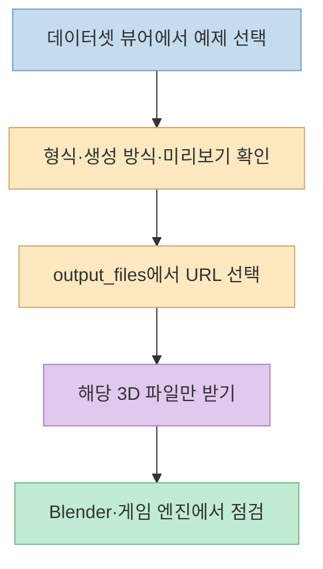
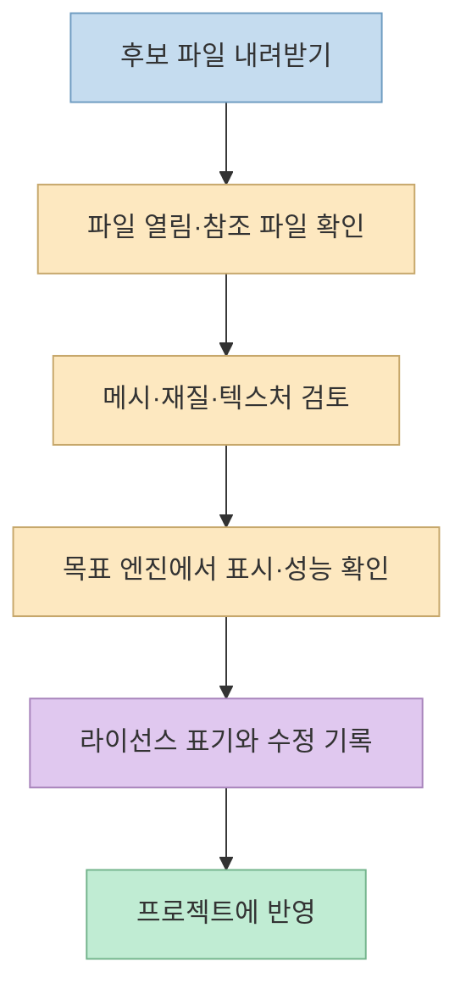

[Threads 게시물](https://www.threads.com/share/BAbpr-VWHl/)은 Scenario가 Blender나 게임 제작에 쓸 수 있는 3D 자료 1,342개를 Hugging Face에 공개했다고 소개한다. [공식 데이터셋 카드](https://huggingface.co/datasets/scenario-labs/3d-collection)를 확인하면 **1,342개는 예제의 수**, **1,500개는 출력 파일의 수**, **약 39GB는 입력 자료와 미리보기까지 포함한 저장소 전체 규모**다. “무료 모델 1,342개”라는 문구만 보고 모든 항목이 Blender 파일이거나 곧바로 게임에 넣을 수 있다고 기대하면 안 된다.

<!--more-->

## Sources

- [입력 Threads 공유 링크](https://www.threads.com/share/BAbpr-VWHl/) · [연결된 원문](https://www.threads.com/@dhdbtkd/post/De3PjC-m2Le)
- [Scenario 3D Collection 공식 데이터셋 카드](https://huggingface.co/datasets/scenario-labs/3d-collection)
- [Creative Commons의 CC BY 4.0 안내](https://creativecommons.org/licenses/by/4.0/)
- [Hugging Face의 파일 다운로드 가이드](https://huggingface.co/docs/huggingface_hub/en/guides/download)

> 확인 방법: Threads 공유 링크는 `scrapling-get` 방식으로 공개 페이지에 접근해 본문과 연결 주소를 확인했다. 수치·형식·라이선스는 Threads의 재전달 문구가 아니라 데이터셋 운영자가 작성한 Hugging Face 카드와 라이선스 원문을 우선했다. 아래 내용은 2026년 10월 25일 확인 기준이다.

## “1,342개·1,500개·39GB”는 서로 다른 단위다

[데이터셋 카드](https://huggingface.co/datasets/scenario-labs/3d-collection)는 선택된 AI 생성 3D **예제 1,342행**과 **출력 파일 1,500개**를 구분한다. 한 예제에서 GLB와 원본 Blender 파일처럼 둘 이상의 출력이 나올 수 있으므로 행 수와 파일 수가 다르다. 약 39GB는 3D 출력만의 용량이 아니라 **미리보기와 이용 가능한 입력 소스까지 포함한 전체 규모**다. Hugging Face 화면의 표시값은 38.7GB다.



형식별 출력 수는 카드에 **GLB 1,271개, Blender 137개, SPZ 41개, PLY 23개, VOX 21개, FBX 7개**로 적혀 있다. 합계는 1,500개다. 따라서 Blender를 쓰는 사람도 1,342개 예제가 모두 `.blend`로 제공된다고 생각하면 안 된다. GLB는 Blender로 불러와 검토할 수 있는 대표적인 3D 교환 형식이다. [Niantic의 SPZ 형식 설명](https://github.com/nianticlabs/spz)은 SPZ를 압축된 3D Gaussian splat 형식으로 정의하므로 일반적인 메시 파일과 같은 용도로 다루기 전에 도구 호환성을 확인해야 한다. 형식별 개수의 근거는 [공식 카드의 Formats and validation](https://huggingface.co/datasets/scenario-labs/3d-collection)에 있다.

또한 [카드](https://huggingface.co/datasets/scenario-labs/3d-collection)는 Tencent Hunyuan 계열로 만든 **별도 예제 393개**를 다른 저장소에, **별도 라이선스**로 공개했다고 밝힌다. 그 자료는 접근 승인과 인증이 필요하다. 이 글에서 말하는 “로그인 없이 볼 수 있는 주 데이터셋”과 Hunyuan 보조 데이터셋을 섞어 1,735개가 모두 같은 조건이라고 소개하면 부정확하다.

## 메타데이터에서 필요한 자료만 찾는 구조

이 저장소에서 `data/train-00000-of-00001.parquet`은 **예제당 한 행인 메타데이터의 단일 기준 파일**이다. 실제 3D 출력은 별도 경로에 있다. 카드에 따르면 `inputs`에는 프롬프트·설정·입력 자산 정보가, `outputs`에는 출력 형식·역할·상대 경로·SHA-256 해시가 담긴다. `input_files`와 `output_files`는 해당 파일을 받는 URL을 제공한다. `preview_file`은 원본 미리보기의 경로와 해시를 보존한다. 즉 뷰어에서 후보를 고른 후 출력 URL로 이동하면 저장소 전체를 먼저 복제할 필요가 없다. [공식 데이터셋 카드의 Metadata](https://huggingface.co/datasets/scenario-labs/3d-collection)



파이썬으로 메타데이터를 살펴본다면 카드가 안내하는 `datasets` 라이브러리의 `load_dataset`을 사용할 수 있다. 다음 예시는 한 예제의 형식과 다운로드 URL을 확인하는 **설명용 코드**다. 이 글을 작성하며 전체 자료를 다운로드하거나 코드를 실행해 개별 3D 파일의 품질을 검증한 것은 아니다.

```python
from datasets import load_dataset

examples = load_dataset("scenario-labs/3d-collection", split="train")
example = examples[0]

print(example["formats"])
print(example["output_files"])
```

출력 파일까지 **전체 저장소를 복제**해야 하는 경우에만 `huggingface_hub.snapshot_download`을 고려할 수 있다. [Hugging Face 공식 가이드](https://huggingface.co/docs/huggingface_hub/en/guides/download)는 `repo_type="dataset"`과 `allow_patterns`를 지원한다고 설명한다. 처음에는 웹 뷰어의 개별 URL을 이용하고, 반복 작업이 필요해졌을 때 패턴을 제한해 받는 편이 저장 공간과 전송량을 아낀다. 참고로 `load_dataset`은 메타데이터를 읽는 예시이고, `snapshot_download`은 원본 파일을 받는 용도다. 두 작업을 같은 “39GB 다운로드”로 혼동하지 말아야 한다.

## CC BY 4.0: 상업 이용은 가능하지만 “출처만 한 줄”로 끝나지 않는다

[Scenario의 데이터셋 카드](https://huggingface.co/datasets/scenario-labs/3d-collection)는 주 데이터셋에 **CC BY 4.0**을 표시하고 “Scenario”를 표시하라고 적는다. [Creative Commons의 공식 안내](https://creativecommons.org/licenses/by/4.0/)는 상업적 복제·변형을 허용하지만, 적절한 저작자 표시와 라이선스 링크, 변경 여부의 표시를 요구한다. 원저자가 사용을 보증하거나 후원하는 듯한 인상을 주어서도 안 된다. 따라서 Threads 원문의 “Scenario 출처만 밝히면 상업적으로 쓸 수 있다”는 요약은 **방향은 맞지만 조건을 지나치게 압축**했다.

게임 크레딧이나 에셋 목록에서는 다음처럼 **출처·자료 링크·라이선스·수정 사실**을 함께 남기는 것이 실무적으로 명확하다. 이는 표기 예시일 뿐 법률 자문은 아니다.

```text
3D asset: Scenario 3D Collection (Scenario)
Source: https://huggingface.co/datasets/scenario-labs/3d-collection
License: CC BY 4.0 https://creativecommons.org/licenses/by/4.0/
Changes: 메시에 경량화와 텍스처 수정 적용
```

라이선스가 있다고 해서 **모든 개별 사용 맥락의 권리 문제가 자동으로 해소되는 것은 아니다**. Creative Commons는 별도의 초상권·개인정보권·인격권 등이 영향을 줄 수 있고 보증을 제공하지 않는다고 안내한다. 특히 Hunyuan 보조 데이터셋은 **같은 CC BY 4.0 묶음으로 취급하지 말고**, 해당 저장소의 별도 라이선스와 접근 조건을 다시 확인해야 한다. [CC BY 4.0 안내](https://creativecommons.org/licenses/by/4.0/) · [Scenario 카드](https://huggingface.co/datasets/scenario-labs/3d-collection)

## 구조 검증과 게임에 쓸 수 있는 품질은 다르다

[공식 카드](https://huggingface.co/datasets/scenario-labs/3d-collection)는 출력의 구조 검사에 통과했고 `.blend` 출력 137개를 자동 실행을 끈 상태에서 열어 봤다고 적는다. 동시에 **Blender 장면 하나가 텍스처 두 개를 찾지 못한다**고 밝히며, 이 검사가 렌더링·애니메이션 품질을 인증하지는 않는다고 명시한다. “무료 공개”와 “프로덕션에 바로 투입 가능” 사이에는 여전히 검토 단계가 있다.



메시 복잡도, 텍스처 크기, 재질 호환성, 좌표·스케일, 애니메이션 필요 여부를 목표 플랫폼에서 직접 확인하는 것이 합리적이다. 이는 **게임·3D 제작에 적용할 때의 권장 점검 절차**이지, 데이터셋 카드가 모든 파일에 이 문제가 있다고 보고했다는 뜻은 아니다. 원본이 제공하는 `sha256` 값은 다운로드한 파일이 카드의 해당 출력과 같은지 확인할 때 쓸 수 있다. [공식 카드의 Metadata·Formats and validation](https://huggingface.co/datasets/scenario-labs/3d-collection)

## 실전 적용 포인트

1. [공식 데이터셋 뷰어](https://huggingface.co/datasets/scenario-labs/3d-collection)에서 먼저 미리보기와 `formats`를 살펴본다. 원하는 형식이 없는 예제를 무리하게 다운로드하지 않는다.
2. `output_files`의 개별 URL로 소수의 후보만 받아 Blender나 목표 게임 엔진에서 열어 본다. 39GB 전체를 받는 것은 필요한 형식과 활용 범위를 확인한 뒤 결정한다.
3. 상업 프로젝트라면 출처와 라이선스 링크를 기록하고, 변형했다면 변경 사실도 남긴다. 별도 Hunyuan 자료에는 주 데이터셋의 조건을 자동 적용하지 않는다.
4. 구조 검사 통과를 품질 보증으로 해석하지 않는다. 장면 참조, 재질, 성능, 최종 렌더링을 실제 사용 환경에서 확인한다.

## 핵심 요약

- Threads의 “1,342개 무료 모델”은 정확히는 **1,342개 AI 생성 예제 행**이며, 출력 파일은 **1,500개**다.
- **약 39GB**는 3D 출력뿐 아니라 미리보기와 이용 가능한 입력 자료를 포함한다.
- 주 데이터셋은 **CC BY 4.0**으로 상업적 활용이 가능하지만, 출처·라이선스 링크·수정 사실 등의 조건을 지켜야 한다.
- 필요한 파일만 고르고, 실제 도구에서 열림·품질·호환성을 점검한 뒤 사용한다.

## 결론

Scenario 3D Collection은 생성 방식과 출력 파일을 함께 탐색할 수 있는 유용한 공개 자료다. 출발점은 “39GB를 전부 받기”가 아니라 **한 예제의 메타데이터를 읽고, 필요한 형식을 골라, 라이선스와 실제 품질을 확인하는 것**이다.
