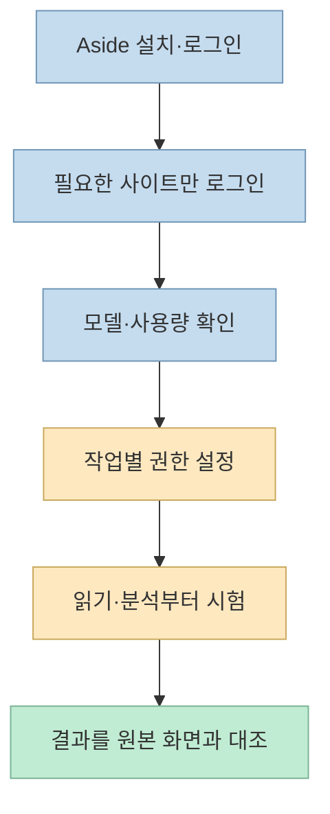
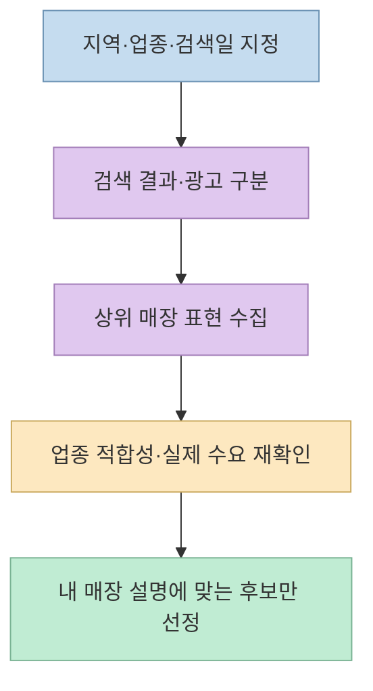
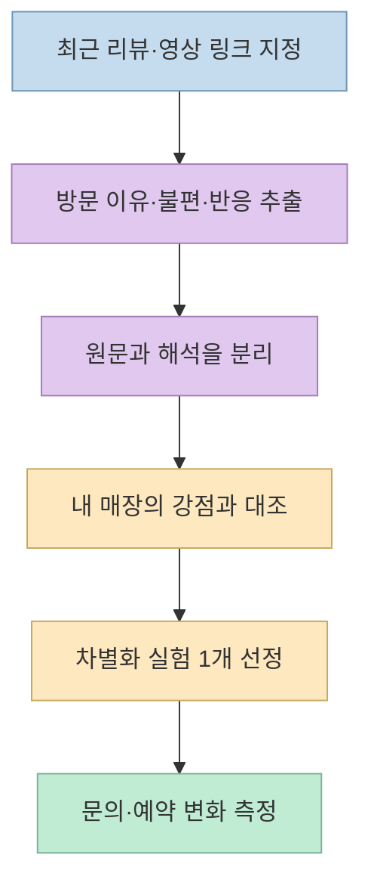
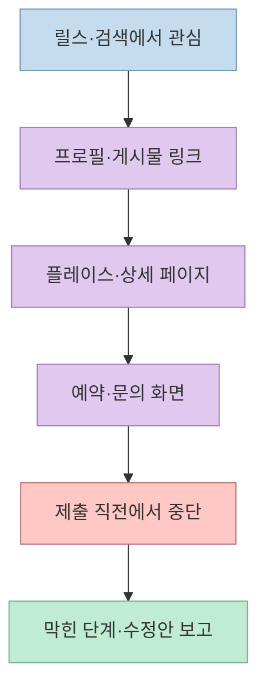
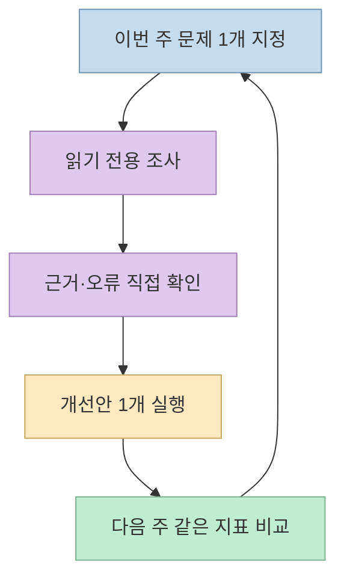

가게 마케팅에 AI를 쓰려면 “매출을 올려줘”보다 **무엇을 읽고, 어디까지 행동하며, 어떤 결과를 내야 하는지** 를 지정해야 한다. [이상한마케팅 아카데미의 어사이드 AI 사용법](https://isanghanacademy.notion.site/AI-3fa3581e0dfb81a3a0c3f0a9d73b618d)은 지역 검색 키워드, 경쟁사 리뷰·SNS, 예약 동선을 점검하는 세 가지 사례를 제시한다. 이 글은 그 절차를 재구성하고, 공식 Aside 문서와 대조해 계정 접근과 데이터 보안의 경계도 함께 짚는다. **실제로 내 가게의 매출을 개선했다는 검증 결과는 아니다.**

<!--more-->

## Sources

- [원본: 내 사업 맞춤 어사이드 AI 사용법](https://isanghanacademy.notion.site/AI-3fa3581e0dfb81a3a0c3f0a9d73b618d) — 세 가지 활용 사례와 프롬프트. 공개 Notion 페이지의 블록 데이터로 본문을 확인했다.
- [Aside 시작 안내](https://docs.aside.com/help/get-started) — 설치, 브라우저 데이터 가져오기, 첫 작업.
- [AI 제공자 연결](https://docs.aside.com/help/ai) — 구독·API 연결 경로.
- [에이전트 권한](https://docs.aside.com/help/security)·[작업 실행](https://docs.aside.com/help/tasks) — 읽기 전용, Guard, Full access.
- [비밀번호 가져오기와 접근 정책](https://docs.aside.com/help/passwords)·[Password Manager](https://docs.aside.com/help/password-manager) — Vault, 자동 채우기, 접근 범위.
- [Aside 개인정보 처리방침](https://aside.com/policy/privacy) — 로컬 저장과 외부 모델 처리의 구분.

## 1. 시작하기: 계정 전체를 넘기지 말고 작업 범위를 정한다

Aside는 로그인한 웹사이트를 브라우저에서 다루는 AI 도구다. 공식 시작 안내는 설치 후 로그인, 브라우저 데이터 가져오기, Password Manager 설정, 첫 작업 순서를 제시한다. 브라우저 데이터 가져오기 대상은 기록·쿠키·북마크다. **기존 브라우저 기록 가져오기와 비밀번호 Vault 가져오기는 서로 다른 단계** 다. 운영체제 지원 여부와 설치 파일은 [공식 다운로드 페이지](https://aside.com/download)에서 사용 중인 기기에 맞춰 확인한다. [시작 안내](https://docs.aside.com/help/get-started)

모델은 `Settings > Models > Providers > Connect`에서 연결한다. 공식 문서는 Aside 요금제 모델, 지원되는 ChatGPT·Claude 등의 **구독 연결**, 자체 API 키를 별도 유형으로 구분한다. 따라서 “기존 구독을 연결하면 모든 작업이 무제한 무료”라고 이해하면 안 된다. 연결한 제공자와 Aside의 사용량·제한을 각각 확인하자. [AI 제공자 안내](https://docs.aside.com/help/ai), [구독·크레딧 안내](https://docs.aside.com/help/subscription)

처음에는 작업 권한을 `Read only`로 시작하고, 파일 편집이 필요할 때만 승인된 폴더를 쓰는 `Guard`를 고려하자. 공식 문서상 `Full access`는 컴퓨터의 어디든 읽고 쓸 수 있는 넓은 권한이다. 경쟁사 조사나 링크 점검에는 보통 필요하지 않다. [에이전트 권한](https://docs.aside.com/help/security)

### 비밀번호 CSV는 채팅에 넣지 않는다

원본 글은 Chrome 비밀번호를 CSV로 내보내 가져오는 방법을 제안한다. 공식 문서에도 `Settings > Passwords > Import`가 있으나, **내보낸 CSV에는 비밀번호 원문이 담길 수 있다.** 가져오기가 꼭 필요하다면 공식 Import 화면에서 처리하고, AI 채팅·공유 드라이브·이메일에 CSV를 올리지 말자. 가져오기 후 불필요한 내보내기 파일과 백업 사본은 안전하게 삭제하고, 은행·결제·관리자 계정은 아예 가져오지 않거나 에이전트 접근에서 제외하는 편이 안전하다. [비밀번호 가져오기 안내](https://docs.aside.com/help/passwords)

Aside Vault는 사이트에 자격 증명을 자동 입력하면서 AI 에이전트에는 저장된 비밀번호 값을 보여주지 않는다고 설명한다. 하지만 이것이 **로그인된 계정에서 수행할 수 있는 행동까지 무해해진다는 뜻은 아니다.** `Settings > Passwords > Access policy for AI agents`에서 `While unlocked` 또는 `Never` 같은 보수적 정책과 항목별 허용 범위를 검토하자. 공식 문서상 기본 정책은 `Always allow`다. [Password Manager](https://docs.aside.com/help/password-manager), [비밀번호 접근 정책](https://docs.aside.com/help/passwords)

또한 Aside는 “로컬 우선”이지만 공식 개인정보 처리방침은 작업에 필요한 프롬프트, 선택된 브라우저 화면·파일 등 **모델에 보이는 맥락이 호스팅된 AI 제공자에게 전달될 수 있다** 고 설명한다. 고객 연락처, 정밀 매출·순이익, 직원 정보는 필요한 부분만 익명화해 제공하자. [개인정보 처리방침](https://aside.com/policy/privacy)

## 2. 플레이스 키워드: 노출 추측이 아닌 검색 결과를 조사한다

원본의 첫 사례는 지역과 업종을 조합해 네이버 검색·플레이스 결과에 나타난 경쟁 매장의 대표 키워드와 공통 표현을 살펴보는 것이다. 예를 들어 “평촌 필라테스”처럼 **실제 고객이 입력할 검색어** 를 정하고, 어느 결과를 언제 봤는지 기록한다. 광고와 자연 노출을 구분하고, 키워드가 업종과 정말 맞는지 검색 결과로 다시 확인해야 한다. 원본의 특정 검색 결과 순위와 소요 시간은 한 시점의 시연일 뿐, 지금도 같은 순위·속도가 나온다는 근거는 아니다. [원본 사례](https://isanghanacademy.notion.site/AI-3fa3581e0dfb81a3a0c3f0a9d73b618d)

다음처럼 요청하면 조사와 판단을 분리할 수 있다.

> “`[지역] [업종]` 검색에서 보이는 플레이스 매장 10곳을 조사해줘. 조사일, 매장 링크, 광고 여부, 화면에서 확인되는 대표 표현을 근거와 함께 정리해줘. 보이지 않는 키워드는 추정으로 채우지 말고 ‘확인 불가’라고 표시해줘. 우리 매장은 `[지역·서비스·차별점]`이다. 우리와 관련 있는 후보 5개를 추천하되 실제 검색 의도와 업종 적합성은 별도 검증 항목으로 남겨줘. 어떤 설정도 변경하지 마.”

원본은 키워드 확인이 어려우면 개발자 도구를 활용하거나 외부 검색량 도구로 점검하는 방법도 소개한다. 다만 페이지 구조와 외부 서비스의 수치는 바뀔 수 있으므로, **노출 키워드·검색량·예약 전환** 을 같은 지표처럼 취급하지 말자. 키워드는 우선순위 후보일 뿐, 매출 보장이 아니다.

## 3. 리뷰와 SNS: 고객의 말을 가설로 바꾼다

원본의 두 번째 사례는 경쟁 매장의 **최근 리뷰 30개** 를 읽어 방문 동기, 만족 요소, 불편 요소를 분류하고, 최근 3개월의 반응 좋은 SNS 영상 5개를 장면·도입부·자막·편집·댓글 반응으로 분석하는 것이다. 30개·5개는 원본 프롬프트의 작업 범위이지 통계적으로 충분하다는 기준이 아니다. 리뷰의 작성 시점, 표본 편향, 광고성 콘텐츠 가능성을 확인하고, AI가 낸 원인 분석은 **가설** 로 취급하자. [원본 사례](https://isanghanacademy.notion.site/AI-3fa3581e0dfb81a3a0c3f0a9d73b618d)

> “`[경쟁 매장 링크]`의 최근 리뷰 최대 30개만 확인해줘. 방문 이유·좋았던 점·불편한 점을 분류하고, 각 결론 옆에 확인 가능한 리뷰 날짜와 링크를 붙여줘. 단순 빈도와 AI의 해석을 분리해줘. 우리 매장의 강점은 `[강점]`이고 주요 고객은 `[고객층]`이다. 경쟁사를 베끼지 않고 개선할 수 있는 아이디어 3개와 검증할 지표를 제시해줘. 리뷰 작성이나 계정 변경은 하지 마.”

SNS 분석도 같은 원리다. “최근 3개월 상위 5개”를 볼 때 **무슨 기준으로 상위인지** — 조회수, 저장, 댓글 등 — 지정하고, 각 영상의 실제 URL을 요구하자. 경쟁사의 영상·문구를 복제하기보다, 고객이 반응한 문제와 표현 방식을 내 서비스에 맞는 새 콘텐츠 가설로 바꾸는 것이 목적이다. 내 매장의 가격·매출·순이익을 제공하라는 원본의 제안은 맞춤화에는 도움이 될 수 있지만, 민감한 재무 수치가 필요 없다면 대략적 가격대·목표·강점만으로 시작하자.

## 4. 고객 동선: ‘관심’에서 ‘예약’ 사이의 끊김을 찾는다

세 번째 사례는 손님 역할로 인스타그램 릴스 → 프로필 링크 → 플레이스·예약 페이지를 따라가며 막히는 지점을 찾는 것이다. 원본은 다섯 지점 중 한 지점의 링크가 빠진 사례를 들지만, 이는 한 사업자의 일화다. **내 사업에서는 실제 링크를 따라가 확인해야 한다.** 특히 지점별 링크, 영업시간·가격 정보 불일치, 모바일에서의 버튼 위치, 예약까지 필요한 단계 수를 살펴보자. [원본 사례](https://isanghanacademy.notion.site/AI-3fa3581e0dfb81a3a0c3f0a9d73b618d)

> “`[내 인스타그램 프로필 링크]`에서 고객처럼 시작해 `[지점명]` 예약 화면까지 이동해줘. 각 단계의 URL과 화면에서 확인한 문구를 기록하고, 링크 오류·정보 불일치·헷갈리는 버튼을 찾아줘. **실제 문의·예약·결제·게시·설정 변경은 하지 말고 제출 직전에서 멈춰줘.** 수정 우선순위를 영향도와 확인 근거로 나눠줘.”

관리자 통계에 접근할 수 있다면 원본처럼 지난달과 이번 달의 유입·클릭·문의·예약·리뷰·재방문을 비교할 수 있다. 단, **두 달의 기간 길이와 지표 정의가 같아야** 의미 있는 비교가 된다. 특정 항목의 수치가 없으면 추정하지 말고 “미제공”이라고 표시하게 하자. 게시·예약·결제 같은 외부 효과가 있는 동작은 사람이 화면에서 최종 확인해야 한다. [원본 통계 프롬프트](https://isanghanacademy.notion.site/AI-3fa3581e0dfb81a3a0c3f0a9d73b618d), [Aside 작업 권한](https://docs.aside.com/help/tasks)

## 5. 매주 반복할 최소 점검 루프

처음부터 모든 채널을 자동화하지 말고 한 지역·한 서비스·한 지점으로 실험을 좁힌다. 원본이 마지막에 제안한 세 질문은 주간 점검에 유용하다. **“지금 보이는 문제는 무엇인가 → 먼저 고칠 세 가지는 무엇인가 → 이번 주 확인할 지표는 무엇인가”** 순서다. AI에게 답변마다 화면 링크와 확인 시각을 붙이게 하고, 대표가 실제 원본을 읽은 뒤 바꿀 것과 보류할 것을 결정하자. [원본의 마무리](https://isanghanacademy.notion.site/AI-3fa3581e0dfb81a3a0c3f0a9d73b618d)

## 핵심 요약

- Aside는 **로그인된 브라우저에서 조사·점검 작업** 을 돕지만, 계정 권한과 결과 검증 책임은 사용자에게 남는다.
- 플레이스 키워드, 리뷰·SNS, 예약 동선을 각각 **검색 의도 → 방문 이유 → 행동 장벽** 의 질문으로 나눠 분석한다.
- 근거 URL·날짜와 AI의 해석을 분리하고, 작은 변경 뒤 문의·예약 지표로 검증한다.
- 비밀번호 CSV를 AI 채팅에 올리지 말고, 읽기 전용 권한과 보수적인 Vault 접근 정책부터 사용한다.

## 결론

어사이드 AI를 “사업을 대신 운영하는 직원”으로 보기보다, **화면을 함께 읽고 문제 가설을 만드는 조사 도구** 로 쓰는 편이 정확하다. 무엇을 고칠지 결정하고 실제 고객 반응을 확인하는 일은 사장님의 몫이다. 원본의 매출 증가 문구나 시연 속도는 결과 보장이 아니며, 가장 안전한 시작은 **읽기 전용 조사 하나와 수동 검증 하나** 다.
