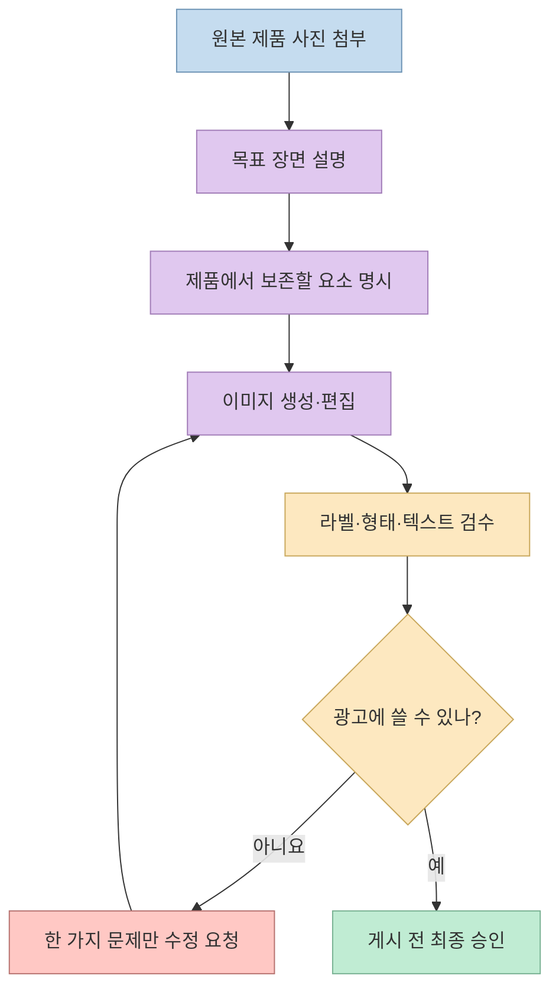
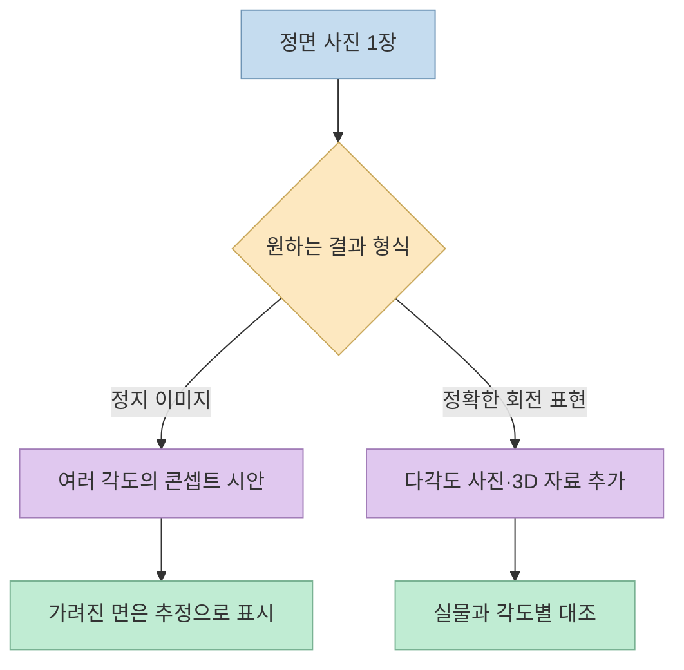

제품 사진을 올린 뒤 짧은 표현만 입력하면 옥외 전광판, SNS 광고, 스튜디오 사진, 여러 각도의 제품 이미지, 생활 장면을 만들 수 있다는 [쇼츠](https://youtube.com/shorts/vk26Fg5FJpM?si=kw3RdBjQhY3Mwjxq)가 있다. 아이디어 자체는 유용하지만 **`/showcase` 같은 문자열을 ChatGPT의 공식 내장 명령어로 받아들이면 안 된다.** [OpenAI Docs의 이미지 생성 안내](https://learn.chatgpt.com/docs/image-generation)는 참조 이미지를 첨부하고 원하는 변화를 자연어로 설명하는 방식을 안내한다. 이 글은 쇼츠에서 소개한 다섯 가지 **시각적 목표** 를 재현 가능한 프롬프트로 풀어쓴다.

<!--more-->

## Sources

- [원본 YouTube 쇼츠: 챗GPT 아스트라 이미지 비밀 코드](https://youtube.com/shorts/vk26Fg5FJpM?si=kw3RdBjQhY3Mwjxq) — 한국어·영어 자동 생성 자막에서 시각적 예시와 시각을 확인했다.
- [OpenAI Docs: ChatGPT 이미지 생성·편집](https://learn.chatgpt.com/docs/image-generation) — 참조 이미지 첨부와 자연어 편집 요청.
- [OpenAI Docs: ChatGPT 사용법](https://learn.chatgpt.com/docs/use-chatgpt) — 특수 명령 없이도 결과와 맥락을 설명할 수 있음.
- [OpenAI Docs: 이미지 프롬프팅](https://developers.openai.com/api/docs/guides/image-prompting) — 변경할 것·보존할 것 분리, 결과 검수. API 문서의 프롬프트 원칙을 참고했으며 아래 예시를 API 실행 결과로 주장하지 않는다.

## 1. '슬래시 코드'가 아니라 편집 목표를 적는다

영상은 첫 예시를 [0초 무렵](https://youtu.be/vk26Fg5FJpM?t=0)에 시작하고, 이어 SNS 광고·쇼케이스·회전 뷰·생활 장면을 [7~25초](https://youtu.be/vk26Fg5FJpM?t=7)에 빠르게 열거한다. 자동 자막에는 `/meta is`, `/view`처럼 부정확해 보이는 표기도 섞여 있다. 따라서 **명령어의 정확한 철자나 해당 표현 하나만으로 같은 결과가 난다는 주장은 확인할 수 없다.** 쇼츠 제목의 “아스트라”가 어떤 제품·모델을 가리키는지도 자막만으로 확정할 수 없다. [원본 영상](https://youtu.be/vk26Fg5FJpM?t=0)

[OpenAI Docs](https://learn.chatgpt.com/docs/use-chatgpt)는 ChatGPT에 완벽한 첫 프롬프트나 특별한 명령이 필요하지 않다고 설명한다. `[제품 사진] + /showcase`처럼 쓰더라도, 시스템에 그 단축어의 뜻을 미리 정의하지 않았다면 사용자가 기대한 조명·구도·보존 범위가 모호하다. **원하는 이미지가 무엇인지 문장으로 풀어 쓰는 편이 재현성과 수정 가능성이 높다.** 이는 공식 안내와 영상의 제시 방식을 대조한 해석이다.

아래 프롬프트는 **영상에서 제시한 결과 유형을 바탕으로 새로 작성한 예시** 다. 영상이 이 문장을 그대로 제공한 것은 아니다. 내 제품의 브랜드·라벨·권리 관계에 맞춰 조정해야 한다.

## 2. 3D 빌보드: 실제 집행 광고가 아닌 목업

쇼츠는 제품이 야외 디지털 전광판에 걸린 듯한 장면을 [0~7초](https://youtu.be/vk26Fg5FJpM?t=0)에 보여준다고 설명한다. 핵심은 제품 이미지를 **거리의 화면과 원근감에 맞춰 배치하는 시각화** 다. 생성 결과는 콘셉트 목업일 뿐, 실제 전광판 집행이나 입체 영상 제작이 완료됐다는 뜻이 아니다.

> “첨부한 제품 사진을 바탕으로 도심의 대형 곡면 디지털 전광판에 제품이 표시된 **광고 목업 이미지**를 만들어줘. 길거리에서 올려다보는 시점, 자연스러운 원근감과 주변 건물의 조명을 표현해줘. 제품의 형태·색상·라벨은 원본과 가능한 한 같게 유지하고, 존재하지 않는 브랜드명·가격·문구는 넣지 마. 실제 광고 집행 사진으로 오해하지 않도록 시안으로 사용할 거야.”

광고 제안서에 넣을 때에는 ‘AI로 만든 목업’이라고 표시하는 편이 적절하다. 로고나 포장 문구가 미세하게 바뀌면 실제 상품을 잘못 소개할 수 있으니 원본과 확대 비교하자. [OpenAI Docs의 결과 검수 항목](https://developers.openai.com/api/docs/guides/image-prompting)

## 3. SNS 광고 시안: 문구보다 먼저 구도를 잡는다

영상은 [7~11초](https://youtu.be/vk26Fg5FJpM?t=7)에 SNS 광고용 이미지를 언급한다. 자동 자막의 코드 표기는 한국어와 영어가 서로 어긋나므로 정확한 문자열을 단정하지 않는다. 플랫폼 광고의 목적은 제품이 보이고, 주요 문구와 버튼을 배치할 **여백이 남는 시안** 을 만드는 것이다.

> “첨부한 제품 사진으로 모바일 SNS 피드용 세로 광고 시안을 만들어줘. 제품을 주인공으로 배치하고 상단에는 헤드라인을 넣을 여백을 남겨줘. 배경은 브랜드 색상 `[색상]`과 어울리게 구성하되, 제품 형태·용기·라벨은 바꾸지 마. **글자·가격·할인율은 이미지에 직접 쓰지 마.**”

이미지 모델이 생성한 가격·효능·이벤트 문구는 정확성을 보장할 수 없다. 중요한 문구는 별도 디자인 도구에서 넣고, 상표·제품 표시·광고 심의가 필요한 업종이라면 게시 전에 확인한다. 이는 이미지 생성 도구의 기능 설명이 아니라 실무 검수 원칙이다. [OpenAI Docs의 텍스트·라벨 검수 안내](https://developers.openai.com/api/docs/guides/image-prompting)

## 4. 쇼케이스: 휴대폰 사진을 스튜디오풍으로

[11~16초](https://youtu.be/vk26Fg5FJpM?t=11)의 `/showcase` 예시는 제품을 전문 스튜디오에서 촬영한 듯 보이게 한다는 설명이다. 실제 촬영이나 상품 3D 모델링을 대신했다는 뜻은 아니다. 원본 사진을 **참조 이미지로 첨부** 하고 바꿀 대상이 배경·조명인지, 제품 자체인지 나눠서 지시한다. [OpenAI Docs의 참조 이미지 안내](https://learn.chatgpt.com/docs/image-generation)

> “이 사진의 **제품은 그대로** 두고 배경과 조명만 정돈해줘. 중성색 스튜디오 배경, 부드러운 측면광, 자연스러운 바닥 그림자를 사용해 프리미엄 제품 상세페이지용 이미지로 만들어줘. 포장 비율·재질·라벨 위치·브랜드 색상은 변경하지 마. 새 텍스트나 소품은 추가하지 마.”

보존 조건을 써도 생성 과정에서 세부 모양이 변할 수 있다. [OpenAI Docs](https://developers.openai.com/api/docs/guides/image-prompting)는 편집할 것과 유지할 것을 분리하고, 결과를 직접 검수한 뒤 한 번에 하나씩 수정하라고 권한다.

## 5. 360도 뷰: 단일 이미지와 회전 영상은 다르다

영상은 [16~21초](https://youtu.be/vk26Fg5FJpM?t=16)에 제품이 한 바퀴 도는 이미지를 언급한다. 그러나 **정면 사진 한 장만으로 실제 뒷면 구조를 알 수는 없다.** 요청 결과가 여러 각도를 한 화면에 배치한 정지 이미지인지, 움직이는 영상인지도 영상의 말만으로 구분되지 않는다. 따라서 처음부터 결과 형식을 명시하고, 보이지 않는 면은 추정임을 표시해야 한다.

> “첨부한 사진을 기준으로 제품의 정면·왼쪽·오른쪽·뒷면을 한 장에 나란히 배치한 **정지 이미지 시안**을 만들어줘. 확인되지 않은 뒷면은 임의 디자인임을 알 수 있게 설명하고, 실제 상품 사양으로 확정하지 마. 정확한 다각도 사진이 필요한 경우 어떤 추가 참조 사진이 필요한지 먼저 알려줘.”

실제 상품의 회전 영상이나 상세페이지용 다각도 사진이 목적이라면 정면 외 사진·영상 또는 정확한 3D 자료를 준비하는 편이 낫다. 생성 이미지의 보이지 않는 면을 상품의 실제 설계로 단정하지 말자.

## 6. 라이프스타일 샷: 사용 맥락을 보여주되 기능을 발명하지 않는다

마지막 유형은 [21~26초](https://youtu.be/vk26Fg5FJpM?t=21)의 ‘생활 장면 속 제품’이다. 배경을 바꾸는 것보다 **고객이 언제·어디서 제품을 쓰는지** 를 전달하는 데 초점을 맞추면 유용하다. 다만 제품이 실제로 지원하지 않는 사용법이나 효능을 장면이 암시하지 않게 해야 한다.

> “첨부한 `[제품명]`을 `[고객 유형]`이 `[사용 상황]`에서 사용하는 자연스러운 생활 사진처럼 보여줘. 조명과 소품은 현실적으로 구성하고, 제품의 형태·색상·라벨은 원본에 가깝게 유지해줘. 제품이 실제로 제공하지 않는 기능이나 효과를 암시하는 장면은 넣지 마.”

한 제품으로 다섯 유형을 모두 만들 필요는 없다. 판매 채널의 목적에 맞춰 한두 가지를 고르고, 원본 대비 포장 정확도와 고객 이해도를 먼저 비교한다. 영상의 “50개가 넘는 단축키”는 [26~31초](https://youtu.be/vk26Fg5FJpM?t=26)의 제작자 주장으로, 자막과 공개 설명만으로 전체 목록·공식 지원 여부를 확인하지 못했다.

## 핵심 요약

- 쇼츠가 소개한 다섯 가지는 **이미지 스타일·용도 아이디어** 다. 슬래시 문자열이 ChatGPT 공식 내장 명령어라는 근거는 확인되지 않았다.
- 참조 사진을 첨부하고 **바꿀 것과 보존할 것** 을 자연어로 명시하는 방식이 더 명확하다.
- 3D 빌보드는 목업이고, 단일 사진의 360도 뷰는 실제 뒷면이나 회전 영상을 보장하지 않는다.
- 광고 사용 전에는 제품 형태·라벨·문구·효능 암시를 원본과 대조해야 한다.

## 결론

이 쇼츠의 실용적인 핵심은 ‘비밀 코드’가 아니라 **제품 사진 한 장을 여러 마케팅 맥락으로 재구성하는 발상** 이다. 원하는 매체·구도·조명·보존 조건을 문장으로 적고, 생성 결과를 시안으로 검수하면 특정 단축어에 의존하지 않고도 같은 작업을 반복할 수 있다.
