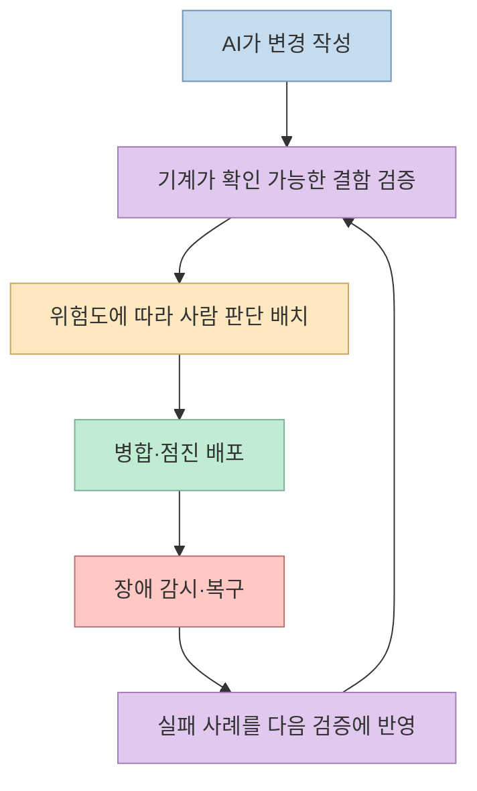
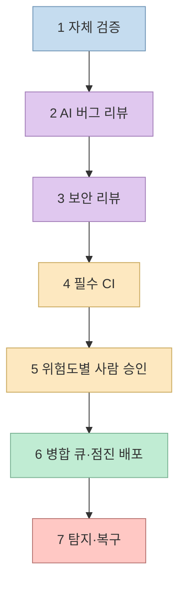
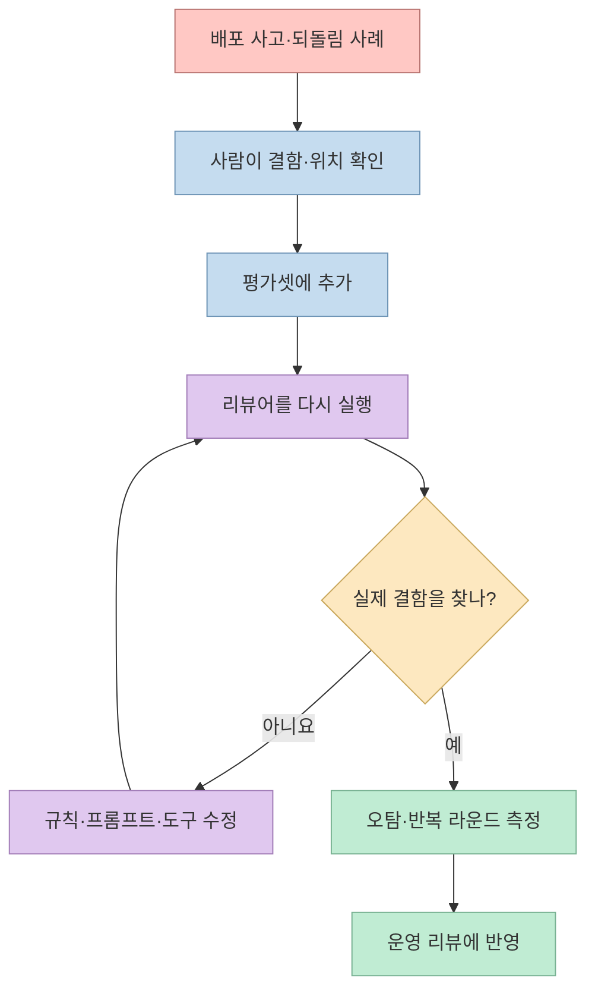

AI가 코드를 더 빨리 작성할수록 사람이 모든 변경을 한 줄씩 읽는 방식은 병목이 된다. [개발동생의 영상](https://youtu.be/J6MsYjDB93k?si=cfNBTtrt_6ezVqeq)은 Claude Code 팀의 `REVIEW.md`와 ‘7개 리뷰 레이어’를 소개한다. 핵심은 **사람을 리뷰에서 없애는 것** 이 아니라, 기계가 확인할 수 있는 것과 사람이 판단해야 할 것을 나누고 문제가 생겼을 때 빨리 되돌리는 것이다. 아래는 영상의 설명을 [Anthropic 원문](https://claude.dev/blog/solving-code-review-at-anthropic/) 및 제품 문서와 대조한 정리다.

<!--more-->

## Sources

- [원본 영상: 클로드 코드 팀은 이제 코드를 안 읽습니다 | REVIEW.md와 7개 리뷰 레이어](https://youtu.be/J6MsYjDB93k?si=cfNBTtrt_6ezVqeq) — 한국어 제공 자막에서 시간별 주장을 확인했다.
- [Anthropic: How the Claude Code team does code review](https://claude.dev/blog/solving-code-review-at-anthropic/) — 영상이 설명하는 팀 내부 운영의 1차 자료.
- [Claude Code Docs: Code Review](https://code.claude.com/docs/en/code-review)·[Customize Code Review](https://code.claude.com/docs/en/code-review-customize) — 관리형 리뷰의 제품 범위와 `REVIEW.md` 적용 규칙.
- [Claude Code Docs: 로컬 `/code-review`](https://code.claude.com/docs/en/code-review-local) — 관리형 서비스와 구분되는 로컬 명령.
- [Claude Help Center: Code Review 설정](https://support.claude.com/en/articles/14233555-set-up-code-review-for-claude-code) — GitHub 연동, 과금, PR 동작.

## 1. ‘코드를 안 읽는다’는 말의 실제 의미

영상은 [0~35초](https://youtu.be/J6MsYjDB93k?t=0)에 AI가 코드 읽기의 많은 부분을 맡고 저위험 변경은 사람 승인 없이 병합할 수 있다고 요약한다. Anthropic 원문도 비슷한 방향을 설명하지만, **모든 PR에서 사람 판단이 사라졌다는 뜻은 아니다.** 코드 리뷰의 두 역할은 배포 전 결함을 찾는 것과 팀 전체가 코드베이스 맥락을 공유하는 것이다. 자동화는 첫째 역할의 반복적인 읽기를 주로 덜어 주고, 방향·위험·아키텍처·검증 근거를 판단하는 책임은 여전히 사람에게 남는다. [Anthropic 원문](https://claude.dev/blog/solving-code-review-at-anthropic/)

Anthropic은 2026년 6월부터 9월까지 Claude Code 저장소에서 **병합 PR 수가 2배 이상 증가했고, 되돌려야 했던 PR의 비중은 40% 이상 감소했다** 고 보고한다. 이는 해당 팀의 내부 관찰치다. 다른 조직에 그대로 재현된다는 증거도, 자동화만이 수치 변화의 원인이라는 실험도 아니다. 더구나 ‘되돌린 **비중** 감소’는 되돌린 PR의 절대 개수가 40% 줄었다는 말과 다르다. [영상 17~25초](https://youtu.be/J6MsYjDB93k?t=17), [Anthropic 원문](https://claude.dev/blog/solving-code-review-at-anthropic/)



## 2. 검증 게이트 여섯 개와 배포 후 복구 한 개

영상은 [59~115초](https://youtu.be/J6MsYjDB93k?t=59)에 7단계를 예고한다. 원문의 도식은 **“검사 6개와 그 아래의 롤백”** 이라고 부르고, 본문은 복구까지 번호 7을 붙인다. 즉 앞의 여섯 단계는 주로 **병합 전 예방**, 마지막 단계는 **배포 후 탐지·피해 축소** 라고 이해하면 숫자 표현이 충돌하지 않는다. [Anthropic 원문 ‘Layer by layer’](https://claude.dev/blog/solving-code-review-at-anthropic/)

### ① PR 전 자체 검증

에이전트가 테스트·빌드·화면 비교를 직접 실행하고 **“완료했다”는 주장 대신 실행 결과** 를 남긴다. 별도 맥락을 가진 에이전트가 diff를 다시 보면 작성자가 놓친 가정을 찾을 수 있다. 영상은 프런트엔드에서 디자인 시안과 스크린샷을 비교하는 예도 든다. 이 단계의 기준은 에이전트가 그럴듯한 설명을 했는지가 아니라, 실행 가능한 검증과 결과물이 남았는지다. [영상 120~181초](https://youtu.be/J6MsYjDB93k?t=120), [Anthropic 원문](https://claude.dev/blog/solving-code-review-at-anthropic/)

### ② PR마다 AI 버그 리뷰

리뷰어는 변경된 diff뿐 아니라 기존 코드와 **PR의 의도** 를 함께 읽어야 한다. 그래야 “요청한 문제를 실제로 해결했는가”, “근본 원인을 고쳤는가”, “다른 흐름을 깨뜨렸는가”를 따질 수 있다. 후보 결함을 다른 에이전트가 재검증해 오탐을 줄이고, 남긴 지적에는 근거가 되는 코드 위치를 붙인다. 영상은 이 분업을 [380~452초](https://youtu.be/J6MsYjDB93k?t=380)에 설명한다. [Anthropic 원문](https://claude.dev/blog/solving-code-review-at-anthropic/)

### ③ 별도 보안 리뷰와 ④ 필수 CI

일반 버그 리뷰가 기능의 의도와 회귀를 본다면, 보안 리뷰는 타인 데이터 접근, 위험한 명령 실행처럼 **피해 범위가 큰 경로** 를 별도로 본다. 그 뒤 린트·타입 검사·테스트·빌드처럼 실행 결과가 명확한 검사를 병합 조건으로 건다. Anthropic 팀 내부에서는 미해결 버그·보안 지적을 해소하거나 이유를 남겨 닫아야 병합된다. 이 차단은 팀이 설정한 정책이다. **관리형 Claude Code Review 제품 자체가 PR을 승인하거나 차단하는 것은 아니다.** [영상 453~604초](https://youtu.be/J6MsYjDB93k?t=453), [Anthropic 원문](https://claude.dev/blog/solving-code-review-at-anthropic/), [Claude Code Docs](https://code.claude.com/docs/en/code-review)

### ⑤ 변경 위험도에 따른 사람 승인

Anthropic 팀은 변경 내용으로 위험도를 분류한다. 저위험은 자동 검사 통과 후 별도 사람 승인 없이, 중간 위험은 한 사람, 고위험은 두 사람의 승인을 요구한다. 단, 이는 **그 팀의 운영 방식** 이며 모든 프로젝트에 적용되는 Claude Code 기본 설정이 아니다. 경량 경로는 신뢰된 작성자에게 제한하고, 민감 경로와 CI 변경에는 사람이 필요하다. 에이전트의 승인은 사람 승인 인원으로 계산하지 않는다. [영상 605~708초](https://youtu.be/J6MsYjDB93k?t=605), [Anthropic 원문](https://claude.dev/blog/solving-code-review-at-anthropic/)

### ⑥ 병합 큐와 점진 배포

PR 두 개가 **각자** 테스트를 통과했어도 최신 `main`과 **함께** 합쳐졌을 때는 실패할 수 있다. 병합 큐는 병합된 상태로 검사를 다시 실행한다. 새 기능은 기능 플래그 뒤에서 내부 사용자에게 먼저 열고, 공개 버전은 `latest`를 거쳐 `stable`로 확장한다는 것이 Anthropic 팀의 설명이다. 기능 플래그는 **누가 기능을 쓰는가**, 릴리즈 채널은 **어떤 버전을 받는가** 를 제어한다. [영상 709~800초](https://youtu.be/J6MsYjDB93k?t=709), [Anthropic 원문](https://claude.dev/blog/solving-code-review-at-anthropic/)

### ⑦ 배포 후 탐지와 빠른 복구

모든 결함을 병합 전에 잡는 것은 불가능하다. 원문은 주간 온콜, 되돌리기·사고 대시보드, 기능 플래그 비활성화로 이상을 빨리 발견하고 피해를 줄이는 단계를 마지막에 둔다. 다만 **플래그로 끌 수 없는 변경** 도 있으므로 롤백 또는 수정 배포 경로가 필요하다. Anthropic은 되돌리기·사고율이 악화되면 승인 강도를 자동으로 올리는 ‘회로 차단기’는 아직 없다고 명시한다. [영상 801~884초](https://youtu.be/J6MsYjDB93k?t=801), [Anthropic 원문](https://claude.dev/blog/solving-code-review-at-anthropic/)



## 3. `REVIEW.md`는 어디에 적용되나

영상은 [209~303초](https://youtu.be/J6MsYjDB93k?t=209)에 `CLAUDE.md`를 프로젝트 맥락, `REVIEW.md`를 **리뷰할 때 무엇을 중요하게 볼지 정하는 기준** 으로 구분한다. Anthropic 원문은 코드 소유자가 짧은 `REVIEW.md`에 “이 저장소에서 실패란 무엇인가”, 사소한 지적의 상한, 제외 경로, 파일·줄 번호 같은 근거 요구를 쓰라고 설명한다. 리뷰 기준이 없으면 결과가 스타일 지적에 치우치거나 기계적 검사를 반복할 수 있다. [Anthropic 원문](https://claude.dev/blog/solving-code-review-at-anthropic/)

예를 들어 결제 코드라면 중복 청구와 롤백 불가 변경을, 권한 코드라면 다른 사용자의 데이터에 접근 가능한지를 ‘중요’ 기준으로 삼을 수 있다. 아래는 **독자가 자신의 프로젝트에 맞게 고쳐 쓸 예시** 이지 Anthropic의 실제 내부 파일은 아니다.

```markdown
# Review instructions

## Important로 보고할 것
- 결제 금액이 중복 계산되거나 청구될 수 있는 변경
- 다른 사용자·테넌트의 데이터에 접근할 수 있는 변경
- 문제 발생 시 안전하게 되돌릴 수 없는 데이터 변경

## 보고하지 않을 것
- CI가 이미 잡는 포맷·린트 문제
- 생성된 코드와 잠금 파일의 사소한 스타일 문제

## 근거
- 지적마다 파일·줄 번호와 실패 조건을 제시한다.
- 확신이 낮은 추측은 확인 방법을 제안하되 결함으로 단정하지 않는다.
```

**적용 범위가 중요하다.** 현재 [Claude Code 공식 문서](https://code.claude.com/docs/en/code-review-customize)에 따르면 GitHub PR의 **관리형 Code Review 서비스** 는 `CLAUDE.md`와 `REVIEW.md`를 읽는다. 반면 **로컬 `/code-review` 명령** 은 `CLAUDE.md`는 읽지만 `REVIEW.md`를 자동으로 읽지 않는다. 로컬에서도 같은 규칙이 필요하면 공통 내용을 `CLAUDE.md`에 넣거나 리뷰 요청에 파일을 명시해야 한다. `REVIEW.md`의 존재만으로 모든 리뷰 도구가 같은 정책을 쓰는 것은 아니다. [영상 274~303초](https://youtu.be/J6MsYjDB93k?t=274)

또한 공식 문서는 관리형 서비스가 읽는 `REVIEW.md`가 PR의 새 파일이 아니라 **기본/대상 브랜치의 사본** 이라고 설명한다. 규칙을 바꾸려면 먼저 해당 파일을 병합하고 브랜치 보호 구성을 확인해야 한다. 최신 기능이라 UI·설정은 [공식 사용자 문서](https://code.claude.com/docs/en/code-review-customize)에서 다시 확인하자.

## 4. 리뷰어 자체도 평가한다: 정확도와 수렴성

영상 후반은 사고를 ‘AI 리뷰어의 기출문제’로 만드는 흐름을 [885~951초](https://youtu.be/J6MsYjDB93k?t=885)에 설명한다. Anthropic 팀은 과거 사고·되돌림 PR과 수정 내용을 모으고, 해당 코드를 아는 엔지니어가 실제 결함과 위치를 확인한 **평가셋** 에 리뷰어를 매일 실행한다고 한다. 리뷰어의 모델·프롬프트·도구를 바꿀 때 과거 결함을 계속 찾는지 확인하는 방식이다. `REVIEW.md`가 ‘무엇을 지적할지’에 대한 **규칙** 이라면 평가셋은 ‘실제로 결함을 찾는가’에 대한 **시험** 이다. [Anthropic 원문](https://claude.dev/blog/solving-code-review-at-anthropic/)

정확도만 높이려 무한히 지적하는 리뷰어도 문제다. 원문은 한 PR에서 **50회가 넘는 리뷰·수정 반복** 이 있었고, 반복 지적의 약 59%가 첫 리뷰 때부터 존재하던 코드였다고 보고한다. 이에 따라 세 차례 뒤에는 작성자가 접근을 재검토하게 하고, 이후에는 **새 diff에 집중** 하며 이미 올린 지적을 반복하지 않도록 바꿨다. 영상은 한 번의 리뷰 라운드로 통과하는 비율이 65%에서 78%로 늘었다고 소개하지만, 이는 Anthropic 내부 환경에서의 전후 비교로 읽어야 한다. [영상 952~1024초](https://youtu.be/J6MsYjDB93k?t=952), [Anthropic 원문](https://claude.dev/blog/solving-code-review-at-anthropic/)



## 5. 작은 팀에 옮길 때: 기능보다 책임 경계부터

영상의 [1155~1242초](https://youtu.be/J6MsYjDB93k?t=1155)와 [Anthropic의 적용 가이드](https://claude.dev/blog/solving-code-review-at-anthropic/)는 한 번에 전체 시스템을 복제하기보다 작은 순서로 시작하라고 권한다.

1. **PR 템플릿부터 정한다.** `Testing`, `Risk`, `How to revert` 세 항목에 실제 실행한 검사와 복구 방법을 적는다. 에이전트가 초안을 써도 작성자가 근거를 확인한다.
2. **실행 가능한 검사부터 자동화한다.** 빌드·테스트·린트가 없다면 먼저 로컬에서 돌리고, 반복할 수 있는 검사만 필수 CI로 옮긴다.
3. **AI 리뷰의 역할을 좁힌다.** 처음에는 한 저장소에서 버그·보안 지적을 시험하고, `REVIEW.md`를 다듬는다. 지적은 수정하거나 오탐 이유를 남긴다.
4. **사람 승인 경로를 보수적으로 시작한다.** 결제·인증·CI·배포와 같은 고위험 경로는 별도 사람 검토를 요구하고, 저위험 자동 병합은 측정 결과가 쌓인 뒤 검토한다.
5. **복구를 병합 전에 설계한다.** 기능 플래그를 끄면 충분한지, 되돌림이 필요한지, 데이터 변경이 되돌릴 수 있는지 확인한다.

관리형 Code Review 도입을 고려한다면 **제품 사용 가능 조건과 비용** 도 분리해 봐야 한다. 현재 공식 안내는 Team·Enterprise 조직용 서비스라고 하며, 사용량 기반 비용이 플랜 사용량과 별도로 청구된다고 설명한다. 로컬 `/code-review`는 별개의 가벼운 경로다. 두 기능을 같은 가격·권한·자동화 수준으로 소개하면 오해가 생긴다. [Claude Code Docs](https://code.claude.com/docs/en/code-review), [설정 안내](https://support.claude.com/en/articles/14233555-set-up-code-review-for-claude-code)

리뷰 자동화에는 **팀 학습 기회가 줄어드는 비용** 도 있다. 영상은 [1078~1154초](https://youtu.be/J6MsYjDB93k?t=1078)에 동료 PR을 읽으며 시스템을 배우던 경로가 약해질 수 있다고 지적한다. Anthropic 원문도 이 문제를 인정하며, 바꿀 모듈의 코드 근거를 설명하는 문서·시각화를 만들고 공개 채널에서 작업 맥락을 나누는 방식을 소개한다. 다만 이 역시 자동 리뷰의 완전한 대체재가 아니라 팀에 맞춰 실험할 보완책이다. [Anthropic 원문](https://claude.dev/blog/solving-code-review-at-anthropic/)

## 핵심 요약

- **7단계** 는 병합 전 검증 게이트 6개와 배포 후 탐지·복구 1개로 이해하면 된다.
- `REVIEW.md`는 관리형 PR Code Review의 기준이지만, 로컬 `/code-review`에는 자동 적용되지 않는다.
- 관리형 리뷰가 PR을 **직접 승인·차단하지는 않는다.** 병합 차단과 사람 승인 수는 팀의 저장소 정책으로 구현한다.
- 리뷰어도 사고 사례로 평가하고, 오탐·중복 지적·무한 리뷰 라운드를 함께 줄여야 한다.
- Anthropic의 성과 수치는 **자체 팀의 보고** 다. 우리 팀에서는 사람 검토 시간과 함께 되돌림·장애율을 추적해야 한다.

## 결론

AI 코드 리뷰의 목적은 ‘아무도 코드를 읽지 않게’ 만드는 것이 아니다. **실행 가능한 검증을 앞당기고, 위험한 변경에는 사람을 남기며, 놓친 문제를 빨리 복구하는 체계** 가 핵심이다. `REVIEW.md` 하나를 추가하는 것보다 테스트 결과·리뷰 근거·승인 책임·롤백 경로를 연결해야 영상의 7단계가 실제 품질 관리가 된다.
