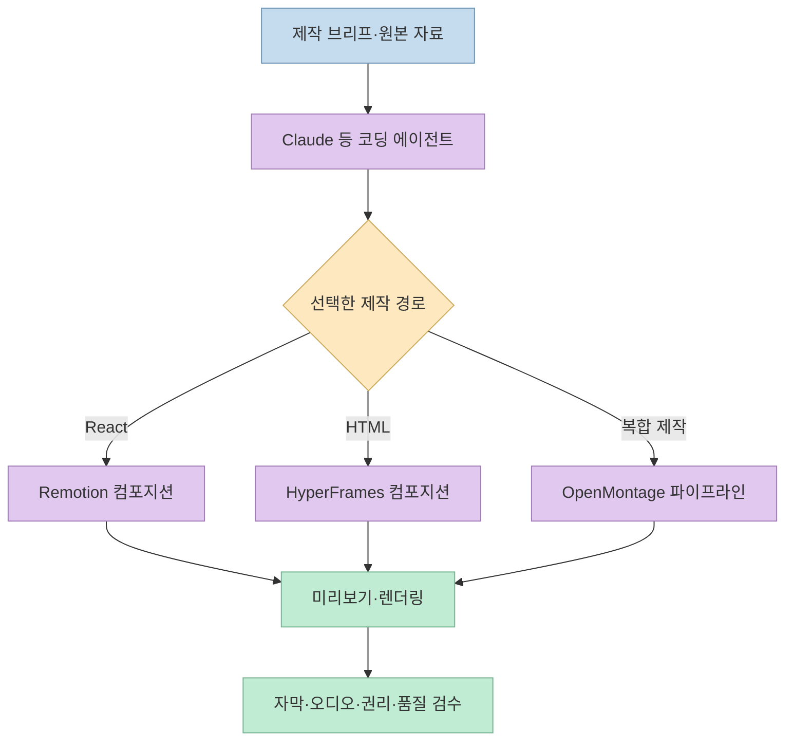
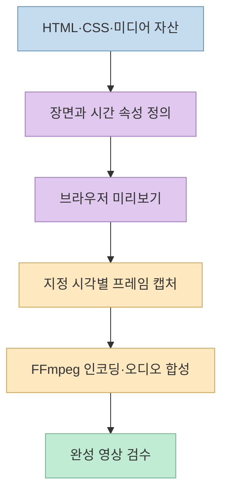
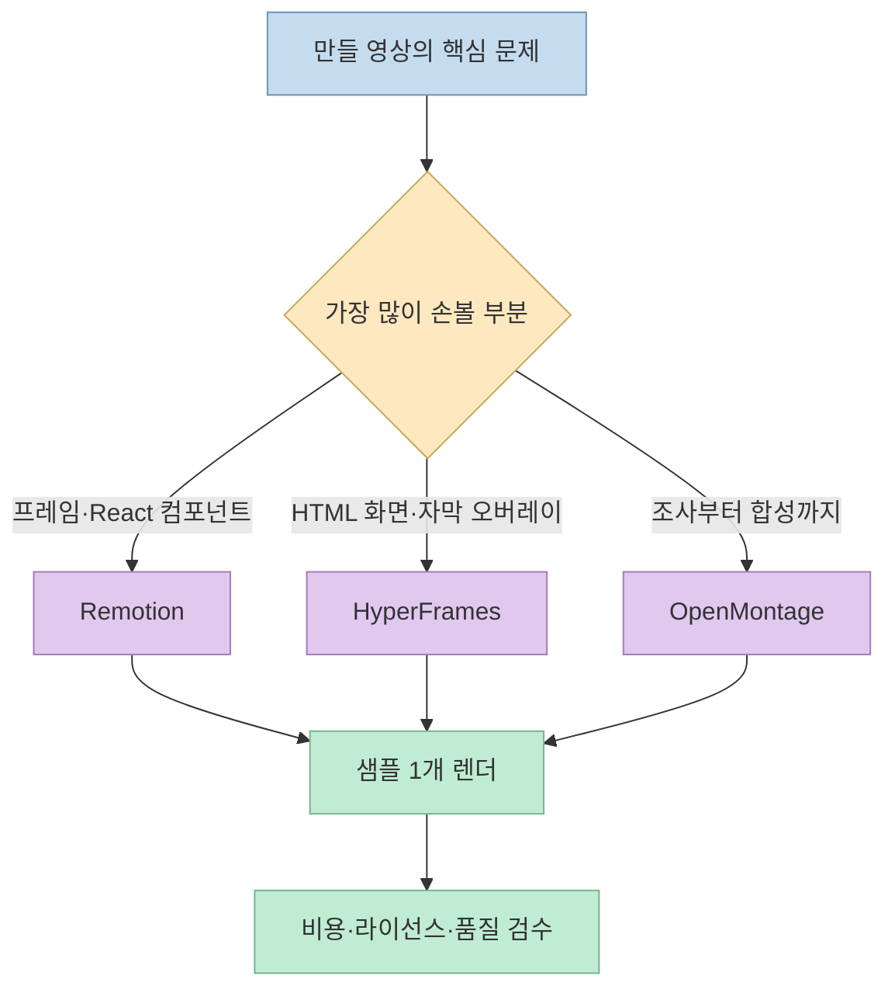

“Claude가 무료로 전문 편집자 수준의 영상을 만든다”는 [짧은 영상](https://youtube.com/shorts/kwHMECJH88I?si=4aM9I4JVPRv07sXc)이 Remotion, HyperFrames, OpenMontage를 소개한다. 세 도구 모두 **AI 코딩 에이전트가 영상 제작에 참여할 수 있게 하는 경로** 를 제공하지만, 같은 종류의 제품은 아니다. 또 **공개된 코드, 무료 라이선스, 무료 제작 과정** 은 서로 다른 말이다. 이 글은 영상의 시연 설명을 각 프로젝트의 공식 자료와 대조해 무엇을 선택하고 무엇을 검증해야 하는지 정리한다. 세 도구를 직접 설치해 같은 브리프로 렌더링한 비교 실험은 아니다.

<!--more-->

## Sources

- [원본 YouTube 쇼츠: 클로드로 영상 만드는 오픈소스 3개](https://youtube.com/shorts/kwHMECJH88I?si=4aM9I4JVPRv07sXc) — 한국어 자동 자막의 시간별 주장 확인.
- [Remotion 공식 렌더링 문서](https://www.remotion.dev/docs/render)·[라이선스 FAQ](https://www.remotion.dev/docs/license/faq) — React 기반 렌더링 경로, 무료 사용 자격, 오픈소스 여부.
- [HyperFrames 공식 저장소](https://github.com/heygen-com/hyperframes) — HTML 기반 저작, 렌더링, 설치 요구 사항, Apache-2.0 라이선스.
- [OpenMontage 공식 저장소](https://github.com/Open-Montage-app/OpenMontage)·[MIT 라이선스](https://github.com/Open-Montage-app/OpenMontage/blob/main/LICENSE) — 파이프라인, 도구 수, 무료·유료 제공자 조합.

이미 개별 도구를 자세히 다룬 [Remotion 실습 글](/post/2026/10/2026-10-10-remotion-vibe-coded-video-editing-and-model-comparison/), [HyperFrames 구조 글](/post/2026/04/2026-04-20-hyperframes-html-video-framework-for-agents/), [OpenMontage 실전 조건 글](/post/2026/10/2026-10-08-openmontage-short-claims-and-practical-setup/)이 있다. 이번 글은 **세 도구를 함께 고르는 기준과 쇼츠의 과장된 범위** 에 초점을 맞춘다.

## 1. 먼저 구분할 것: Claude는 지시·수정하고 도구가 렌더링한다

쇼츠는 [0~5초](https://youtu.be/kwHMECJH88I?t=0)에 “이것만 있으면 Claude가 영상을 무료로 만든다”고 말한다. 정확히는 **Claude Code 같은 AI 코딩 에이전트가 영상 프로젝트의 코드·장면 지시를 작성하거나 수정하고, 별도 프레임워크와 렌더러가 영상을 출력** 하는 구조다. 프로젝트 설치, 이미지·음원 준비, 컴퓨터 자원, 유료 모델/API 선택 여부, 라이선스 조건은 별도다. “전문 편집자 수준”도 이 쇼츠의 평가이지 검증된 품질 기준이 아니다. [Remotion 렌더링 문서](https://www.remotion.dev/docs/render), [HyperFrames README](https://github.com/heygen-com/hyperframes), [OpenMontage README](https://github.com/Open-Montage-app/OpenMontage)

## 2. Remotion: React 코드로 시간·장면을 제어한다

쇼츠는 [5~12초](https://youtu.be/kwHMECJH88I?t=5)에 **Remotion**을 “영상을 코드로 만들고 Claude가 직접 수정한다”고 소개한다. Remotion은 React 컴포넌트로 장면·텍스트·애니메이션을 구성하고 Studio, CLI 또는 서버 측 방법으로 렌더링할 수 있다. 공식 문서에는 `npx remotion render` 같은 CLI 출력 경로가 명시되어 있다. 따라서 “대사 단어마다 움직이는 화면”은 이 프로젝트로 **구현할 수 있는 예시** 이지만, 어떤 대본을 넣어도 자동으로 그 수준의 편집이 완성된다는 뜻은 아니다. [Remotion 공식 렌더링 문서](https://www.remotion.dev/docs/render)

**라이선스가 쇼츠와 다르다.** Remotion 공식 FAQ는 프로젝트를 **source-available**로 설명하며, OSI 정의의 오픈소스는 아니라고 명시한다. 개인이나 3인 이하 팀 등은 무료 사용 자격이 있지만, 더 큰 영리 조직은 라이선스 조건을 확인해야 한다. 영상 제작에 쓰는 음원·폰트·스톡 영상의 권리, 클라우드 렌더링 비용, 코딩 에이전트 사용 비용도 별도다. “무료로 시작 가능”을 “모든 조직과 용도가 무료”로 읽어서는 안 된다. [Remotion 라이선스 FAQ](https://www.remotion.dev/docs/license/faq)

선택 기준은 **React에 익숙하고, 프레임 단위로 글자·전환·장면을 반복 수정해야 하는가** 다. 구체적인 코드 수정과 렌더링 루프는 [기존 Remotion 실습 글](/post/2026/10/2026-10-10-remotion-vibe-coded-video-editing-and-model-comparison/)에서 더 자세히 다뤘다.

## 3. HyperFrames: HTML·CSS·JS 장면을 프레임별로 영상화한다

쇼츠는 [12~20초](https://youtu.be/kwHMECJH88I?t=12)에 **HyperFrames**를 “홈페이지를 만들듯 화면을 만들고 기존 영상 위에 자막·효과를 얹는 방식”으로 설명한다. 공식 저장소는 HTML·CSS·미디어 요소와 **시간 지정 가능한 애니메이션** 으로 컴포지션을 만들고, 브라우저에서 각 프레임을 캡처해 FFmpeg로 인코딩한다고 설명한다. 단순 웹사이트 캡처 도구가 아니라 **정해진 시각의 상태를 재현할 수 있는 영상 저작 시스템** 에 가깝다. [HeyGen의 HyperFrames 저장소](https://github.com/heygen-com/hyperframes)

HyperFrames 저장소는 **Apache-2.0 오픈소스** 이며, 로컬 CLI 경로에는 Node.js 22 이상과 FFmpeg가 필요하다고 적는다. 코딩 에이전트용 스킬과 Claude Code 플러그인도 제공한다. 그러나 “패키지에 렌더당 라이선스 비용이 없다”는 것과 “호스팅·컴퓨팅·유료 음성·영상 자산까지 무료”는 다르다. 특히 URL이나 외부 자료를 영상으로 옮길 때는 접근권과 재사용 권리를 확인해야 한다. [HyperFrames 공식 README](https://github.com/heygen-com/hyperframes)

선택 기준은 **웹 기술로 글자·자막·그래프·기존 영상 위의 오버레이를 정밀하게 배치하고 싶은가** 다. 저작 모델과 결정론적 렌더링에 대한 자세한 설명은 [기존 HyperFrames 구조 글](/post/2026/04/2026-04-20-hyperframes-html-video-framework-for-agents/)을 참고할 수 있다.

## 4. OpenMontage: 렌더러 하나보다 넓은 제작 파이프라인

쇼츠는 [21~30초](https://youtu.be/kwHMECJH88I?t=21)에 **OpenMontage**를 배경 음악, 자막, 참고 영상까지 다루는 “영상 제작 공장”이라고 부른다. 이 비유는 프로젝트의 성격을 잘 짚지만 **모든 자산을 항상 자동·무료로 생성한다** 고 이해하면 안 된다. 공식 저장소는 조사·기획·대본·영상/음성/음악 도구 선택·합성·검수의 여러 파이프라인을 설명하며, Remotion·HyperFrames·FFmpeg를 제작 과정의 구성 요소로도 열거한다. 즉 OpenMontage는 앞의 두 도구와 동급의 단일 렌더러라기보다 **다양한 도구를 엮는 상위 작업 흐름** 에 가깝다. [OpenMontage 공식 README](https://github.com/Open-Montage-app/OpenMontage)

영상 자막의 “도구 121개”는 **확인한 공식 README에서 재확인되지 않았다.** 현재 README 소개 문구는 **제작 도구 52개** 라고 적지만, 같은 문서의 아키텍처 도식에는 **Python 도구 48개** 라는 표현도 남아 있다. 무엇을 ‘도구’로 세는지와 버전이 달라질 수 있으므로 숫자 자체보다 **원하는 작업 경로에 필요한 제공자·키·실행 환경이 실제로 갖춰졌는지** 를 확인해야 한다. [영상 21~26초](https://youtu.be/kwHMECJH88I?t=21), [OpenMontage 공식 README](https://github.com/Open-Montage-app/OpenMontage)

OpenMontage 코드 자체는 [MIT 라이선스](https://github.com/Open-Montage-app/OpenMontage/blob/main/LICENSE)다. 공식 문서에는 Piper TTS, 공개 영상 자산, FFmpeg 등을 쓰는 **유료 API 키 없는 경로** 가 있다. 동시에 Suno·ElevenLabs 등 클라우드 제공자를 이용하는 선택지도 있다. 따라서 결과물 제작비는 **선택한 모델·제공자·컴퓨팅·자산 라이선스** 에 따라 달라진다. 공개 영상도 모두 자유롭게 재사용할 수 있는 것은 아니다. [OpenMontage 무료 경로 설명](https://github.com/Open-Montage-app/OpenMontage#what-you-get-with-zero-api-keys)

선택 기준은 **한 장면의 모션보다 조사부터 최종 납품까지 여러 단계를 묶고 싶은가** 다. 설치와 한국어 자막·검수 조건은 [기존 OpenMontage 실전 글](/post/2026/10/2026-10-08-openmontage-short-claims-and-practical-setup/)에서 다뤘다.

## 5. 무엇을 고를까: 영상의 ‘문제 종류’로 결정한다

세 프로젝트 중 하나가 모든 작업에서 우월하다는 근거는 없다. 코드를 직접 고쳐 같은 형식을 반복 렌더링하려면 **Remotion**, HTML/웹 애니메이션과 오버레이를 중심으로 만들려면 **HyperFrames**, 조사·음성·영상 자산·자막·합성을 한 흐름으로 묶고 싶다면 **OpenMontage**가 출발점이 된다. OpenMontage가 내부 합성 도구로 앞의 둘을 사용할 수 있으므로, 이 셋을 무조건 배타적인 대안으로 볼 필요도 없다. 이는 각 공식 문서의 저작 모델과 파이프라인 설명에서 도출한 선택 기준이다. [Remotion](https://www.remotion.dev/docs/render), [HyperFrames](https://github.com/heygen-com/hyperframes), [OpenMontage](https://github.com/Open-Montage-app/OpenMontage)

처음 시도한다면 **15초짜리 샘플 하나** 로 범위를 좁히자. 브리프에 길이, 화면비, 대본, 자막 언어, 사용할 원본 자산, 음악 권리, 최종 출력 형식을 적고, 렌더 후에는 프레임 깨짐·자막 싱크·음량·출처를 직접 확인한다. 영상의 [30~38초](https://youtu.be/kwHMECJH88I?t=30)에 있는 “설치가 쉽고 공짜”라는 마무리는 입문을 유도하는 주장이다. 세 도구를 동일한 환경에서 설치·제작·비용 측정한 비교 결과는 제시되지 않는다.

## 핵심 요약

- **Remotion**은 React 기반의 코드형 영상 제작 도구다. 코드는 공개돼 있지만 공식 FAQ상 OSI 오픈소스는 아니며 무료 사용 자격에 조건이 있다.
- **HyperFrames**는 HTML 기반의 프레임 렌더링 도구로, 공식 저장소는 Apache-2.0 라이선스다.
- **OpenMontage**는 도구를 조합하는 제작 파이프라인이며 MIT 라이선스다. 선택한 외부 제공자에 따라 비용이 생길 수 있다.
- 쇼츠의 **‘121개 도구’, ‘모두 무료’, ‘전문 편집자 수준’** 은 확인된 보편적 사실로 취급하지 않는다.

## 결론

Claude에게 “영상 하나 만들어 줘”라고 맡기기 전에 **어떤 부분을 코드로 수정할지, 어떤 자산을 어디서 가져올지, 어떤 품질과 비용을 허용할지** 를 먼저 정해야 한다. 세 도구는 그 과정의 서로 다른 층을 맡는다. 작은 샘플을 실제로 렌더하고 권리·비용·출력을 검수한 뒤 제작 범위를 늘리는 편이 안전하다.
