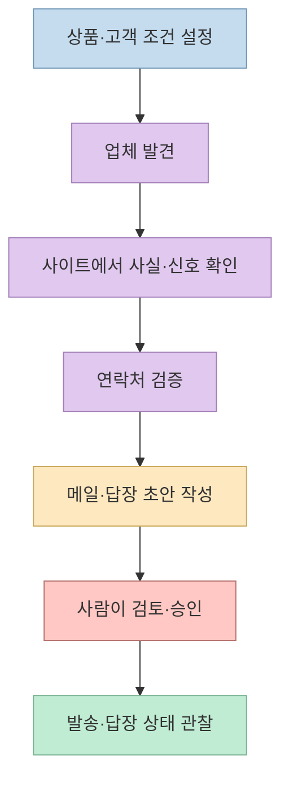
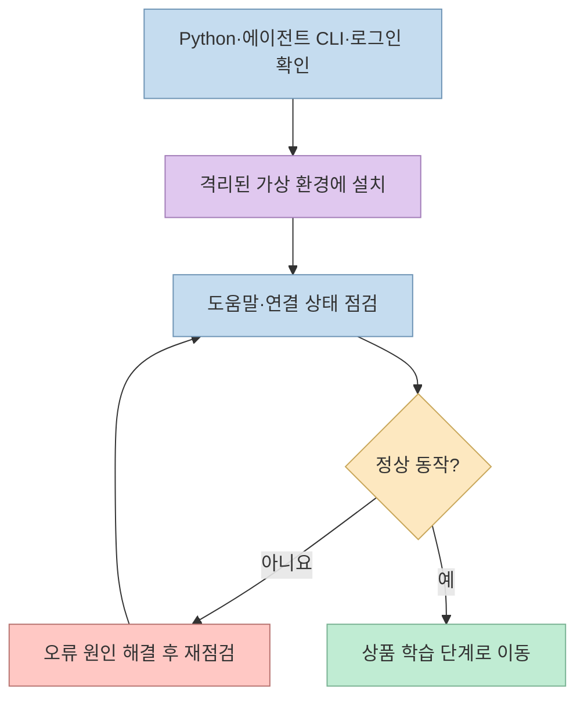
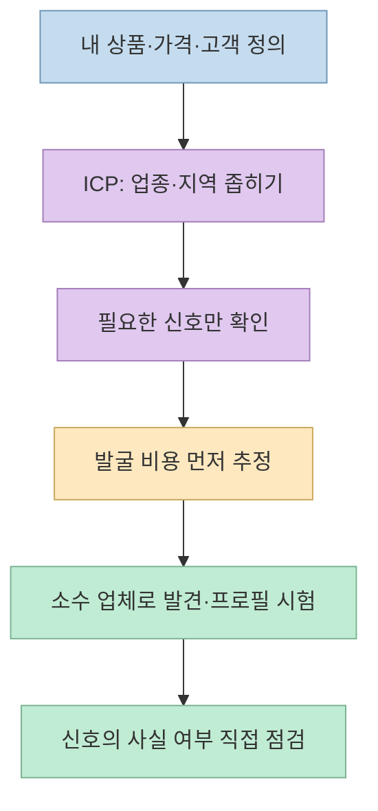
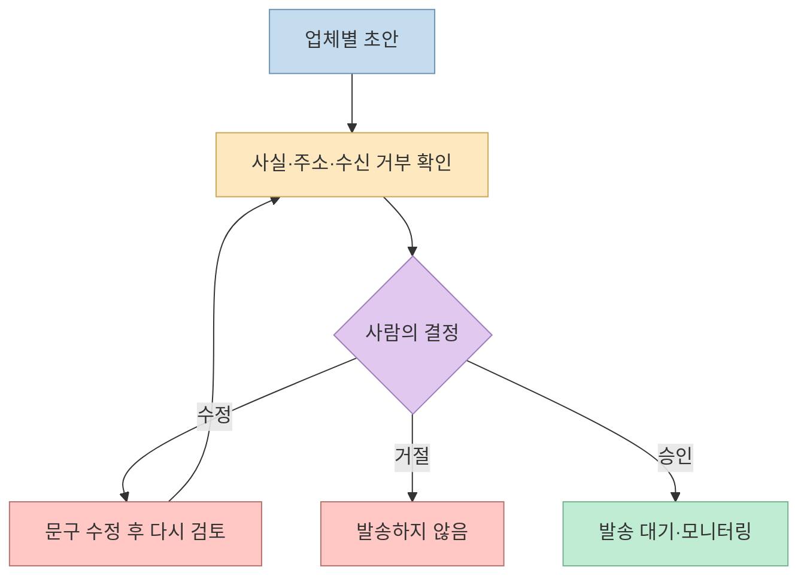
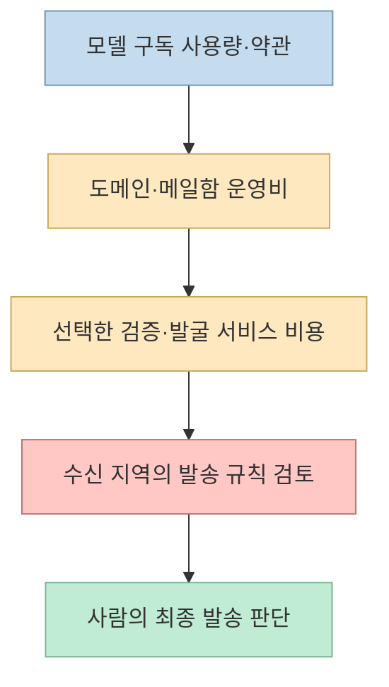

잠재 고객을 찾고 맞춤 영업 메일을 작성하는 작업을 자동화하고 싶다면, [게으른 빌더의 Harvey 설정 가이드](https://lazyowen.com/guides/claude-harvey-sales-agent)는 따라 하기 쉬운 출발점이다. 다만 **"에이전트가 초안을 쓴다"와 "내 이름으로 메일이 발송된다" 사이에는 승인·비용·법규의 경계** 가 있다. 공식 저장소와 대조해 그 경계를 중심으로 읽어 보자. 이 글은 Harvey를 직접 설치하거나 메일을 발송한 사용 후기가 아니다.

<!--more-->

## Sources

- [원본 가이드: 고객 유치만을 위한 클로드 에이전트 세팅하는 법](https://lazyowen.com/guides/claude-harvey-sales-agent)
- [Harvey 공식 README](https://github.com/ethanplusai/harvey) — 요구 사항, 명령, 신호, 승인과 발송 구조
- [Harvey 공식 변경 기록](https://github.com/ethanplusai/harvey/blob/main/CHANGELOG.md) — 버전 변화를 확인할 곳
- [미국 FTC의 CAN-SPAM 사업자 안내](https://www.ftc.gov/business-guidance/resources/can-spam-act-compliance-guide-business) — 미국 상업 이메일의 기본 요구사항
- [KISA 불법스팸대응센터](https://spam.kisa.or.kr/spam/main.do) — 국내 광고성 정보 관련 공식 안내

원본은 **Claude Code를 쓰는 해외 업체 대상 영업** 을 전제로 한 실습 가이드다. 아래에서 다른 제공자나 국가를 언급할 때는 원본의 약속이 아니라 **현재 공식 README에 추가로 있는 선택지 또는 별도 검토 사항** 임을 구분했다.

## 1. Harvey는 어떤 일을 자동화하나

[공식 README](https://github.com/ethanplusai/harvey#what-harvey-actually-does)에 따르면 Harvey는 로컬 컴퓨터에서 기본 **15분 간격의 하트비트** 로 움직인다. 예산과 휴식 시간을 확인한 다음 답장 처리, 발송 대기, 새 메일 작성, 잠재 고객 발굴 중 할 일을 정하고 기록한다. 그 사이 잠재 고객의 사이트를 읽어 구체적 관찰을 모으고, 연락처를 확인해 메일 초안을 만든다. 이 주기와 순서는 프로젝트의 설계 설명이지 **자동으로 좋은 고객을 찾거나 미팅을 성사시킨다는 보장** 은 아니다.

기본 설정에서 모든 발신 메일은 **사람의 승인** 을 기다린다. 이 점이 중요하다. 공식 문서는 한꺼번에 승인하는 명령도 제공하지만, 첫 실행에서 이를 쓰면 업체별 사실과 주소 검증 상태를 살피는 안전장치를 스스로 건너뛰게 된다. 선택적으로 자동 발송 모드를 켤 수 있으므로, "기본 승인제"를 "절대 자동 발송 불가"로 오해해서도 안 된다. [Harvey README의 승인 모드](https://github.com/ethanplusai/harvey#nothing-sends-without-you)

## 2. 설치는 실행보다 환경 확인이 먼저다

원본 가이드는 `python3.13`으로 가상 환경을 만들도록 안내한다. **현재 공식 최소 요구는 Python 3.11 이상** 이다. 가이드가 3.13을 지정한 것은 특히 macOS의 기본 `python3`이 오래된 버전일 수 있어서, 실제로 사용할 인터프리터를 명확히 고르는 실무적 방법이다. 설치 전에는 `python3 --version`, 선택한 Python 실행 파일, Claude Code 로그인 상태를 확인해야 한다. Codex를 쓰려면 별도의 공식 요구 버전과 로그인 조건을 확인해야 한다. [Harvey README의 요구 사항·빠른 시작](https://github.com/ethanplusai/harvey#quick-start)

가이드의 설치 흐름은 저장소를 복제한 뒤 전용 `.venv`에 `pip install -e .`로 설치하는 방식이다. 설치 여부는 `harvey --help`와 `harvey status --check`로 확인한다. 이는 **내 컴퓨터에 새 코드를 설치하는 작업** 이므로 프로젝트 위치, 설치 명령, 권한을 먼저 읽고 실행해야 한다. 여기서는 사용자의 컴퓨터에서 해당 명령을 실행하지 않았다. [원본 설치 단계](https://lazyowen.com/guides/claude-harvey-sales-agent), [공식 빠른 시작](https://github.com/ethanplusai/harvey#quick-start)

## 3. 상품을 가르친 뒤 어떤 고객을 찾을지 정한다

`harvey train <상품 사이트 URL>`은 사이트를 바탕으로 상품과 대상 고객 정보를 채우는 단계다. 공식 README에 따르면 학습은 `harvey.local.yaml`의 상품·타기팅 설정과 상품 지식 파일 등을 갱신한다. 이후 **ICP(이상적 고객 프로필)** 의 업종·지역을 실제 판매 범위에 맞게 고쳐야 한다. 상품 설명이 빈약한 단일 글을 넣으면 에이전트가 무엇을 판매하는지 충분히 알기 어렵다는 원본 가이드의 조언은 타당한 실무 기준이다. 자동 추출된 가격·효능·고객 사례는 발송 전에 원본 사이트와 대조해야 한다. [원본 STEP 3](https://lazyowen.com/guides/claude-harvey-sales-agent), [Harvey README의 설정](https://github.com/ethanplusai/harvey#configuration)

원본은 고객을 판별하는 **신호 23개** 를 설명하지만, 확인한 공식 README는 **29개 신호 중 무료 26개** 를 안내한다. 이는 문서 시점에 따른 차이로 보이며, 실제 선택지는 설치한 버전의 `harvey signals` 출력에서 확인해야 한다. **신호는 사용자가 확정하기 전에는 수집하지 않는다** 는 원칙은 양쪽 설명이 같다. 예를 들어 `NO_WEBSITE`는 홈페이지가 없는 업체를, `NO_ONLINE_BOOKING`은 온라인 예약이 없는 업체를 구분한다. 후자가 모든 업체에 곧바로 판매 기회라는 뜻은 아니며 내 상품이 그 문제를 실제로 해결해야 한다. [Harvey README의 신호 목록](https://github.com/ethanplusai/harvey#you-confirm-what-it-looks-for)

공식 README는 기본 OpenStreetMap 발굴을 무료로 설명하지만, **웹사이트가 없는 일부 업종·서비스 지역 업체의 포괄성은 낮을 수 있다** 고 경고한다. 결과가 적다고 무조건 신호를 늘리거나 유료 제공자를 켜지 말고, 먼저 `harvey discover --estimate`로 비용을 보고 소수 업체에서 `harvey profile` 결과를 검토하는 순서가 적절하다. 주소가 `guess`나 `risky`인지 `verified`인지도 분리해 봐야 한다. [Harvey README의 발굴 단계](https://github.com/ethanplusai/harvey#the-prospecting-pipeline)

## 4. 메일함 연결 뒤에도 사람이 결정해야 한다

원본 가이드는 발송용 도메인과 메일함을 마련하고 Gmail API 인증, 주소 검증 키, `compliance.postal_address`를 설정한 다음 `harvey warmup`으로 발송 준비를 확인하는 순서를 설명한다. 공식 README는 Gmail 외에도 Microsoft 365와 SMTP를 지원한다. SPF·DKIM·DMARC, 도메인 상태, 반송률을 점검해도 **전달률이나 법규 준수를 자동 보증하는 것은 아니다**. 설정 파일 `.env`의 키와 대시보드 잠금 해제 토큰은 비밀로 다뤄야 한다. [원본 STEP 5](https://lazyowen.com/guides/claude-harvey-sales-agent), [Harvey README의 발송 준비](https://github.com/ethanplusai/harvey#legal-and-deliverability)

대시보드의 Outbox에서 각 초안의 **관찰 근거·수신 주소 상태·문장·수신 거부 안내** 를 확인하고 승인, 수정, 거절을 선택한다. 답장이 와도 응답 초안은 기본적으로 같은 승인 경로를 거친다. 계약·가격 약속이나 일정 확정처럼 에이전트가 임의로 결론을 내리기 어려운 대화는 사람이 직접 이어가는 편이 안전하다. 발송을 즉시 멈춰야 하면 `harvey sending pause`가 있고, 실행 루프 자체는 `Ctrl+C`로 중단한다. 단, 이미 외부 발송 서비스에 넘긴 작업까지 모두 되돌린다는 뜻은 아니므로 외부 발송 상태도 확인해야 한다. [Harvey README의 Outbox와 중지 명령](https://github.com/ethanplusai/harvey#nothing-sends-without-you)

## 5. "API 과금 없음"과 "비용 없음"은 다르다

원본은 Claude Pro·Max 구독을 이용하면 별도 모델 API 과금 없이 메일 초안을 만들 수 있다고 설명한다. 현재 공식 README도 **Claude Code를 기본**, **Codex를 선택적 제공자** 로 안내한다. 어느 쪽이든 모델 호출은 사용 중인 구독의 사용량과 제공자 약관에 영향을 받는다. 이 밖에 발송용 도메인·메일함, 선택한 주소 검증 서비스, 유료 고객 발굴 소스에 별도 비용이 들 수 있다. 따라서 "이메일 하나면 전부 무료"라는 문구를 **운영비가 0원이라는 보장** 으로 읽으면 안 된다. [Harvey README의 비용 설명](https://github.com/ethanplusai/harvey#how-much-does-it-cost), [원본 가이드](https://lazyowen.com/guides/claude-harvey-sales-agent)

법적 책임도 도구가 대신 지지 않는다. [미국 FTC의 CAN-SPAM 안내](https://www.ftc.gov/business-guidance/resources/can-spam-act-compliance-guide-business)는 상업 이메일의 정확한 발신 정보·제목, 유효한 우편 주소, 수신 거부 방법 등을 요구한다. 한국 수신자에게 광고성 정보를 보낼 때는 [KISA 불법스팸대응센터](https://spam.kisa.or.kr/spam/main.do)의 기준을 별도로 확인해야 한다. 수신자의 국가와 상황에 따라 적용 규칙이 다르므로, Harvey의 기본값이나 이 글만으로 적법성을 판단하지 말자. 대량 발송 전에는 담당 법률 전문가의 검토가 적절하다.

## 6. 원본 가이드에서 버전 차이로 다시 볼 부분

- **Python:** 원본은 3.13으로 진행하지만 현재 공식 최소 요구는 **3.11 이상** 이다. 다만 macOS에서는 잘못된 기본 `python3`으로 가상 환경을 만들지 않도록 실제 실행 버전을 확인해야 한다. [공식 요구 사항](https://github.com/ethanplusai/harvey#quick-start)
- **신호 수:** 원본의 **23개** 와 현재 README의 **29개(무료 26개)** 가 다르다. 설치한 버전의 `harvey signals`를 기준으로 삼는다. [공식 신호 안내](https://github.com/ethanplusai/harvey#you-confirm-what-it-looks-for)
- **모델 제공자:** 원본의 Claude Code 흐름은 유효하지만 현재 저장소는 **Codex를 선택적으로 지원** 한다. 전환은 공식 요구 버전·인증·격리 조건을 따로 확인해야 하며, 실패 시 자동으로 다른 제공자로 넘어가지 않는다. [공식 Codex 안내](https://github.com/ethanplusai/harvey#using-a-chatgpt-plan-instead-codex)
- **설치 점검 출력:** 원본이 예시로 든 특정 `Brain` 문구 하나에만 기대기보다 `harvey status --check`의 성공 여부와 설치 버전의 진단 메시지를 확인한다. [공식 문제 해결](https://github.com/ethanplusai/harvey#troubleshooting)

## 실전 적용 포인트

1. **발송 전에 샘플로 검증:** 상품 학습 → 무료 신호 확인 → 비용 추정 → 소수 업체 프로필까지만 먼저 확인한다.
2. **승인제를 유지:** 첫 캠페인에서는 일괄 승인이나 자동 발송을 켜지 않고 근거·주소·수신 거부 안내를 한 통씩 읽는다.
3. **비용과 권한을 따로 기록:** 구독 사용량, 메일함·도메인, 검증·발굴 서비스의 유료 전환 조건을 분리해 본다.
4. **발송 대상 국가를 먼저 정하기:** 지역별 광고성 이메일 규칙을 확인하고, 판단이 어려우면 발송하지 않은 채 전문가에게 검토를 요청한다.

## 핵심 요약

- Harvey는 고객 발굴·사이트 조사·초안 작성·답장 분류를 돕지만, **기본 발송 경로에는 사람의 승인** 이 있다.
- 원본 가이드와 현재 README 사이에는 **Python 설명, 신호 개수, 지원 모델 제공자** 의 차이가 있다.
- 모델 API 과금이 없더라도 구독 사용량과 메일·도메인·검증 서비스 비용, 그리고 발송자의 법적 책임은 남는다.

## 결론

Harvey를 도입할 때 가장 먼저 자동화할 것은 발송이 아니라 **고객 조건의 명확화와 사실 확인** 이다. 작은 후보 집합에서 신호·초안을 검증하고, 승인제와 중지 수단을 유지한 뒤, 비용과 수신자 지역의 규칙을 확인해야 한다. "자동 영업"보다 **사람이 통제하는 영업 보조 도구** 로 시작하는 편이 안전하다.
