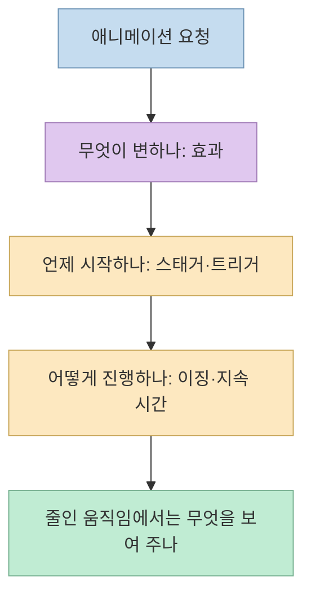
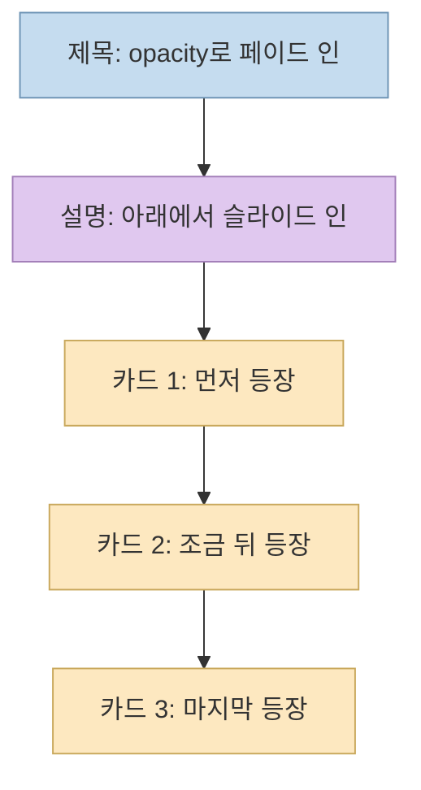
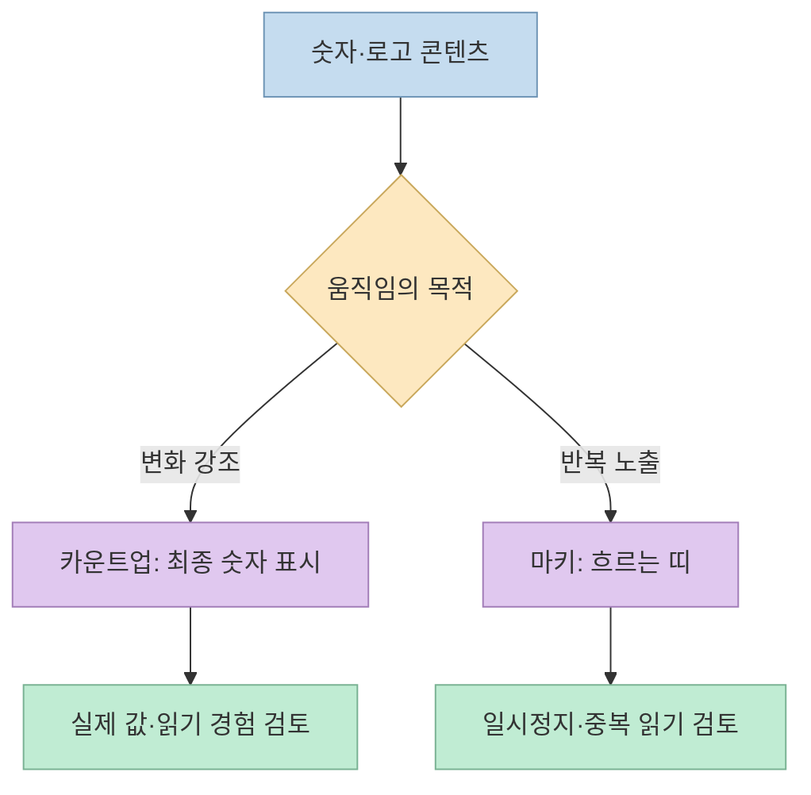
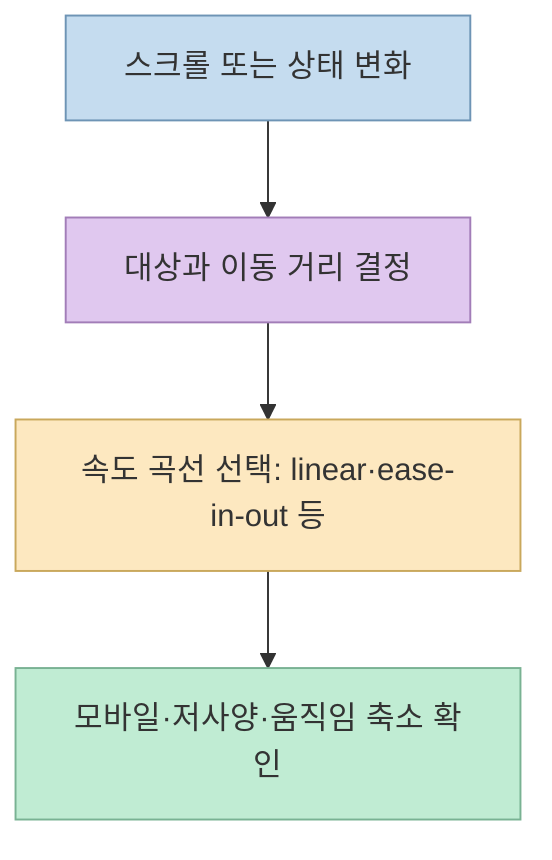
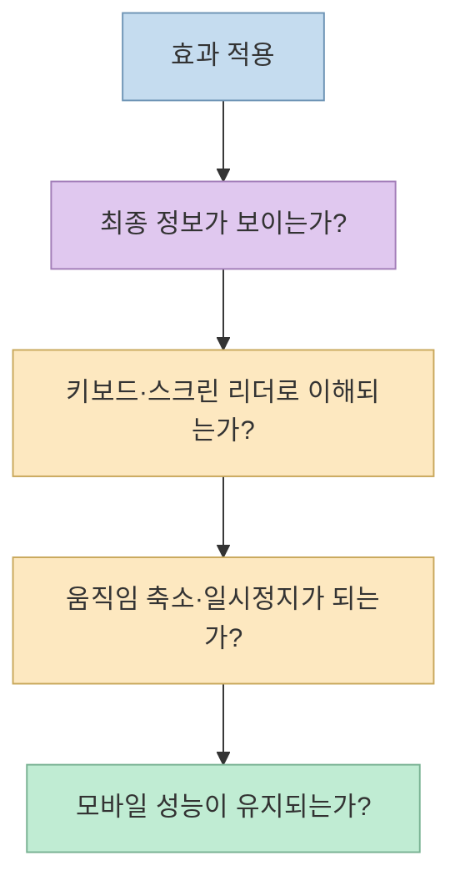

AI로 웹사이트를 만들 때 "좀 움직이게 해줘"라고 하면 결과가 막연해지기 쉽다. [Threads 영상](https://www.threads.com/share/_g3IU4f4F/)은 **페이드 인, 마키, 카운트업, 스태거, 패럴랙스, 슬라이드 인, 이징**이라는 일곱 용어를 짧은 화면 예시로 보여 준다. 이 이름을 아는 것보다 중요한 일은 **무엇이 움직이고, 언제 시작하며, 어떤 속도로 끝나고, 움직임을 줄여야 할 때 무엇을 보여 줄지** 함께 정하는 것이다.

<!--more-->

## Sources

- [원본 Threads 게시물과 첨부 영상](https://www.threads.com/share/_g3IU4f4F/) — 7가지 용어와 예시 문구
- [MDN: CSS 애니메이션 사용법](https://developer.mozilla.org/en-US/docs/Web/CSS/CSS_Animations/Using_CSS_animations), [`animation-delay`](https://developer.mozilla.org/en-US/docs/Web/CSS/animation-delay), [`animation-timing-function`](https://developer.mozilla.org/en-US/docs/Web/CSS/animation-timing-function)
- [MDN: `requestAnimationFrame()`](https://developer.mozilla.org/en-US/docs/Web/API/Window/requestAnimationFrame), [Intersection Observer API](https://developer.mozilla.org/en-US/docs/Web/API/Intersection_Observer_API)
- [MDN: `<marquee>` 요소](https://developer.mozilla.org/en-US/docs/Web/HTML/Element/marquee), [`prefers-reduced-motion`](https://developer.mozilla.org/en-US/docs/Web/CSS/@media/prefers-reduced-motion)
- [web.dev: 고성능 애니메이션](https://web.dev/articles/animations-guide), [W3C: 움직이는 콘텐츠의 일시정지·중지](https://www.w3.org/WAI/WCAG22/Understanding/pause-stop-hide.html), [W3C: 상호작용으로 시작되는 애니메이션](https://www.w3.org/WAI/WCAG22/Understanding/animation-from-interactions.html)

원본은 짧은 소개 영상이므로 아래의 CSS·JavaScript·접근성 설명은 **웹 플랫폼 문서를 바탕으로 보강한 구현 가이드** 다. 특정 라이브러리나 프레임워크가 원본 영상에서 추천됐다는 뜻은 아니다.

## 1. 먼저 일곱 용어를 세 종류로 나누기

영상의 일곱 이름은 모두 같은 차원의 효과가 아니다. **페이드 인·슬라이드 인·마키·카운트업·패럴랙스** 는 화면에서 *무엇이 변하는지*를 말한다. **스태거** 는 여러 요소가 *어떤 순서와 간격으로 시작하는지*, **이징** 은 한 요소가 *진행하는 동안 얼마나 빨라지고 느려지는지*를 말한다. 따라서 "카드는 슬라이드 인, 각 카드 시작은 스태거, 이동 곡선은 ease-out"처럼 조합할 수 있다. [원본 영상](https://www.threads.com/share/_g3IU4f4F/), [MDN의 애니메이션 속성 설명](https://developer.mozilla.org/en-US/docs/Web/CSS/CSS_Animations/Using_CSS_animations)

## 2. 페이드 인·슬라이드 인·스태거: 등장 방식을 지정한다

**페이드 인(fade-in)** 은 투명도 `opacity`를 0에서 1로 높여 요소가 서서히 보이게 한다. 영상에서는 제목에 쓰는 예를 보여 준다. **슬라이드 인(slide-in)** 은 요소를 한 방향에서 제자리로 이동시켜 등장시킨다. 영상의 설명 박스처럼 아래에서 올라오는 경우라면 `transform: translateY(...)`를 제자리로 되돌리는 식이다. 두 효과는 함께 쓸 수도 있지만, 그때는 "제목은 투명도만, 설명 박스는 아래에서 조금 이동하며 등장"처럼 요소별로 구분해 요청해야 과한 움직임을 막을 수 있다. [원본 영상](https://www.threads.com/share/_g3IU4f4F/), [MDN CSS 애니메이션](https://developer.mozilla.org/en-US/docs/Web/CSS/CSS_Animations/Using_CSS_animations)

**스태거(stagger)** 는 리스트나 카드가 동시에 나타나지 않고 일정한 시간차로 시작하는 구성이다. 영상은 항목 간 **0.15초** 간격을 예시로 든다. CSS에서는 같은 애니메이션에 요소별 `animation-delay`를 다르게 주는 방식이 가능하다. 단, 항목이 많으면 마지막 카드가 너무 늦게 보일 수 있으므로 목록 길이에 맞춰 간격과 전체 대기 시간을 검토해야 한다. 이는 영상의 수치를 모든 페이지에 그대로 적용하라는 뜻이 아니다. [원본 영상](https://www.threads.com/share/_g3IU4f4F/), [MDN `animation-delay`](https://developer.mozilla.org/en-US/docs/Web/CSS/animation-delay)

구현을 요청할 때는 **등장 전에도 중요한 텍스트가 사라진 채로 남지 않도록** 조건을 덧붙이자. 예컨대 JavaScript로 뷰포트 진입을 감지하는 경우, 스크립트가 실패해도 본문은 읽혀야 한다. [Intersection Observer](https://developer.mozilla.org/en-US/docs/Web/API/Intersection_Observer_API)는 요소의 뷰포트 진입을 관찰하는 방법이지, 애니메이션이나 접근성을 자동으로 완성해 주는 도구는 아니다.

## 3. 카운트업·마키: 숫자와 반복 콘텐츠를 움직인다

**카운트업(count-up)** 은 통계 숫자가 0 또는 다른 시작값에서 실제 값까지 올라가는 효과다. 영상에서는 "성과 숫자에 카운트업"을 요청하는 예를 보여 준다. 숫자 자체가 바뀌므로 CSS의 위치·투명도 애니메이션만으로 끝나지 않는다. JavaScript로 표시값을 갱신한다면 [MDN의 `requestAnimationFrame()` 설명](https://developer.mozilla.org/en-US/docs/Web/API/Window/requestAnimationFrame)처럼 프레임마다 호출하면서 **시간값을 기준으로 진행률** 을 계산해야 화면 주사율에 따라 속도가 달라지지 않는다. 숫자가 의미의 핵심이라면 최종 값을 처음부터 문서 데이터로 보유하고, 애니메이션은 표시 방식으로만 다루는 편이 안전하다.

**마키(marquee)** 는 로고나 문구가 한 방향으로 계속 흐르는 효과다. 영상은 로고 띠를 예로 든다. 여기서 말하는 것은 **시각 효과의 이름** 이지, 옛 HTML `<marquee>` 요소를 쓰라는 뜻이 아니다. MDN은 그 요소를 더 이상 새 프로젝트에 사용하지 말고 CSS 애니메이션과 `transform`을 고려하라고 안내한다. 로고가 반복될 때 스크린 리더에 같은 이름이 중복해서 읽히지 않는지도 확인해야 한다. [원본 영상](https://www.threads.com/share/_g3IU4f4F/), [MDN `<marquee>`](https://developer.mozilla.org/en-US/docs/Web/HTML/Element/marquee)

## 4. 패럴랙스·이징: 스크롤 반응과 속도감을 조절한다

**패럴랙스(parallax)** 는 스크롤할 때 배경과 전경이 서로 다른 속도로 움직여 깊이감을 주는 효과다. 영상 역시 배경이 콘텐츠보다 느리게 움직이는 장면을 보여 준다. 이는 스크롤 이벤트에 무조건 큰 이미지를 계속 다시 그리라는 뜻이 아니다. 구현 방식은 CSS의 스크롤 기반 애니메이션이나 JavaScript 등으로 달라질 수 있으며, 지원 브라우저와 작은 화면에서의 동작을 확인해야 한다. [원본 영상](https://www.threads.com/share/_g3IU4f4F/), [MDN 스크롤 기반 애니메이션](https://developer.mozilla.org/en-US/docs/Web/CSS/CSS_scroll-driven_animations)

**이징(easing)** 은 움직임의 처음부터 끝까지 진행률이 시간에 따라 바뀌는 규칙이다. 영상은 같은 거리와 시간을 이동해도 `linear`는 일정한 속도, `ease-in-out`은 출발과 도착이 완만한 예를 비교한다. CSS에서는 `animation-timing-function`이나 전환의 타이밍 함수로 지정한다. 이징은 슬라이드 인 같은 **이동 효과에 적용하는 속도 곡선** 이지 독립적인 화면 요소가 아니다. 버튼 반응처럼 즉시성이 중요한 곳에 무조건 느린 곡선을 적용하면 사용자가 지연으로 느낄 수 있으므로 목적에 맞게 고른다. [원본 영상](https://www.threads.com/share/_g3IU4f4F/), [MDN 타이밍 함수](https://developer.mozilla.org/en-US/docs/Web/CSS/animation-timing-function)

## 5. AI에 요청할 때는 효과 이름 뒤에 검수 조건을 붙인다

아래는 영상의 예시를 조합한 **요청 문장 예시** 다. 특정 도구의 전용 문법이 아니라 어떤 AI 코딩 도구에도 전달할 수 있는 자연어 요구사항이다.

> 첫 화면의 제목만 페이드 인으로 등장시키고, 설명 박스는 아래에서 짧게 슬라이드 인해 주세요. 카드 세 개는 순서대로 등장시키되 카드 사이 시작 간격은 0.15초를 기준으로 조정해 주세요. 성과 숫자는 최종 값이 정확히 표시되도록 카운트업하고, 로고 띠는 일시정지할 수 있게 해 주세요. 이동에는 완만한 이징을 쓰고, `prefers-reduced-motion`을 선택한 사용자는 주요 정보를 움직임 없이 즉시 볼 수 있게 해 주세요. 모바일에서 가로 넘침과 스크롤 끊김도 확인해 주세요.

좋은 요청에는 **대상, 효과, 시작 조건, 종료 상태, 움직임을 줄인 대체 상태, 검수 기준** 이 함께 있다. 원본의 일곱 용어만 나열하면 AI가 페이지 전체에 같은 효과를 과도하게 적용할 수 있다. 페이드 인과 슬라이드 인은 필요한 요소에만, 패럴랙스는 장식적 배경에만 쓰는 식으로 범위를 좁히는 편이 낫다. 이는 영상에서 제시한 기능과 웹 문서의 제약을 결합한 **실무적 제안** 이다.

## 6. 성능과 접근성에서 마지막으로 걸러야 한다

애니메이션은 보기 좋더라도 내용 전달을 방해할 수 있다. [web.dev의 성능 가이드](https://web.dev/articles/animations-guide)는 가능하면 `opacity`와 `transform`처럼 합성 단계에서 처리하기 쉬운 속성을 우선하고, 다른 속성을 바꿀 때는 렌더링 비용을 측정하라고 권한다. 무작정 `will-change`를 모든 요소에 붙이는 것 역시 권하지 않는다. 특히 여러 요소의 스태거와 스크롤 패럴랙스를 한 화면에 겹치면 실제 기기에서 부드러운지 확인해야 한다.

[W3C의 일시정지·중지 지침](https://www.w3.org/WAI/WCAG22/Understanding/pause-stop-hide.html)은 자동으로 시작해 **5초 넘게 계속 움직이며 다른 콘텐츠와 함께 보이는** 요소에는 사용자가 멈추거나 숨길 수 있는 방법을 요구한다. 무한 마키가 대표적인 점검 대상이다. [상호작용 애니메이션 지침](https://www.w3.org/WAI/WCAG22/Understanding/animation-from-interactions.html)은 패럴랙스처럼 스크롤에 따라 추가로 움직이는 장식이 일부 사용자에게 불편을 줄 수 있다고 설명한다. [`prefers-reduced-motion`](https://developer.mozilla.org/en-US/docs/Web/CSS/@media/prefers-reduced-motion)을 존중하고, 효과가 꺼져도 텍스트·숫자·버튼은 그대로 접근 가능해야 한다.

## 실전 적용 포인트

1. **한 화면에 주역 하나만:** 제목, 숫자, 카드 중 어디에 시선을 모을지 먼저 정한다.
2. **용어를 조합하되 역할을 구분:** 효과(슬라이드 인), 순서(스태거), 속도(이징)를 별도 요구사항으로 적는다.
3. **반복 움직임에는 제어 제공:** 마키를 쓰면 멈춤 수단과 움직임 축소 상태를 검토한다.
4. **최종 정보는 애니메이션과 독립:** 카운트업이 실패해도 실제 숫자가 보이고, 등장 효과가 꺼져도 콘텐츠가 읽혀야 한다.

## 핵심 요약

- 영상의 일곱 용어는 **페이드 인·마키·카운트업·스태거·패럴랙스·슬라이드 인·이징** 이다.
- 페이드 인·마키·카운트업·패럴랙스·슬라이드 인은 화면 변화의 종류, 스태거는 시작 간격, 이징은 진행 속도의 형태를 지정한다.
- AI에 효과 이름만 주지 말고 **대상·시작 조건·종료 상태·접근성·성능 검수** 를 함께 요청한다.

## 결론

웹 애니메이션의 목표는 화면을 계속 움직이게 만드는 것이 아니라 **정보의 순서와 상태 변화를 더 쉽게 이해시키는 것** 이다. 일곱 용어를 정확히 쓰되, 움직이지 않는 상태에서도 같은 정보를 얻을 수 있게 설계하면 AI에 주는 요청도 훨씬 선명해진다.
