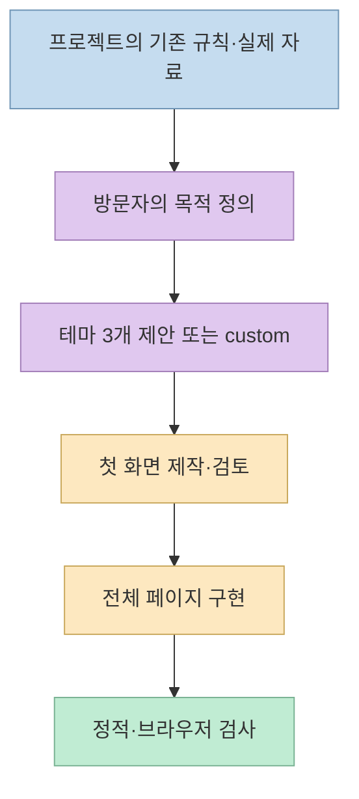
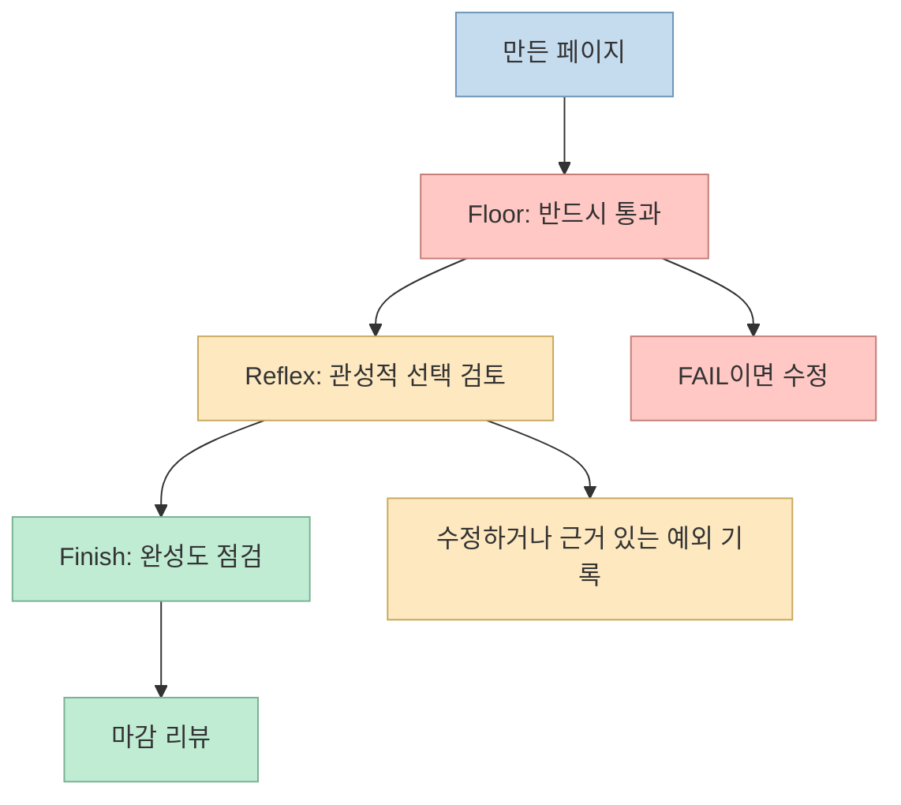
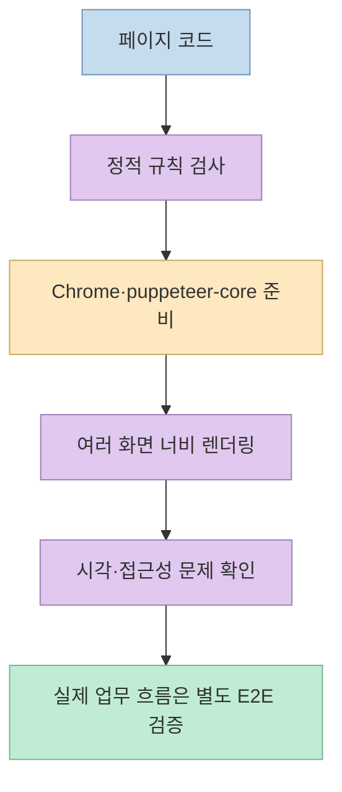

"AI가 만든 웹사이트는 왜 다 비슷할까?" [Threads 글](https://www.threads.com/share/BAYGmvhRZ7/)은 **Hallmark**를 그 문제의 해법으로 소개한다. 공식 저장소를 확인하면 Hallmark는 웹사이트를 대신 호스팅하는 서비스가 아니라, Claude Code·Codex·Cursor 같은 코딩 에이전트가 **페이지를 설계·구현·검사할 때 읽는 디자인 스킬과 검사 스크립트**다. 핵심은 테마 선택만이 아니라, 방문자의 목적에 맞는 구성과 실제 렌더링 결과를 함께 검토하는 흐름이다. [Hallmark README](https://github.com/Nutlope/hallmark)

<!--more-->

## Sources

- [원본 Threads 공유 글](https://www.threads.com/share/BAYGmvhRZ7/) — 50개 테마, 상투적 레이아웃 검사, 브라우저 점검, 리디자인, 설치 명령을 소개한 게시물. 원문은 공개 페이지에서 직접 추출했다.
- [Hallmark 공식 저장소](https://github.com/Nutlope/hallmark) — 현재 기능, 설치·실행 조건, 라이선스.
- [Hallmark 스킬 원문](https://github.com/Nutlope/hallmark/blob/main/skills/hallmark/SKILL.md) — 강제 규칙과 제작 흐름.
- [Hallmark 로드맵](https://github.com/Nutlope/hallmark/blob/main/ROADMAP.md) — 현재 브라우저 검사 범위와 아직 계획 단계인 기능.

## 1. "AI 티"를 줄이는 방식: 테마보다 먼저 페이지의 목적을 잡는다

원문은 "50가지 디자인 테마"를 장점으로 꼽는다. 현재 공식 README도 **50개 테마 중 3개를 제안**하고 하나를 선택하는 흐름을 설명한다. 다만 테마는 완성된 랜딩 페이지 50개를 복사하는 템플릿이 아니다. 종이·색·타이포그래피·표면·컴포넌트 같은 **시각 재료**를 고르고, 페이지의 섹션과 동선은 방문자가 실제로 하려는 일에 맞춰 구성한다. 예약 페이지라면 예약, 상점이라면 구매라는 행동을 중심에 놓는 식이다. 브랜드 맥락에 맞는 방향을 직접 요청하는 **custom** 경로도 있다. [Hallmark README의 Themes·Custom·How a build runs](https://github.com/Nutlope/hallmark#themes)

이 구분이 중요한 이유는 색과 글꼴만 바꾸면 구조는 여전히 똑같을 수 있기 때문이다. Hallmark는 프로젝트의 기존 디자인 시스템·글꼴·색상·프레임워크를 먼저 읽고, 사용할 사진·스크린샷·실제 수치 같은 자료를 확인하도록 지시한다. 이어 첫 화면을 먼저 만들고 검토한 후 나머지를 확장한다. **테마 → 즉시 전체 페이지 생성**이 아니라 **프로젝트 확인 → 목적·재료 선택 → 첫 화면 검토 → 전체 구현**에 가깝다. [Hallmark README](https://github.com/Nutlope/hallmark#how-a-build-runs), [스킬의 Pre-flight·Flow](https://github.com/Nutlope/hallmark/blob/main/skills/hallmark/SKILL.md)

## 2. 검사 기준은 한 덩어리가 아니다: Floor·Reflex·Finish

공식 문서는 규칙을 **Floor, Reflex, Finish**로 나눈다. Floor는 대비·키보드 포커스·동작 줄이기 설정·모바일 레이아웃·지어낸 수치 같은, 결과를 넘기기 전에 반드시 해결해야 할 항목이다. 스킬 원문에는 `transition: all`을 쓰지 않기, 모든 상호작용 요소에 `:focus-visible`을 제공하기, `prefers-reduced-motion` 대안을 마련하기, 근거 없는 지표·후기를 만들지 않기 같은 구체적 요구가 있다. [Hallmark README의 게이트 설명](https://github.com/Nutlope/hallmark), [Hallmark SKILL.md의 Floor](https://github.com/Nutlope/hallmark/blob/main/skills/hallmark/SKILL.md)

Reflex는 AI가 자주 택하는 **상투적 기본값**을 지적하지만, 페이지에 타당한 이유가 있다면 그 이유를 기록하고 예외를 둘 수 있다. Finish는 완성도를 높이는 세부 점검으로, 공식 설명에서는 배포를 막는 게이트가 아니다. 즉 "보라색 그라데이션을 발견하면 무조건 실패" 같은 단순한 금칙어 목록이 아니라 **반드시 지킬 기준, 설명 가능한 예외, 마감 품질**을 구분하는 구조다. [Hallmark README](https://github.com/Nutlope/hallmark), [Hallmark SKILL.md](https://github.com/Nutlope/hallmark/blob/main/skills/hallmark/SKILL.md)

## 3. "실제 브라우저 검사"는 무엇을 확인하고 무엇을 보장하지 않나

Threads는 모바일 화면과 작동하지 않는 버튼까지 검사한다고 소개한다. 공식 README의 제작 흐름은 `scripts/sloplint.mjs --render`로 **8개 화면 너비**에서 페이지를 검사하고, 별도의 새로운 맥락을 가진 리뷰가 마무리한다고 설명한다. 로드맵은 실제 렌더링 단계에서 첫 화면의 접힘 위치, 텍스트와 배경의 대비, 키보드 포커스, 섹션 간격, 사진 비율, 겹치거나 좁아진 텍스트 등을 측정한다고 구체화한다. 정적 코드 검사만으로 알기 어려운 문제를 화면에서 확인하려는 방식이다. [Hallmark README](https://github.com/Nutlope/hallmark#how-a-build-runs), [Hallmark ROADMAP](https://github.com/Nutlope/hallmark/blob/main/ROADMAP.md)

**중요한 조건:** README에 따르면 설치 명령만 실행한 상태에서도 정적 검사는 가능하지만, `--render`와 스크린샷 기반 검사에는 **Chrome과 전역 `puppeteer-core` 설치**가 추가로 필요하다. 따라서 "설치하면 언제나 실제 브라우저까지 자동 검사"로 받아들이면 안 된다. 또한 링크·폼 필드·핸들러가 남아 있는지 확인하는 것과, 결제나 예약이 외부 서버까지 정상 완료되는지를 검증하는 것은 다르다. 후자는 실제 서비스의 E2E 테스트와 사람의 확인이 별도로 필요하다. [Hallmark README의 Install·Redesign](https://github.com/Nutlope/hallmark#install), [Hallmark ROADMAP](https://github.com/Nutlope/hallmark/blob/main/ROADMAP.md)

## 4. 새 페이지와 기존 페이지는 경로가 다르다

Hallmark의 기본 제작 흐름은 **새 페이지**를 대상으로 한다. 기존 화면을 바꿀 때는 대상을 명시해 `/hallmark redesign <path>`를 사용하고, 바꾸지 않고 진단만 하려면 `/hallmark audit <path>`를 쓴다. 공식 설명은 리디자인 전에 링크·폼 필드·핸들러·제목을 기록하고, 이후 누락 여부를 검사한다고 밝힌다. 따라서 단순한 색상 교체가 아니라 **내용과 연결을 보존하면서 시스템과 레이아웃을 다시 만드는 작업**으로 이해하는 편이 정확하다. [Hallmark README의 Redesign](https://github.com/Nutlope/hallmark#redesign), [Hallmark ROADMAP](https://github.com/Nutlope/hallmark/blob/main/ROADMAP.md)

다만 "기존 기능을 보존한다"는 프로젝트의 검사 목표이지, 모든 애플리케이션의 동작을 자동 증명한다는 뜻은 아니다. 복잡한 SPA, 인증·결제, 반응형 상태, 숨겨진 조건부 UI는 원래 프로젝트의 테스트가 필요하다. 특히 공식 로드맵의 **다중 페이지 일관성, 라이브 프리뷰 MCP, 더 깊은 앱 화면 검사**는 현재 완성 기능이 아니라 후속 계획으로 구분해야 한다. [Hallmark ROADMAP](https://github.com/Nutlope/hallmark/blob/main/ROADMAP.md)

## 5. 설치와 숫자를 읽을 때의 주의점

원문이 제시한 설치 명령 `npx skills add nutlope/hallmark -g`는 공식 README와 일치한다. `-g`는 모든 프로젝트에서 쓰도록 설치하는 옵션이며, 생략하면 현재 프로젝트에 설치한다. README는 **Node.js 18 이상**을 요구하고, 브라우저 기반 점검을 하려면 Chrome과 `npm i -g puppeteer-core`가 추가로 필요하다고 적는다. 설치 후에는 사용 중인 에이전트에서 Hallmark를 명시적으로 호출하거나, 새 페이지 제작 요청에 스킬이 선택되는지 확인해야 한다. 이 글은 설치 명령을 안내할 뿐, 독자의 환경에서 실행한 설치 성공 사례는 아니다. [Hallmark README의 Install](https://github.com/Nutlope/hallmark#install)

Threads 게시물의 "GitHub 스타 3.8만 개"는 게시 시점의 수치다. 이 글을 작성하며 확인한 공식 저장소 화면에는 **약 3.95만 개**가 표시됐다. 별 수는 계속 바뀌므로 기능이나 품질의 검증 지표로 취급하지 않는 편이 낫다. 또한 이전에 작성한 [AI 디자인 도구 비교 글](/post/2026/10/2026-10-25-github-trending-five-design-agent-robot-fact-check/)에는 당시 README 기준 **48개 테마**라고 적혀 있지만, **현재 README는 50개**라고 설명한다. 버전별 수치를 섞어 읽지 않아야 한다. [Hallmark 공식 저장소](https://github.com/Nutlope/hallmark)

Hallmark 본체는 **MIT 라이선스**로 공개돼 있다. 다만 README에 소개된 사진 라이브러리는 사진마다 CC0·퍼블릭 도메인·CC BY·CC BY-SA 등 **개별 라이선스**가 적용된다. 생성 결과에 쓴 사진·로고·폰트의 권리는 별도로 점검해야 한다. [Hallmark README의 Licence](https://github.com/Nutlope/hallmark#licence)

## 실전 적용 포인트

1. 먼저 **새 화면 제작인지, 기존 화면 진단인지, 리디자인인지** 정한다. 기존 페이지를 아무 설명 없이 바꾸도록 요청하지 말고 대상 경로와 보존할 기능을 적는다. [Hallmark README](https://github.com/Nutlope/hallmark#redesign)
2. 제품의 실제 사진·스크린샷·문구·수치, 사용자와 핵심 행동을 제공한다. 근거 없는 후기·수치를 채우지 않도록 하는 Floor 규칙과도 맞는다. [Hallmark SKILL.md](https://github.com/Nutlope/hallmark/blob/main/skills/hallmark/SKILL.md)
3. 정적 검사와 `--render` 검사 결과를 구분한다. 브라우저 환경을 준비한 후 모바일·데스크톱에서 직접 확인하고, 로그인·결제·폼 제출 같은 핵심 흐름은 별도의 테스트로 끝까지 점검한다. [Hallmark README](https://github.com/Nutlope/hallmark#install), [Hallmark ROADMAP](https://github.com/Nutlope/hallmark/blob/main/ROADMAP.md)

## 핵심 요약

- Hallmark v2는 **50개 시각 테마**를 제공하지만, 완성 페이지를 골라 붙이는 템플릿 모음은 아니다. 방문자의 목적과 기존 프로젝트 맥락을 먼저 반영한다. [공식 README](https://github.com/Nutlope/hallmark)
- **Floor·Reflex·Finish**로 필수 기준, 설명 가능한 기본값 검토, 마감 품질을 구분한다. `sloplint --render`에는 별도 브라우저 환경이 필요하다. [공식 README](https://github.com/Nutlope/hallmark), [스킬 원문](https://github.com/Nutlope/hallmark/blob/main/skills/hallmark/SKILL.md)
- 기존 디자인은 명시적으로 `audit` 또는 `redesign` 경로를 선택한다. 자동 검사가 제품의 모든 실제 동작과 미적 성공을 보장하는 것은 아니다. [공식 README](https://github.com/Nutlope/hallmark#redesign)

## 결론

Hallmark의 실용적 가치는 "AI 티를 없애는 마법 버튼"보다 **목적 중심 설계와 검증 가능한 디자인 규칙을 코딩 에이전트의 작업 흐름에 넣는 것**에 있다. 테마를 고른 뒤에도 실제 자료를 제공하고, 브라우저 결과와 서비스 기능을 사람이 확인해야 비슷비슷한 화면에서 한 단계 더 나아갈 수 있다.
