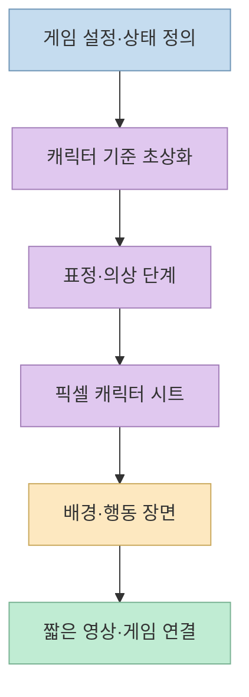
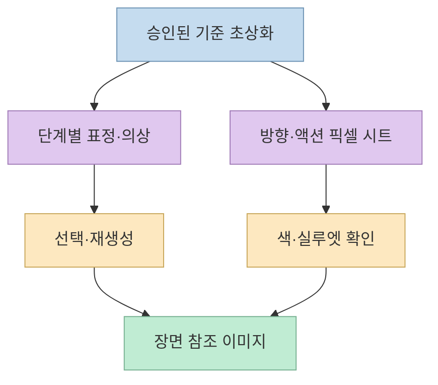
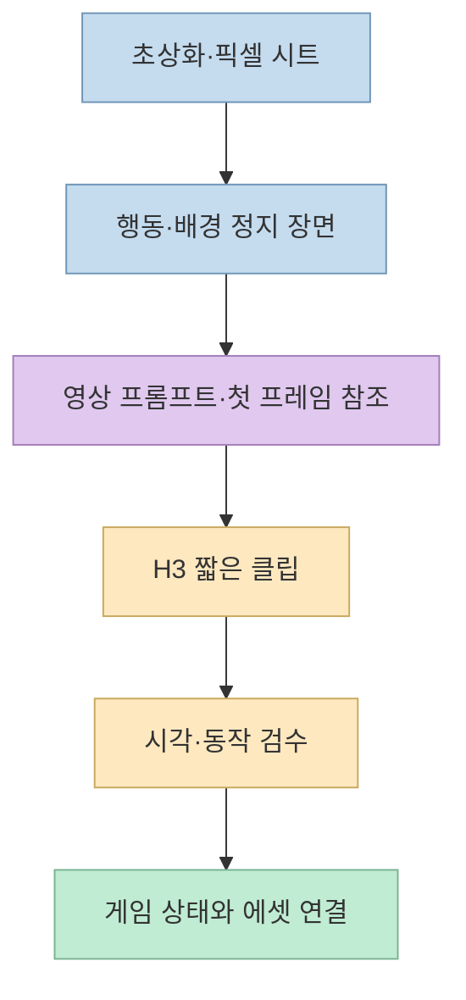

코드만으로 작동하는 게임도 플레이는 가능하지만, 인물 초상화·배경 음악·행동 영상이 더해지면 같은 버튼의 체감이 달라질 수 있다. [성공지식백과 영상](https://youtu.be/w-7FkzY8CbY)은 한 게임의 캐릭터를 예로 들어 **Claude Opus 5.5로 지시문을 다듬고, MiniMax Design에서 초상화와 픽셀 아트를 만든 뒤, MiniMax H3로 짧은 장면을 영상화**하는 과정을 보여준다. 이 글은 그 제작 순서를 재구성하고, 모델 역할·일관성·크레딧 비용에 관한 주장을 공식 자료와 구분해 설명한다.

<!--more-->

## Sources

- [원본 YouTube 영상](https://youtu.be/w-7FkzY8CbY?si=pOFKfB4rDjFkf1WX) — 게임 에셋 제작 실습과 영상 속 크레딧 사례.
- [MiniMax Design 공식 사이트](https://design.minimax.io/) — 에이전트, 연결형 캔버스, 스킬·플러그인, 데스크톱 앱.
- [GPT Image 2.5의 Flare·Sunburst 안내](https://design.minimax.io/tools/gpt-image-2-5) — 정지 이미지 생성·편집 모델과 참조 이미지 사용법.
- [MiniMax H3 공식 소개](https://www.minimax.io/blog/minimax-h3) · [H3 활용 안내](https://design.minimax.io/h3) — 첫·마지막 프레임 제어, 영상 길이·해상도와 모델 범위.
- [MiniMax Design 멤버십 안내](https://design.minimax.io/media-plan/subscribe) — 현재 공개 페이지의 요금 표시 상태.

## 1. 먼저 게임의 에셋 목록과 역할을 분리한다

영상은 **이미지·영상·음악이 없는 코드 기반 화면**과 이들 에셋을 넣은 화면을 차례로 보여준다. 같은 "집에서 잠자기" 행동도 영상이 나오면 흐름이 더 자연스럽게 느껴진다는 제작자의 관찰이다. 다만 이것은 한 게임 화면을 대상으로 한 시연이지, 에셋만 추가하면 게임의 재미나 사용성이 자동으로 높아진다는 비교 실험은 아니다. [영상 0:09~0:46](https://youtu.be/w-7FkzY8CbY?t=9)

영상에서 실제로 이어지는 에셋은 **인물 초상화 → 관계 단계별 표정·의상 → 픽셀 캐릭터 시트 → 배경과 행동 장면 → 짧은 영상**이다. UI·UX와 음성도 언급하지만 음성 제작은 이전 영상에서 다뤘다고 하며, 이번 영상은 주로 이미지와 영상에 집중한다. 따라서 이 글 역시 음성 제작법을 새로 추정하지 않는다. [영상 0:12~0:20](https://youtu.be/w-7FkzY8CbY?t=12), [8:55~9:05](https://youtu.be/w-7FkzY8CbY?t=535)

## 2. Opus 5.5는 그림을 출력하는 모델이 아니라 기획·지시문 단계에 놓였다

영상 초반 제작자는 게임 설정을 설명하고 **세밀한 애니메이션풍 초상화**와 **기존 일러스트를 참조한 픽셀 장면**을 만들겠다는 요청을 Claude Opus 5.5에 넣는다. 이어 역할, 나이, 체형, 외형, 의상·소품, 표정·자세를 채워 **자세한 영어 이미지 프롬프트**를 받는다. 여기서 Opus의 주된 역할은 시각물을 직접 렌더링하기보다 **제작 의도와 시각적 제약을 생성 모델이 사용할 지시문으로 정리**하는 것이다. [영상 1:03~2:20](https://youtu.be/w-7FkzY8CbY?t=63)

제작자는 그 프롬프트를 MiniMax Design에 붙여 넣고, 플랫폼의 에이전트가 다시 지시를 보완한다고 관찰한다. 영상 후반에는 Design 안의 에이전트에서도 후속 단계 프롬프트를 실행한다. **Claude 구독·외부 대화에서 만든 프롬프트, Design 에이전트 사용, 이미지·영상 생성**은 서로 다른 작업과 비용 항목일 수 있다. 영상은 촬영 중 Design의 에이전트 선택지에 Opus 5.5가 추가됐다고 말하지만, 이 글에서 확인한 공개 제품 페이지로는 해당 선택지가 모든 계정·지역에 동일하게 제공되는지 확인하지 못했다. [영상 3:04~3:24](https://youtu.be/w-7FkzY8CbY?t=184), [5:27~6:10](https://youtu.be/w-7FkzY8CbY?t=327), [MiniMax Design 공식 사이트](https://design.minimax.io/)

## 3. 정지 이미지 모델과 영상 모델은 따로 고른다

제작자는 초상화에 **GPT Image 2.5 Sunburst**를 선택하고, 다른 이미지 모델은 해제한다. 공식 [MiniMax Design의 GPT Image 2.5 안내](https://design.minimax.io/tools/gpt-image-2-5)는 **Flare는 빠른 생성·편집**, **Sunburst는 디테일을 다듬는 작업**에 초점을 둔다고 설명한다. 영상에서 Sunburst가 다른 선택지보다 선과 디테일이 선명했다는 평가는 **제작자가 비교한 특정 샘플**의 관찰이다. 모든 캐릭터·해상도·비용 조건에서 우월하다는 보장은 아니다. [영상 3:31~4:09](https://youtu.be/w-7FkzY8CbY?t=211), [공식 모델 안내](https://design.minimax.io/tools/gpt-image-2-5)

공식 문서는 초상화와 편집에서 **참조 이미지를 넣고 유지할 특징을 명시**하라고 권한다. 생성 후 인물의 얼굴, 손·소품, 의상 문양, 텍스트, 배경 투명도 등을 검토하고 수정 지시를 한 번에 하나씩 좁히는 방식이 유용하다. 영상도 기존 인물을 예시로 넣고 결과를 확대해 비교한다. 이 과정은 모델이 자동으로 캐릭터 정체성을 보존한다는 가정 대신 **시각 기준을 만들고 사람이 승인하는 루프**다. [영상 1:49~2:12](https://youtu.be/w-7FkzY8CbY?t=109), [5:09~5:26](https://youtu.be/w-7FkzY8CbY?t=309), [공식 GPT Image 2.5 사용법](https://design.minimax.io/tools/gpt-image-2-5)

## 4. 캐릭터 일관성은 "한 장 생성"보다 참조의 계보를 관리하는 문제다

초상화를 얻은 다음 영상은 같은 캐릭터의 **관계·호감도 1~3단계**를 만든다. 제작자는 표정뿐 아니라 자세와 의상도 단계별로 바꾸라고 지시하고, 두 단계가 너무 비슷해 보이는 결과는 다시 생성한다. MiniMax Design의 캔버스에서는 결과물이 어느 참조 이미지에서 파생됐는지 선으로 보이고, 각 이미지의 프롬프트와 레퍼런스도 확인할 수 있다고 시연한다. 이 기능은 결과물을 **참조와 수정 이력의 그래프**로 관리하게 해 준다. [영상 6:10~8:55](https://youtu.be/w-7FkzY8CbY?t=370), [MiniMax Design의 Canvas Flow](https://design.minimax.io/)

이후 초상화를 **정면·대각·측면·후면과 여러 액션이 들어간 픽셀 시트**로 바꾼다. 제작자는 먼저 만든 캐릭터를 기준으로 시트를 생성하고, 색상 팔레트와 각 방향의 결과를 확인한다. 일반적인 재사용 작업이라면 반대로 주인공의 픽셀 시트를 먼저 만들어 여러 캐릭터의 기준으로 삼을 수도 있다고 설명한다. 어느 순서든 핵심은 **다음 이미지가 어떤 기준 이미지와 색·실루엣·의상을 공유해야 하는지 기록**하는 것이다. [영상 9:03~10:22](https://youtu.be/w-7FkzY8CbY?t=543), [11:30~12:06](https://youtu.be/w-7FkzY8CbY?t=690)

## 5. 픽셀 장면에서 H3 영상으로 넘어가는 경계

픽셀 시트만으로는 두 인물이 상호작용하는 장면이 완성되지 않는다. 영상은 **캐릭터 두 명, 레모네이드를 만드는 행동, 어울리는 배경**을 한 장면으로 만들고, 캔버스의 연결선을 통해 어떤 픽셀 아트를 참조했는지 확인한다. 다음에는 기존 영상 프롬프트 프리셋을 장면에 맞게 고치고, 플랫폼의 H3 프롬프트 스킬로 다듬는다. 영상 속 Blender·Unity·Unreal·Photoshop 등은 **플러그인으로 연결할 수 있다는 소개**이며, 이번 장면에서 각 도구를 실제 실행한 증거는 아니다. [영상 12:03~13:30](https://youtu.be/w-7FkzY8CbY?t=723), [MiniMax Design의 스킬·플러그인 설명](https://design.minimax.io/)

마지막 단계에서 제작자는 **MiniMax H3**를 영상 모델로 고르고 나머지 후보를 끈 다음, 완성한 정지 장면을 **첫 프레임 참조**로 넣어 **2K·8초 클립**을 생성했다고 화면에서 확인한다. 공식 [H3 소개](https://www.minimax.io/blog/minimax-h3)는 H3가 텍스트·이미지·영상·오디오 문맥을 받아 영상을 만들고, 첫·마지막 프레임 제어도 지원한다고 설명한다. 하지만 이번 시연에서 확인되는 것은 **첫 프레임을 참조한 한 클립**이다. "첫 프레임과 마지막 프레임을 잘 이어 준다"는 제작자의 일반적 경험과, 이 시연에서 마지막 프레임까지 지정했다는 사실은 구분해야 한다. [영상 13:31~14:28](https://youtu.be/w-7FkzY8CbY?t=811), [H3 공식 소개](https://www.minimax.io/blog/minimax-h3)

영상 모델의 출력은 장면의 **움직임과 분위기**를 보여 주는 에셋이지 곧바로 완성된 게임 로직이 아니다. 실제 프로젝트에서는 파일 형식·용량·길이, 게임 상태와 영상의 연결, 반복 재생 시 끊김, 모바일 성능, 사용 권한을 별도로 확인해야 한다. 이는 영상의 결과물을 게임에 넣기 위한 **실무 점검 제안**이며, 영상에서 이 모든 검사를 완료했다는 뜻은 아니다. [영상 0:24~0:41](https://youtu.be/w-7FkzY8CbY?t=24), [13:59~14:28](https://youtu.be/w-7FkzY8CbY?t=839)

## 6. 크레딧 계산: 화면에 찍힌 사례와 현재 가격은 다르다

영상 화면에서는 초상화 한 번에 **이미지 80 + 에이전트 85 = 165크레딧**, H3의 **8초 영상 한 번에 960크레딧**을 쓴 것으로 설명한다. 이 수치는 **그때 선택한 설정·계정의 사용 기록**이다. 제작자는 Pro 요금이 **월 215달러에 27만 크레딧**인 화면을 근거로 `270,000 ÷ 165 ≈ 1,636`장을 계산한다. 산술은 맞지만 **모든 크레딧을 같은 이미지 작업에만 쓰고, 재생성·추가 에이전트·영상 비용이 없을 때의 단순 상한**이다. 실제 제작량은 여러 번의 시도와 다른 작업에 쓴 크레딧만큼 줄어든다. [영상 4:29~5:08](https://youtu.be/w-7FkzY8CbY?t=269), [14:09~14:27](https://youtu.be/w-7FkzY8CbY?t=849)

**현재 요금으로 확정해 적지는 않는다.** 이 글에서 확인한 [MiniMax Design 공식 멤버십 공개 페이지](https://design.minimax.io/media-plan/subscribe)는 크레딧 구매와 연간 옵션을 보여 주지만, 조회 시점에 구체적 플랜 데이터가 표시되지 않았다. 따라서 영상의 월 215달러·27만 크레딧·연간 할인율을 **현재 모든 계정에 적용되는 공식 가격**으로 검증할 수 없다. 가입 전에는 앱에서 플랜별 크레딧, 이미지·에이전트·영상 각 작업의 차감량, 유효기간을 직접 확인해야 한다. [영상의 가격 설명](https://youtu.be/w-7FkzY8CbY?t=287), [공식 멤버십 페이지](https://design.minimax.io/media-plan/subscribe)

## 실전 적용 포인트

1. **한 캐릭터·한 행동으로 시작한다.** 역할·외형·의상·색상·금지할 변화와 게임에 필요한 표정 단계를 적고, 기준 초상화를 승인한 뒤 파생 에셋을 만든다. [영상의 프롬프트 구성](https://youtu.be/w-7FkzY8CbY?t=109), [단계별 생성](https://youtu.be/w-7FkzY8CbY?t=392)
2. **참조 관계를 유지한다.** 초상화 → 픽셀 시트 → 배경 장면 → 영상의 어느 단계가 어느 이미지를 참조했는지 기록하고, 마음에 들지 않는 단계만 다시 만든다. [영상의 캔버스 시연](https://youtu.be/w-7FkzY8CbY?t=451), [공식 캔버스 설명](https://design.minimax.io/)
3. **한 번의 저해상도·짧은 시험 클립으로 예산을 확인한다.** 움직임, 인물 유지, 프레임 연결, 게임 내 재생을 검토한 뒤 필요한 장면만 고품질로 다시 만든다. 정확한 크레딧은 사용 시점의 앱 표기를 기준으로 한다. [영상의 H3 시연](https://youtu.be/w-7FkzY8CbY?t=815), [H3 공식 안내](https://design.minimax.io/h3)

## 핵심 요약

- 이 영상의 작업 분담은 **Opus 5.5의 지시문 구성 → MiniMax Design의 에셋·참조 관리 → GPT Image 2.5 Sunburst 정지 이미지 → MiniMax H3 영상**이다. [영상 1:03](https://youtu.be/w-7FkzY8CbY?t=63), [3:31](https://youtu.be/w-7FkzY8CbY?t=211), [13:35](https://youtu.be/w-7FkzY8CbY?t=815)
- 인물 일관성은 한 번의 생성보다 **승인한 기준 이미지, 파생 관계, 수정 단계의 확인**에 달려 있다. [영상 6:10~8:55](https://youtu.be/w-7FkzY8CbY?t=370), [공식 캔버스 설명](https://design.minimax.io/)
- **165·960크레딧**은 영상의 설정에서 관찰한 사례이며, **월 215달러**도 현재 공개 페이지에서 재확인되지 않았다. [영상의 화면 설명](https://youtu.be/w-7FkzY8CbY?t=269), [공식 멤버십](https://design.minimax.io/media-plan/subscribe)
- 이미지·영상의 생성과 **게임 코드·성능·사용권 검증**은 별개 단계다. [영상의 게임 비교](https://youtu.be/w-7FkzY8CbY?t=9), [공식 GPT Image 2.5 안내](https://design.minimax.io/tools/gpt-image-2-5)

## 결론

비전공자가 게임용 캐릭터와 움직이는 장면을 빠르게 시도할 수 있다는 것이 영상의 가장 설득력 있는 부분이다. 하지만 결과를 안정적으로 쓰려면 **참조 이미지와 캐릭터 기준을 관리하고, 단계별로 재생성·검수하며, 크레딧과 게임 내 구현을 따로 확인**해야 한다. 좋은 에셋 제작 흐름이 게임 전체를 자동으로 완성한다는 뜻은 아니다.
