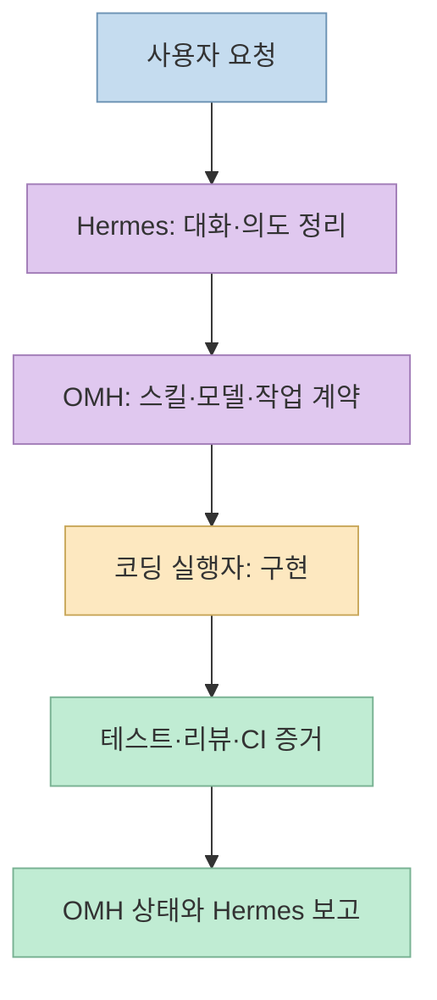
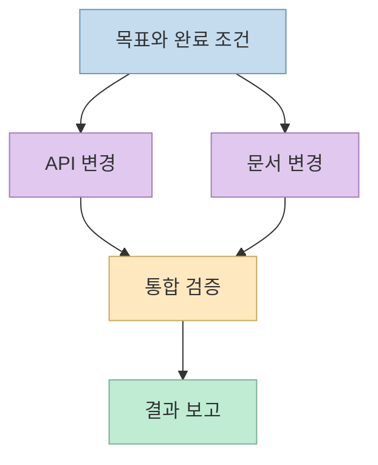
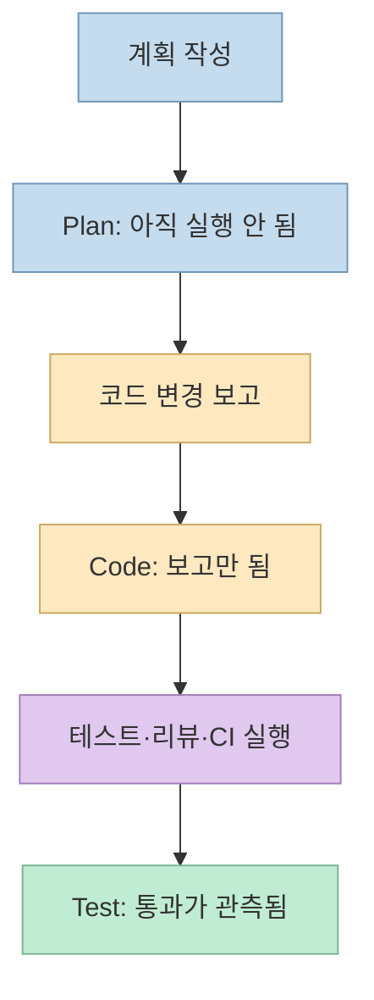

[Threads 게시물](https://www.threads.com/share/BAOVmWGR95/)은 “S티어 하네스 써볼까용”이라는 한 문장과 [Oh My Hermes 저장소](https://github.com/rlaope/oh-my-hermes)를 공유한다. 별도의 성능 비교나 사용 후기는 없다. 따라서 **“S티어”는 작성자의 추천 표현**으로 두고, 이 글에서는 **Oh My Hermes(OMH)가 실제로 어떤 작업을 맡는지** 공식 README와 문서를 바탕으로 살펴본다.

<!--more-->

## Sources

- [원본 Threads 공유 글](https://www.threads.com/share/BAOVmWGR95/) — 한 문장 추천과 프로젝트 링크. 공개 게시물을 직접 추출했다.
- [Oh My Hermes 공식 저장소](https://github.com/rlaope/oh-my-hermes) — 기능, 명령, 설치 경로와 라이선스.
- [OMH 아키텍처 문서](https://github.com/rlaope/oh-my-hermes/blob/main/docs/ARCHITECTURE.md) — Hermes·OMH·코딩 실행자의 책임 경계.
- [OMH 설치 문서](https://github.com/rlaope/oh-my-hermes/blob/main/docs/INSTALLATION.md) — 운영체제와 선행 조건.
- [OMH 제품 비교 벤치마크 안내](https://github.com/rlaope/oh-my-hermes/blob/main/benchmarks/product-ab/v1/README.md) — 측정 결과의 공개 여부.

## 1. OMH는 Hermes를 대체하지 않는 운영 계층이다

공식 README는 OMH를 **Hermes Agent를 위한 운영 계층**이라고 설명한다. 사용자는 계속 Hermes와 대화하고, OMH는 작업 유형에 맞는 스킬·모델 경로·병렬 실행 구조를 고른다. README는 Hermes 자체를 패치하거나 교체하지 않는다고 명시한다. 즉 "Codex 또는 Claude Code에 넣는 범용 프롬프트 한 장"보다는, **Hermes 대화와 코딩 실행자 사이의 조정층**으로 이해하는 편이 정확하다. [OMH README](https://github.com/rlaope/oh-my-hermes)

아키텍처 문서의 책임 구분은 더 선명하다. **Hermes**는 사용자와 대화하고 의도를 정리하며, **OMH**는 라우팅·작업 계약·상태와 증거를 관리하고, 선택된 **코딩 실행자**가 실제 구현·검증을 수행한다. 준비된 작업 지시나 계획은 실행 증거가 아니며, 실행 기록과 테스트 결과가 따로 있어야 완료로 판정한다. 저장소에 Claude Code·Codex 관련 파일이 있어도 **OMH 자체가 그 도구들의 공식 내장 기능**이라는 뜻은 아니다. [OMH 아키텍처의 System View](https://github.com/rlaope/oh-my-hermes/blob/main/docs/ARCHITECTURE.md), [README의 Evidence before claims](https://github.com/rlaope/oh-my-hermes)

## 2. `dag-ulw`: 큰 일을 의존성 그래프로 나누는 흐름

README에서 가장 앞세우는 명령은 **`/dag-ulw`**다. 하나의 목표를 여러 작은 노드로 나누고, 앞선 작업이 끝나야 시작할 노드와 **서로 독립적으로 병렬 실행할 노드**를 구분한다. 각 노드는 작업 범주에 맞는 모델과 추론 강도로 실행되며, 동시에 실행되는 노드가 같은 쓰기 범위를 공유하지 않도록 설계했다고 설명한다. 별도의 검증 노드가 전체 목표를 확인하고 실패한 노드를 복구하는 흐름도 문서화돼 있다. [OMH README의 DAG-ULW](https://github.com/rlaope/oh-my-hermes#dag-ulw)

이 방식의 이점은 단순히 "에이전트를 많이 띄운다"가 아니다. 예를 들어 API 변경과 문서 수정은 병렬로 시작할 수 있어도, 통합 테스트는 두 변경이 합쳐진 뒤 실행해야 의미가 있다. 또한 같은 파일을 여러 작업자가 동시에 바꾸면 충돌과 누락이 생긴다. **의존성, 파일 소유권, 검증 단계**를 명시하면 병렬성의 이점과 통제 가능성을 함께 얻을 수 있다. 이는 README의 그래프 실행·쓰기 범위 규칙에서 도출한 활용 예시이며, 특정 프로젝트에서 속도가 반드시 빨라진다는 실측 결과는 아니다. [OMH README의 병렬 작업 설명](https://github.com/rlaope/oh-my-hermes), [아키텍처 문서](https://github.com/rlaope/oh-my-hermes/blob/main/docs/ARCHITECTURE.md)

## 3. 모델 라우팅과 스킬 로딩: 선택의 근거가 분리돼 있다

OMH는 노드에 `quick`, `deep`, `visual-engineering`, `ultrabrain` 같은 **작업 범주**를 붙이고, 범주별 모델 체인과 추론 강도를 선택하도록 설명한다. 공급자가 한 모델을 거절하면 체인의 다음 후보로 넘어가는 방식이며, 사용자가 체인을 수정할 수 있다. 별도로 100개 이상의 `omh-*` 전문 스킬을 카탈로그에서 작업에 맞게 로드한다고 소개한다. **스킬 선택과 모델 선택은 같은 결정이 아니다.** 예컨대 UI 검토 스킬을 쓴다는 사실만으로 어떤 공급자 모델이 실제 호출됐는지는 알 수 없다. [OMH README의 What you get·How it works](https://github.com/rlaope/oh-my-hermes)

이 구조는 단순 작업에 무거운 모델을 고정하지 않고, 어려운 작업에 더 많은 자원을 배분할 수 있다는 **설계 의도**를 갖는다. 그러나 범주가 붙었다는 기록만으로 실제 비용 절감이나 성능 개선이 검증된 것은 아니다. 설정된 모델 별칭과 **실제로 실행된 모델**, 계획된 분기와 **관측된 실행 결과**를 구분해야 한다는 점도 아키텍처 문서가 강조한다. [OMH 아키텍처의 관측·상태 경계](https://github.com/rlaope/oh-my-hermes/blob/main/docs/ARCHITECTURE.md), [README의 모델 라우팅](https://github.com/rlaope/oh-my-hermes)

## 4. `완료`를 어떻게 말하나: 계획·코드·검증의 증거 구분

README는 상태를 **`Plan · not run`**, **`Code · reported done`**, **`Test · verified`**처럼 구분한다. 계획은 실행되지 않았고, 코딩 실행자가 "완료"라고 보고한 것만으로는 아직 검증되지 않았으며, 테스트·리뷰·CI 게이트가 실제로 통과해야 검증된 것으로 표시한다. 장기 메모리도 모든 대화를 무조건 사실로 저장하는 방식이 아니라 후보를 검토·보류·거부하는 절차를 설명한다. 이 둘의 공통점은 **준비된 정보와 관측된 결과를 혼동하지 않으려는 것**이다. [OMH README의 Evidence before claims·Long-term memory](https://github.com/rlaope/oh-my-hermes), [아키텍처 문서](https://github.com/rlaope/oh-my-hermes/blob/main/docs/ARCHITECTURE.md)

이 원칙은 실무에서 유용하다. "작업 지시를 에이전트에게 보냈다"는 것은 파일이 바뀌었다는 증거가 아니고, "파일이 바뀌었다"는 것은 테스트가 통과했다는 증거가 아니다. 완료 보고에 **실제로 실행한 명령과 결과, 남은 미검증 범위**를 붙여야 한다. 다만 이는 OMH가 지향하는 상태 표현과 게이트 구조에 대한 설명이며, 모든 외부 실행자와 모든 프로젝트에서 검증이 자동으로 완벽해진다는 보장은 아니다. [OMH README의 Evidence before claims](https://github.com/rlaope/oh-my-hermes), [OMH 아키텍처](https://github.com/rlaope/oh-my-hermes/blob/main/docs/ARCHITECTURE.md)

## 5. 설치하기 전에 확인할 조건과 "S티어" 평가의 한계

공식 문서는 macOS·Linux에 설치 스크립트, Windows에 PowerShell 설치 경로를 제공하고, Homebrew·npm·Bun 경로도 안내한다. 설치 후 `omh setup`, 문제 확인용 `omh doctor`를 설명한다. npm·Bun 경로에는 **Node.js 18 이상과 Python 3.11 이상**이 필요하며, 설치 문서는 macOS·Linux 범용 설치 스크립트도 적합한 Python을 찾거나 준비한다고 적는다. 모델 공급자와 실행자 설정도 별도로 필요할 수 있다. 저장소가 MIT 라이선스라는 사실이 모델 API 사용료까지 무료라는 뜻은 아니다. [OMH README의 Install·Licence](https://github.com/rlaope/oh-my-hermes), [설치 문서의 Quick Start](https://github.com/rlaope/oh-my-hermes/blob/main/docs/INSTALLATION.md)

**이 글에서는 설치 명령을 실행하지 않았다.** 원격 스크립트를 바로 셸에 연결하기 전에 출처·고정 버전·실행할 코드를 확인하고, 기존 Hermes 설정과 충돌하는 부분이 없는지 살피는 편이 안전하다. 특히 README의 에이전트용 설치 안내도 현재 `main`을 그대로 따르지 말고 커밋 SHA를 확인해 고정된 지침을 읽으라고 권한다. 이 내용은 설치 시 주의점이지, 사용자가 이 URL을 보냈다는 이유만으로 설치를 승인했다는 뜻은 아니다. [OMH README의 Agent Install 안내](https://github.com/rlaope/oh-my-hermes), [설치 문서](https://github.com/rlaope/oh-my-hermes/blob/main/docs/INSTALLATION.md)

"S티어"를 객관적 성능 등급으로 받아들이기에는 공개 증거가 부족하다. OMH 저장소의 [Hermes 단독 대 OMH 적용 제품 비교 벤치마크 문서](https://github.com/rlaope/oh-my-hermes/blob/main/benchmarks/product-ab/v1/README.md)는 **비교용 작업 목록과 오프라인 파일럿은 있지만 측정 실행 결과는 아직 공개되지 않았다**고 명시한다. 따라서 문서화된 기능과 설계 방향은 평가할 수 있어도, "OMH가 Hermes 단독보다 몇 % 빠르다"는 식의 결론은 이 자료에서 낼 수 없다.

## 실전 적용 포인트

1. **큰 작업 하나만 시험한다.** 독립적으로 나눌 수 있는 작업, 합쳐서 검증해야 할 작업, 각 작업의 수정 파일 범위를 먼저 적는다. 병렬 실행의 이점은 이런 경계가 있을 때 판단할 수 있다. [OMH README의 DAG-ULW](https://github.com/rlaope/oh-my-hermes#dag-ulw)
2. **설정과 관측을 따로 확인한다.** 어떤 범주와 모델이 설정됐는지보다 실제 어떤 모델·실행자·테스트가 사용됐는지 결과 기록을 본다. [OMH README의 상태 구분](https://github.com/rlaope/oh-my-hermes), [OMH 아키텍처](https://github.com/rlaope/oh-my-hermes/blob/main/docs/ARCHITECTURE.md)
3. **같은 작업을 비교할 때만 우열을 말한다.** 시간·토큰·비용·테스트 결과·사람의 수정량을 동일한 조건에서 기록하고, 검증 전에는 "S티어"를 개인적 기대치로만 남긴다. [OMH 벤치마크의 공개 상태](https://github.com/rlaope/oh-my-hermes/blob/main/benchmarks/product-ab/v1/README.md)

## 핵심 요약

- OMH는 **Hermes의 대화 위에서 스킬·모델·실행자를 조정하는 운영 계층**이며, Hermes 자체를 대체하지 않는다. [공식 README](https://github.com/rlaope/oh-my-hermes)
- `/dag-ulw`는 목표를 **의존성 그래프**로 나누고, 쓰기 범위가 충돌하지 않는 작업을 병렬로 실행한 뒤 별도 검증 단계를 둔다. [공식 README](https://github.com/rlaope/oh-my-hermes#dag-ulw)
- **계획, 코드 변경 보고, 테스트 통과**는 다른 상태다. OMH는 이를 구분해 표시하도록 설계됐다. [공식 README](https://github.com/rlaope/oh-my-hermes)
- 원문의 "S티어"는 의견이며, 공식 저장소의 **제품 비교 측정 결과는 아직 공개되지 않았다.** [벤치마크 문서](https://github.com/rlaope/oh-my-hermes/blob/main/benchmarks/product-ab/v1/README.md)

## 결론

Oh My Hermes가 흥미로운 이유는 스킬 수나 화려한 TUI만이 아니다. **누가 어떤 파일을 바꾸는지, 어떤 모델이 실제 실행됐는지, 무엇을 검증했는지**를 작업 흐름 속에서 분리하려는 설계에 있다. 다만 설계의 풍부함과 성능 우수성은 별개의 주장이다. 사용 전에는 Hermes 환경과 설치 조건을 확인하고, 사용 후에는 동일한 작업으로 결과를 직접 비교해야 한다.
