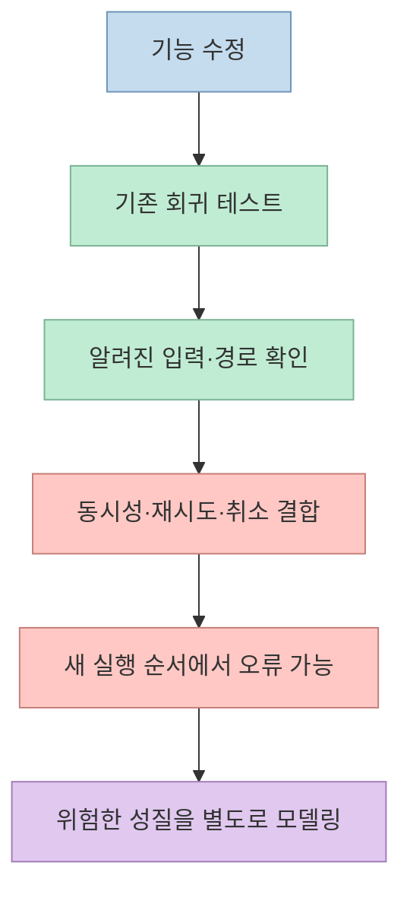
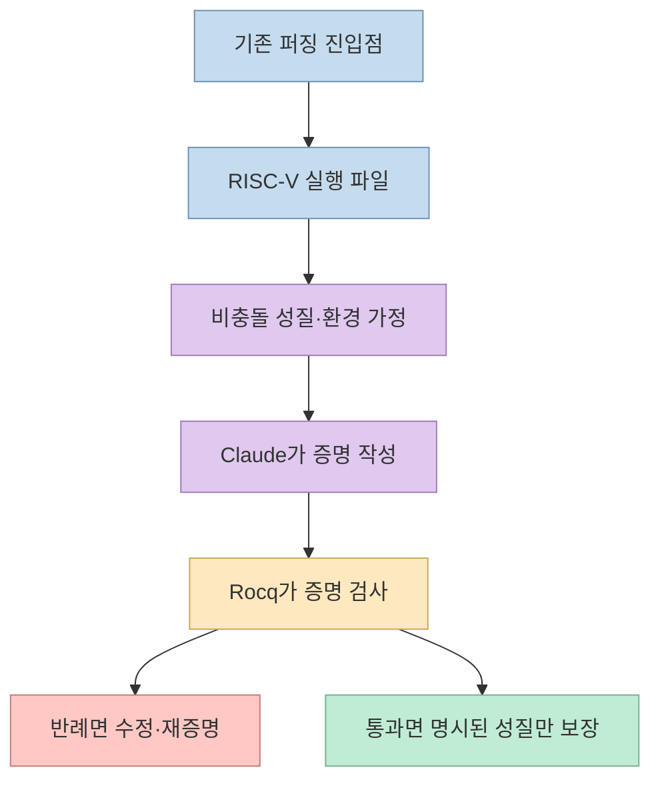
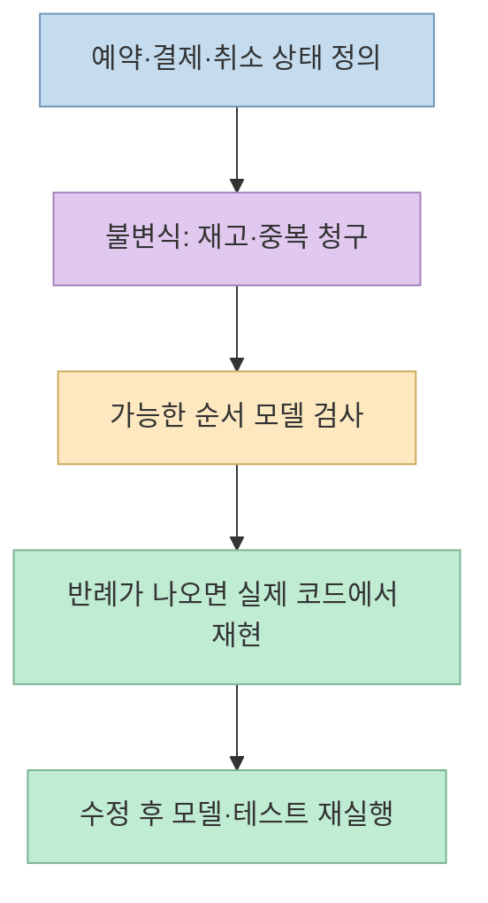

AI로 코드를 빠르게 만들더라도 기능이 서로 얽히면 **한 부분의 수정이 다른 부분을 깨뜨리는 회귀 버그**가 생긴다. [소스놀이터 영상](https://youtu.be/xAoB4EqzlyU)은 테스트만 늘리는 대신 형식 검증을 선택적으로 쓰자고 제안한다. 방향은 유용하지만, 영상에서 한 흐름으로 묶은 **Anthropic·Theorem의 바이너리 증명**과 **일반 개발자가 설치하는 TLA+/Lean 스킬**은 검증 대상과 보장 범위가 다르다. 숫자도 그대로 받아들이기보다 원문을 확인해야 한다.

<!--more-->

## Sources

- [원본 YouTube 영상](https://youtu.be/xAoB4EqzlyU?si=b2pWKTvLmHrdsOel) — 회귀 버그, 형식 검증, 공개 스킬, 비용과 적용 기준.
- [Anthropic의 형식 검증 연구 발표](https://www.anthropic.com/research/formal-verification) — 123개 라이브러리·239개 진입점의 정확한 의미와 증명 가정.
- [Theorem OSS Verify 공개 증명 저장소](https://github.com/theorem-labs/oss-verify-proofs) · [신청 안내](https://theorem.dev/oss-verify/) — 공개 범위와 서비스 조건.
- [Opum AI Proof Skills](https://github.com/opum-ai/proof-skills) — TLA+/Lean 스킬의 사용 방식과 자체 평가.
- [Agent Formal Verify](https://github.com/michael-denyer/agent-formal-verify) — Codex에서도 쓸 수 있는 별도 커뮤니티 스킬.

## 1. 회귀 버그: 테스트가 필요한 이유와 테스트만으로 부족한 이유

영상은 작은 프로젝트가 몇 주·몇 달 동안 커지고 페이지와 기능이 서로 얽힐수록, 국소적인 수정이 이전 동작을 깨뜨릴 수 있다고 설명한다. 특히 파일 전달·작업 취소·재시작·운영체제별 실행처럼 **상태와 순서가 결합된 기능**을 본인의 프로그램 사례로 든다. 이는 영상 제작자의 경험담이며, 모든 바이브 코딩 프로젝트가 같은 속도로 망가진다는 일반 법칙은 아니다. [영상 0:16~0:35](https://youtu.be/xAoB4EqzlyU?t=16), [7:25~8:23](https://youtu.be/xAoB4EqzlyU?t=445)

회귀 테스트는 이미 알려진 입력과 기대 결과를 다시 실행해 같은 문제가 되살아나는지 확인한다. 하지만 동시 요청, 지연, 취소, 재시도, 실패 복구가 섞이면 가능한 실행 순서가 급증한다. 영상의 "10가지 순서만 있어도 10! = 3,628,800"은 **서로 다른 사건 10개를 모두 한 번씩 배열하는 경우**에만 성립하는 예시다. 실제 시스템의 모든 경로가 반드시 그 수와 같다는 뜻은 아니지만, 순서에 의존하는 오류를 몇 개의 테스트 사례만으로 포괄하기 어렵다는 설명에는 적합하다. [영상 4:44~5:44](https://youtu.be/xAoB4EqzlyU?t=284), [Anthropic의 퍼징과 증명 비교](https://www.anthropic.com/research/formal-verification)

## 2. Anthropic·Theorem의 연구: "239개 버그"가 아니라 "239개 진입점"

영상은 Anthropic과 Theorem이 **123개 오픈소스 라이브러리의 239개 지점**을 분석했다고 말한 뒤, 이를 "239개 지점에서 버그를 발견하고 해결"한 것처럼 설명한다. 공식 발표의 정확한 수치는 **123개 라이브러리에 걸친 239개 퍼징 진입점에서, 발견한 크래시 유발 버그를 수정한 다음 비충돌 성질을 증명**했다는 것이다. **239는 버그 건수가 아니다.** 발표는 증명 과정에서 "수백 개의 버그"가 드러났다고 설명하지만, 239개를 발견 버그 수로 제시하지 않는다. [영상 3:26~3:58](https://youtu.be/xAoB4EqzlyU?t=206), [Anthropic의 실험 결과·버그 설명](https://www.anthropic.com/research/formal-verification)

방법도 단순히 "모든 코드를 수학적으로 완벽히 증명"한 것이 아니다. 기존 **퍼징 테스트의 진입점**을 RISC-V 실행 파일로 컴파일하고, 특정 크기 이하 입력에서 테스트가 크래시 없이 끝난다는 **명시적 성질**을 수학적 명세로 만든다. Claude가 증명을 작성하면 **Rocq 증명 검사기**가 명세에 맞는지 확인한다. 증명 중 실제 반례가 나오면 코드를 고치고, 바뀐 실행 파일과 명세에 대해 다시 증명하는 흐름이다. 이것이 무작위 입력을 많이 넣는 퍼징과 다른 지점이다. [영상 2:43~3:26](https://youtu.be/xAoB4EqzlyU?t=163), [Anthropic의 Turning tests into proofs](https://www.anthropic.com/research/formal-verification)

**보장의 경계가 중요하다.** 공식 발표의 해당 증명은 **단일 스레드·고정 메모리 예산·Linux의 정적 RISC-V 바이너리**를 모델로 하고, **64MB 이하 입력**을 대상으로 한다. 실제 배포가 x86·ARM이나 다른 OS·동적 라이브러리를 쓴다면 같은 증명이 곧바로 그 환경의 모든 동작을 보장하지 않는다. 상품 가격 오류, 권한 설계 실수, 미검증 API 경로도 "크래시가 없다"는 성질 바깥일 수 있다. Anthropic 역시 "형식 검증 = 버그 없음"이 아니라고 분명히 쓴다. [Anthropic의 가정과 한계](https://www.anthropic.com/research/formal-verification)

영상은 **25개 라이브러리의 60개 지점**이 공개됐다고 소개한다. 이 역시 당시 공개 범위를 가리키는 숫자다. 이 글을 작성하며 확인한 [공개 증명 저장소 README](https://github.com/theorem-labs/oss-verify-proofs)는 **26개 라이브러리, 61개 진입점**이라고 적는다. 123개·239개는 연구 전체 결과, 26개·61개는 **현재 공개된 증명 부분집합**으로 구분해야 한다. 공개하지 않은 증명에는 미패치 버그 노출 우려가 있다는 것이 Anthropic의 설명이다. [영상 3:45~3:57](https://youtu.be/xAoB4EqzlyU?t=225), [Anthropic 공개 범위](https://www.anthropic.com/research/formal-verification), [Theorem 공개 저장소](https://github.com/theorem-labs/oss-verify-proofs)

## 3. 티켓 동시성 문제에는 무엇을 증명해야 하나

영상의 티켓 예시는 **남은 좌석 10개에 다수가 동시에 접근하고, 결제 실패·취소·지연·재시도가 겹치는 상황**이다. 이때 막으려는 위험은 "어떤 입력에서도 프로그램이 크래시하지 않는다"와 다르다. 예를 들어 **확정된 예약 수가 재고를 넘지 않는다**, **같은 결제 요청이 중복 청구되지 않는다**, **취소된 예약이 뒤늦은 응답으로 다시 확정되지 않는다** 같은 **안전성 성질**을 먼저 적어야 한다. 이는 영상 예시를 바탕으로 한 모델링 예시이지, 영상 속 실제 티켓 시스템의 검증 결과가 아니다. [영상 4:44~5:44](https://youtu.be/xAoB4EqzlyU?t=284)

그다음 예약·결제·취소·타임아웃을 **상태 전이**로 만들고, 서로 다른 실행 순서에서도 성질이 유지되는지 모델 검사기로 확인한다. 반례가 나오면 "사용자 A가 결제 대기 중일 때 사용자 B가 취소하고, 늦은 완료 알림이 도착한다"처럼 깨지는 순서를 재현할 수 있다. 다만 모델에 **실제 코드의 락·트랜잭션·메시지 재전송 정책**이 빠져 있다면 모델 검사 통과가 운영 코드의 안전을 뜻하지 않는다. 코드와 모델의 대응 관계, 가정, 검사한 범위를 기록해야 한다. [Proof Skills의 모델·코드 대응 및 반례 재현 설명](https://github.com/opum-ai/proof-skills), [Agent Formal Verify의 범위 설명](https://github.com/michael-denyer/agent-formal-verify)

## 4. 무료 스킬과 연구용 증명 서비스를 혼동하지 말자

영상은 공개 대안으로 Claude Code의 **Proof Skills**와 Codex의 **Agent Formal Verify**를 말한다. [Opum AI의 Proof Skills](https://github.com/opum-ai/proof-skills)는 TLA+로 동시 실행·상태 전이를 모델 검사하고 Lean 4로 수학적 성질을 증명하는 **Claude Code용 공개 스킬**이다. [michael-denyer의 Agent Formal Verify](https://github.com/michael-denyer/agent-formal-verify)는 Claude Code·Codex·Pi에 설치할 수 있는 **별도 커뮤니티 프로젝트**로, TLA+/Lean 모델과 일부 Rust 코드의 Kani 검사를 사용한다. 둘 다 설치만 하면 모든 코드를 자동으로 완전 증명하는 버튼이 아니고, **검증할 성질과 모델의 범위를 정해 도구를 실행하는 작업 흐름**이다. 이 두 저장소는 Anthropic·Theorem의 239개 바이너리 증명 서비스와 동일한 제품이 아니다. [영상 4:18~4:44](https://youtu.be/xAoB4EqzlyU?t=258), [Proof Skills README](https://github.com/opum-ai/proof-skills), [Agent Formal Verify README](https://github.com/michael-denyer/agent-formal-verify)

Theorem의 [OSS Verify 신청 안내](https://theorem.dev/oss-verify/)는 **자격을 갖춘 오픈소스 프로젝트에 무료**로 바이너리 증명 파이프라인을 제공한다고 적는다. 프로젝트 관리자가 신청하고, 유지·사용 현황과 보안 중요도 등을 개별 심사한다. 따라서 영상의 "신청 대상자에 한해 서비스"는 대체로 맞지만, **공개된 무료 스킬을 로컬에서 쓰는 것**과 **심사를 거쳐 Theorem의 대규모 증명 파이프라인을 받는 것**은 별개다. [영상 4:19~4:33](https://youtu.be/xAoB4EqzlyU?t=259), [Theorem OSS Verify](https://theorem.dev/oss-verify/)

## 5. 98% 대 54%는 "모든 경우의 수 검증률"이 아니다

영상은 Proof Skills를 쓰면 시간 **2.4배**, 토큰 **2.2배**가 들지만 검증 범위가 **54%에서 98%**로 증가한다고 말한다. [공식 README의 현재 평가 설명](https://github.com/opum-ai/proof-skills#evaluation)은 **의도적으로 버그를 심은 5개 사례**에 같은 프롬프트를 적용한 뒤, 객관적 채점 항목의 평균이 **스킬 사용 98%, 미사용 54%**였다고 적는다. 두 구성 모두 심어 둔 버그는 찾고 고쳤으며, 스킬은 범위·반례·모델-코드 대응·증거 로그 같은 검증 산출물을 더 충실히 만들었다는 설명이다. 이 수치를 **전체 가능한 실행 경로의 98%를 실제로 증명했다**는 뜻으로 바꾸면 안 된다. [영상 6:03~6:36](https://youtu.be/xAoB4EqzlyU?t=363), [Proof Skills 평가](https://github.com/opum-ai/proof-skills#evaluation)

README는 비용을 **시간·토큰 약 2배**로 요약한다. 영상의 2.4배·2.2배는 이 글에서 확인한 공개 README의 대표 수치로는 재확인되지 않아, 특정 실행이나 버전의 측정일 가능성을 남긴다. 어느 쪽이든 **5개 예제로 얻은 프로젝트 자체 평가**이지, 다양한 실제 코드베이스에서 같은 개선폭이 반복된다는 독립적인 증거는 아니다. 규모·모델·도구 설치·증명 난도에 따라 비용도 달라진다. [영상 6:06~6:28](https://youtu.be/xAoB4EqzlyU?t=366), [Proof Skills 평가와 비용](https://github.com/opum-ai/proof-skills#evaluation)

## 6. 언제 도입할까: 테스트를 버리지 말고 고위험 부분에 더한다

영상은 버튼·색상처럼 국소적인 UI 수정에는 형식 검증이 과하고, 여러 기능이 얽히거나 동시성이 강할 때 선택적으로 적용하자고 말한다. 실무적으로도 **회귀 테스트 → 위험한 성질 정의 → 필요한 경우 모델 검사/증명 → 실제 코드 재현 → CI 재검증** 순서가 합리적이다. 테스트는 이미 아는 경로와 실제 실행의 연결을 확인하고, 모델 검사는 명시한 범위의 가능한 상태 전이를 탐색한다. 서로 대체하기보다 역할을 나눈다. [영상 6:41~7:24](https://youtu.be/xAoB4EqzlyU?t=401), [Proof Skills의 작업 흐름](https://github.com/opum-ai/proof-skills)

영상 후반의 **AGENTS.md에 조건부 사용 지침을 둔다**는 방법은 검증 비용을 조절하는 아이디어다. 다만 영상에서 말한 댓글의 정확한 지침 전문은 자막에 나오지 않으므로 이 글에서 복원하지 않는다. 지침만 추가해도 에이전트가 언제나 알맞은 성질을 선택하고, 검증 도구를 실제로 실행하며, 유효한 증거를 남긴다는 보장은 없다. 코드 경계·상태 전이·중요한 불변식을 사람이 정리하고 결과를 검토해야 한다. [영상 8:23~9:13](https://youtu.be/xAoB4EqzlyU?t=503), [Agent Formal Verify의 범위·증거 설명](https://github.com/michael-denyer/agent-formal-verify)

## 실전 적용 포인트

1. **하나의 사고 시나리오부터 시작한다.** 예를 들어 "재시도와 취소가 겹쳐도 한 주문이 두 번 청구되지 않는다"처럼 성질을 구체화한다. [영상의 동시성 예시](https://youtu.be/xAoB4EqzlyU?t=284), [Proof Skills의 사용 사례](https://github.com/opum-ai/proof-skills)
2. **모델과 실제 코드를 연결한다.** 어떤 함수·트랜잭션·외부 서비스 응답을 모델에 포함하거나 제외했는지 적고, 반례를 실제 테스트로 재현한다. 모델만 통과시키고 운영 코드의 버그를 해결했다고 선언하지 않는다. [Proof Skills의 산출물 설명](https://github.com/opum-ai/proof-skills), [Agent Formal Verify](https://github.com/michael-denyer/agent-formal-verify)
3. **검증 비용을 측정한다.** 사용한 모델·토큰·소요 시간·증명 범위·실패 사례를 기록한 뒤, 위험 감소에 비해 비용이 큰 화면 수정에는 일반 테스트를 우선한다. [영상의 비용·선택적 적용 논의](https://youtu.be/xAoB4EqzlyU?t=361), [Proof Skills 평가](https://github.com/opum-ai/proof-skills#evaluation)

## 핵심 요약

- Anthropic·Theorem의 **239는 버그 수가 아니라 증명한 진입점 수**다. 증명은 특정 RISC-V 환경과 입력 범위에서 **정해진 비충돌 성질**을 대상으로 한다. [영상 3:26](https://youtu.be/xAoB4EqzlyU?t=206), [Anthropic 발표](https://www.anthropic.com/research/formal-verification)
- 영상의 **25개 라이브러리·60개 지점** 공개 수치는 현재 [Theorem 저장소](https://github.com/theorem-labs/oss-verify-proofs)의 **26개·61개**로 업데이트됐다.
- Proof Skills의 **98% 대 54%는 5개 사례의 채점 항목 평균**이다. 모든 가능한 경우를 그만큼 증명했다는 뜻은 아니다. [영상 6:24](https://youtu.be/xAoB4EqzlyU?t=384), [공식 평가](https://github.com/opum-ai/proof-skills#evaluation)
- 형식 검증은 회귀 테스트를 없애는 도구가 아니라, **동시성·상태 전이 같은 고위험 부분에 명시적 성질과 증거를 추가하는 방법**이다. [Proof Skills](https://github.com/opum-ai/proof-skills), [Agent Formal Verify](https://github.com/michael-denyer/agent-formal-verify)

## 결론

바이브 코딩 프로젝트를 오래 유지하는 핵심은 "모든 코드를 한 번에 완벽히 증명"하는 데 있지 않다. **무엇이 깨지면 안 되는지 먼저 명시하고**, 테스트가 놓치는 위험한 상태·순서를 선택적으로 모델링하며, 증명 결과가 실제 코드와 운영 환경에 어느 범위까지 적용되는지 끝까지 확인하는 데 있다.
