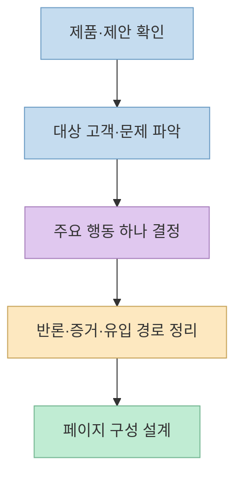
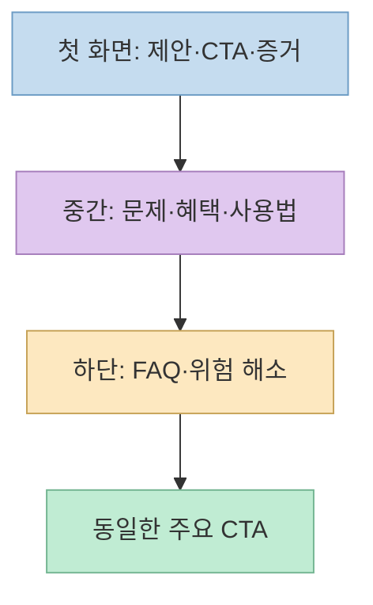
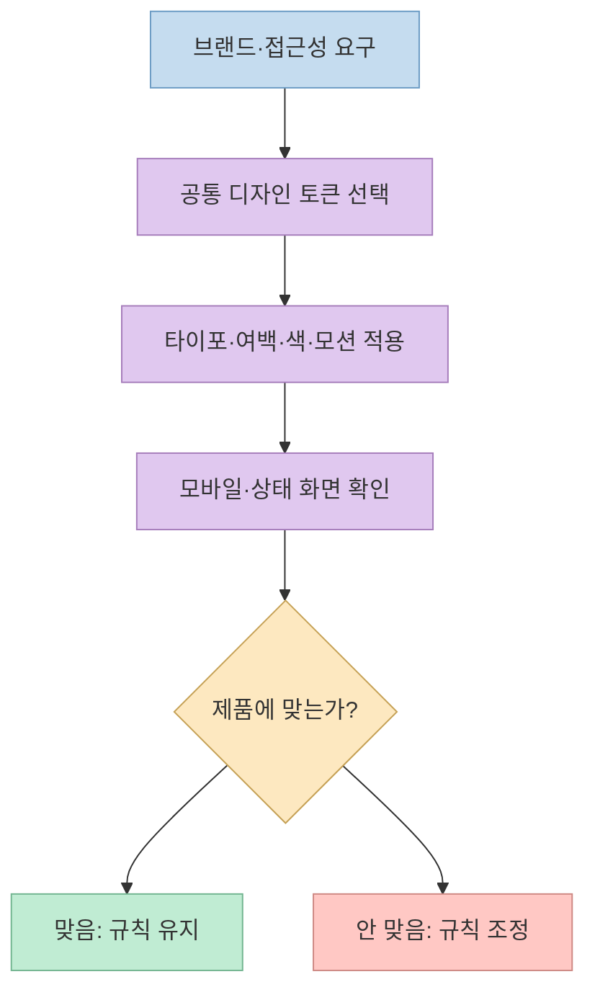

[원본 쇼츠](https://youtube.com/shorts/x0qEDLfXLWQ?si=s1Ix7mE7RqLGrDij)는 `AI Design Skills`를 “예쁜 화면을 만드는 스킬”보다 **랜딩 페이지를 처음부터 끝까지 설계하는 규칙**으로 소개한다. [공식 저장소](https://github.com/elayadesign/ai-design-skills)를 확인하면 현재 공개된 핵심은 `landing-page-design` 스킬 하나이며, 먼저 **무엇을 누구에게 제안하고 어떤 행동을 유도할지** 정한 뒤 구성·문구·시각 규칙을 적용하는 방식이다.

<!--more-->

## Sources

- [원본 YouTube Shorts](https://youtube.com/shorts/x0qEDLfXLWQ?si=s1Ix7mE7RqLGrDij) — 영상의 설명과 해당 시점.
- [AI Design Skills 공식 저장소](https://github.com/elayadesign/ai-design-skills) — 공개 스킬 목록, 도구별 사용 안내, MIT 라이선스.
- [`landing-page-design` 원본 SKILL.md](https://github.com/elayadesign/ai-design-skills/blob/main/skills/landing-page-design/SKILL.md) — 인테이크 질문, 페이지 구조, 카피, 시각 규칙, 상태와 출하 점검.

## 1. 랜딩 페이지의 출발점은 화면이 아니라 전환 목표다

영상 [0:12~0:27](https://youtu.be/x0qEDLfXLWQ?t=12)은 제품 소개 페이지를 요청했을 때 대상 고객, 강조할 장점, 방문자가 취할 행동부터 정한다고 설명한다. [원본 스킬의 Part A](https://github.com/elayadesign/ai-design-skills/blob/main/skills/landing-page-design/SKILL.md)는 이를 **하나의 제안·하나의 대상·하나의 주요 행동**으로 표현한다. 가입, 데모 예약, 다운로드처럼 성공 기준을 한 가지로 정하고, 고객의 문제와 반대 이유, 유입 경로, 증거 자료를 확인하도록 한다.

이 순서가 중요한 이유는 같은 제품이라도 방문자의 맥락에 따라 페이지가 달라지기 때문이다. 이미 제품을 아는 사용자를 위한 다운로드 페이지와 처음 검색으로 들어온 방문자를 설득하는 페이지는 설명량과 증거 배치가 다르다. 스킬은 정보가 비어 있을 때 합리적인 가정을 밝히고 진행하라고 하지만, **실제 고객 정보나 근거 수치를 지어내도 된다는 뜻은 아니다**. [스킬의 Intake·Page structure](https://github.com/elayadesign/ai-design-skills/blob/main/skills/landing-page-design/SKILL.md)

## 2. 페이지 구조와 문구를 한 흐름으로 만든다

[스킬의 Page structure](https://github.com/elayadesign/ai-design-skills/blob/main/skills/landing-page-design/SKILL.md)는 첫 화면에 결과와 대상이 드러나는 제목, 이를 구체화하는 부제, 명확한 CTA, 증거 하나, 제품 시각 자료를 놓도록 한다. 이어서 문제→해결, 혜택, 사용 방법, 사회적 증거를 배치하고, 마지막에는 FAQ·위험 해소·반복 CTA로 반론을 처리한다. 영상 [0:24~0:27](https://youtu.be/x0qEDLfXLWQ?t=24)의 “전체 구성”은 이처럼 **방문자가 다음 행동을 결정하는 순서**를 설계한다는 의미다. 실제 페이지에서는 제공할 수 없는 후기나 보증을 빈칸 채우기용으로 만들면 안 된다.

영상 [0:38~0:44](https://youtu.be/x0qEDLfXLWQ?t=38)은 “혁신적인 경험” 같은 추상적 문구 대신 제품의 장점이 드러나는 문구를 권한다. [원본 스킬의 Copywriting](https://github.com/elayadesign/ai-design-skills/blob/main/skills/landing-page-design/SKILL.md)은 기능보다 사용자 결과를 먼저 쓰고, CTA에는 “더 알아보기” 대신 행동과 얻을 것을 명시하라고 한다. 예를 들어 실제 기능이 주간 보고서를 자동 정리한다면 “보고서를 더 쉽게”보다 “주간 보고서 초안을 생성하기”가 행동을 분명히 한다. 다만 시간 절약률·고객 수 같은 **검증되지 않은 숫자를 구체적으로 보이게 꾸미는 것은 피해야 한다**.

## 3. 시각 시스템은 일관성을 주지만 의도적으로 좁다

영상 [0:27~0:38](https://youtu.be/x0qEDLfXLWQ?t=27)은 글꼴·색·글자 크기·여백을 하나의 템플릿으로 묶어 페이지마다 스타일이 흔들리지 않게 한다고 설명한다. [스킬의 Part B](https://github.com/elayadesign/ai-design-skills/blob/main/skills/landing-page-design/SKILL.md)는 사용할 글꼴과 크기 단계, 여백 값, 모서리 반경, 배경과 전환 동작까지 구체적으로 제한한다. 여러 화면을 만드는 에이전트가 매번 다른 값을 고르지 못하게 하는 **설계 토큰 역할**이다.

그러나 이것은 보편적 디자인 법칙이 아니라 **작성자가 선택한 강한 취향의 시스템**이다. 예컨대 글꼴 후보와 여백 단계를 좁히고, 배경 그라디언트나 특정 아이콘 세트를 배제하며, 별도 태그라인 연출 구간까지 요구한다. 기존 브랜드 가이드, 접근성 요구, 콘텐츠 밀도, 성능 제약과 맞지 않을 수 있다. 영상도 [0:48~0:55](https://youtu.be/x0qEDLfXLWQ?t=48)에 규칙이 엄격해 모든 사이트에 어울리지는 않는다고 인정한다. 따라서 **제품 고유의 디자인 시스템이 있으면 이를 우선**하고, 스킬은 선택적으로 수정해 써야 한다. [원본 시각 규칙](https://github.com/elayadesign/ai-design-skills/blob/main/skills/landing-page-design/SKILL.md)

## 4. 로딩·빈 화면·오류까지 설계해야 완성된다

영상 [0:44~0:48](https://youtu.be/x0qEDLfXLWQ?t=44)은 로딩과 오류 상태도 챙긴다고 짚는다. [스킬의 States·Ship requirements](https://github.com/elayadesign/ai-design-skills/blob/main/skills/landing-page-design/SKILL.md)는 인터랙션마다 hover·active·focus·loading·empty·error 상태를 요구하고, 링크·폼 검증·대체 텍스트·의미 있는 HTML·메타 태그 등 출시 전 확인 항목을 제시한다. 랜딩 페이지도 신청 폼, 가격 문의, 다운로드처럼 **사용자가 행동하는 지점**이 있다면 정상 화면만 설계해서는 부족하다.

다만 체크리스트에 항목이 있다는 사실만으로 자동 구현이나 접근성 검증이 끝난 것은 아니다. 실제 페이지를 만들었다면 모바일 폭, 키보드 탐색, 폼 실패, 느린 연결, 링크 목적지와 콘텐츠 사실 여부를 따로 테스트해야 한다. 스킬은 **작업 지시서**이지 완성 품질을 보증하는 테스트 도구가 아니다. [원본 SKILL.md](https://github.com/elayadesign/ai-design-skills/blob/main/skills/landing-page-design/SKILL.md)

영상 [0:00~0:07](https://youtu.be/x0qEDLfXLWQ?t=0)의 “GitHub 트렌딩 전체 1위”와 하루 약 1,400개 별 증가량은 **영상이 소개한 당시의 순위·증가량**이다. 과거 해당 시점의 트렌딩 기록을 공식 자료로 재현하지 못했으므로 현재 순위처럼 단정하지 않는다. [공식 저장소](https://github.com/elayadesign/ai-design-skills)가 확인해 주는 것은 프로젝트의 존재와 현재 내용이지, 그날의 순위가 아니다.

## 실전 적용 포인트

1. AI에게 바로 화면을 그리게 하기보다 **대상 고객·제안·주요 CTA·실제 증거**를 먼저 한 문단으로 정리한다.
2. 스킬의 Part A로 구성과 문구를 먼저 검토하고, Part B의 폰트·여백·색 규칙은 기존 브랜드에 맞게 선택적으로 채택한다.
3. 완성 후에는 모바일 화면, 키보드 포커스, 로딩·빈 상태·오류, 폼 검증과 실제 링크를 직접 확인한다.
4. [저장소의 설치 안내](https://github.com/elayadesign/ai-design-skills)를 참고하되, 외부 스킬 파일을 프로젝트에 넣기 전에 내용을 읽고 기존 전역 규칙과 충돌하지 않는지 확인한다. 영상 [0:57](https://youtu.be/x0qEDLfXLWQ?t=57)의 Claude Code·Codex 활용 언급도 **도구별 규칙 위치와 우선순위를 확인하는 과정**이 필요하다.

## 핵심 요약

- 이 저장소의 현재 공개 스킬은 **`landing-page-design` 하나**다.
- 핵심 순서는 **목표·대상·증거 → 구성·문구 → 시각 시스템 → 상태·출하 검증**이다.
- 강한 디자인 규칙은 일관성을 높이지만 모든 브랜드에 맞지 않으며, **검증되지 않은 마케팅 수치나 후기를 만들어서는 안 된다**.

## 결론

AI Design Skills의 차별점은 UI를 더 화려하게 만드는 것이 아니라 **랜딩 페이지가 누구를 어떤 행동으로 이끌지 먼저 결정**하게 하는 데 있다. 실제 사용에서는 스킬의 구체적 규칙을 제품 맥락에 맞춰 조정하고, 완성된 페이지를 사용자 관점에서 검증해야 한다.
