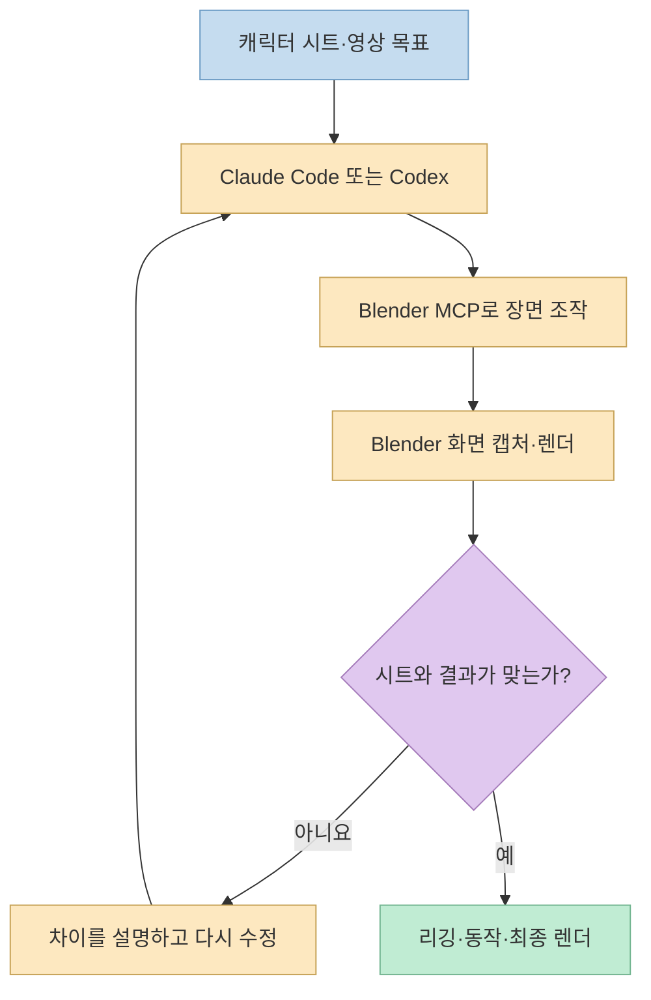
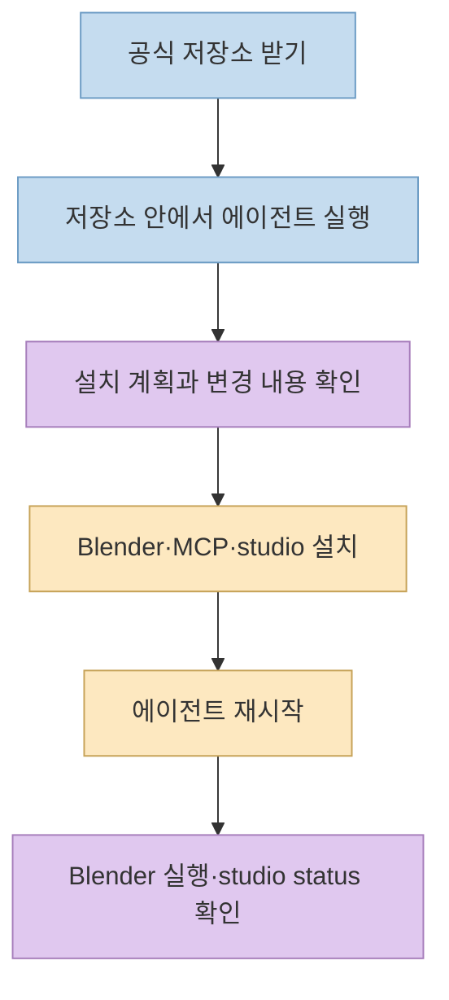
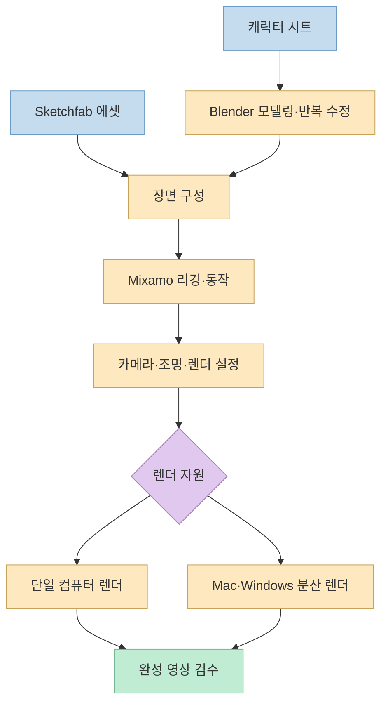

[Threads 작성자](https://www.threads.com/share/BAZRMlGbj6/)는 AI 구독과 Blender MCP로 캐릭터를 만들고 영상을 렌더링하는 작업 흐름을 공개했다. 여기서 핵심은 **이미지 한 장을 넣으면 무료로 완성 영상이 나오는 서비스**가 아니라, AI 에이전트가 로컬 Blender를 조작하고 사람이 결과를 보며 계속 고치는 제작 방식이다. 작성자가 댓글에 연결한 [Blender MCP Studio 저장소](https://github.com/d-onworks/blender-mcp-studio)는 그 과정의 설치와 에셋·동작·렌더 연결을 묶는다.

<!--more-->

## Sources

- [원본 Threads 공유 링크](https://www.threads.com/share/BAZRMlGbj6/) · [연결된 원문과 작성자 댓글](https://www.threads.com/@autofrog.kr/post/DfFAo3Zgs74) — 브라우저로 공개 본문과 댓글을 확인했다.
- [Blender MCP Studio 공식 저장소](https://github.com/d-onworks/blender-mcp-studio) — 구성, 빠른 시작, 제작 사례, 한계, 라이선스 안내.
- [저장소 설치 프롬프트](https://github.com/d-onworks/blender-mcp-studio/blob/main/INSTALL_PROMPT.md) — 에이전트에게 설치를 맡길 때 쓰는 원문 안내.

## 1. 무엇을 자동화하고, 무엇을 사람이 해야 하나

이 저장소는 Blender 자체를 대신하는 영상 생성 모델이 아니다. [README](https://github.com/d-onworks/blender-mcp-studio)는 Blender 5.2.3 LTS, Blender MCP 연결, Claude Code·Codex용 MCP 등록, 자체 `studio` 도구를 설치 흐름으로 묶는다. 에이전트는 자연어 요청을 받아 Blender 작업을 실행하고, 화면을 캡처해 상태를 확인할 수 있다. Sketchfab에서 에셋을 찾아 가져오거나 Mixamo 동작을 붙이는 작업도 지원한다.

그러나 **캐릭터 시트와 같은 모양을 한 번에 재현하는 기능은 아니다.** 저장소는 에이전트가 Blender 코드를 새로 작성하며, 캡처를 보고 수정하는 과정을 여러 번 반복해야 한다고 명시한다. Threads 작성자도 높은 품질의 캐릭터와 영상을 얻으려면 계속 다듬어야 한다고 적었다. 따라서 프롬프트는 조작의 인터페이스이고, 결과를 판단하는 역할은 여전히 사람에게 남는다.



## 2. 설치와 연결: 저장소 안에서 에이전트를 시작한다

[빠른 시작 안내](https://github.com/d-onworks/blender-mcp-studio)는 저장소를 받은 뒤 그 디렉터리에서 Claude Code 또는 Codex를 실행하고, `설치해줘`라고 요청하는 방식을 제시한다. 저장소의 `CLAUDE.md`·`AGENTS.md`가 설치 순서를 안내하며, 설치 과정에는 운영체제 확인, 작업 계획 제시, Blender·`uv`·MCP 구성, 연결 확인이 포함된다. 이미 설치된 Blender는 건너뛸 수 있다. 설치 후에는 에이전트를 다시 시작해야 MCP 도구가 보인다.

```bash
git clone https://github.com/d-onworks/blender-mcp-studio.git
cd blender-mcp-studio
claude  # 또는 codex
```

그다음 에이전트에 `설치해줘`라고 요청한다. **설치 스크립트와 MCP 서버는 로컬 프로그램을 실행하고 설정을 바꾸므로**, 저장소의 최신 설치 지침과 실행 계획을 확인한 뒤 진행하는 편이 안전하다. [README](https://github.com/d-onworks/blender-mcp-studio)는 macOS·Windows 수동 설치 명령과 `studio status` 확인 방법도 제공한다. 그림 한 장에서 3D 기반 모델을 만드는 TripoSG는 기본 기능이 아니라 설치 중 선택하는 옵션이다.



## 3. 캐릭터에서 영상까지: 모델·동작·렌더를 분리한다

캐릭터 제작에서는 정면·측면·후면 등 참고 이미지를 주고 형태를 만든 다음, 캡처와 원본을 대조하며 어긋난 부분을 수정한다. [저장소 제작 일지](https://github.com/d-onworks/blender-mcp-studio)는 사람이 손으로 Blender를 모델링하지 않았더라도, 지시와 검수는 매우 많이 필요했다고 설명한다. 공개된 **348번 지시·187.5시간**은 해당 팀의 사례 기록이지 일반 사용자의 예상 소요 시간이나 자동화 성능 보증이 아니다.

소품과 배경은 [Sketchfab 연동](https://github.com/d-onworks/blender-mcp-studio)을 통해 검색·추천·가져오기를 할 수 있다. 저장소는 가져온 에셋의 출처를 `credits.json`에 기록한다고 설명한다. 캐릭터 동작은 [Mixamo 연동](https://github.com/d-onworks/blender-mcp-studio)으로 자동 리깅과 애니메이션 검색·적용을 지원하지만, 사용자가 자신의 Adobe 계정으로 로그인해야 한다. Mixamo 연동은 **공식 공개 API가 아닌 웹사이트 내부 API에 의존**하므로 서비스 변경 시 동작이 깨질 수 있다.

마지막 렌더는 Blender에서 실행된다. 저장소의 분산 렌더 기능은 동일 네트워크에서 SSH로 연결된 Mac과 Windows PC가 프레임을 나눠 처리하는 구성이다. README의 **1.59배**는 특정 1,164프레임 장면에서 가장 빠른 단일 기기와 비교한 자체 측정치다. 모든 프로젝트에서 같은 향상을 기대하면 안 된다.



## 4. “무료 영상”의 조건과 작업 한계

Threads의 표현은 **별도 생성형 영상 API 사용료 없이 로컬 Blender 렌더를 활용한다**는 맥락으로 읽어야 한다. 완전 무비용은 아니다. Claude Code·Codex 등 에이전트 사용 조건, 컴퓨터와 GPU, 전기·렌더 시간, 외부 에셋의 라이선스가 남는다. [README](https://github.com/d-onworks/blender-mcp-studio)는 실용적인 캡처·렌더에 Apple Silicon Mac GPU 또는 Windows의 NVIDIA GPU가 필요하며, GPU가 없으면 CPU 처리로 매우 느려진다고 설명한다.

제작 대상에도 차이가 있다. 저장소는 둥근 형태의 개구리·카피바라 캐릭터는 코드 모델링과 반복 수정에 맞지만, 사람 얼굴과 애니풍 머리카락은 여러 차례 실패했다고 공개한다. 이 결과 역시 해당 제작 사례의 한계이지 모든 Blender 모델링의 일반 법칙은 아니다. 인물형 작업은 다른 3D 베이스를 사용한 뒤 수정하는 경로를 검토하라고 권한다.

에셋의 권리도 따로 확인해야 한다. 저장소 코드는 MIT지만 Sketchfab 모델은 **각 모델의 라이선스**, Mixamo 동작은 **Adobe 이용 조건**을 따른다. 선택 기능인 TripoSG는 저장소 설명상 NVIDIA VRAM 8GB 이상과 개인 프로젝트 사용 조건이 있으며, 핵심 코드의 별도 라이선스는 대한민국·EU·영국 사용을 제외한다고 경고한다. 이 지역에서는 해당 옵션을 설치·사용하기 전에 [라이선스 안내](https://github.com/d-onworks/blender-mcp-studio/blob/main/docs/07_TripoSG.md)를 먼저 확인해야 한다.

## 실전 적용 포인트

1. **짧은 장면부터 검증한다.** 설치 직후 긴 영상보다 단일 캐릭터·단일 동작·짧은 렌더로 MCP 연결, 화면 캡처, 출력 경로를 확인한다.
2. **수정 기준을 구체화한다.** "더 비슷하게"보다 "정면 시트에 비해 머리 너비를 줄이고 눈 간격을 넓혀줘"처럼 관찰 가능한 차이를 전달한다.
3. **외부 서비스 단계를 분리한다.** Sketchfab 다운로드 권한·출처 표기와 Mixamo 로그인·동작 적용을 각각 확인한다.
4. **최종 렌더 전에 미리보기한다.** 리깅 변형, 카메라 프레이밍, 모션블러, 렌더 시간과 GPU 메모리를 작은 샘플로 점검한다.

## 핵심 요약

Blender MCP Studio는 **자연어로 로컬 Blender 제작 흐름을 조작하도록 연결해 주는 오픈소스 도구**다. 설치·에셋 검색·리깅·렌더 절차를 줄일 수 있지만, 캐릭터 품질은 참고 이미지와 결과를 대조해 반복 수정하는 과정에 달려 있다. “무료”라는 표현보다 **사용할 AI 구독, GPU, 제작 시간, 외부 에셋·모델 라이선스**를 함께 계산하는 것이 정확하다.

## 결론

이 방식이 적합한 사람은 한 번의 프롬프트로 영상을 뽑으려는 사람이 아니라, Blender 결과물을 검수하면서 **조작은 에이전트에 맡기고 제작 판단은 직접 하려는 사람**이다. 먼저 설치와 짧은 샘플을 검증하고, 반복 수정 비용이 감당되는지 확인한 뒤 전체 영상으로 확장하는 편이 좋다.
