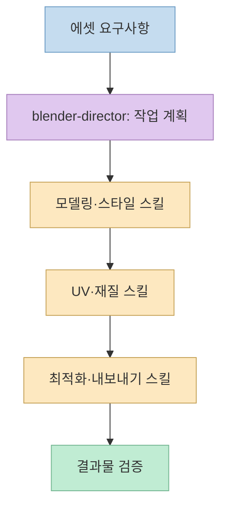
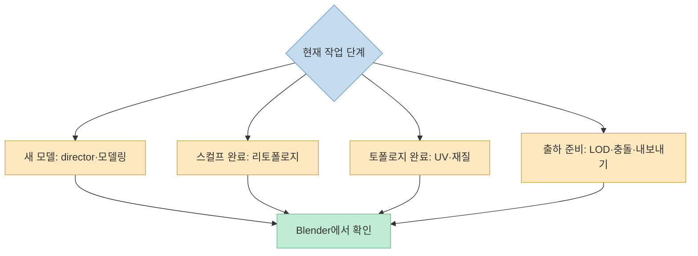
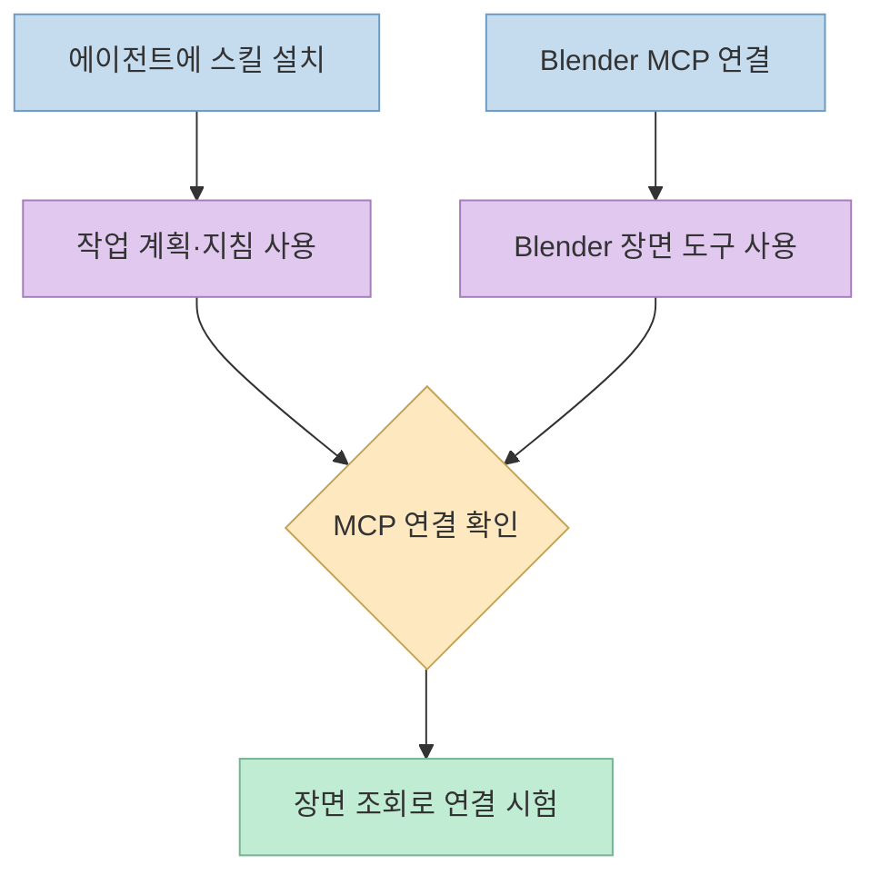

[Threads 글](https://www.threads.com/share/BAOmHripD7/)은 Claude Code·Codex 등에서 쓰는 무료 Blender 스킬 94개를 소개한다. 핵심은 프롬프트 한 줄로 3D 모델을 보장한다는 뜻이 아니라, **에셋 제작 절차를 스킬로 나누고 `blender-director`가 작업에 맞는 순서를 고른다**는 점이다. 실제 Blender를 조작하려면 별도의 MCP 연결도 필요하다.

<!--more-->

## Sources

- [원본 Threads 공유 글](https://www.threads.com/share/BAOmHripD7/) — 본문과 작성자의 이어진 설명. 공유 링크가 [원문](https://www.threads.com/@dhdbtkd/post/DfEoRfVGQ80)으로 연결되며, 공개 페이지를 HTTP로 읽고 Jina Reader로 이어진 글을 확인했다.
- [Blender Skills 공식 저장소](https://github.com/arjun988/blender-skills) — 스킬 수, 예시 파이프라인, 라이선스.
- [스킬 가이드](https://github.com/arjun988/blender-skills/blob/main/SKILLS_GUIDE.md) — 스킬 분류와 작업별 라우팅.
- [빠른 시작 안내](https://github.com/arjun988/blender-skills/blob/main/QUICKSTART.md) — 설치, 첫 프롬프트, 연결 검증.
- [Blender MCP 설정 안내](https://github.com/arjun988/blender-skills/blob/main/docs/BLENDER_MCP_SETUP.md) — 선행 조건과 Python 실행 주의.
- [MCP for Blender 원본 저장소](https://github.com/ahujasid/mcp-for-blender) — 커뮤니티 MCP 도구의 현재 기능과 보안 안내.

## 1. 94개는 병렬 에이전트가 아니라 작업별 스킬이다

원본 글은 하드서피스·소품·차량·환경·캐릭터 같은 모델링, 스컬핑·리토폴로지·UV·텍스처·리깅 같은 제작 단계, 다양한 화풍과 게임 장르, Unity·Unreal·Godot 내보내기를 나열한다. [공식 스킬 가이드](https://github.com/arjun988/blender-skills/blob/main/SKILLS_GUIDE.md)의 목록도 같은 구성을 확인한다. 저장소가 말하는 **94개**는 작업 지침과 참고 자료로 된 스킬의 수다. 94명의 작업자가 자동으로 동시에 실행된다는 의미가 아니다.

`blender-director`는 요청을 읽고 전문 스킬을 조합하는 진입점이다. 예컨대 [공식 README의 SF 소총 예시](https://github.com/arjun988/blender-skills)는 `hard-surface → uv-workflow → materials → asset-optimization → export-pipeline` 흐름을 제시한다. 이 순서는 모델을 만든 뒤 UV와 재질을 붙이고, 예산에 맞춰 최적화한 다음 엔진용 형식으로 내보내는 **계획 예시**다. 실제 폴리곤 수, 재질 품질, 엔진 호환성은 결과물을 별도로 검사해야 한다.

## 2. 작업별로 어느 스킬이 붙는가

스킬은 특정 툴 조작 하나만 설명하지 않는다. [스킬 가이드의 결정 트리](https://github.com/arjun988/blender-skills/blob/main/SKILLS_GUIDE.md)에 따르면 처음 만드는 에셋은 `blender-director`에서 모델링·스타일 스킬로 이어지고, 완성된 스컬프는 `retopology`, 토폴로지가 끝난 모델은 `uv-workflow → materials → lookdev`로 넘어간다. 출하 전에는 `asset-optimization`, `lod-pipeline`, `collision-proxy`와 엔진별 내보내기를 조합한다.

원본에서 말하는 화풍도 각각 자동 생성 모델을 뜻하지 않는다. 로우폴리·PSX 공포·복셀 같은 **시각적 제약**을 해당 스킬이 작업 지침으로 제공한다. 장르 스킬 역시 소울라이크·생존·레이싱 등의 아트 디렉션을 보조한다. 구체적인 하위 스타일은 별도 스킬 파일이 아니라 참고 문서에 묶여 있을 수 있다. 따라서 원하는 장르가 목록에 있다고 해서 게임 전체나 완성 에셋이 보장되는 것은 아니다. [스킬 가이드의 분류·하위 유형 안내](https://github.com/arjun988/blender-skills/blob/main/SKILLS_GUIDE.md)

## 3. 스킬 설치와 Blender 조작은 서로 다른 단계다

[공식 README](https://github.com/arjun988/blender-skills)는 Claude Code 프로젝트의 `.claude/skills/`로 스킬 디렉터리를 복사하는 방법을 제시하고, Codex·Cursor·Kiro용 경로도 안내한다. 그러나 **스킬 파일을 복사하는 것만으로 Blender를 제어할 수는 없다**. [빠른 시작 안내](https://github.com/arjun988/blender-skills/blob/main/QUICKSTART.md)는 Blender MCP 애드온 연결, 클라이언트 재시작, 장면 정보 조회 테스트를 별도 단계로 둔다. 원본 작성자의 이어진 글도 이 차이를 명시한다.

[프로젝트의 MCP 설정 안내](https://github.com/arjun988/blender-skills/blob/main/docs/BLENDER_MCP_SETUP.md)는 Blender 3.0+, Python 3.10+, `uv`를 선행 조건으로 적고 있다. 다만 실제 연동 대상인 [MCP for Blender](https://github.com/ahujasid/mcp-for-blender)는 별도 커뮤니티 프로젝트이며 계속 바뀔 수 있다. 이 스킬 저장소의 설정 예시와 MCP 원본 저장소의 최신 설치·명령 이름이 다를 수 있으므로, **실제 설치 시에는 양쪽의 현재 문서를 대조**해야 한다. 블로그 글은 설치를 실행하거나 결과를 검증한 사용 후기가 아니다.

## 4. 무료 스킬과 안전한 실행은 별개다

스킬 팩은 [MIT 라이선스](https://github.com/arjun988/blender-skills/blob/main/LICENSE)로 공개되어 있다. 저장소의 별 수는 시점에 따라 변하므로 선택 기준으로 삼기보다, 실제 스킬 내용과 필요한 MCP 권한을 검토하는 편이 낫다. 또한 스킬 팩이 무료여도 모델 사용료나 선택한 외부 생성 서비스 비용까지 무료인 것은 아니다.

중요한 보안 경계는 MCP의 `execute_blender_code`다. [스킬 팩 설정 문서](https://github.com/arjun988/blender-skills/blob/main/docs/BLENDER_MCP_SETUP.md)와 [MCP 원본 README](https://github.com/ahujasid/mcp-for-blender)는 이 도구가 Blender 안에서 Python 코드를 실행할 수 있으므로 작업 파일을 먼저 저장하고 주의하라고 안내한다. 원본 Threads 댓글은 `BLENDER_MCP_SAFE_MODE=1`을 언급하지만, **현재 확인한 두 저장소의 공개 설정·보안 안내에서는 그 환경 변수의 동작을 검증할 수 없었다**. 따라서 해당 값이 파일 읽기·쓰기를 차단한다고 믿고 위험한 권한을 허용해서는 안 된다. 사용 중인 MCP 버전의 실제 구현과 설정을 먼저 확인해야 한다.

[CHANGELOG](https://github.com/arjun988/blender-skills/blob/main/CHANGELOG.md)의 가장 최근 항목은 2026년 7월 10일 v1.3.0이며 스킬 수가 46개에서 94개로 늘었다고 기록한다. 이는 **문서화된 릴리스 이력**이지, 저장소의 모든 파일이 그날 이후 수정되지 않았다는 증거는 아니다.

## 실전 적용 포인트

1. 복잡한 장면보다 **단일 소품**으로 시작한다. 예: “Unreal용 SF 상자, 삼각형 예산 1,500, PBR 재질, FBX 내보내기”. [공식 빠른 시작의 예시](https://github.com/arjun988/blender-skills/blob/main/QUICKSTART.md)도 작은 게임 에셋을 첫 작업으로 제안한다.
2. 먼저 스킬이 인식되는지 확인하고, 그다음 MCP 연결 상태와 장면 조회를 각각 시험한다. 두 조건 중 하나라도 빠지면 설명만 출력될 수 있다.
3. 내보내기 뒤에는 Blender 장면만 보지 말고 **엔진에서 재질·방향·크기·폴리곤 수**를 검사한다. 스킬이 제안한 파이프라인과 실제 통과한 품질 기준을 구분한다.
4. MCP가 실행할 Python 코드를 검토하고 `.blend` 파일을 백업한다. 검증되지 않은 환경 변수를 안전장치로 간주하지 않는다.

## 핵심 요약

- Blender Skills의 **94개는 작업별 스킬 수**이며, `blender-director`가 요청에 맞춰 조합한다.
- **스킬 설치는 계획·지침 제공**, **Blender MCP 연결은 실제 장면 조작**이다.
- MIT 공개 여부와 실행 안전성은 별개다. MCP의 Python 실행 권한을 확인하고 결과물을 검증해야 한다.

## 결론

이 프로젝트의 가치는 “한 줄로 완성 에셋을 보장”하는 데 있지 않다. 모델링부터 UV·재질·최적화·엔진 내보내기까지 **빠뜨리기 쉬운 제작 단계를 구조화**하는 데 있다. 도입할 때는 스킬 라우팅, MCP 연결, 실행 권한, 엔진 검증을 각각 확인해야 한다.
