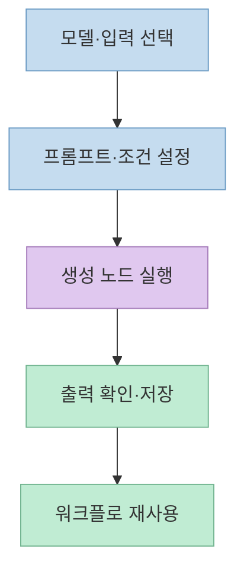
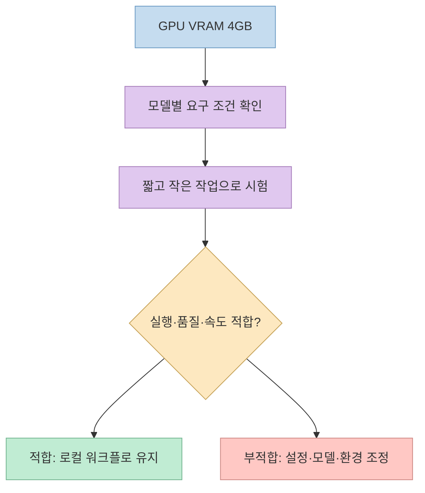
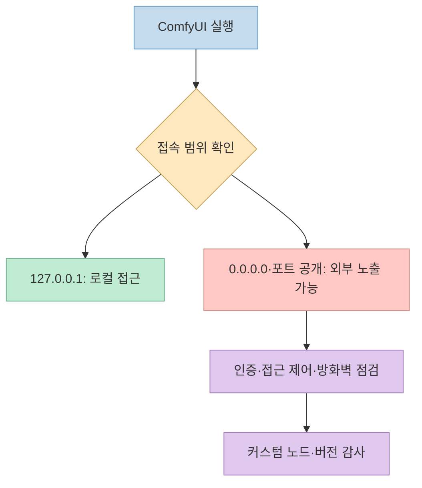

[쇼츠](https://youtube.com/shorts/MpZ7yxjzD8w?si=k2gwEllD9xkEZNkQ)는 **ComfyUI**를 “로컬 PC에서 무료로 AI 영상을 만드는 도구”로 소개한다. 방향은 맞지만, “VRAM 4GB면 최신 영상 모델도 된다”와 “공개 서버 1,000대가 해킹됐다”는 표현은 조건과 숫자의 뜻을 분리해 읽어야 한다. ComfyUI는 모델 자체가 아니라 **모델과 처리 단계를 연결해 실행하는 워크플로 엔진**이다.

<!--more-->

## Sources

- [원본 YouTube Shorts](https://youtube.com/shorts/MpZ7yxjzD8w?si=k2gwEllD9xkEZNkQ) — 영상 설명의 순서와 시점.
- [ComfyUI 공식 README](https://github.com/Comfy-Org/ComfyUI) — 지원 작업, 노드 그래프, 메모리 관리, 로컬·클라우드 경계.
- [Comfy Desktop 공식 다운로드](https://comfy.org/download/) — 설치 경로와 무료·클라우드 구분.
- [Comfy 공식 투자 발표](https://blog.comfy.org/p/comfyui-raises-30m-to-scale-open) — 이용자 수와 기업 가치의 기준 시점.
- [ComfyUI 공식 서버 시작 옵션](https://github.com/Comfy-Org/docs/blob/main/development/comfyui-server/startup-flags.mdx) — 기본 바인딩 주소와 `--listen` 의미.
- [ComfyUI 공식 보안 정책](https://github.com/Comfy-Org/ComfyUI/security) — 로컬 전제와 외부 공개 시 책임 경계.
- [Cloud Security Alliance 보안 연구 노트](https://labs.cloudsecurityalliance.org/research/csa-research-note-ai-workload-exposure-cryptomining-20260408/) — 공개 ComfyUI 인스턴스 대상 채굴·프록시 봇넷 활동 분석.

## 1. ComfyUI는 모델 하나가 아니라 실행 그래프다

영상 [0:09~0:30](https://youtu.be/MpZ7yxjzD8w?t=9)은 모델 불러오기, 프롬프트, 생성 같은 상자를 선으로 이어 작업 순서를 만들고 재사용한다고 설명한다. [공식 README](https://github.com/Comfy-Org/ComfyUI)는 이를 이미지·영상·오디오·3D·텍스트 작업용 **시각적 노드 그래프**로 설명한다. 입력·모델·샘플링·저장 단계를 연결하면 같은 그래프를 다시 실행하거나 일부 단계를 바꿔 실험할 수 있다. 워크플로는 JSON으로 저장할 수도 있다.

이 구조 덕분에 같은 인터페이스에서 이미지·영상·음악·3D 관련 워크플로를 다룰 수 있지만, **각 작업에 맞는 모델·파일·노드·하드웨어가 별도로 필요**하다. 영상 [0:14~0:18](https://youtu.be/MpZ7yxjzD8w?t=14)의 “전부 내 컴퓨터에서 공짜”라는 말은 모든 모델과 서비스가 추가 비용 없이 자동 제공된다는 뜻은 아니다. 공식 README는 로컬 오픈 모델과 별도로 유료 외부 모델을 호출하는 API 노드, Comfy Cloud를 구분한다. [ComfyUI README](https://github.com/Comfy-Org/ComfyUI), [Desktop FAQ](https://comfy.org/download/)

## 2. 4GB VRAM은 최소 실행 가능성이지 영상 제작 보증이 아니다

영상 [0:04~0:09](https://youtu.be/MpZ7yxjzD8w?t=4)은 그래픽카드 메모리 4GB에서 최신 AI 영상 모델을 돌릴 수 있다고 말한다. [공식 README](https://github.com/Comfy-Org/ComfyUI)는 **VRAM 4GB와 시스템 RAM 8GB**에서도 큰 오픈 모델을 가중치 스트리밍·오프로딩으로 실행할 수 있다고 안내한다. 다만 이는 ComfyUI의 메모리 관리 능력에 관한 설명이지, **모든 영상 모델·해상도·길이·속도 조합이 4GB에서 원활하다는 보증은 아니다**. 실제 가능 여부는 선택한 모델과 워크플로 요구 사항을 확인해야 한다.

저사양 GPU라면 먼저 작은 해상도·짧은 클립과 해당 모델의 저메모리 워크플로로 시험하고, 출력 품질과 소요 시간을 측정하는 편이 현실적이다. 모델별 정밀도·오프로딩 설정과 시스템 RAM·저장공간에도 영향을 받는다. 이 부분은 [공식 README의 메모리 관리 기능](https://github.com/Comfy-Org/ComfyUI)을 바탕으로 한 적용 조언이며, 영상에 특정 모델의 4GB 실측 벤치마크가 제시된 것은 아니다.

## 3. 무료 로컬 앱과 유료 클라우드를 구분한다

영상 [0:32~0:38](https://youtu.be/MpZ7yxjzD8w?t=32)은 공식 사이트에서 데스크톱 앱을 받을 수 있다고 한다. [공식 다운로드 페이지](https://comfy.org/download/)는 Desktop을 무료 오픈소스 앱으로 안내하고, [README](https://github.com/Comfy-Org/ComfyUI)는 Desktop이 Windows·macOS용이며 Linux는 수동 설치 경로를 제공한다고 명시한다. 모델 파일은 별도로 준비해야 하고, 모델 라이선스와 필요한 저장공간도 확인해야 한다.

“로컬”은 **선택한 로컬 모델을 내 컴퓨터에서 실행할 수 있다**는 뜻이다. 외부 API를 쓰는 파트너 노드나 [유료 Comfy Cloud](https://comfy.org/download/)를 선택하면 계산과 데이터 경로가 달라진다. 공식 README는 코어가 요청하지 않은 다운로드를 하지 않으며, 오프라인 동작을 강제하는 옵션을 설명한다. 따라서 워크플로를 가져왔을 때 외부 서비스를 호출하는 노드가 있는지 확인해야 “전부 로컬”이라고 말할 수 있다. [ComfyUI README](https://github.com/Comfy-Org/ComfyUI)

영상 [0:12~0:14](https://youtu.be/MpZ7yxjzD8w?t=12)의 **이용자 400만 명**과 [0:30~0:35](https://youtu.be/MpZ7yxjzD8w?t=30)의 **기업 가치 5억 달러**는 [Comfy의 2026년 4월 24일 투자 발표](https://blog.comfy.org/p/comfyui-raises-30m-to-scale-open)와 일치한다. 회사 발표 기준으로 3천만 달러 투자 유치, 5억 달러 평가액, 이용자 400만 명을 알렸다. 이는 **당시 회사가 발표한 수치**이지 현재 이용자 수나 독립적으로 측정된 성능 지표는 아니다. 영상의 GitHub 별 수 역시 변동하므로 고정 수치로 다루지 않는다.

## 4. 공개 서버 1,000대와 침해 서버 1,000대는 다르다

영상 [0:39~0:48](https://youtu.be/MpZ7yxjzD8w?t=39)은 인터넷에 열린 서버가 채굴 공격을 받았다고 경고한다. [Cloud Security Alliance의 2026년 4월 연구 노트](https://labs.cloudsecurityalliance.org/research/csa-research-note-ai-workload-exposure-cryptomining-20260408/)는 당시 **인증 없이 접근 가능한 ComfyUI 인스턴스 1,000대 이상**이 확인되고, 이를 노리는 채굴·프록시 봇넷 캠페인이 있었다고 설명한다. 중요한 차이는 **1,000대 이상이 공개돼 있었다는 수치가 곧 1,000대 모두 침해됐다는 통계는 아니라는 것**이다. 캠페인은 위험한 커스텀 노드와 관리 기능을 공격 경로로 삼았다.

[공식 시작 옵션](https://github.com/Comfy-Org/docs/blob/main/development/comfyui-server/startup-flags.mdx)의 기본 바인딩은 `127.0.0.1`이다. 반면 `--listen`을 값 없이 사용하거나 `0.0.0.0`으로 설정하면 네트워크 인터페이스 전체에서 접속을 받는다. [공식 보안 정책](https://github.com/Comfy-Org/ComfyUI/security)도 기본 로컬 사용과 사용자가 의도적으로 외부에 노출한 배포를 구분한다. 원격 접속이 필요하다면 단순히 포트를 공개하지 말고 인증, 접근 제어, 방화벽, 업데이트를 갖춘 별도 배포 설계가 필요하다. 출처가 불분명한 커스텀 노드는 실행 코드이므로 설치 전에 작성자와 코드를 검토해야 한다.

## 실전 적용 포인트

1. [공식 다운로드 페이지](https://comfy.org/download/)에서 운영체제에 맞는 설치 경로를 선택한다. Linux는 공식 README의 수동 설치 안내를 확인한다.
2. 영상 모델을 고르기 전에 해당 모델의 **VRAM·RAM·저장공간·라이선스** 요구 사항을 확인하고, 작은 테스트부터 실행한다.
3. 워크플로의 모든 노드가 로컬인지, 유료 API나 클라우드 호출이 섞였는지 확인한다.
4. 개인 PC에서는 기본 로컬 바인딩을 유지하고, `--listen`·포트포워딩·공개 프록시를 무심코 사용하지 않는다. 확장 노드는 신뢰할 수 있는 출처에서만 설치한다.

## 핵심 요약

- ComfyUI는 이미지·영상 등을 만드는 **노드 기반 실행 엔진**이며, 모델과 워크플로를 별도로 준비해야 한다.
- **VRAM 4GB에서 실행 가능한 경우가 있다**는 것과 **모든 최신 영상 모델이 실용적으로 동작한다**는 것은 다르다.
- 2026년 보안 보고의 **1,000대 이상은 인터넷에 노출된 인스턴스 수**로, 모두 해킹됐다는 수치가 아니다.

## 결론

ComfyUI는 로컬 제작의 자유도와 재사용 가능한 워크플로가 강점이다. 다만 모델별 하드웨어 조건과 유료·외부 서비스 경계를 확인하고, 서버는 로컬에 제한하며 커스텀 노드의 실행 권한을 신중하게 다뤄야 한다. 이 조건을 지키면 영상의 장점을 과장 없이 활용할 수 있다.
